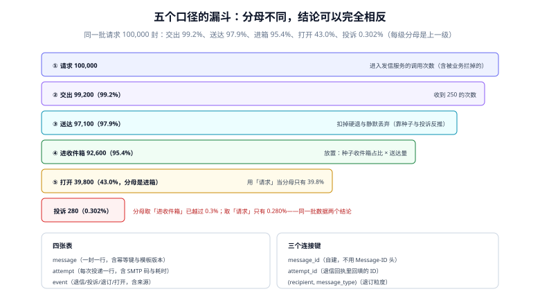

# 观测与分诊：五个口径、四张表与告警

「送达率 99%」这句话如果没有分母，就没有信息量。本页把五个口径固定下来，给出四张表的结构与三个连接键，最后把告警条件写成可以直接抄的规则。

::: tip 一句话理解
口径的价值不在于准确，而在于**同一份数据在任何人手里都算出同一个数**；做不到这一点，面板上的数字每次开会都会被重新解释一遍。
:::



## 一、五个口径与各自的分母

| 口径 | 分子 | 分母 | 用途 | 常见错法 |
| --- | --- | --- | --- | --- |
| 交出率 | `2xx` 次数 | 投递尝试次数 | 判断我方 MTA 与对方连通性 | 用「调用次数」当分母（含被业务拦掉的） |
| 送达率 | 送达量（反推） | `2xx` 次数 | 判断是否被静默丢弃 | 直接用交出率代替 |
| 进箱率 | 进收件箱量（种子推算） | 送达量 | 判断放置 | 用「打开率」代替 |
| 打开率 | 唯一打开数 | **送达量** | 判断内容与互动 | 分母用「请求」，导致虚高 |
| 投诉率 | 投诉数 | **进收件箱量** | 判断声誉风险 | 分母用「请求」，系统性低估 |

### 一份数据的五个数

```text
请求     100,000
交出      99,200  → 交出率 99.2%（分母：请求）
送达      97,100  → 送达率 97.9%（分母：交出）
进收件箱   92,600  → 进箱率 95.4%（分母：送达）
打开      39,800  → 打开率 43.0%（分母：进收件箱）
投诉         280  → 投诉率 0.302%（分母：进收件箱）← 已越过 0.3%
```

同一批数据里，投诉率如果用「请求」当分母是 0.280%（看起来安全），用「进收件箱」是 0.302%（已超标）。**差别只在一个分母，结论从「没问题」变成「要停量」。**

::: danger 三个让口径失真的习惯
1. **把 `delayed`（延迟通知）当成失败**：`Action: delayed` 不是退信，算进失败会让送达率凭空下降。
2. **把「重试成功」算成两封信**：一封重试 3 次才成功，交出次数是 3，但信只有 1 封。交出率的分母必须是**尝试**，送达率的分母必须是**信**。
3. **打开率用像素统计却不扣机器预取**：Gmail 图片代理、企业网关的链接扫描都会「打开」一次，未去重的打开率会虚高 20%~50%。
:::

## 二、四张表

```sql
-- 1) 一封信一行
CREATE TABLE mail_message (
    id            bigserial PRIMARY KEY,
    biz_type      text        NOT NULL,          -- invite | reset | digest | marketing
    biz_id        text        NOT NULL,          -- 业务主键，与 biz_type 组成幂等键
    recipient     text        NOT NULL,
    template      text        NOT NULL,
    template_ver  int         NOT NULL,
    from_domain   text        NOT NULL,
    dkim_selector text        NOT NULL,
    status        text        NOT NULL,          -- queued|sending|accepted|delivered|bounced_*|suppressed
    created_at    timestamptz NOT NULL DEFAULT now(),
    UNIQUE (biz_type, biz_id)                    -- 幂等键落在这里，不在代码里
);

-- 2) 一次投递尝试一行（一封信可能多行）
CREATE TABLE mail_attempt (
    id          bigserial PRIMARY KEY,
    message_id  bigint      NOT NULL REFERENCES mail_message(id),
    attempt_no  int         NOT NULL,
    mx_host     text,
    smtp_code   int,                             -- 250 / 451 / 550
    enhanced    text,                            -- 2.0.0 / 4.7.1 / 5.1.1
    diagnostic  text,                            -- 应答原文（截断到 1 KB）
    duration_ms int,
    started_at  timestamptz NOT NULL DEFAULT now(),
    UNIQUE (message_id, attempt_no)
);

-- 3) 事件一行（退信 / 投诉 / 退订 / 打开）
CREATE TABLE mail_event (
    id          bigserial PRIMARY KEY,
    message_id  bigint      REFERENCES mail_message(id),
    recipient   text        NOT NULL,
    kind        text        NOT NULL,             -- bounce_hard|bounce_soft|complaint|unsub|open|not_spam
    source      text        NOT NULL,             -- dsn|arf|api|pixel
    occurred_at timestamptz NOT NULL,
    payload     jsonb
);

-- 4) 名单状态一行（抑制与退订）
CREATE TABLE mail_suppression (
    address_norm text        NOT NULL,
    message_type text,
    reason       text        NOT NULL,
    since        timestamptz NOT NULL DEFAULT now(),
    PRIMARY KEY (address_norm, COALESCE(message_type, '*'))
);
```

### 三个连接键

| 键 | 连什么 | 为什么不能用别的 |
| --- | --- | --- |
| `mail_message.id`（自建） | 三张表互连 | `Message-ID` 头可能被重写或重复，且不是数字，join 代价高 |
| `mail_attempt.id` + `attempt_no` | 退信回执回填 | 退信里只带原始收件人与时间，必须靠「最后一次尝试」匹配 |
| `(recipient, message_type)` | 抑制与发送前检查 | 投诉粒度是「这类邮件」，不是「所有邮件」 |

## 三、六项数据质量检查

口径对了，数据错了照样没用。以下六项每天跑一次，任意一项非零就报警：

| 检查 | SQL 形状 | 非零意味着 |
| --- | --- | --- |
| 行数守恒 | `count(attempt) >= count(message)` | 有信没有尝试记录（入队后丢了） |
| 孤儿事件 | `event.message_id NOT IN (SELECT id FROM message)` | 匹配逻辑错了，或消息被删 |
| 时间倒挂 | `attempt.started_at < message.created_at` | 时钟不同步，或补数据出错 |
| 重复尝试 | `GROUP BY message_id, attempt_no HAVING count(*) > 1` | 并发认领没加锁 |
| 口径版本 | `metric_def` 表里每个指标有 `version` 与生效时间 | 改了分母却没记录，历史曲线不可比 |
| 时区一致 | 所有时间戳都是 `timestamptz`，查询显式带时区 | 日切点漂移，投诉率按天算会错位 |

## 四、告警：带样本量下限的六条

| 告警 | 条件 | 样本量下限 | 动作 |
| --- | --- | --- | --- |
| 交出率骤降 | 近 15 min 交出率 < 基线的 80% | ≥ 200 次尝试 | 暂停该域投递，查 SMTP 码分布 |
| 单一应答码集中 | 同一 `enhanced` 码占比 > 50% | ≥ 100 次尝试 | 按码分诊（`5.7.x` 查身份） |
| 硬退率上升 | 近 1 h 硬退率 > 3% | ≥ 500 封 | 停量，查名单来源 |
| 投诉率上升 | 当日 > 0.1% | ≥ 1,000 封进箱 | 降量 50%，查内容与名单 |
| 队列积压 | `queued` 且 `next_at < now()` 的数量 > 10,000 | — | 扩 worker；同时看是否被对方限流 |
| 静默丢弃疑似 | 进箱率（种子）< 80%，且认证全 pass | 种子 ≥ 4 家 | 查黑名单与声誉 |

**为什么每条都要样本量下限**：没有下限时，凌晨 3 点只有 3 封信、其中 1 封硬退，硬退率 33%，告警雪崩。下限的作用是区分「比例异常」与「样本太小」。

## 五、分诊：从应答码原文到根因

| 应答码片段 | 根因 | 先查什么 | 不要做什么 |
| --- | --- | --- | --- |
| `5.7.26` | SPF 与 DKIM 都失败 | DNS 记录是否还在、选择器是否拼错 | 不要重试 |
| `421 4.7.40` | 缺 DMARC 记录 | `_dmarc` 是否发布、是否在子域上 | 不要换 IP |
| `421 4.7.32` | DMARC 未对齐 | `From` 与 `d=` / 信封域 | 不要改内容 |
| `5.7.25` | 无 PTR 或反解不匹配 | `dig -x`，与 HELO 名比对 | 不要申诉黑名单 |
| `5.7.29` | 未加密传输 | 25 端口是否支持 STARTTLS、证书是否过期 | 不要关掉 TLS 校验 |
| `550 5.1.1` | 收件人不存在 | 名单来源、是否拼错 | 不要重试 |
| `452 4.2.2` | 邮箱已满 | 是否该用户长期不收信 | 不要连续重试 |
| `451 4.7.0` / `421 4.7.28` | 被限流 | 当前发信速率、是否与他人共享 IP | 不要立刻提高并发 |
| `554 5.7.1`（内容） | 内容规则命中 | 链接域名、图片比例、是否纯图 | 不要只改主题 |

## 六、本页判据

本页判据族 `DVE-A` ~ `DVE-H`，共 8 条。

| 编号 | 判据 | 判定方式 | 不满足时改哪里 |
| --- | --- | --- | --- |
| `DVE-A` | 五个口径各自有定义、分母与 owner，写在指标字典里 | 查 `metric_def` 表 | 补定义与版本 |
| `DVE-B` | 投诉率分母是「进收件箱量」 | 抽查一天的重算 | 改 SQL |
| `DVE-C` | `delayed` 不计入失败 | 查事件分类 | 加分支 |
| `DVE-D` | 交出率分母是「尝试次数」，送达率分母是「信」 | 用一封重试 3 次成功的信验证 | 改聚合粒度 |
| `DVE-E` | 六项数据质量检查每日执行且结果入库 | 查调度记录 | 建定时任务 |
| `DVE-F` | 每条告警都有样本量下限 | 查告警规则 | 补 `for` / 样本数条件 |
| `DVE-G` | 分诊表覆盖至少 8 个应答码，且写明「不要做什么」 | 对照本页第五节 | 补表 |
| `DVE-H` | 打开率扣除了图片代理与扫描器 | 对比同日 `open` 事件与真实点击 | 加去重与 UA 过滤 |

## 七、验证：把漏斗与投诉率重算一遍

```sql
-- 一天的漏斗（PostgreSQL 写法；SQLite 把 date_trunc 换成 strftime 即可）
WITH base AS (
  SELECT
    (SELECT count(*) FROM mail_message WHERE created_at::date = DATE '2026-10-20') AS requested,
    (SELECT count(*) FROM mail_attempt a JOIN mail_message m ON m.id=a.message_id
      WHERE m.created_at::date = DATE '2026-10-20' AND a.smtp_code BETWEEN 200 AND 299) AS handed,
    (SELECT count(DISTINCT message_id) FROM mail_attempt a JOIN mail_message m ON m.id=a.message_id
      WHERE m.created_at::date = DATE '2026-10-20' AND a.smtp_code = 250) AS accepted_msgs
)
SELECT requested, handed, accepted_msgs,
       round(100.0*handed/requested, 2) AS handoff_pct
  FROM base;
```

```sql
-- 投诉率：同一批投诉，两个分母
SELECT
  count(*) FILTER (WHERE kind='complaint')                                   AS complaints,
  count(DISTINCT recipient) FILTER (WHERE kind='open')                       AS opened_recipients,
  round(100.0 * count(*) FILTER (WHERE kind='complaint')
        / NULLIF((SELECT count(DISTINCT message_id) FROM mail_event WHERE kind='open'),0), 3) AS rate_vs_inbox,
  round(100.0 * count(*) FILTER (WHERE kind='complaint')
        / NULLIF((SELECT count(*) FROM mail_message),0), 3)                  AS rate_vs_requested
FROM mail_event
WHERE occurred_at::date = DATE '2026-10-20';
```

预期：第一条查询里 `handoff_pct` 应与你面板上的「交出率」一致；如果不一致，说明面板用的是另一个分母。第二条查询的 `rate_vs_inbox` 与 `rate_vs_requested` 应该**不相等**——若相等，说明其中一个分母写错了。

## 八、参考资料

- [RFC 3463：增强状态码（分诊表的依据）](https://www.rfc-editor.org/rfc/rfc3463)
- [Gmail Postmaster Tools：官方指标口径](https://postmaster.google.com/)
- [观测驱动开发 · 指标先行](../../Tools/ObservabilityDriven/MetricsFirst/index.md)：指标定义的通用方法
- [观测驱动开发 · 告警设计](../../Tools/ObservabilityDriven/AlertDesign/index.md)：配额与介入比
- [声誉与预热](../ReputationWarmup/index.md)：投诉率的阈值与分母
