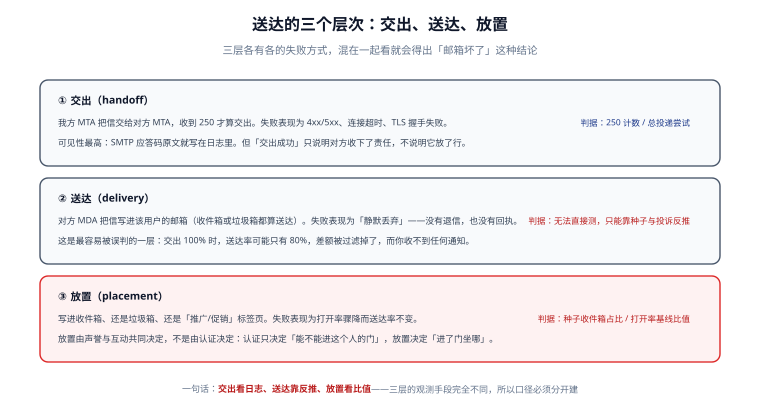

# 总览：三层送达与五个必失点

发信这件事最容易亏在**把三层合成一层看**：日志里全是 `250 OK`，于是断定「送达率 100%」，而客户其实什么都没收到。本页先把三层拆开，再给出五个一定会踩的失效点，最后回答「什么时候不该自建发信」。

::: tip 一句话理解
**交出看日志、送达靠反推、放置看比值**——三层的观测手段不同，口径必须分开建，否则你永远在拿一个数字解释三种问题。
:::



## 一、三种「没送到」的区别

| 说法 | 实际含义 | 谁能看到 | 典型证据 |
| --- | --- | --- | --- |
| 「没发出去」 | 我方在**连接或命令阶段**就失败了 | 我方日志 | `421`、`450`、`TLS handshake failure`、`Connection timed out` |
| 「发出去了但没到」 | 对方 MTA 接了（250），但没有写进任何邮箱 | 基本看不到 | 对方网关静默丢弃；只有种子邮箱与投诉率能反推 |
| 「到了但没看见」 | 写进了垃圾箱或「促销」标签页 | 看不到 | 打开率相对基线骤降，而交出率不变 |

三者的处置完全不同：

1. **没发出去**是工程问题——查 DNS、查 PTR、查防火墙、查对方是否在维护。
2. **发出去了但没到**是身份与声誉问题——查 SPF/DKIM/DMARC 的对齐、查黑名单、查内容哈希。
3. **到了但没看见**是声誉与互动问题——认证已经过关，只能靠减少投诉、提高互动、稳定发信量慢慢挣回来。

::: danger 把三层混在一起的三个后果
1. **用一个「送达率」汇报**：这个数只能是我方口径（交出率），一旦被当成收件方口径，就会在事故里给出完全错误的结论。
2. **用交出失败的经验去修放置问题**：`250` 已经拿到了，再怎么加重试也不会让信从垃圾箱回到收件箱。
3. **用放置问题的经验去修交出失败**：内容改得再干净，SPF 预算用尽时依然是 `permerror`。
:::

## 二、链路里的四个角色

| 角色 | 全称 | 干什么 | 出错时的表现 |
| --- | --- | --- | --- |
| MUA | Mail User Agent | 写信、读信的客户端 | 展示层问题：编码乱码、附件丢失、会话断裂 |
| MSA | Mail Submission Agent | 接收客户端提交（通常 587 端口 + 认证） | 提交被拒：`530 Authentication required`、`550 relay denied` |
| MTA | Mail Transfer Agent | 服务器之间用 SMTP 转发 | 连接/命令失败，`4xx`/`5xx` |
| MDA | Mail Delivery Agent | 把信写进具体用户的邮箱 | 静默丢弃、超配额 `452`、投进垃圾箱 |

一条最常见的误解：**「我们用的是某某云的邮件推送服务，所以链路不归我们管」**。云服务商只承担 MTA 那一段；域名、DNS 记录、From 域、内容、名单质量仍然在你手上——出问题时，服务商能给你的只有「我们交出去了」，剩下两层还是你自己的账。

## 三、五个必失点

这五条不是「可能出错」，而是**只要做了就会出错**，区别只是什么时候被发现。

### 1. DNS 预算被悄悄吃光

SPF 的 `include` 是**共享预算**：所有 `include`、`a`、`mx`、`ptr`、`exists`、`redirect` 加在一起不能超过 10 次 DNS 查询。每接一家 SaaS（CRM、工单、发票、短信平台）就多一层 include，吃到第 11 格时整条记录 `permerror`——**所有信一起坏，而不是新接的那一家坏**。

实测（合成区文件）：include 链 9 段 = 10 次查询刚好通过；10 段 = 11 次 `permerror`；「主域 + 三家 SaaS 各再套 2~3 层」的常见形态正好用满 10 次，**余量为 0**。详见 [DNS 与密钥](../DnsAndKeys/index.md)。

### 2. 认证通过但不对齐

用 ESP（Email Service Provider）的域签 DKIM、却把 `From:` 留成自己的域：DKIM 结果是 `pass`，SPF 也可能 `pass`，但**两个域都不是 `From` 域**，DMARC 判失败。这是「三件套都配了、却依然被判为伪造」的最常见原因。

### 3. 退信分类错，重试放大成封禁

`550 5.1.1 user unknown` 拿去重试 8 次，等于向收件方声明「我在给不存在的地址反复投递」；`451 4.7.1 greylisted` 不重试，则永远收不到。分类靠的是**应答码原文**，不是「5 开头就永久、4 开头就重试」这一条粗规则——`421 4.7.40`（无 DMARC）被很多实现当成永久问题，但它其实是**配置问题**，改完 DNS 立刻能过。

### 4. 投诉率的分母算错

同一批 280 封投诉：

| 分母 | 值 | 投诉率 | 结论 |
| --- | --- | --- | --- |
| 请求 100,000 | 280 | 0.280% | 通过（< 0.3%） |
| 交出 99,200 | 280 | 0.282% | 通过 |
| 送达 97,100 | 280 | 0.288% | 通过（接近红线） |
| 进收件箱 92,600 | 280 | **0.302%** | **不通过** |

**同一份数据，四个分母，两个结论**。收件方用的是最后一种（进收件箱口径），所以「我们自己算着没超」完全不构成辩护。

### 5. 重试撞上限

单封信的软退重试如果没有总时长上限，会一直排到队列里最贵的那个位置。本机算例：`300 / 600 / 1200 / 2400 / 4800 / 9600 / 19200 / 38400` 秒，累计到第 8 次是 **21.2 小时**——刚好卡在「24 小时内送达」的承诺边上。第 9 次要果断放弃并标记软退终态，否则队列里会堆满永远送不到的信。

## 四、五问决策：要不要自建发信

| 问题 | 若答「否」 | 影响 |
| --- | --- | --- |
| 每天发信量是否稳定超过 5,000 封？ | 用共享 ESP 更划算 | 自建 IP 的预热成本要自己扛 |
| 是否需要完全控制退信与投诉数据？ | 用托管服务 | 托管方常只给汇总数，不给逐封回执 |
| 是否有能力维护 DNS、DKIM 轮换与黑名单申诉？ | 用托管服务 | 这些是长期运营工作，不是一次性配置 |
| 是否需要收信（回复、工单转入）？ | 只做发信 | 收信要额外维护 MX、网关与解析 |
| 是否受合规约束（数据不出境、留痕）？ | 按合规要求选 | 邮件正文与日志的落点会被审计 |

四个**不该自建**的场景：日发信量 < 1,000 封；没有专人维护 DNS；主要发给企业内部（可用企业邮箱中继）；只需要「偶尔发验证码」（用短信或托管 API 更稳）。

## 五、一次发信的时间线

```text
T+0ms      业务调用 send(template, recipient, vars)  → 校验参数、生成幂等键
T+2ms      渲染模板 → 组装 MIME（纯文本 + HTML + 附件）
T+5ms      入队（写库，状态 queued）        ← 事务提交点，之后可以崩溃
T+50ms     投递 worker 认领（sending）
T+180ms    连接对方 MX（EHLO → STARTTLS → MAIL FROM → RCPT TO → DATA）
T+420ms    收到 250 queued（accepted）
T+数分钟    对方投递完成（delivered，我方通常看不到）
T+数小时   退信/投诉异步回来（bounced_* / complained）
```

三个关键点：

1. **入队即落库**：`T+5ms` 之后进程崩溃，重启必须能接着发——这是队列存在的唯一理由。
2. **`250` 只代表「对方收下了责任」**：`T+420ms` 的 `accepted` 不是 `delivered`。
3. **回执是异步且可能丢失的**：`T+数小时` 之后才回来的退信，必须能对上 `T+0ms` 那条业务记录，靠的是**自己生成的 `message_id`**，不是 `Message-ID` 头（那个可能被重写）。

## 六、四条常见误解

| 误解 | 实际情况 |
| --- | --- |
| 「配了 SPF 就不会被伪造」 | SPF 只校验信封域，`From:` 头完全不受它保护——这正是 DMARC 存在的理由 |
| 「DMARC 设 `p=reject` 最安全」 | 没有先跑 `p=none` 收报告就上 `reject`，会把合法但未对齐的发信方（如工单系统）一起打死 |
| 「用大厂的 IP 就一定进收件箱」 | 共享 IP 的声誉是所有租户的平均值，某个租户的坏行为会连坐 |
| 「邮件进了垃圾箱就是被判定为垃圾内容」 | 更多时候是**声誉**与**互动**的结果，内容只是其中一项 |

## 七、本页判据

本页判据族 `DVO-A` ~ `DVO-H`，共 8 条。

| 编号 | 判据 | 判定方式 | 不满足时改哪里 |
| --- | --- | --- | --- |
| `DVO-A` | 交出率、送达率、进箱率、打开率、投诉率五个口径**分列**，且各自标注分母 | 看监控面板与周报 | 拆指标；每个指标名后写「分母 = …」 |
| `DVO-B` | 「交出」的判据是收到 `2xx`，不是「调用没报错」 | 查投递日志是否记录 SMTP 码 | 在 attempt 表里落 `smtp_code` |
| `DVO-C` | 「送达」有独立证据来源（种子邮箱 / 投诉 / 退信），不靠交出率推断 | 查是否有种子测试 | 建 3~5 个种子邮箱，按周发 |
| `DVO-D` | 「放置」用**相对基线**判定（本周进箱率 ÷ 前四周中位数），不用绝对值 | 看面板上是否有基线线 | 建 4 周滚动基线 |
| `DVO-E` | 五个必失点每一项都有对应的监控或检查项 | 对照本页第三节逐条点名 | 缺哪条补哪条，先补 DNS 预算 |
| `DVO-F` | 自建/托管的决策有书面结论，且写明「不做什么」 | 查 ADR 或方案文档 | 按第四节五问补齐 |
| `DVO-G` | 时间线上三个关键点（入队落库、`2xx`、异步回执）都有日志可查 | 故意重启 worker 验证 | 补 `message_id` 与状态迁移日志 |
| `DVO-H` | 四条误解中任意一条在团队内仍被当成事实时，有对应文档纠正 | 抽查值守文档 | 把本页表格抄进值班手册 |

## 八、验证：三分钟自查

```shell
# 1) 三条记录是否都在（把 example.com 换成自己的发信域）
dig +short TXT example.com | grep "v=spf1"
dig +short TXT _dmarc.example.com
dig +short TXT 2026._domainkey.example.com

# 2) SPF 是否只有一条（出现两行就是错的）
dig +short TXT example.com | grep -c "v=spf1"

# 3) 是否声明了发信 IP 的反向解析
dig +short -x 203.0.113.10
```

预期输出：第 1 步三条命令各有一行非空结果；第 2 步输出 `1`；第 3 步返回一个与你的 HELO 名一致的主机名。任意一项为空，先补记录，不要往下调内容。

## 与「消息通知与触达工程」的分工（第 206 天补充）

| 问题 | 看哪一页 | 边界 |
| --- | --- | --- |
| 这封信能不能进收件箱（SPF/DKIM/DMARC、声誉、退信分类） | **本页与 Authentication / BounceComplaint / ReputationWarmup** | 协议与身份层 |
| 这条事件该不该走邮件、走邮件之后还要不要降级 | [消息通知与触达工程 · 通道矩阵](../../NotificationDelivery/Channels/index.md) | 决策与路由层 |
| 邮件这条通道的「送达」怎么算 | 本页的观测口径 | 通知侧只引用，不重定义 |

**本页特有的一个坑**：邮件是**唯一没有送达回执**的通道。SMTP `250` 之后信件的命运（进收件箱 / 进垃圾箱 / 被规则归档）你无法知道，所以本专题在[投递与回执](../../NotificationDelivery/Delivery/index.md)里把邮件的 `delivered` 定义为「受理且未收到硬退信」，并把它标注为**推断值**。如果同一份报表里既有推送的「真回执送达率」又有邮件的「推断送达率」，两个数不能直接相加或对比——它们的分母虽然都是受理数，但分子一个是事实、一个是推断。

## 九、参考资料

- [RFC 9989：DMARC](https://www.rfc-editor.org/rfc/rfc9989)
- [RFC 7208：SPF](https://www.rfc-editor.org/rfc/rfc7208)
- [Gmail 发信人指南](https://support.google.com/a/answer/81126)
- [身份三件套](../Authentication/index.md)：三件套的原理与对齐细节
- [观测与分诊](../Observability/index.md)：五个口径怎么落成四张表
