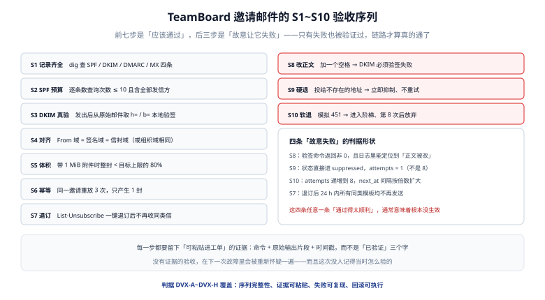

# 实战：TeamBoard 邀请邮件的端到端验收

把前八页落到一条真实链路上：TeamBoard 的「邀请成员」是它唯一一类**必须送达**的邮件——送不到，人就进不来。本页给出域名、记录、模板、队列、回执与 S1~S10 验收序列，全部可执行。

::: tip 一句话理解
邀请邮件的验收标准不是「我收到了」，而是**「我故意让它错的四种情况，都被正确识别了」**。
:::



## 一、口径六项

| 项 | 取值 | 理由 |
| --- | --- | --- |
| 发信域 | `board.example.com` | 与产品主域一致，域声誉可复用 |
| 信封域（退信） | `bounce.board.example.com` | 退信与投诉不污染主域邮箱 |
| DKIM 选择器 | `2026`（主）/ `2027`（备） | 两套并存才能无损轮换 |
| `From` 显示 | `TeamBoard <no-reply@board.example.com>` | `no-reply` 是承诺：这个地址不收信 |
| `Reply-To` | 不设 | 邀请邮件不需要回复；设了就必须有人看 |
| 邮件类型 | `invite` | 抑制与退订的粒度键 |

::: warning `no-reply` 是承诺，不是装饰
既然叫 `no-reply`，就必须有 `Reply-To` 指向一个真人邮箱，或者干脆不设并接受「用户回复会进黑洞」。最糟的做法是叫 `no-reply` 却在签名里写「有问题请回复本邮件」——投诉率会因此上升，因为用户的求助没有得到回应。
:::

## 二、DNS 记录全集

```text
; 主域 SPF：两家服务（自建 MTA + 事务邮件服务商），只留 2 格余量
board.example.com.            300 IN TXT "v=spf1 include:_spf.txn.example.net ip4:203.0.113.10 -all"

; 退信域自己的 SPF
bounce.board.example.com.     300 IN TXT "v=spf1 include:_spf.txn.example.net ip4:203.0.113.10 -all"

; DKIM：两套并存
2026._domainkey.board.example.com. 300 IN TXT "v=DKIM1; k=rsa; p=MIIBIjANBgkqhkiG9w0BAQEFAAOCAQ8A..."
2027._domainkey.board.example.com. 300 IN TXT "v=DKIM1; k=rsa; p=MIIBIjANBgkqhkiG9w0BAQEFAAOCAQ8B..."

; DMARC：先从 none 起步，收两周报告
_dmarc.board.example.com.     300 IN TXT "v=DMARC1; p=none; rua=mailto:dmarc@board.example.com; adkim=r; aspf=r"

; 收信：邀请接受后的回信走这里
board.example.com.            300 IN MX 10 mx.board.example.com.
mx.board.example.com.         300 IN A  203.0.113.20
10.113.0.203.in-addr.arpa.    300 IN PTR mail.board.example.com.

; 传输层
_mta-sts.board.example.com.   300 IN TXT "v=STSv1; id=20261021T000000"
_smtp._tls.board.example.com. 300 IN TXT "v=TLSRPTv1; rua=mailto:tls@board.example.com"
```

预算核对：`_spf.txn.example.net` 内部通常有 2~3 层 include，加上（若有）其他服务，总数要 ≤ 8。**每次接新服务前先跑一遍计数脚本**，见 [DNS 与密钥](../DnsAndKeys/index.md)。

## 三、表结构与幂等

```sql
CREATE TABLE invite (
    id           bigserial PRIMARY KEY,
    tenant_id    bigint      NOT NULL,
    board_id     bigint      NOT NULL,
    email_norm   text        NOT NULL,
    token_hash   text        NOT NULL,          -- 只存哈希
    status       text        NOT NULL,          -- pending|accepted|revoked|expired
    expires_at   timestamptz NOT NULL,
    created_by   bigint      NOT NULL,
    created_at   timestamptz NOT NULL DEFAULT now(),
    UNIQUE (tenant_id, board_id, email_norm)    -- 同一看板同一邮箱只有一条有效邀请
);

CREATE TABLE mail_outbox (
    id            bigserial PRIMARY KEY,
    biz_type      text NOT NULL,                -- 固定 'invite'
    biz_id        text NOT NULL,                -- invite.id
    recipient     text NOT NULL,
    template_ver  int  NOT NULL,
    status        text NOT NULL DEFAULT 'queued',
    attempts      int  NOT NULL DEFAULT 0,
    next_at       timestamptz NOT NULL DEFAULT now(),
    created_at    timestamptz NOT NULL DEFAULT now(),
    UNIQUE (biz_type, biz_id, recipient)        -- 幂等键：重放不会多发
);
```

幂等的实现要点：

1. **`UNIQUE` 落在库上**，不在代码里做「先查再插」——并发下必失效。
2. 插入冲突时返回「已存在」，接口对调用方仍然是 200（幂等语义），但要返回 `mail_status`。
3. **重发**（用户没收到，点「重新发送」）不是重放：它应该生成新的 `biz_id`（新邀请记录）或显式 `resend` 计数，避免被唯一键挡住。

```java
// 关键片段：入队与业务同事务，提交后才投递
@Transactional
public InviteResult invite(long tenantId, long boardId, String email) {
    var norm = AddressNormalizer.normalize(email);
    var inv = inviteRepo.insertIfAbsent(tenantId, boardId, norm);   // ON CONFLICT DO NOTHING
    if (inv.isEmpty()) return InviteResult.alreadyInvited();
    outboxRepo.enqueue("invite", String.valueOf(inv.get().id()), norm, TEMPLATE_VER);
    return InviteResult.created(inv.get().id());
    // 事务提交后由 @TransactionalEventListener(AFTER_COMMIT) 触发投递
}
```

## 四、模板与头部

```text
From: TeamBoard <no-reply@board.example.com>
To: 张三 <zhangsan@example.net>
Subject: 邀请你加入看板「设计评审」
Message-ID: <inv-88213.1761091200@board.example.com>
Date: Wed, 21 Oct 2026 10:00:00 +0800
Auto-Submitted: auto-generated
List-Unsubscribe: <https://board.example.com/u/tk_9f2a>, <mailto:unsub@board.example.com?subject=unsub-9f2a>
List-Unsubscribe-Post: List-Unsubscribe=One-Click
X-TB-Invite-Id: 88213
```

三个设计决定：

| 决定 | 原因 |
| --- | --- |
| `Message-ID` 用业务 ID 派生（`inv-88213.` 前缀） | 出事故时可以从头部直接定位到业务记录 |
| 加 `X-TB-Invite-Id` | 自定义头便于日志关联，且不影响投递 |
| 邀请邮件也给 `List-Unsubscribe` | 用户可能不想再收任何邀请；不给退订入口，他就点「标记垃圾」 |

正文模板要点：

- **纯文本与 HTML 双版本**，纯文本里也要有完整链接（部分企业网关只显示纯文本）；
- 链接里的令牌是**一次性**的，但**页面可重复打开**（用户可能换设备）；
- 不放大图、不用短链（短链域名是声誉风险源）；
- 底部写明「这封邮件因你在 TeamBoard 被邀请而发送」——降低投诉。

## 五、S1~S10 验收序列

| 步骤 | 命令 / 操作 | 预期输出 | 判据 |
| --- | --- | --- | --- |
| S1 记录齐全 | 见 [DNS 与密钥 · 验证](../DnsAndKeys/index.md) 的八条 `dig` | 七条非空，SPF 条数 = 1 | `DVX-A` |
| S2 SPF 预算 | 计数脚本 | 查询次数 ≤ 8 | `DVX-B` |
| S3 DKIM 真验 | 取原始信，`openssl dgst -verify` | `Verified OK`；改一个字后 `Verification failure` | `DVX-C` |
| S4 对齐 | 对比 `From` / `d=` / `Return-Path` | 三者组织域相同 | `DVX-D` |
| S5 体积 | 发一封带 1 MiB 附件的邀请 | 整封 ≈ 1.37 MiB，< 上限 80% | `DVX-E` |
| S6 幂等 | 同一请求重放 3 次 | `invite` 1 条、`mail_outbox` 1 条 | `DVX-F` |
| S7 退订 | POST 一键退订地址 | 24 h 内不再收到 `invite` 类邮件 | `DVX-G` |
| S8 改正文 | 发送后手动改正文一个空格 | DKIM 验签失败，且日志能定位 | `DVX-H` |
| S9 硬退 | 投给 `nobody@example.invalid` | 状态 `suppressed`，`attempts = 1` | `DVB-B` |
| S10 软退 | 本地 sink 返回 `451 4.2.1` | `attempts` 递增到 8 后 `given_up` | `DVB-C` |

### 四条「故意失败」怎么造

| 演练 | 造法 | 通过标准 |
| --- | --- | --- |
| S8 改正文 | 在 sink 收到 `captured.eml` 后，改正文再验签 | 验签命令返回非 0，且能说清「改的是正文」 |
| S9 硬退 | 用一个 `.invalid` 顶级域（RFC 2606 保证不存在） | 状态直接终态，不经过重试 |
| S10 软退 | sink 对 `RCPT TO` 回 `451 4.2.1` | 8 次后放弃，`next_at` 间隔符合阶梯 |
| S4 破坏对齐 | 临时把 DKIM 选择器指向 `d=txn.example.net` 的签名 | DMARC 结果变 `fail`，交付进垃圾箱 |

::: danger 四条演练里最容易「假通过」的一条
S8 常常被写成「改完之后系统没报错，所以通过了」。**正确的判据是：验签命令必须失败，且失败原因可定位到正文**。如果改完正文验签仍然 `Verified OK`，说明你验的根本不是这封信（比如验的是缓存的 `bh`）。

同理，S9 如果 `attempts = 2`，那不是「重试了一次就好了」，而是缺陷：硬退在第一次就该终态。
:::

## 六、回滚：域名切换的可执行方案

发信域不是「配好就不动」的。真要换（换服务商、换子域），按这个顺序，任一步失败都能回到上一步：

```text
① 新域发布 SPF / DKIM / DMARC(p=none)，等 24 h
② 新域先只发内部种子（1% 量），观察 3 天进箱率
③ 把 invite 的 From 切到新域，DKIM 选择器同步
④ 保留旧域记录至少 30 天（旧信的回执还会回来）
⑤ 旧域降到 p=quarantine，观察 2 周后再考虑删除记录
```

回滚动作只有一条：**把 `From` 与 `dkim_selector` 两个配置项改回旧值**，DNS 不用动（旧记录还在）。这就是「保留 30 天」的意义——它让回滚变成一次配置修改，而不是一次域名迁移。

## 七、本页判据

本页判据族 `DVX-A` ~ `DVX-H`，共 8 条。

| 编号 | 判据 | 判定方式 | 不满足时改哪里 |
| --- | --- | --- | --- |
| `DVX-A` | S1~S10 十步全部执行过，且每步有可粘贴的证据 | 查验收记录 | 补做缺的步骤 |
| `DVX-B` | SPF 查询次数 ≤ 8（留 2 格余量） | 计数脚本 | 收敛 include |
| `DVX-C` | S3 与 S8 成对存在（一个验通过、一个验失败） | 查记录 | 补 S8 |
| `DVX-D` | `From` / `d=` / `Return-Path` 组织域一致 | 对比三个值 | 改配置 |
| `DVX-E` | 体积 ≤ 目标上限的 80% | 计算整封字节 | 缩小附件或改走下载链接 |
| `DVX-F` | 重放 3 次只产生 1 条邀请与 1 条 outbox | 查库 | 加唯一索引 |
| `DVX-G` | 一键退订 24 h 内生效，且只影响 `invite` 类 | 实测 | 改退订粒度 |
| `DVX-H` | 回滚只需改两个配置项，DNS 不动 | 演练一次回滚 | 保留旧域记录 |

## 八、验证：一条命令看全貌

```shell
# 邀请 → 入队 → 投递 → 回执，四张表各一行
psql "$DSN" -c "
SELECT i.id AS invite, i.status AS invite_status,
       o.status AS mail_status, o.attempts,
       (SELECT count(*) FROM mail_attempt a WHERE a.message_id=o.id) AS attempts_logged,
       (SELECT count(*) FROM mail_event e WHERE e.message_id=o.id AND e.kind='bounce_hard') AS hard_bounce
  FROM invite i JOIN mail_outbox o ON o.biz_id = i.id::text
 WHERE i.id = 88213;"
```

预期（一封成功送达的邀请）：

```text
 invite | invite_status | mail_status | attempts | attempts_logged | hard_bounce
--------+---------------+-------------+----------+-----------------+-------------
  88213 | accepted      | accepted    |        1 |               1 |           0
```

三处读数要一起看：`attempts = attempts_logged`（没有丢记录）、`hard_bounce = 0`（没有硬退）、`mail_status` 停在 `accepted` 而不是 `delivered`（因为我们确实看不到对方投递）——**`accepted` 才是诚实的状态**，把它写成 `delivered` 是自欺。

## 九、参考资料

- [身份三件套](../Authentication/index.md) · [DNS 与密钥](../DnsAndKeys/index.md) · [发信链路](../SendingPipeline/index.md)
- [退信与投诉](../BounceComplaint/index.md) · [观测与分诊](../Observability/index.md)
- [RFC 2606：保留域名（`.invalid` 用于演练）](https://www.rfc-editor.org/rfc/rfc2606)
- [RFC 8058：一键退订](https://www.rfc-editor.org/rfc/rfc8058)
- 项目侧同名落地：[TeamBoard · 成员邀请与角色变更](../../../../project/Complete/TeamBoard/MemberInvite/index.md)
