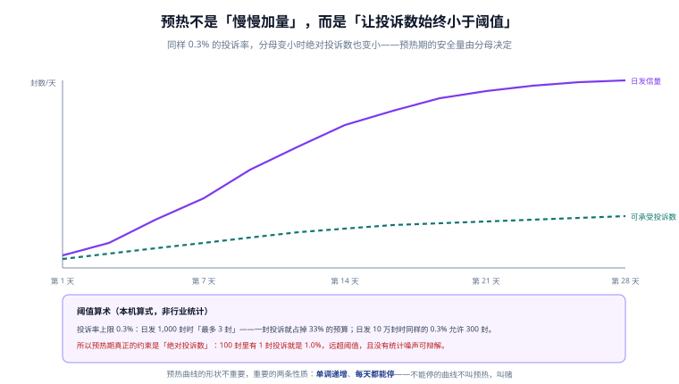

# 声誉与预热：投诉率算术与共享 IP 的账

认证解决「你有权发信」，声誉解决「你有资格被看见」。这一层没有配置项、没有 DNS 记录，只有**历史行为**——所以它既是最慢改善的，也是最容易被别人的行为毁掉的。

::: tip 一句话理解
投诉率的分母不是「你发了多少」，而是「**有多少封信真的被看见了**」。分母越小，同样的投诉数越致命。
:::



## 一、声誉的三个载体

| 载体 | 由什么决定 | 谁能影响它 | 出问题时的表现 |
| --- | --- | --- | --- |
| IP 声誉 | 这个 IP 过去发的内容被如何对待 | 共用该 IP 的所有人 | 连接被限流、`421 4.7.28`、整体进垃圾箱 |
| 域声誉 | 这个域（及其组织域）的历史 | 只有你自己 | 同域所有子域一起受影响 |
| URL / 品牌声誉 | 正文里的链接域名 | 链接落点、短链服务 | 内容被标为可疑，即使认证全过 |

三者的关系可以粗略理解为：**域声誉是主账，IP 声誉是辅账，URL 声誉是附加项**。各家收件方都不公布权重，所以任何「权重是 X%」的说法都不可信；能确定的是——域声誉差时，换 IP 救不了。

## 二、投诉率：分母决定结论

### 1. 阈值与绝对数

行业里最常被引用的两条线是 **0.3%（硬上限）** 与 **0.1%（建议目标）**，Gmail 对批量发信方的公开要求是前者。把百分比换算成绝对数，问题立刻清楚：

| 日发信量 | 0.3% 允许的投诉数 | 1 封投诉等于 |
| --- | --- | --- |
| 100 | 0.3 封 | **1.0000%**（超阈值 3.3 倍） |
| 1,000 | 3 封 | 0.1000% |
| 5,000 | 15 封 | 0.0200% |
| 10,000 | 30 封 | 0.0100% |
| 100,000 | 300 封 | 0.0010% |
| 1,000,000 | 3,000 封 | 0.0001% |

**这张表解释了一个常见困惑**：「我们投诉率只有 0.08%，为什么还被降权？」——如果日发信量是 500 封，0.08% 意味着**每 1,250 封里有 1 封投诉**，在统计上等价于「1 封投诉」，噪声极大，收件方会按更保守的方式处理。

### 2. 四个分母，两个结论

| 分母 | 值 | 280 封投诉对应 | 是否通过 0.3% |
| --- | --- | --- | --- |
| 请求 | 100,000 | 0.280% | 通过 |
| 交出（`2xx`） | 99,200 | 0.282% | 通过 |
| 送达 | 97,100 | 0.288% | 通过（贴线） |
| **进收件箱** | 92,600 | **0.302%** | **不通过** |

收件方算的是最后一种：**被丢进垃圾箱的信，用户根本看不到，也就不会投诉**——所以分母天然是「进收件箱」的量。用「请求」当分母，等于把 7,400 封没进收件箱的信也算进分母，把自己的投诉率算低。

::: danger 三个算错投诉率的典型方式
1. **用「发出量」当分母**：包含硬退与静默丢弃，投诉率被系统性低估。
2. **只看月度汇总**：一次事故（某天 500 封投诉）被 30 天的平均冲淡，而收件方按天甚至按小时看。
3. **把 `not-spam` 也算成投诉**：用户把信从垃圾箱移回收件箱是**正向信号**，算成投诉会让团队去修一个不存在的问题。
:::

## 三、预热：一条能停的曲线

### 1. 曲线设计

预热的目标不是「发得多」，而是**在投诉数始终低于阈值的前提下，把量抬到目标值**。一条可执行的曲线（本机算例：起点 50 封/天，日增 1.5 倍，封顶 50,000）：

| 天 | 日发信量 | 0.3% 允许的投诉数 |
| --- | --- | --- |
| 1 | 50 | 0.15 |
| 3 | 112 | 0.34 |
| 7 | 567 | 1.7 |
| 14 | 9,680 | 29 |
| 21 | 50,000（封顶） | 150 |
| 28 | 50,000 | 150 |

28 天累计约 **646,917 封**。三个设计要点：

1. **前两天最危险**：50 封里有 1 封投诉就是 2.0%，直接超阈值 6 倍。所以预热期的名单必须是**最活跃、最近有互动**的那部分用户，而不是全量。
2. **日增倍数不要超过 2 倍**：1.5 倍是可解释的（每天多一点），2 倍以上在收件方看来是「突然放量」。
3. **曲线必须能停**：每天都能选择「今天不加量」。不能停的曲线不是预热，是赌。

### 2. 三条停止条件

| 条件 | 阈值 | 动作 |
| --- | --- | --- |
| 投诉率 | 当日 > 0.1% | 当日停止放量，回退到前一天的量 |
| 硬退率 | 当日 > 2% | 停止，先查名单来源（这是名单脏，不是声誉问题） |
| 进箱率 | 种子邮箱进箱率 < 80% | 停止，回到上一阶段观察 48 h |

三条都是**当日生效**，不要「再观察一天」——放量的第二天往往就是事故日。

### 3. 共享 IP 与专用 IP 的账

| 维度 | 共享 IP | 专用 IP |
| --- | --- | --- |
| 起步速度 | 快（已有声誉） | 慢（必须预热） |
| 声誉可控性 | 低（别人的行为影响你） | 高 |
| 成本 | 低（按量付费） | 高（固定费用 + 闲置也付费） |
| 适用 | 日发信量 < 5 万、非核心业务 | 日发信量 > 10 万、事务邮件为主 |

共享 IP 的连坐可以算清楚（算例，非行业数据）：

```text
共享 IP 承载 10 个租户，合计 1,000,000 封/天
其中一个租户发了 50,000 封，投诉 500 封（自身 1.0%，已严重超标）
IP 层面投诉率 = 500 / 1,000,000 = 0.05%
```

0.05% 看起来「很安全」，但这正是共享 IP 的危险之处：**坏行为被大分母稀释，于是没人被触发告警，直到整个 IP 被降权**。所以共享 IP 必须有**按租户的投诉率看板**，而不是只看 IP 汇总。

## 四、种子测试：唯一能看见「放置」的手段

### 1. 怎么做

| 项 | 做法 |
| --- | --- |
| 种子数量 | 3~5 个，覆盖 Gmail / Outlook / Yahoo / 国内主流邮箱 |
| 频率 | 每周 1 次，固定时间（同一星期几、同一小时） |
| 内容 | 用真实模板，只把收件人换成种子地址 |
| 记录 | 进箱 / 垃圾箱 / 促销标签 / 未收到，四项人工或半自动记录 |
| 基线 | 至少 4 周数据才有意义（单周波动太大） |

### 2. 判读

| 现象 | 含义 | 动作 |
| --- | --- | --- |
| 全部进箱，打开率稳定 | 正常 | 保持 |
| 某一家进垃圾箱，其他正常 | 该收件方阈值更严（常见于 DKIM 密钥长度、内容规则） | 按该家文档逐项核对 |
| 全部进垃圾箱，认证全过 | 声誉问题 | 查投诉率与黑名单，降量观察 |
| 部分种子「未收到」 | 静默丢弃 | 查是否命中内容规则或 IP 黑名单 |

种子测试的价值在于**它是唯一不依赖收件方配合的观测手段**。打开率、投诉率都是「用户行为」，只有种子是「我们自己制造的行为」。

## 五、黑名单：查哪些、怎么申诉

| 名单 | 影响面 | 查询方式 | 申诉 |
| --- | --- | --- | --- |
| Spamhaus（ZEN） | 全球多数收件方 | 官网查询页 / DNS 查询 `zen.spamhaus.org` | 官网表单，通常 24~72 h |
| Barracuda | 企业网关为主 | 官网查询 | 表单 |
| SORBS | 部分欧洲收件方 | DNS 查询 | 多数已停止维护，先确认是否还生效 |
| 各家自建名单 | 单一收件方 | 只能通过退信原文判断 | 走对方 postmaster 渠道 |

::: warning 查黑名单前先确认「是不是自己的 IP」
共享 IP 场景下，你查到的黑名单记录可能属于**同 IP 的其他租户**。这种情况申诉无效，只能换 IP 或等服务商处理——这也是「共享 IP 必须有按租户看板」的另一个理由。
:::

## 六、本页判据

本页判据族 `DVR-A` ~ `DVR-H`，共 8 条。

| 编号 | 判据 | 判定方式 | 不满足时改哪里 |
| --- | --- | --- | --- |
| `DVR-A` | 投诉率分母是「进收件箱量」，且在指标名后写明 | 看指标定义 | 改分母；补「进箱量」来源 |
| `DVR-B` | 投诉率同时有日粒度与周粒度，不只月度 | 看面板时间粒度 | 加日粒度曲线 |
| `DVR-C` | `not-spam` 不计入投诉，单独统计为正向信号 | 查事件分类 | 加分支 |
| `DVR-D` | 预热曲线有书面表格（起点、倍数、封顶、天数） | 查方案文档 | 按第三节补 |
| `DVR-E` | 三条停止条件都配了自动动作，而不是只告警 | 造一次超标，看是否自动降量 | 把告警升级为动作 |
| `DVR-F` | 共享 IP 有按租户的投诉率看板 | 查面板维度 | 加租户维度 |
| `DVR-G` | 种子测试每周执行且有 ≥ 4 周基线 | 查记录表 | 建固定日历任务 |
| `DVR-H` | 黑名单检查区分「自己的 IP」与「同 IP 他人」 | 查流程文档 | 补判定步骤 |

## 七、验证：把阈值表算出来

```python
# 阈值表与预热曲线：纯算术，不依赖网络
def allowed(volume, rate=0.003):
    return round(volume * rate, 2)

for v in (100, 1000, 5000, 10000, 100000, 1000000):
    print(f"{v:>8} 封/天 → 允许投诉 {allowed(v):>7} 封；1 封投诉 = {100/v:.4f}%")

cap, cur, total = 50000, 50, 0
for day in range(1, 29):
    if day > 1:
        cur = min(cap, round(cur * 1.5))
    total += cur
    if day in (1, 3, 7, 14, 21, 28):
        print(f"第 {day:>2} 天：{cur:>6} 封，允许投诉 {allowed(cur)} 封")
print("28 天累计：", total)
```

预期输出：

```text
     100 封/天 → 允许投诉     0.3 封；1 封投诉 = 1.0000%
    1000 封/天 → 允许投诉     3.0 封；1 封投诉 = 0.1000%
    5000 封/天 → 允许投诉    15.0 封；1 封投诉 = 0.0200%
   10000 封/天 → 允许投诉    30.0 封；1 封投诉 = 0.0100%
  100000 封/天 → 允许投诉   300.0 封；1 封投诉 = 0.0010%
 1000000 封/天 → 允许投诉  3000.0 封；1 封投诉 = 0.0001%
第  1 天：    50 封，允许投诉 0.15 封
第  3 天：   112 封，允许投诉 0.34 封
第  7 天：   567 封，允许投诉 1.7 封
第 14 天：  9680 封，允许投诉 29.0 封
第 21 天： 50000 封，允许投诉 150.0 封
第 28 天： 50000 封，允许投诉 150.0 封
28 天累计： 646917
```

读法：**前三天「允许投诉」都小于 1 封**，意味着这三天里任何一封投诉都超标。所以预热期的名单筛选比曲线设计更重要。

## 八、参考资料

- [Gmail 发信人指南：垃圾邮件率与批量发信要求](https://support.google.com/a/answer/81126)
- [Gmail Postmaster Tools（投诉率官方口径）](https://postmaster.google.com/)
- [Spamhaus：查询与申诉](https://www.spamhaus.org/)
- [退信与投诉](../BounceComplaint/index.md)：投诉事件从哪来、怎么分类
- [观测与分诊](../Observability/index.md)：投诉率落到哪张表、怎么告警
