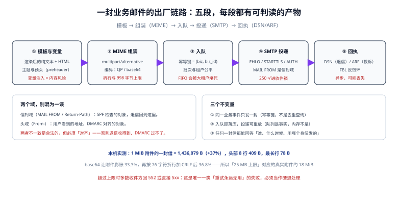

# 发信链路：MIME 组装、队列与投递

业务代码里最常见的一句 `mailService.send(...)` 背后有五段：模板渲染、MIME 组装、入队、SMTP 投递、回执处理。本页把每段的**可判读产物**写清楚——因为排障时你需要的不是「代码在哪」，而是「这一段当时留下了什么」。

::: tip 一句话理解
一封信的可靠性不取决于 SMTP 写得多漂亮，而取决于**入队那一刻是否已经落库**：内存里的队列在进程重启时不算数。
:::



## 一、五个不变量

| 不变量 | 含义 | 违反后的现象 |
| --- | --- | --- |
| 一封业务事件一封信 | 幂等键由业务生成，不是「发之前先查一遍」 | 用户收到 3 封一样的邀请；重试时又发一轮 |
| 入队即落库 | 状态从 `queued` 起就在数据库里 | 进程重启丢信，日志里查不到任何痕迹 |
| 投递可重放 | worker 崩溃后能重新认领 | 状态卡在 `sending` 永不前进 |
| 身份可追溯 | 每封信能回答「用哪个域、哪个选择器、哪个模板版本发的」 | 出事故时无法确定影响面 |
| 体积有上限 | 组装阶段就拒绝超限，而不是等 SMTP 回 552 | 队列里堆满永远发不出去的信 |

## 二、MIME 组装：编码与体积

### 1. 一个真实体积读数

本机用 Python 标准库组装了一封「纯文本 + HTML 替代版本 + 1 MiB PDF 附件」的信：

```text
组装后整封 1,436,079 B（正文 + 1 MiB 附件），行数 18,434
头部 409 B，占 0.03%；头部行数 8
头部行最长：78 B（RFC 5322 §2.1.1 上限 998）
```

```python
import email.policy
from email.message import EmailMessage
from email.utils import formatdate, make_msgid

msg = EmailMessage()
msg["From"] = "TeamBoard <no-reply@board.example.com>"
msg["To"] = "user@example.net"
msg["Subject"] = "看板「设计评审」有 3 张卡片即将逾期"
msg["Message-ID"] = make_msgid(domain="board.example.com")
msg["Date"] = formatdate(localtime=False)
msg.set_content("你好，这是一封邀请。\n")
msg.add_alternative("<p>你好，这是一封邀请。</p>", subtype="html")
msg.add_attachment(b"x" * (1024 * 1024), maintype="application",
                   subtype="pdf", filename="看板导出.pdf")
data = msg.as_bytes(policy=email.policy.SMTP)
print(len(data), data.count(b"\r\n"))
```

**为什么 1 MiB 的信变成 1.37 MiB**：base64 让附件膨胀 33.3%，再按 76 字符折行加 CRLF 后 36.8%，再加 HTML 替代版本与头部，合计约 37%。这个比例不是常数，附件越大越接近 37%。

### 2. 体积上限的换算表

| 整封上限 | base64 开销 | 折行开销 | 单附件可用上限（预留 1 KiB 头部） |
| --- | --- | --- | --- |
| 25 MiB（Gmail 商务基础版发送） | +33.3% | +3.5% | **≈ 18.25 MiB** |
| 50 MiB（Enterprise Plus，2026-02-23 起） | 同上 | 同上 | **≈ 36.50 MiB** |
| 10 MiB（多数企业网关默认） | 同上 | 同上 | **≈ 7.30 MiB** |

本机实测（8 MiB 附件）：

```text
附件 8 MiB → base64 10.67 MiB（+33.3%）；按 76 字符折行 147,169 行，
加 CRLF 后 10.95 MiB（+36.8%）
```

::: danger 三个体积相关的坑
1. **按附件原始大小判断是否超限**：25 MiB 上限下，20 MiB 的附件必然失败（编码后 27.4 MiB），但本地测试「文件不大」。
2. **中文主题不做编码直接塞进头部**：非 ASCII 必须走 RFC 2047。本机实测 26 个汉字编码后 122 字节（+69.4%），78 个汉字编码后 356 字节（1.65 倍）——主题越长，膨胀越接近 1.65 倍封顶。
3. **超长行不折行**：超过 998 字节的行会被中间 MTA 折行，签名随即失效（`bh` 变了）。
:::

### 3. 头部：五条业务必须写的

| 头部 | 作用 | 不写的后果 |
| --- | --- | --- |
| `Message-ID` | 全局唯一标识，供会话与去重使用 | 部分收件方判为可疑；客户端无法正确串会话 |
| `Date` | 发信时间（**用 UTC 或带时区**） | 时区错误会导致会话排序错乱 |
| `List-Unsubscribe` + `List-Unsubscribe-Post` | 一键退订（RFC 8058） | 批量发信不合规，投诉率上升 |
| `Auto-Submitted: auto-generated` | 声明这是自动信（自动回复、通知） | 触发对方「休假自动回复」的循环 |
| `Precedence: bulk`（营销类） | 声明批量性质 | 自动回复与转发行为不可预期 |

```text
List-Unsubscribe: <https://board.example.com/u/tk_9f2a>, <mailto:unsub@board.example.com?subject=unsub-9f2a>
List-Unsubscribe-Post: List-Unsubscribe=One-Click
Auto-Submitted: auto-generated
```

**一键退订要真的能一键**：POST 到 `https://.../u/tk_9f2a` 必须直接生效，不能返回一个「请登录后确认」的页面——收件方会把「点了没生效」记为不遵守。

## 三、队列：认领、公平与吞吐

### 1. 认领的正确形状

```sql
-- 一次认领 500 条，按「到期时间 + id」排序，避免同一条被两个 worker 抢到
UPDATE mail_queue
   SET status = 'sending', attempts = attempts + 1, locked_at = now()
 WHERE id IN (
       SELECT id FROM mail_queue
        WHERE status = 'queued' AND next_at <= now()
        ORDER BY next_at, id
        LIMIT 500
        FOR UPDATE SKIP LOCKED)      -- PostgreSQL；MySQL 8 用 SKIP LOCKED 同样可用
RETURNING id;
```

`SKIP LOCKED` 是这段的核心：没有它，多个 worker 会互相等锁，吞吐随 worker 数增加反而下降。

### 2. 本机吞吐读数（SQLite，200,000 条）

```text
入队 200,000 条：522 ms（383,434 条/秒）
批次 500 认领→归档：200,000 条 / 1.20 s = 167,290 条/秒，每批 2.99 ms
```

这两个数说明一件反直觉的事：**数据库本身不是瓶颈**。真实发信的瓶颈永远在 SMTP 往返（每封 100~500 ms）与收件方限流，所以队列设计的目标不是「更快」，而是**可暂停、可重放、可公平**。

### 3. 公平性：FIFO 会被大租户堵死

```text
全局 FIFO：唯一一条小租户消息排在第 20,001 位，按 3000 条/秒 需等 6.7 s
按租户轮转：同一条消息排在第 2 位，等待 1 ms
```

多租户系统里，一个租户一次性导入 2 万条邀请，会把其他租户的通知全部压后。修法有两种：

| 方案 | 做法 | 代价 |
| --- | --- | --- |
| 按租户轮转 | 排序键改成 `(tenant_seq, next_at)`，每轮每租户取 1 条 | 需要维护 `tenant_seq`，SQL 略复杂 |
| 按租户配额 | 每租户每分钟最多 N 条，超出延后 | 大租户的批量任务变慢，但可预期 |

无论哪种，**都要保留「优先级」这一维**：密码重置这类事务邮件必须能插到营销邮件前面，否则用户会在等验证码时超时。

## 四、SMTP 投递：命令序列与失败点

```text
C: 220 mx.google.com ESMTP
S: EHLO mail.board.example.com
C: 250-mx.google.com at your service
C: STARTTLS
S: 220 2.0.0 Ready to start TLS
   （TLS 握手，之后所有命令加密）
C: MAIL FROM:<bounce@bounce.board.example.com>     ← 信封域，SPF 查这里
S: 250 2.1.0 OK
C: RCPT TO:<user@example.net>
S: 250 2.1.5 OK
C: DATA
S: 354 Go ahead
C: <整封信，以 "." 单独一行结束>
S: 250 2.0.0 OK  1234567890 abcdef - gsmtp          ← 只代表「已接收」
```

四个失败点与处置：

| 阶段 | 典型应答 | 处置 |
| --- | --- | --- |
| 连接 | 超时 / `421` | 重试；连续失败要查对方是否在维护、自己 IP 是否被墙 |
| `MAIL FROM` | `550 5.7.1`、`421 4.7.40` | 身份问题：查 SPF 与 DMARC 记录，**不要重试** |
| `RCPT TO` | `550 5.1.1`（用户不存在）、`450 4.2.1`（邮箱忙） | 前者立即抑制；后者按阶梯重试 |
| `DATA` 结束 | `552`（超限）、`554`（内容被拒） | 超限是硬退；`554` 要看原文，可能是内容规则 |

::: warning 一个必须写进代码的细节
`MAIL FROM` 用的是**信封域**，`From:` 头是**头域**。两者可以不同（这是 ESP 的标准做法），但必须满足 DMARC 对齐。很多实现把两者写成同一个变量，结果「换发信服务商」时无法把退信收回到 `bounce.` 子域。
:::

## 五、模板与变量：别把用户输入拼进头部

| 位置 | 风险 | 正确做法 |
| --- | --- | --- |
| 主题 | 用户昵称带换行 → 头部注入（可注入 `Bcc:`） | 渲染后**删除所有 CR/LF**，长度截断到 78 字符 |
| 收件人显示名 | 同上 | 用标准库的地址编码，不手工拼 `"名字" <addr>` |
| HTML 正文 | XSS 在 webmail 里同样成立 | 转义后再插入模板；富文本走白名单清洗 |
| 链接 | `javascript:` 伪协议 | 只允许 `https:`，域名白名单 |
| 附件名 | 路径穿越、超长文件名 | 只保留 basename，长度截断，非 ASCII 走 RFC 2231 |

```python
def safe_header(value: str, limit: int = 78) -> str:
    # 头部注入的唯一有效防线：渲染后去掉 CR/LF，而不是「相信模板不会带」
    v = value.replace("\r", " ").replace("\n", " ").strip()
    return v[:limit]
```

## 六、本页判据

本页判据族 `DVP-A` ~ `DVP-H`，共 8 条。

| 编号 | 判据 | 判定方式 | 不满足时改哪里 |
| --- | --- | --- | --- |
| `DVP-A` | 一封业务事件只产生一封信，幂等键来自业务而非查询 | 重放同一请求 3 次，库里只有 1 条 | 加唯一索引 `(biz_type, biz_id)` |
| `DVP-B` | 入队是数据库写入，且有 `queued` 初始状态 | 停 worker 后发信，重启能接着发 | 去掉内存队列 |
| `DVP-C` | 组装阶段校验体积，超限直接拒绝并记录原因 | 构造 30 MiB 附件，应得明确错误 | 在 `send()` 前加检查 |
| `DVP-D` | 所有非 ASCII 头部走 RFC 2047 编码，行长 ≤ 998 | 发一封纯中文主题，检查原始信 | 用标准库编码，不手工拼 |
| `DVP-E` | 五条业务头部齐全（Message-ID / Date / List-Unsubscribe / Auto-Submitted / Precedence） | 检查原始信头部 | 按第二节表格补 |
| `DVP-F` | 认领使用 `SKIP LOCKED`（或等价机制） | 两个 worker 并发跑，无重复认领 | 改 SQL |
| `DVP-G` | 队列有租户公平与优先级两维 | 大租户灌 2 万条，观察小租户延迟 | 按第三节方案改造 |
| `DVP-H` | `MAIL FROM` 与 `From:` 分离配置，且满足对齐 | 检查配置项与 DMARC 结果 | 拆成两个配置项 |

## 七、验证：端到端跑一封

::: warning 别用 `python3 -m smtpd`
`smtpd` 模块在 **Python 3.12 已被移除**（本机是 3.13.12，直接报 `No module named smtpd`）。网上大量教程仍在用它，照抄会得到一个「命令不存在」的假失败。下面用 20 行 socket 写一个最小收信端，不依赖任何第三方包。
:::

```python
# sink.py：最小 SMTP 收信端，只打印不投递
import socket
srv = socket.socket(); srv.setsockopt(socket.SOL_SOCKET, socket.SO_REUSEADDR, 1)
srv.bind(("127.0.0.1", 1025)); srv.listen(1)
print("listening on 1025")
conn, _ = srv.accept()
f = conn.makefile("rwb")
conn.sendall(b"220 sink ESMTP\r\n")
data_mode, buf = False, []
while True:
    line = f.readline()
    if not line: break
    if data_mode:
        if line.strip() == b".":
            data_mode = False
            conn.sendall(b"250 2.0.0 OK\r\n")
            body = b"".join(buf)
            print("收到整封字节数:", len(body))
            open("captured.eml", "wb").write(body)
            buf = []
        else:
            buf.append(line)
        continue
    cmd = line.strip().upper()
    if cmd.startswith(b"EHLO") or cmd.startswith(b"HELO"):
        conn.sendall(b"250-sink\r\n250 OK\r\n")
    elif cmd.startswith(b"DATA"):
        data_mode = True
        conn.sendall(b"354 Go ahead\r\n")
    elif cmd.startswith(b"QUIT"):
        conn.sendall(b"221 Bye\r\n"); break
    else:
        conn.sendall(b"250 OK\r\n")
conn.close(); srv.close()
```

```shell
# 1) 终端 A：起收信端
python3 sink.py

# 2) 终端 B：发一封带中文主题与 1 MiB 附件的信
python3 - <<'EOF'
import smtplib, email.policy
from email.message import EmailMessage
m = EmailMessage()
m["From"] = "TeamBoard <no-reply@board.example.com>"
m["To"] = "user@example.net"
m["Subject"] = "看板「设计评审」有 3 张卡片即将逾期"
m.set_content("你好，这是一封邀请。\n")
m.add_attachment(b"x"*(1024*1024), maintype="application", subtype="pdf", filename="看板导出.pdf")
raw = m.as_bytes(policy=email.policy.SMTP)
print("整封字节数:", len(raw), "= 附件体积的", round(len(raw)/1048576, 3), "倍")
s = smtplib.SMTP("localhost", 1025)
s.send_message(m); s.quit()
EOF
```

预期：第 1 步打印 `listening on 1025`；第 2 步打印 `整封字节数: 1435590 = 附件体积的 1.369 倍`，第 1 步的终端里打印 `收到整封字节数: 1435590`，并在当前目录生成 `captured.eml`（`head -c 300 captured.eml` 能看到头部与 base64 正文）。**这就是「体积换算表」的现场证据**。

本机两次读数的差异值得记一笔：不带 `Date` 与 `Message-ID` 时是 **1,435,590 B**，加上这两个头部后是 **1,436,079 B**——头部只占 0.03%，但它决定了「这封信能不能被正确归档与串会话」。

## 八、参考资料

- [RFC 5321：SMTP](https://www.rfc-editor.org/rfc/rfc5321) 与 [RFC 5322：消息格式](https://www.rfc-editor.org/rfc/rfc5322)
- [RFC 2045~2049：MIME](https://www.rfc-editor.org/rfc/rfc2045)
- [RFC 8058：一键退订](https://www.rfc-editor.org/rfc/rfc8058)
- [RFC 3834：自动回复与 Auto-Submitted](https://www.rfc-editor.org/rfc/rfc3834)
- [消息队列工程](../../MessageQueue/index.md)：投递语义与 outbox 的通用做法
- [退信与投诉](../BounceComplaint/index.md)：投递结果怎么分类与处置
