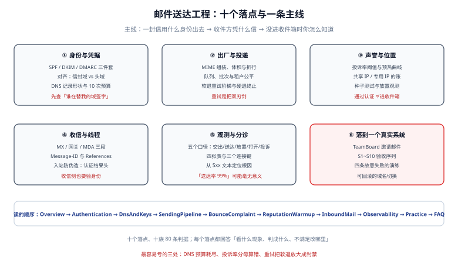

# 邮件送达工程

邮件送达工程（Email Deliverability Engineering）研究的不是「怎么把信发出去」，而是**「收件方凭什么相信这封信、又凭什么把它放进收件箱」**。本专题面向要写发信服务的后端工程师、要配 DNS 的运维、以及要回答「为什么客户收不到」的负责人。

::: tip 一句话理解
调通 SMTP 只是拿到了入场券：**交出（250）不等于送达，送达不等于进收件箱**，而这三层的观测手段完全不同。
:::

::: info 本专题与相邻专题的分工
- **怎么实现一条通知/消息的可靠投递（重试、幂等、outbox）** → [消息队列工程](../MessageQueue/index.md) 与 [幂等与状态机工程](../IdempotencyStateMachine/index.md)：那里回答「消息怎么不丢不重」。
- **邮件这种通道本身怎么被收件方接受**（SPF/DKIM/DMARC、退信、声誉、放置、收信）→ 本专题：回答「同一封信，为什么 Gmail 进收件箱、Outlook 进垃圾箱」。
- **告警通道怎么选、怎么避免告警风暴** → [观测驱动开发](../../Tools/ObservabilityDriven/AlertDesign/index.md)：邮件只是其中一种通知通道，那页管的是「什么时候该告警」。
- **凭证与证书的生命周期** → [证书与信任链生命周期](../../Ops/CertificateLifecycle/index.md)：SMTP 的 TLS 用哪张证书、怎么轮换归那边；本专题只要求「连接必须加密」。
- **租户隔离与越权** → [认证与权限](../../Backend/Auth/index.md)：邀请邮件的令牌属于认证域，本专题只管「这封信有没有送到」。
- **数据保留与合规删除** → [数据治理](../../DB/DataGovernance/index.md)：邮件正文里有没有 PII、留多久，归数据治理；本专题只讲「投递日志留什么字段」。
:::

## 目录

- [总览：三层送达与五个必失点](Overview/index.md)
- [身份三件套：SPF、DKIM、DMARC 与对齐](Authentication/index.md)
- [DNS 与密钥：记录形状、查询预算与轮换](DnsAndKeys/index.md)
- [发信链路：MIME 组装、队列与投递](SendingPipeline/index.md)
- [退信与投诉：分类、抑制名单与重试阶梯](BounceComplaint/index.md)
- [声誉与预热：投诉率算术与共享 IP 的账](ReputationWarmup/index.md)
- [收信侧：MX、网关、会话与防伪造](InboundMail/index.md)
- [观测与分诊：五个口径、四张表与告警](Observability/index.md)
- [实战：TeamBoard 邀请邮件的端到端验收](Practice/index.md)
- [常见问题与排错](FAQ/index.md)

## 专题地图

## 判据纪律

本专题沿用全库写法：**每页 8 条，编号形如 `DVA-A`**，逐页前缀唯一，可被 `utils/audit` 下的判据类巡检机械核对。判据不是口号，每条都要能回答三个问题：**看什么现象、判成什么、不满足时改哪里**。

| 页 | 判据族 | 条数 | 这一族管什么 |
| --- | --- | --- | --- |
| 总览 | `DVO-A` ~ `DVO-H` | 8 | 三层送达是否被分开度量 |
| 身份三件套 | `DVA-A` ~ `DVA-H` | 8 | 三种认证结果与对齐是否都成立 |
| DNS 与密钥 | `DVD-A` ~ `DVD-H` | 8 | 记录形状、预算、选择器与轮换 |
| 发信链路 | `DVP-A` ~ `DVP-H` | 8 | 组装、体积、队列与幂等 |
| 退信与投诉 | `DVB-A` ~ `DVB-H` | 8 | 分类、抑制与重试是否正确 |
| 声誉与预热 | `DVR-A` ~ `DVR-H` | 8 | 投诉率分母、预热与 IP 策略 |
| 收信侧 | `DVI-A` ~ `DVI-H` | 8 | 路由、认证结果头与会话 |
| 观测与分诊 | `DVE-A` ~ `DVE-H` | 8 | 口径、数据质量与告警 |
| 实战 | `DVX-A` ~ `DVX-H` | 8 | 端到端验收序列 |
| 常见问题 | `DVQ-A` ~ `DVQ-H` | 8 | 症状分诊与自查 |

合计 **10 族 80 条**。

## 事实与口径速览（2026-10 核对）

| 项 | 口径 | 说明 |
| --- | --- | --- |
| DMARC 核心规范 | **RFC 9989**（2026-05-20，Standards Track），同时废止 RFC 7489（2015，Informational）与 RFC 9091 | 第一次把 DMARC 从 Informational 提到 Proposed Standard；`v=DMARC1` 记录向后兼容 |
| DMARC 报告规范 | RFC 9990（聚合报告）、RFC 9991（失败报告） | 与核心协议拆成三份，可各自独立修订 |
| 新规范里废弃的标签 | `pct` / `rf` / `ri` | 收件方忽略而不是拒绝记录；下次改 DNS 时顺手删掉 |
| SPF | RFC 7208（2014） | **10 次 DNS 查询**、**2 次 void lookup** 上限，超限 `permerror`（不是 fail） |
| DKIM | RFC 6376（2011）；Ed25519 签名见 RFC 8463（2018） | RSA-2048 最通用；1024 位是很多收件方的下限，512 位会被直接拒 |
| 一键退订 | RFC 8058（2017） | `List-Unsubscribe` + `List-Unsubscribe-Post: List-Unsubscribe=One-Click`，收件方要求 2 天内生效 |
| Gmail 批量发信门槛 | 每日向 `gmail.com` / `googlemail.com` ≥ **5,000 封**（按主域计，子域合并；**不含 Workspace 账号**） | 触发后**永久**标记为 bulk sender；要求 SPF+DKIM+DMARC（`p=none` 起）、对齐、一键退订、投诉率 **< 0.3%**（目标 < 0.1%）、有效 PTR、TLS |
| 常见拒信码 | Gmail：`5.7.26`（SPF 与 DKIM 都失败）、`421 4.7.40`（无 DMARC）、`421 4.7.32`（未对齐）、`5.7.25`（PTR）、`5.7.29`（TLS）；Microsoft：`550 5.7.515`（2025-05 起） | 读应答原文再定分支，别只按 5xx 一刀切 |
| 体积上限 | Gmail 商务基础版：发 **25 MB** / 收 50 MB；Enterprise Plus 自 **2026-02-23** 起发 **50 MB** / 收 **70 MB**（管理员可配） | 上限指**整封**（含 base64 编码），不是附件原始大小 |
| 行长 | RFC 5322 §2.1.1：每行 ≤ **998 字节**（不含 CRLF） | 超长行会被中间 MTA 折行，或直接拒收 |
| TLS 相关 | MTA-STS（RFC 8461）、TLS-RPT（RFC 8460）、DANE（RFC 7672） | 三者解决的是「发信时能不能确认对方真的支持 TLS」，与「信能不能进收件箱」是两条线 |

## 版本组织说明（为何不建版本目录）

本专题涉及一次**规范换代**：DMARC 从 RFC 7489（2015）换到 RFC 9989/9990/9991（2026-05-20）。但这里**不建 `Dmarc7489/` `Dmarc9989/` 这样的版本目录**，理由三条：

1. **线上格式没变**：新旧规范的记录都是 `v=DMARC1; p=...`，版本标签没动，同一条记录两边都认。真正变化的是三个被废弃的标签与 PSD（公共后缀域）相关的扩展，属于**能力矩阵**而不是**两套并存写法**。
2. **不存在「两代栈」**：本库建版本目录的先例都是「同一主题的多代技术栈并存」——`docs/Backend/Java/Frame/Spring/Spring5` 与 `Spring6`、`SpringBoot` 下的 `v2`/`v3`/`v4`、`Vue2` 与 `Vue3`，读者可能真的还在维护旧栈。DMARC 没有「还在用 7489 的部署」这种状态，只有「记录里还留着 `pct`」这种**字段级残留**。
3. **拆开会让引用断裂**：八条判据、四张表、验收序列都同时引用「对齐」与「处置策略」，拆成两个目录会让同一套判断标准出现两份各自漂移的副本。

旧规范的内容**没有被删除**：在 [DNS 与密钥](DnsAndKeys/index.md) 里有一节「版本对照：RFC 7489 与 RFC 9989」，用表格逐条标注 `pct` / `rf` / `ri` 的旧语义、现状（废弃 / 忽略）与迁移动作。将来若真出现「两代协议需要长期并存维护」的情形（例如某天 SPF 被彻底替换成新机制且旧机制仍需支持），**届时再建版本目录，并把旧目录原样保留**，而不是就地改写现有页面。

::: warning 关于「实测」的诚实标注
本专题的数字分两类，正文里逐处标明：

- **本机可复跑**：Python 3.13.12 标准库 + OpenSSL 3.3.2 + SQLite 3.50.4，固定种子，命令写在页面里，**脚本本身不入库**（放在仓库外）。涉及 SPF 计数的实验用**合成区文件**而非真实 DNS，因此只能证明「计数规则」而不是「某个域的真实查询次数」。
- **公开口径**：RFC 条款、服务商规则、体积上限，逐条标了来源与日期。凡属推算（成本、预热曲线、容量）一律写「算例」或「推演」，不当成行业统计。
:::

## 三条底线

1. **没有身份的信不该发**：一个域只要发过业务邮件，就必须有 SPF 与 DKIM；有 DMARC 之前不要谈「送达率」。
2. **投诉率的分母决定结论**：同一批数据，分母取「请求」「交出」「送达」「进收件箱」会得出四个不同的数，而收件方只认其中一种。
3. **重试只对「暂时」有效**：把 5xx 拿去重试，等于用同一份脏名单反复敲收件方的门——这是最快把自己打成垃圾发送者的方式。

## 学习路径

| 你现在的位置 | 从哪开始 | 大约要花的时间 |
| --- | --- | --- |
| 第一次配发信域 | [总览](Overview/index.md) → [身份三件套](Authentication/index.md) → [DNS 与密钥](DnsAndKeys/index.md) | 40 分钟 |
| 信发出去了，但客户说没收到 | [观测与分诊](Observability/index.md) → [常见问题](FAQ/index.md) → [退信与投诉](BounceComplaint/index.md) | 30 分钟 |
| 要上线批量发信（邀请、通知、营销） | [声誉与预热](ReputationWarmup/index.md) → [发信链路](SendingPipeline/index.md) → [实战](Practice/index.md) | 1 小时 |
| 要做收信能力（回复邮件、工单转入） | [收信侧](InboundMail/index.md) → [身份三件套](Authentication/index.md) | 30 分钟 |

## 参考资料

- [RFC 9989：DMARC（2026-05，废止 RFC 7489 与 9091）](https://www.rfc-editor.org/rfc/rfc9989)
- [RFC 7208：SPF](https://www.rfc-editor.org/rfc/rfc7208)
- [RFC 6376：DKIM](https://www.rfc-editor.org/rfc/rfc6376)
- [RFC 8058：一键退订（List-Unsubscribe=One-Click）](https://www.rfc-editor.org/rfc/rfc8058)
- [RFC 5321：SMTP](https://www.rfc-editor.org/rfc/rfc5321) 与 [RFC 5322：消息格式](https://www.rfc-editor.org/rfc/rfc5322)
- [Gmail 发信人指南（批量发信要求）](https://support.google.com/a/answer/81126)
- [dmarc.org：IETF 发布更新后的 DMARC 规范](https://dmarc.org/)
