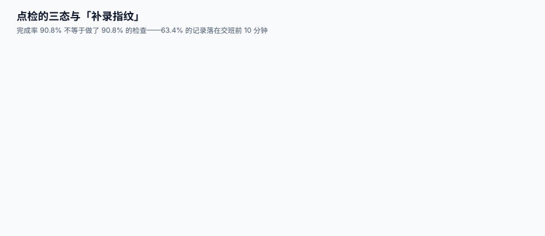

# 点检、状态监测与阈值

<p style="text-align:center;"></p>

点检表在多数工厂长这样：一行设备、一列日期、一个勾。它记录了「有人去看过」，但没记录**看到了什么**。等到设备真的坏了，翻记录只能得到「上周检查过，正常」——而这句话既不能证明检查有效，也不能告诉你它从什么时候开始不正常。

本页判据族 `EQC-A` ~ `EQC-H`，共 8 条，定义在第七节。

## 一、一条点检记录必须回答四个问题



| 要素 | 字段 | 缺了会怎样 |
| --- | --- | --- |
| 在哪测 | `point`（测点号，绑定位置与方向） | 同一个值来自泵驱动端还是自由端说不清 |
| 测了什么 | `metric`（振动速度 / 温度 / 压力 / 目视） | 「温度 60」是油温还是壳体温度 |
| 测到多少 | `value` + `unit` | 无法做趋势，也无法与阈值比 |
| 什么时候测的 | `measured_at`（**测量时刻**，不是上传时刻） | 离线补传后所有点挤在同一分钟 |

```sql
CREATE TABLE eq_inspect (
  insp_id     INTEGER PRIMARY KEY AUTOINCREMENT,
  asset_id    TEXT NOT NULL REFERENCES eq_asset(asset_id),
  point       TEXT NOT NULL,               -- 如 DE-H（驱动端水平）
  metric      TEXT NOT NULL,               -- 如 VEL_RMS / TEMP_C / VISUAL
  value       REAL,
  unit        TEXT,
  verdict     TEXT NOT NULL CHECK (verdict IN ('OK','WARN','NG')),
  measured_at TEXT NOT NULL,               -- 测量时刻
  uploaded_at TEXT NOT NULL DEFAULT (datetime('now')),
  by_whom     TEXT NOT NULL,
  offline     INTEGER NOT NULL DEFAULT 0 CHECK (offline IN (0,1)),
  CHECK (verdict = 'OK' OR value IS NOT NULL)   -- WARN/NG 必须有数值
);
```

最后那条 `CHECK` 是关键：**判「异常」必须有数**，否则会出现「NG，原因是感觉不对」这种既无法追责也无法分析的记录。

## 二、阈值三带与它的来源

| 带 | 含义 | 动作 | 谁定 |
| --- | --- | --- | --- |
| OK | 正常 | 按原间隔继续 | 标准 / 厂家 / 历史分位 |
| WARN | 预警 | 缩短间隔、加密测点、准备备件 | 维护工程 |
| NG | 报警 | 降载或停机检修 | 维护工程 + 生产 |

阈值**不能拍**。三个合法来源，按可靠性排序：

1. **标准分区**：振动按 ISO 20816-3:2022 的 A/B/C/D 四区（A 新机、B 可长期运行、C 不宜长期运行、D 可能损坏），边界值随机器类别与支承方式不同，必须查原表。
2. **厂家额定值**：温度、压力、油品指标通常有明确上限。
3. **自身历史分位**：同一台设备稳定运行 6 个月后，取 P95 作为 WARN、P99 作为 NG——这是「基线法」，适合没有标准可依的测点。

::: danger 三个常见的阈值错误
1. **把标准值直接套到所有设备**：ISO 20816-3 的分区依赖机器类别、功率与支承刚性，同一张表套到一台 5.5 kW 的泵上会得到「永远合格」。
2. **WARN 与 NG 用同一个数**：等于没有预警，只有报警。
3. **阈值只升不降**：某次误报后把阈值调高，之后再也不调回来，最终阈值失去意义。每次调整必须留 `threshold_change_log`。
:::

## 三、趋势比单点强得多

一个实测中反复出现的现象：单点越限的时候，往往已经晚了；而**连续三点单调上升**能在越限前一到两周给出信号。

| 判定方式 | 提前量 | 误报 | 实现成本 |
| --- | --- | --- | --- |
| 单点超 NG | 0（已经坏了） | 低 | 最低 |
| 单点超 WARN | 数天 | 中 | 低 |
| 连续 3 点上升且斜率 > 基线 | 1~2 周 | 中高 | 中 |
| 趋势 + 频谱特征（1×/2×/BPFO） | 2~6 周 | 低 | 高 |

```sql
-- 连续 3 次测量单调上升（同一设备同一测点）
WITH s AS (
  SELECT asset_id, point, measured_at, value,
         LAG(value,1) OVER w AS v1,
         LAG(value,2) OVER w AS v2
  FROM eq_inspect
  WHERE metric = 'VEL_RMS'
  WINDOW w AS (PARTITION BY asset_id, point ORDER BY measured_at)
)
SELECT asset_id, point, measured_at, v2, v1, value
FROM s
WHERE v2 IS NOT NULL AND v2 < v1 AND v1 < value;
```

这条查询只回答「在涨」，不回答「涨得快不快」。判断严重程度还要除以时间间隔——**从 2.0 涨到 2.1 用了三个月，和用了一天，完全是两件事**。

## 四、补录指纹：完成率是最容易作假的指标

本机模拟 60 台设备 × 30 天 = 1,800 条应检：

| 指标 | 数值 | 读法 |
| --- | --- | --- |
| 实际记录 | 1,635 条 | 完成率 **90.8%** |
| 落在交班前 10 分钟的记录 | 1,037 条 = **63.4%** | 高度可疑：一半以上的「检查」是坐下来补的 |
| 时间戳完全重复 | 2 条 | 批量提交的指纹 |
| 连续漏检 > 3 天的空档 | 6 处，最长 **12 天** | 有 8 台设备整段没人去过 |

完成率 90.8% 是一张很漂亮的表。但它和「63.4% 集中在交班前」放在一起，结论就反过来了。

::: tip 一条能落地的反作弊规则
不禁止补录（现场确实会忘），但**必须区分**：`offline = 1` 的记录同时存 `measured_at` 与 `uploaded_at`，并在看板上单列「补录率」。补录率超过 40% 的班组，其点检数据不参与可靠性分析——因为它不是测量，是回忆。
:::

## 五、离线采集：保住「测量时刻」

移动端在车间常常没网。正确做法是**采集时就把时间写死在本地**，联网后原样上传：

```json
{
  "asset_id": "EQ-002",
  "point": "DE-H",
  "metric": "VEL_RMS",
  "value": 4.7,
  "unit": "mm/s",
  "measured_at": "2026-11-02T09:14:03+08:00",
  "offline": true,
  "device_clock_skew_s": 12
}
```

带 `device_clock_skew_s` 是一个小但重要的设计：手机时钟可能不准，服务端据此可以校正，也可以判定这条记录是否可信。**没有这个字段，补传数据的时间戳就永远只能信一半。**

## 六、数据量与存储

一个算例（口径演示）：

| 项 | 数值 |
| --- | --- |
| A/B 类设备 | 120 台 |
| 每台测点 | 8 个 |
| 采集频次 | 每天 1 次 |
| 记录数 | 120 × 8 × 365 = **35 万条/年** |
| 单条（含索引） | 约 120 B |
| 年增量 | 约 **41 MB** |

总值点检的数据量微不足道。真正吃存储的是**波形与频谱**：一次振动频谱采集 3,200 点 × 4 B ≈ 12.8 KB，120 台 × 8 点 × 每周 1 次 ≈ **4.8 GB/年**。所以：

- **总值必存**（用于趋势）；
- **频谱按触发存**（超 WARN 存全谱，正常只存特征值）；
- **原始波形只在不合格时存**，并设保留期（如 24 个月）。

## 七、判据清单

| 编号 | 判据 | 怎么验 |
| --- | --- | --- |
| `EQC-A` | 每条记录有测点、指标、数值、判定四要素 | `eq_inspect` 四列非空（`OK` 允许无值） |
| `EQC-B` | `WARN`/`NG` 必须有数值 | `CHECK (verdict='OK' OR value IS NOT NULL)` |
| `EQC-C` | 记录区分「测量时刻」与「上传时刻」 | 两列都存在，且 `measured_at <= uploaded_at` |
| `EQC-D` | 阈值有来源与复核日期 | `threshold_src` + `threshold_checked_at` |
| `EQC-E` | 完成率与「交班前集中度」同时报出 | 看板两列并列，缺一不可 |
| `EQC-F` | 连续未检天数可查询 | 有 `v_inspect_gap` 视图 |
| `EQC-G` | 趋势判定与单点判定分开，且趋势要除以时间 | 有连续性查询且带斜率 |
| `EQC-H` | 频谱 / 波形有保留策略，不全量长存 | 有 `retention_policy` 配置 |

## 八、验证方式

```shell
# 1) WARN/NG 无值应被拒
sqlite3 /tmp/mnt.db "INSERT INTO eq_inspect(asset_id,point,metric,value,unit,verdict,measured_at,by_whom)
  VALUES('EQ-001','DE-H','VEL_RMS',NULL,'mm/s','NG','2026-11-02T09:00','T-01');"
# 期望：CHECK constraint failed

# 2) 测量时刻不得晚于上传时刻
sqlite3 /tmp/mnt.db "SELECT count(*) FROM eq_inspect WHERE measured_at > uploaded_at;"
# 期望：0

# 3) 补录指纹：交班前的集中度
sqlite3 /tmp/mnt.db "SELECT ROUND(100.0*sum(CASE WHEN offline=1 THEN 1 ELSE 0 END)/count(*),1) FROM eq_inspect;"
# 期望：< 40%；若 > 60%，说明这批记录是回忆不是测量

# 4) 连续未检空档
sqlite3 /tmp/mnt.db "SELECT asset_id, max(gap_days) FROM (
    SELECT asset_id, julianday(measured_at)-julianday(LAG(measured_at) OVER (PARTITION BY asset_id ORDER BY measured_at)) AS gap_days
    FROM eq_inspect) GROUP BY asset_id ORDER BY 2 DESC LIMIT 5;"
# 期望：最大空档 < 7 天；出现 10 天以上说明有设备被整段遗漏

# 5) 阈值来源可追溯
sqlite3 /tmp/mnt.db "SELECT count(*) FROM eq_threshold WHERE src IS NULL OR checked_at IS NULL;"
# 期望：0
```

::: warning 抽查比全量更有效
上面的 SQL 只能发现「形态异常」。真正判断点检是否有效，要**随机抽 5 条 NG 记录去现场复核**：如果现场已修但系统没更新，说明闭环断在关单；如果现场没修，说明 NG 没有触发动作。这一步脚本做不了。
:::

## 参考资料

- [维护策略与间隔：BM / PM / CBM / PdM](../Strategy/index.md)：CBM 阈值服务于哪种策略
- [报修、工单状态机与停机登记](../WorkOrder/index.md)：NG 之后怎么开工单
- [振动监测与故障诊断](../../../DB/TimeSeries/index.md)：时序数据的存储与降采样
- ISO 17359:2018《机器的状态监测与诊断 — 通用指南》：状态监测程序的七个步骤：<https://www.iso.org/standard/71194.html>
- ISO 20816-3:2022：工业机械振动评价的四区划分（取代 ISO 10816-3:2009）：<https://www.iso.org/standard/78311.html>
