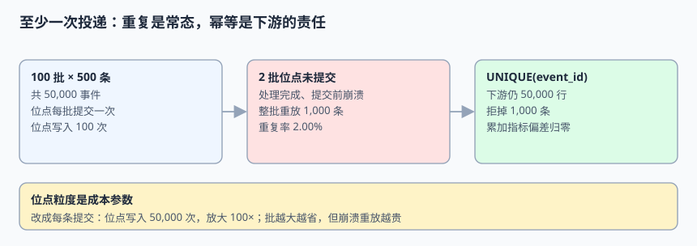

# 投递语义与去重：至少一次之后

消息中间件几乎从不承诺「一条不多、一条不少」。它承诺的是**至少一次**（at-least-once）：可能重复，但不静默丢。于是集成层真正要做的不是「挑一个恰好一次的 MQ」，而是让**下游写入**在重复面前保持幂等。本页给出位点、重放、三种幂等实现与毒丸事件的完整处置。

本页判据族 `EID-A` ~ `EID-H`，共 8 条。



## 一、三种投递语义，谁负责什么

| 语义 | 英文 | 可能丢 | 可能重 | 谁负责收口 |
| --- | --- | --- | --- | --- |
| 至多一次 | at-most-once | **可能** | 不会 | 没人能补救，只适合可丢的指标采样 |
| 至少一次 | at-least-once | 不会 | **可能** | 下游幂等 + 位点管理 |
| 恰好一次（效果） | effectively-once | 不会 | 表面可能、效果不会 | **写入端事务**（去重表/唯一键）与输出端位点在同一个原子动作里 |

第三行是关键区别：所谓「恰好一次」是一条**端到端性质**，不是 broker 的一个开关。即便 broker 提供事务或幂等生产者，只要下游写入与位点提交不在同一个事务里，崩溃窗口依然存在。

::: info 术语对照
位点（offset / checkpoint）表示「处理到哪了」；重放（replay）是位点回退后重新消费；毒丸事件（poison pill）指永远处理失败、会卡住整条流的那一条；死信队列（DLQ / dead letter queue）是它的隔离区。
:::

## 二、批次位点与 2.00% 的重复

消费者按批处理、每批提交一次位点，是最常见的性能取舍。崩溃若发生在**处理完成、位点未提交**之间，整批会被重放：

```python [/tmp/delivery_probe.py]
BATCH, BATCHES, CRASH_RATE = 500, 100, 0.02
total = BATCH * BATCHES
crash_batches = round(BATCHES * CRASH_RATE)
dups = crash_batches * BATCH
print("events =", total, "replayed =", dups, "dup_rate = %.2f%%" % (dups/total*100))
print("no_idempotency_rows =", total + dups, "with_unique_rows =", total)
print("offset_writes_batch =", BATCHES, "offset_writes_per_event =", total,
      "amplification =", total // BATCH, "x")
# events = 50000 replayed = 1000 dup_rate = 2.00%
# no_idempotency_rows = 51000 with_unique_rows = 50000
# offset_writes_batch = 100 offset_writes_per_event = 50000 amplification = 100 x
```

本机读数（固定种子 `20261111`）：50,000 条事件，2 批位点未提交 → 重放 **1,000 条（2.00%）**。下游若无幂等，行数变成 51,000；若是 `SUM(amount)` 这类累加指标，金额也会凭空高 2.00%——而且**不会报错**，报表只是「比昨天多了一点」。

位点粒度的成本同样要算清楚：每批提交 100 次，改成每条提交就是 50,000 次，**放大 100×**。批越大越省写入，但崩溃时重放越贵；这个取舍应该由「重复一条的成本」决定，不由「中间件默认值」决定。

## 三、三种幂等实现与各自的边界

| 实现 | 写法 | 能挡住 | 挡不住 |
| --- | --- | --- | --- |
| 唯一键去重 | `UNIQUE(event_id)` | 同一事件重复投递 | 两条不同事件的新旧倒序 |
| 条件更新 | `WHERE lsn < :incoming` | 乱序覆盖 | 完全重复（需要唯一键配合） |
| 去重表 + 同事务 | 处理结果与位点/去重行一起提交 | 崩溃窗口内的重复 | 跨库写入（无法单事务） |

推荐组合是**前两条一起装**，第三条在「位点能存进同一个库」时使用：

```sql [V3__delivery_guard.sql]
CREATE TABLE processed_event (
  event_id   UUID        PRIMARY KEY,
  processed_at TIMESTAMPTZ NOT NULL DEFAULT now(),
  lsn        BIGINT      NOT NULL
);

CREATE TABLE order_projection (
  order_id   BIGINT      PRIMARY KEY,
  status     TEXT        NOT NULL,
  version    BIGINT      NOT NULL,
  lsn        BIGINT      NOT NULL,
  last_event UUID        NOT NULL
);

-- 单事务：写业务结果 + 记去重行 + 推进位点（三者一起成功或一起失败）
```

```sql [apply_one_event.sql]
BEGIN;
  INSERT INTO processed_event(event_id, lsn) VALUES (:event_id, :lsn);  -- 重复会直接冲突

  INSERT INTO order_projection(order_id, status, version, lsn, last_event)
  VALUES (:order_id, :status, :version, :lsn, :event_id)
  ON CONFLICT (order_id) DO UPDATE
    SET status = EXCLUDED.status, version = EXCLUDED.version,
        lsn = EXCLUDED.lsn, last_event = EXCLUDED.last_event
    WHERE order_projection.lsn < EXCLUDED.lsn;

  UPDATE consumer_offset SET offset = :offset WHERE partition_id = :partition;
COMMIT;
```

三条写在一个事务里，就消除了「结果写了、位点没写」的窗口。若位点必须存在 broker 里（无法与业务库同事务），那就退回「下游幂等 + 允许重放」：重复会被 `processed_event` 的主键挡住，效果仍然是恰好一次。

::: danger 四个把幂等做假的地方
1. **「先查有没有，再插入」**：`READ COMMITTED` 下两个并发会话能同时查到「没有」，然后各插一条。唯一约束必须落在数据库上，不能落在应用层判断上。
2. **「用 `INSERT IGNORE` / `ON CONFLICT DO NOTHING` 吞掉冲突」**：重复被吞了，但冲突也可能来自**同一 `event_id` 对应不同内容**（生产者 bug），这时静默跳过等于掩盖数据损坏。建议至少记录冲突计数并定期比对 `lsn`。
3. **「去重表只留最近 7 天」**：迟到的重放（补数、灾备回放）超过保留期就会重新生效。去重表的保留期必须 ≥ 事件最大回放窗口。
4. **「累加指标也用 upsert」**：`SUM` 类指标没有「覆盖」语义，重复一次就多算一次。要么改成「按明细重算」，要么把去重放在累加之前。
:::

## 四、位点提交的三条纪律

| 纪律 | 说明 |
| --- | --- |
| 提交在处理之后 | 「拉取即提交」会让重平衡后丢处理 |
| 提交与结果同事务（可行时） | 否则接受重放 + 幂等 |
| 位点按分区记，不按消费者记 | 重平衡后新消费者要能从正确分区位点接上 |

第 3 章的水位结论在这里复用：`min(分区位点)` 才是「可以对外宣布追平」的依据，单个分区的位点不是。

## 五、毒丸事件与死信

一条永远处理失败的事件（字段类型错、外键缺失、schema 不兼容）会卡住整条分区。处置顺序：

```python [/tmp/poison_probe.py]
MAX_RETRY = 3
def handle(ev, tries):
    if is_poison(ev):
        if tries >= MAX_RETRY:
            return "DLQ"        # 隔离，不阻塞后续事件
        return "RETRY"
    return "APPLY"

print("A1 正常事件 →", handle({"ok": True}, 0))
print("A2 毒丸第 1 次 →", handle({"ok": False}, 1))
print("A3 毒丸第 3 次 →", handle({"ok": False}, 3))
# A1 正常事件 → APPLY / A2 毒丸第 1 次 → RETRY / A3 毒丸第 3 次 → DLQ
```

三条配套约束：

1. **DLQ 要带原始事件、失败原因、位点与 `trace_id`**，否则排查时无法定位。
2. **跳过后必须记账**：让第 6 章的对账能发现「下游少了一条」，不能把毒丸当成功吞掉。
3. **不要自动无限重试**：指数退避 + 上限，超过上限转人工；无限重试与卡住分区是同一件事。

## 本页判据

| 判据 | 约定 | 定错了会怎样 | 怎么验证 |
| --- | --- | --- | --- |
| `EID-A` | 默认按至少一次设计，不声明「恰好一次投递」 | 重复发生时无收口手段 | 契约文本无「零重复」表述 |
| `EID-B` | 下游 `UNIQUE(event_id)` 由数据库保证 | 并发双通过、行数多出 | 重放 1,000 条后行数不变 |
| `EID-C` | 同时带 `lsn < :incoming` 条件 | 乱序把新值改回旧值 | 反序注入后状态仍为最新 |
| `EID-D` | 位点提交在处理之后，且与结果尽量同事务 | 重平衡丢处理 | 注入崩溃后 0 行丢失 |
| `EID-E` | 位点按分区记录，水位取最小值 | 宣布追平但实际落后 | 慢分区场景水位停在 900 |
| `EID-F` | 去重表保留期 ≥ 最大回放窗口 | 迟到的补数重新生效 | 回放 30 天前事件仍被拦住 |
| `EID-G` | 累加型指标按明细重算，不用覆盖语义 | 金额随重复率虚高 | 2.00% 重放下金额不变 |
| `EID-H` | 毒丸有重试上限、DLQ 与差异记账 | 整条分区卡死或静默少一行 | 第 3 次进 DLQ 且对账报差异 |

## 验证方式

```shell
python3 /tmp/delivery_probe.py
# 预期：events = 50000 replayed = 1000 dup_rate = 2.00%
#       no_idempotency_rows = 51000 with_unique_rows = 50000 amplification = 100 x

python3 /tmp/poison_probe.py
# 预期：A1 正常事件 → APPLY / A2 毒丸第 1 次 → RETRY / A3 毒丸第 3 次 → DLQ
```

在自己的数据库里做一次「反向探针三连」，每一步都要看到预期结果：

```sql
-- 1) 同一事件投递两次（期望第二次主键冲突，行数不变）
SELECT count(*) FROM order_projection WHERE order_id = 1042;   -- 预期 1

-- 2) 删掉 UNIQUE(event_id) 后重放 1000 条（期望行数变 51000，探针变红）

-- 3) 去掉 WHERE lsn < EXCLUDED.lsn 后反序注入（期望 status 回退，探针变红）
```

```shell
# 端到端收尾：重放一次全部事件后，源库与下游行数、校验和一致
# 预期：rows_equal = True, checksum_equal = True, EXIT=0
```

## 参考资料

- [Apache Kafka：消费者位点与 `enable.auto.commit`](https://kafka.apache.org/documentation/#consumerconfigs)
- [Debezium：投递语义与故障后重放](https://debezium.io/documentation/reference/stable/development/engine.html)
- [PostgreSQL：`ON CONFLICT` 与唯一约束](https://www.postgresql.org/docs/current/sql-insert.html#SQL-ON-CONFLICT)
- [Confluent：Exactly-once semantics 的边界](https://docs.confluent.io/kafka/design/exactly-once-semantics.html)
