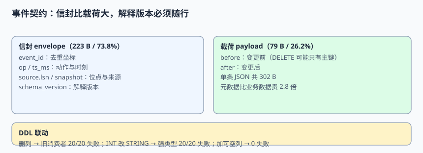

# 事件契约：信封、解释版本与 DDL 联动

下游拿到一条事件，凭什么知道「这条是什么、按哪版规则解释、能不能安全反序列化」？答案不在 MQ 的配置里，在**事件自己带的信封**里。本页给出可直接落库的字段契约、兼容性矩阵、DDL 变更的四种待遇，以及一份能算出「元数据比业务数据还贵」的体积账。

本页判据族 `EJA-A` ~ `EJA-H`，共 8 条。



## 一、信封字段契约

一条变更事件至少分成两层：**信封（envelope）**是传输与解释所需的元数据，**载荷（payload）**才是业务数据。下表是最小可用集合，少任何一列，历史事件都会在某个时刻失去解释力。

| 字段 | 英文 / 类型 | 作用 | 允许为空 | 缺失后果 |
| --- | --- | --- | --- | --- |
| `event_id` | UUID / string | 全局去重坐标 | 否 | 下游无法幂等，重放即重复 |
| `op` | enum `c`/`u`/`d`/`r` | 变更动作（create/update/delete/read） | 否 | 快照事件与增量事件无法区分 |
| `aggregate_type` / `aggregate_id` | string | 聚合身份，也是分区键来源 | 否 | 顺序无法界定、无法按聚合重建 |
| `schema_version` | int | 按哪版 schema 解释 `payload` | 否 | 结构变更后旧事件读不出来 |
| `source.lsn` / `binlog_file` / `binlog_pos` | string / int | 源库位点，**事件在全序里的位置** | 否 | 无法对账、无法做条件 upsert |
| `source.snapshot` | bool / string | 这条是快照还是增量 | 否 | 接缝处无法判断覆盖范围 |
| `ts_ms` | int64 | 捕获时刻（毫秒） | 否 | 延迟与水位无从计算 |
| `before` / `after` | object | 变更前后的行 | 视 `op` | DELETE 无 `after`；UPDATE 的 `before` 可能只有主键 |
| `trace_id` | string | 关联业务调用链 | 是 | 出事时无法回溯到上游请求 |

::: info 术语对照
`before` / `after` 是 Debezium 等 CDC 工具的字段名；在业务自定义事件里常写作 `previous` / `current`。`lsn`（Log Sequence Number）在 PostgreSQL 里是 WAL 位置，在 MySQL 里对应 `binlog` 文件 + 位点或 GTID 集合。**位点不是时间戳**：时间会重复、会回拨，位点在全序里单调递增。
:::

### 1.1 一条完整事件长什么样

```json [event-sample.json]
{
  "event_id": "9f1c2d7e-0000-4000-8000-000000000001",
  "op": "u",
  "ts_ms": 1786435255680,
  "aggregate_type": "order",
  "aggregate_id": "1042",
  "schema_version": 7,
  "source": {
    "connector": "postgresql",
    "lsn": 24023128,
    "snapshot": "false",
    "db": "order",
    "table": "orders"
  },
  "before": { "id": 1042, "status": "PENDING" },
  "after":  { "id": 1042, "status": "SHIPPED" }
}
```

`source.snapshot` 这一列常被省略，但它正是第 5 章「快照接缝」里区分「这条是历史数据」与「这条是窗口内变更」的唯一依据；没有它，下游只能靠时间猜。

## 二、体积账：元数据比业务数据贵 2.8 倍

用本机把上面那条事件序列化成紧凑 JSON，再拆开算一次：

```python [/tmp/envelope_probe.py]
import json
env = {"event_id":"9f1c2d7e-0000-4000-8000-000000000001","op":"u","ts_ms":1786435255680,
       "source":{"connector":"postgresql","lsn":24023128,"ts_ms":1786435255680,
                 "snapshot":"false","db":"order","table":"orders"},
       "schema_version":7,
       "before":{"id":1042,"status":"PENDING"},"after":{"id":1042,"status":"SHIPPED"}}
full = len(json.dumps(env, separators=(",",":"), ensure_ascii=False).encode())
meta = len(json.dumps({k:v for k,v in env.items() if k not in ("before","after")},
                      separators=(",",":"), ensure_ascii=False).encode())
print("total =", full, "B; envelope =", meta, "B (%.1f%%); payload = %d B" % (meta/full*100, full-meta))
# total = 302 B; envelope = 223 B (73.8%); payload = 79 B
```

实测：**302 B / 条，信封 223 B 占 73.8%，业务载荷只有 79 B**。按每天 200 万条变更估算，仅信封就是约 **446 MB/天**（未压缩、不含 Kafka 记录头与副本）。由此得到两条工程结论：

1. **压缩要按批做，不要按条做。** 信封字段名高度重复，单条 gzip 几乎压不动，成批压缩后重复字段名才被合并。
2. **不要为了「省流量」砍掉 `schema_version` 或 `lsn`。** 省下的十几个字节，换来的是历史数据不可解释、下游无法判新旧——这正是第 5 章「回退」事故的根源。

## 三、四类 DDL 变更，三种待遇

源库改表结构不会征求下游同意。把变更按「对已有事件的影响」分类，才能定兼容性策略：

| 源库动作 | 对旧消费者 | 兼容方向 | 处置 |
| --- | --- | --- | --- |
| 加**可空**列 | 忽略未知列即可 | 向后兼容（BACKWARD） | 允许直接上线；消费者升级后再开始读 |
| 加**必填**列（带默认值） | 旧消费者不写该列，可能违反约束 | 不兼容 | 先加可空列 → 回填 → 再改约束 |
| 删列 / 改列名 | 旧消费者缺必填字段 | **破坏性** | 禁止；走「加新列 → 双写 → 切读 → 删旧列」四步 |
| 改类型（如 INT → STRING） | 强类型反序列化失败；弱类型静默变形 | **破坏性** | 新建列 + 新事件类型，旧类型保留一个兼容期 |

本机对 20 个各自 pin 住一份 schema 的消费者做注入：`加可空列 → 失败 0/20`、`删列 → 失败 20/20`、`INT 改 STRING → 强类型失败 20/20`。弱类型消费者更危险——它不报错，只是把整数变成字符串，下游所有数值比较会安静地失效。

::: danger 三个只在生产才现形的坑
1. **「我们用的是 JSON，没有 schema，所以不怕改字段」**：JSON 只是把校验从写入时挪到了读取时；`status` 从 `0/1` 改成 `PENDING/SHIPPED`，代码里 `if status == 0` 不报错，只是永远不成立。
2. **「先改表，再改消费者」**：DDL 一旦提交，连接器立刻开始发新形状的事件，旧消费者在升级完成前会持续失败或吞错。正确顺序永远是**先扩消费者 → 再改源库 → 最后收紧校验**。
3. **「事件里带个 `version` 字段就够了」**：`version` 只说明「按哪版解释」，不保证「这版还能不能读」。必须有一份兼容性策略（见下一节）与一组 golden events 回放测试，否则版本号只是个装饰。
:::

## 四、DELETE 的 `before` 可能只有主键

这是集成层最容易被忽略的一条配置差异。PostgreSQL 默认的 `REPLICA IDENTITY DEFAULT` 只为 UPDATE/DELETE 记录**主键列**到 `before`，普通 UPDATE 的 `before` 甚至可能为 `null`；MySQL 的 `binlog_row_metadata` 也有类似「是否记录完整列元数据」的开关。

```sql [V2__replica_identity.sql]
-- PostgreSQL：让 UPDATE / DELETE 事件带上完整的前镜像
ALTER TABLE orders REPLICA IDENTITY FULL;

-- MySQL 8.x：让 binlog 记录完整行元数据（需重启会话/连接生效）
-- SET GLOBAL binlog_row_metadata = 'FULL';
```

本机模拟 2,000 条 DELETE 事件、下游按非主键条件做关联清理：

| 配置 | `before` 内容 | 清理命中 |
| --- | --- | --- |
| `REPLICA IDENTITY DEFAULT` | 只有 `id` | **0 / 2,000** |
| `REPLICA IDENTITY FULL` | 全部列 | **2,000 / 2,000** |

注意这个失败**不报错**：下游的 `WHERE status = :before.status` 匹配不到任何行，日志里连一条 WARN 都没有，只是该清理的数据一直留着。第 6 章的分块校验和会把它抓出来，但那时通常已经过去几天了。

## 五、兼容性策略：谁能读谁

Schema Registry 一类组件把「兼容性」变成一条可配置的门禁。常用三档：

| 策略 | 英文 | 保证 | 适用 |
| --- | --- | --- | --- |
| 向后兼容 | BACKWARD | **新 schema 能读旧数据** | 消费者先升级、生产者随后改（最常见） |
| 向前兼容 | FORWARD | **旧 schema 能读新数据** | 生产者先改、消费者随后升级 |
| 双向兼容 | FULL / FULL_TRANSITIVE | 新旧互读，且与所有历史版本互读 | 多版本长期并存、无法协调升级顺序 |

```json [schema-registry-config.json]
{
  "compatibility": "BACKWARD_TRANSITIVE",
  "subject": "order-events-value",
  "note": "TRANSITIVE 表示与所有历史版本比较，不只比上一版；长期存档场景必须带它"
}
```

::: warning 别把「能反序列化」当成「语义没变」
`BACKWARD` 保证的是结构可读，不保证含义一致。把 `amount` 的单位从「分」改成「元」、把 `status` 的枚举值重新编号，结构完全兼容，数值却全错。这类**语义变更**必须新开事件类型（如 `OrderAmountV2`）并保留迁移期，不能靠兼容性策略放行。
:::

## 六、解释版本放哪儿

| 放法 | 优点 | 缺点 | 建议 |
| --- | --- | --- | --- |
| 事件信封里带 `schema_version` | 事件自描述，脱离 registry 也能解释 | 每条多几十字节；版本可能被写错 | **必须带**，作为兜底 |
| Registry 的 subject + version | 集中治理、可做兼容门禁 | 离线归档/换介质后失去索引 | **必须配**，作为门禁 |
| 只靠 topic 名（`-v2`） | 简单 | 同一 topic 里混版本时无从区分 | 只作为路由手段，不作为契约 |

两者都要有：**Registry 管「能不能发」，信封管「事后怎么解释」**。只做前者，事件被导进数据湖、脱离 Registry 之后就变成一堆没有解释版本的 JSON。

## 本页判据

| 判据 | 约定 | 定错了会怎样 | 怎么验证 |
| --- | --- | --- | --- |
| `EJA-A` | 每条事件必须带全局唯一 `event_id` | 重放产生重复 | 唯一约束统计重复为 0 |
| `EJA-B` | 必须带 `schema_version` 且随行归档 | 历史事件不可解释 | 抽样 100 条，字段非空率 100% |
| `EJA-C` | 必须带源库位点（`lsn` / GTID / binlog 位点） | 无法判新旧、无法对账 | 位点单调性断言通过 |
| `EJA-D` | 必须带 `source.snapshot` 区分快照与增量 | 接缝处覆盖范围靠猜 | 快照事件该列为 `true` |
| `EJA-E` | `op` 用枚举，DELETE 不得依赖 `after` | 删除被当成更新 | 四种 op 各有断言用例 |
| `EJA-F` | 破坏性 DDL 走「加 → 双写 → 切读 → 删」四步 | 旧消费者集体失败 | 20 个 pin 住旧 schema 的消费者回放全通过 |
| `EJA-G` | 需要 `before` 完整列时显式设 `REPLICA IDENTITY FULL` | 清理逻辑静默零命中 | 2,000 条 DELETE 命中 2,000 |
| `EJA-H` | 语义变更新开事件类型、保留迁移期 | 单位/枚举含义变了但结构兼容 | 兼容矩阵里有独立的新类型行 |

## 验证方式

```shell
python3 /tmp/envelope_probe.py
# 预期：total = 302 B; envelope = 223 B (73.8%); payload = 79 B
```

在自己的 PostgreSQL 实例上执行下面三步，逐步确认「缺配置时真的测得到」：

```sql
-- 1) 默认配置：before 只有主键（用逻辑解码或连接器事件观察）
SELECT relreplident FROM pg_class WHERE relname = 'orders';   -- 预期 d（DEFAULT）

-- 2) 改成 FULL
ALTER TABLE orders REPLICA IDENTITY FULL;
SELECT relreplident FROM pg_class WHERE relname = 'orders';   -- 预期 f（FULL）

-- 3) 反向探针：改回 DEFAULT 后，DELETE 清理断言必须从 2000/2000 变成 0/2000
ALTER TABLE orders REPLICA IDENTITY DEFAULT;
```

再用 `event-sample.json` 做一次 golden events 回放：把 `schema_version` 改成 8 但保持结构不变，兼容性门禁应放行；把 `after.status` 的类型改成整数，`BACKWARD_TRANSITIVE` 门禁应拒绝。两件事一正一反都要看到，才算真的接上了门禁。

## 参考资料

- [Confluent Schema Registry：兼容性策略](https://docs.confluent.io/platform/current/schema-registry/index.html)
- [Debezium：事件结构与 envelope 字段](https://debezium.io/documentation/reference/stable/connectors/postgresql.html#postgresql-events)
- [PostgreSQL：`ALTER TABLE ... REPLICA IDENTITY`](https://www.postgresql.org/docs/current/sql-altertable.html#SQL-ALTERTABLE-REPLICA-IDENTITY)
- [MySQL：`binlog_row_metadata` 系统变量](https://dev.mysql.com/doc/refman/8.4/en/replication-options-binary-log.html)
- [Apache Avro：Schema 与兼容性规则](https://avro.apache.org/docs/current/specification/)
