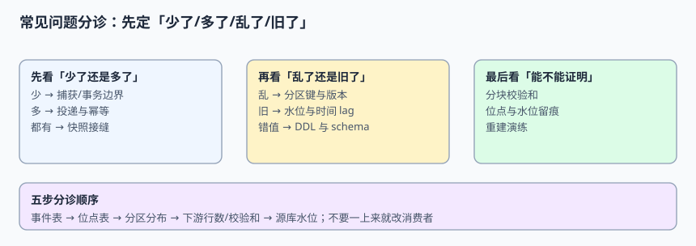

# 常见问题与分诊

集成链路出问题时，最常见的错误是**一上来就改消费者**。事实上「下游不对」只是一个症状，原因可能在事务边界、分区键、快照接缝、位点或对账口径的任意一处。本页给出一条五步分诊顺序、四类症状的原因表、十六个高频问题与五个反模式，让读者按「少了 / 多了 / 乱了 / 旧了」先把问题归类。

本页判据族 `EFQ-A` ~ `EFQ-H`，共 8 条。



## 一、五步分诊顺序

| 步 | 看什么 | 能排除什么 | 别跳过的原因 |
| --- | --- | --- | --- |
| 1 | 事件表：这条事件有没有被捕获 | 排除「源库就没变」与「事务边界丢事件」 | 下游为空时，先确认上游有没有 |
| 2 | 位点表：消费到哪、水位是多少 | 排除「位点没推进」「某分区拖后腿」 | 平均值会掩盖最慢分区 |
| 3 | 分区分布：同聚合是否跨分区 | 排除「顺序边界被破坏」 | 「乱」通常不是消费者 bug |
| 4 | 下游行数 + 分块校验和 | 排除「值不对但行数对」 | `count(*)` 相等不代表一致 |
| 5 | 源库水位与时间滞后 | 排除「其实已经追平，只是延迟」 | 条数 lag 会被速率误导 |

::: tip 一句话分诊
**少了**看捕获与位点，**多了**看去重与重放，**乱了**看分区键与版本条件，**旧了**看接缝与水位。四类症状对应四组完全不同的修复动作，混着查会把时间耗在改消费者上。
:::

## 二、「少了」：四类原因

| 原因 | 典型现象 | 定位命令 / 判据 | 修复方向 |
| --- | --- | --- | --- |
| 双写崩溃窗口 | 下游少一批，事件表里也没有 | 比对业务表与 `outbox` 行数 | 改发件箱同事务 |
| 快照从 `T1` 才订阅 | 上线当天整体偏少，差值 ≈ 窗口写入量 | 60 s × 2,000 行/s = 120,000 条 | 记录低水位并缓冲增量 |
| 位点提交太早 | 重平衡后少一批 | 位点 > 实际处理行数 | 提交移到处理之后 |
| 源库日志被清理 | 连接器反复重启、位点失效 | 位点对应的 binlog/WAL 已不存在 | 延长保留 + 重快照 |

## 三、「多了」：四类原因

| 原因 | 典型现象 | 定位命令 / 判据 | 修复方向 |
| --- | --- | --- | --- |
| 至少一次重放 | 行数随重启次数增长 | 重放 2.00%、`processed_event` 无对应记录 | `UNIQUE(event_id)` |
| 去重表保留期太短 | 补数/灾备回放后重复生效 | 回放窗口 > 保留期 | 保留期 ≥ 最大回放窗口 |
| 累加指标用覆盖语义 | 金额偏高但行数正常 | `SUM` 随重放增加 | 按明细重算 |
| 毒丸被无限重试 | 同一条事件反复出现 | 重试次数无上限 | 退避上限 + DLQ |

## 四、「乱了 / 旧了」：四类原因

| 原因 | 症状 | 定位判据 | 修复方向 |
| --- | --- | --- | --- |
| 按 `event_id` 分区 | 状态倒退、DELETE 先到 | 8 分区下 87.50% 跨分区 | 分区键改 `aggregate_id` |
| 跨表事务按表分区 | 子表先到、主表未到 | 98.53% 事务至少跨两分区 | `tx_id` 缓冲 + 水位 |
| 缺少版本条件 | 迟到事件把新值改回旧值 | 反序注入状态回退 | `WHERE lsn < :incoming` |
| 快照接缝无条件覆盖 | 行数对、值旧 | 窗口内 49.88% 落在已扫描区 | 快照行带 `L0` 且共用条件 upsert |

## 五、十六个高频问题

### 5.1 关于「选哪条路线」

1. **已经有 Kafka 了，还需要发件箱吗？** 需要。Kafka 解决的是传输，发件箱解决的是「业务写入与通知是否原子」。这两件事不在一个层。
2. **CDC 能不能完全替代业务事件？** 不能。CDC 发出的是状态变化，不含操作人、意图、`trace_id`；需要业务语义时走发件箱。
3. **能不能两种来源都接到同一个下游表？** 不建议。两个来源没有共同的新旧判据，互相覆盖时无法判定谁对。要接就分开建投影。
4. **上游系统不能改代码，怎么办？** 用读日志 CDC，并在契约里显式写明「只发状态、不发意图」，把语义缺失登记为已知边界。

### 5.2 关于「顺序」

5. **分区数调大能不能改善顺序？** 不能，反而让同一聚合的分布更分散（分区数变化会整体改变哈希结果）。顺序由分区键决定。
6. **消费者里按 `ts_ms` 排序靠谱吗？** 不靠谱。时间戳会重复、会回拨；排序键必须是源库位点或版本号。
7. **同一个事务改了三张表，怎么保证主表先到？** 不靠分区保证，靠 `tx_id` / `tx_total` 缓冲，收齐或水位越过后再应用。
8. **「全局有序」真的做不到吗？** 单分区能做到，代价是吞吐与扩容能力全放弃。集成场景需要的是聚合序，不是全局序。

### 5.3 关于「重复与幂等」

9. **broker 支持事务了，是不是就不用下游幂等了？** 不是。只要下游写入与位点提交不在同一个原子动作里，崩溃窗口仍在。
10. **`ON CONFLICT DO NOTHING` 可以吗？** 可以挡重复，但会吞掉「同一 ID 不同内容」的生产者 bug；至少记录冲突计数并比对 `lsn`。
11. **去重表要留多久？** 不短于最大回放窗口。补数、灾备回放常常跨越数周，按「7 天」设会踩坑。
12. **累加型指标怎么幂等？** 不要覆盖，改成「按明细重算」；或者在累加前先过 `processed_event`。

### 5.4 关于「快照、对账与运维」

13. **快照做完了为什么不自动有历史数据？** `initial` 只在首次启动执行；后来加进 `table.include.list` 的表需要显式发 `execute-snapshot` 信号。
14. **`count(*)` 相等就对齐了吗？** 不是。一行多、一行少或值被改旧都能让行数相等；要用分块校验和（100 块 × 1,000 行，命中 100%）。
15. **lag 显示 20,000 条，要不要报警？** 先看速率：200 行/s 时等于落后 100 秒，10,000 行/s 时只落后 2 秒。SLA 写时间滞后 p99。
16. **投影落后了，追增量还是重建？** 先算。本机折叠 20 万事件 63.5 ms、原子切换 1.26 ms，重建往往比慢慢追增量便宜。

## 六、五个反模式

| 反模式 | 为什么诱人 | 实际代价 |
| --- | --- | --- |
| 「不丢不重」写进需求就完事 | 一句话最省事 | 没有主语、没有判据，验收时无法执行 |
| 靠 `sleep` 等主表事件 | 改动最小 | 等待无上界，高峰期滞后被放大 |
| 抽样 1% 做对账 | 便宜 | 0.05% 差异漏检 60.65% |
| 一致性异常就以下游为准覆盖 | 修复快 | 没定位到差异块，可能把对的一边改错 |
| 把旧版配置顺手改成新写法 | 看起来「统一」了 | 抹掉存量事实，升级时失去对照 |

::: danger 排查时最容易做的三件错事
1. **先改消费者重试逻辑**：能掩盖「位点提交太早」，但重复与滞后会更严重。
2. **删掉「有问题」的事件重跑**：删掉的是定位证据，差异还在，只是不再可见。
3. **用「上线后观察两天」代替断言**：这类缺陷不报错、不告警，观察两天通常什么也看不到。
:::

## 七、排查工具箱

```shell
# 1) 事件表里有没有这条（排除捕获侧）
grep -n 'event_id' change_event.log | head

# 2) 位点与水位（排除拖后腿的分区）
# 期望：min(partition_offsets) 已越过目标 lsn
python3 -c "print(min({'p0':1200,'p1':1180,'p2':1210,'p3':900}.values()))"

# 3) 分区分布（排除跨分区）
# 期望：同一 aggregate_id 的哈希分区集合大小为 1

# 4) 分块校验和（排除「值旧」）
# 期望：100 块逐块相等，差异块能定位到具体主键范围

# 5) 时间滞后（排除「其实已经追平」）
# 期望：p99 <= 30s
```

## 八、什么时候应该放弃 CDC

三条判据出现任意一条，就该重新评估方案而不是继续加补丁：

| 判据 | 说明 |
| --- | --- |
| 上游表结构每周都变 | DDL 直接传播到下游，契约治理成本超过同步收益 |
| 下游需要的字段日志里没有 | 语义翻译层会越堆越厚，不如让业务方直接发事件 |
| 无法承受任何重放 | 至少一次是这类管道的基本语义，无法幂等的下游不适合接入 |

::: warning 上面第三条常被误读
「不能承受重放」通常不是业务要求，而是下游写入没做幂等。先把 `UNIQUE(event_id)` 与版本条件装上，再判断是不是真的不能承受——绝大多数情况下，问题在下游而不在管道。
:::

## 本页判据

| 判据 | 约定 | 定错了会怎样 | 怎么验证 |
| --- | --- | --- | --- |
| `EFQ-A` | 分诊按「事件表 → 位点 → 分区 → 校验和 → 水位」五步 | 一上来改消费者，掩盖真实原因 | 演练按五步输出定位结论 |
| `EFQ-B` | 症状先归类为少/多/乱/旧 | 四类修复动作混用 | 四个用例各命中一类 |
| `EFQ-C` | 「少了」先查捕获与位点 | 误判为下游 bug | 事件表无记录时不下结论 |
| `EFQ-D` | 「多了」先查去重与重放 | 累加指标持续虚高 | 重放 2% 后行数不变 |
| `EFQ-E` | 分块校验和按主键分块，纳入状态与版本列 | 值变了但哈希没变，门禁失效 | 改 1 行后报出 1 个差异块 |
| `EFQ-F` | 「乱了」先查分区键与版本条件 | 用 `sleep` 掩盖窗口 | 反序注入状态不回退 |
| `EFQ-G` | 「旧了」先查接缝与水位 | 行数对但值旧 | 逐行比对源库 0 行 stale |
| `EFQ-H` | 对账用分块校验和、SLA 用时间滞后 | 抽样漏检、lag 误报 | 100 块全比对 + p99 ≤ 30 s |

## 验证方式

照本页分诊顺序做一次「四类症状」演练，每类注入一个故障并输出定位结论：

```shell
# 少：从 T1 才订阅 → 期望定位到「快照窗口」，差值 = 120000
# 多：重放 2% 且去掉唯一键 → 期望定位到「去重表」，行数 = 51000
# 乱：按 event_id 分区 → 期望定位到「分区键」，跨分区率 = 87.50%
# 旧：去掉版本条件 → 期望定位到「条件 upsert」，stale_rows > 0
```

收尾判据：四类症状都能在**第 5 步之前**定位到根因，且修复后[实战页](../Practice/index.md)的 `10/10 PASS / EXIT=0` 仍成立。

## 参考资料

- [Debezium：常见问题与故障排查](https://debezium.io/documentation/reference/stable/operations/debezium-monitoring.html)
- [Apache Kafka：消费者 lag 监控](https://kafka.apache.org/documentation/#consumer_group_monitoring)
- [Confluent：Schema Registry 兼容性策略](https://docs.confluent.io/platform/current/schema-registry/index.html)
- [Google SRE Book：监控与 SLO](https://sre.google/sre-book/service-level-objectives/)
