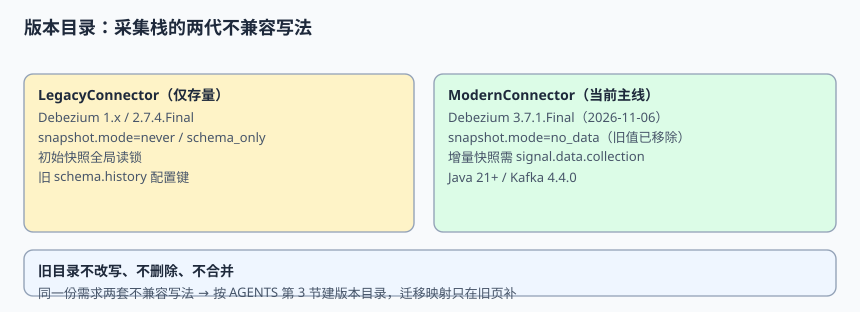

# 旧版采集栈（仅存量项目使用）

::: danger 版本状态：仅存量项目使用 · 已停止新增
本页记录 **Debezium 1.x / 2.7.4.Final 一代**的配置写法与迁移映射，**不改写、不删除、不与新版合并**。新项目一律使用[当前主线采集栈](../ModernConnector/index.md)；本页只在维护存量、排查旧连接、做升级映射时阅读。页面顶部这一行状态标注本身就是契约的一部分，请勿移除。
:::

旧一代栈的麻烦不在「抓不到变更」，而在**配置契约与当前主线不兼容**：若干快照模式取值已弃用、增量快照的信号机制与水位管理方式不同、初始快照的锁行为更重。本页把这些差异写成一张可逐项核对的映射表，供存量系统升级时对照。

本页判据族 `ELC-A` ~ `ELC-H`，共 8 条。



## 一、这一代栈覆盖了什么

| 维度 | 旧一代典型取值 | 与当前主线的差异 |
| --- | --- | --- |
| 连接器版本 | Debezium 1.x、`2.7.4.Final`（2024-12-11） | 当前主线为 `3.7.1.Final`（2026-11-06） |
| 快照模式 | `snapshot.mode=schema_only`、`never` 一类写法 | 当前文档中 `schema_only` 标 **Deprecated**（→ `no_data`），`never` 不在取值表 |
| 初始快照 | 常依赖全局读锁（MySQL `FLUSH TABLES WITH READ LOCK`） | 当前主线可用增量/只读快照，避免长时间全局锁 |
| 新增表回填 | 通常靠重建连接器或整库重快照 | 当前主线用信号表触发增量快照 |
| schema history | 内部 history topic，早期配置键写法不统一 | 当前统一为 `schema.history.internal.*` 前缀，且强制单分区 |
| 运行时 | Kafka Connect 旧线 | 当前主线与 Kafka 4.4.0 搭配，社区资料提示较新的 Connect 版本要求 |

::: info 版本事实核对
旧稳定线 `2.7.4.Final` 的发布日期、当前稳定版 `3.7.1.Final` 的发布日期均来自 [Debezium Releases](https://debezium.io/releases/)（2026-11-11 检索）。`snapshot.mode` 的取值与弃用状态来自[官方 MySQL Connector 配置文档](https://debezium.io/documentation/reference/stable/connectors/mysql.html)。**旧线上配置以实际文件为准**，本页只给共性写法，不替代逐实例核查。
:::

## 二、一份典型的旧配置（含弃用项）

```properties [connector-legacy.properties]
name=order-connector-legacy
connector.class=io.debezium.connector.mysql.MySqlConnector
tasks.max=1
database.hostname=mysql-primary
database.port=3306
database.user=debezium
database.server.id=154011
database.server.name=orderdb
table.include.list=orderdb.orders,orderdb.order_items

# 以下两项在当前主线配置文档中已弃用 / 不再列出，仅存量保留
snapshot.mode=schema_only
snapshot.locking.mode=minimal

schema.history.internal.kafka.topic=internal.orderdb.history
schema.history.internal.kafka.bootstrap.servers=kafka:9092
```

`snapshot.mode=schema_only` 在官方文档中明确标为 *Deprecated, see `no_data`*；`never` 一类取值不在当前取值表里。把这份配置原样贴进当前主线连接器，轻则校验失败起不来，重则以「看起来能跑」的默认值启动，快照行为与预期不符。

::: warning 不要在旧页里「顺手改成新写法」
本页是**存量事实的记录**，不是可执行模板。把这里的 `schema_only` 改成 `no_data` 会抹掉「线上现在跑的是什么」这条信息，升级时反而失去对照。新写法统一写在[当前主线采集栈](../ModernConnector/index.md)。
:::

## 三、三类只在旧栈常见的失败方式

| 失败 | 现象 | 原因 | 存量处置 |
| --- | --- | --- | --- |
| 初始快照长时间锁库 | 写请求排队、主库 RT 抖升 | 全局读锁或表级锁覆盖整个快照窗口 | 只在低峰重快照；先评估 `snapshot.locking.mode=none` 的 DDL 风险 |
| 配置值不被接受 | 连接器校验失败、反复重启 | 把旧 `snapshot.mode` 值直接套到新版本 | 按第四节映射表逐项替换后再升级 |
| history topic 被分区/清理 | 重启后无法重建表结构 | history topic 必须单分区、无限期保留 | 核查分区数与保留策略，再考虑迁移 |

第三条尤其容易被误判成「连接器坏了」：schema history topic 必须保持全局顺序（官方明确要求 partition count = 1），一旦被自动创建成多分区或被按保留期清掉，连接器重启时无法按位点重建当时的表结构。

::: danger 三个存量升级的坑
1. **「先升级连接器，再改配置」**：新版本启动时就会按新校验规则读旧配置，直接起不来，且可能已经占住了位点。正确顺序是先改配置、再滚动升级。
2. **「history topic 可以重建一个空的」**：它记录的是历史 DDL，空 topic 无法解释过去的表结构；要么从源库按官方 `recovery` 模式重建，要么保留原 topic。
3. **「旧目录里的写法已经过时，删掉算了」**：删除等于抹掉存量系统的可追溯性。按 `AGENTS.md` 第 3 节，旧版本目录保留原内容并标注状态，迁移说明只在本页补。
:::

## 四、旧 → 新 迁移映射表

| 旧写法 | 当前主线 | 迁移动作 |
| --- | --- | --- |
| `snapshot.mode=schema_only` | `snapshot.mode=no_data` | 逐实例替换；确认「只要结构、不要 READ 事件」的语义仍符合预期 |
| `snapshot.mode=never` | 当前取值表无此项，按需求选 `no_data` / `when_needed` / `recovery` | 先确认原本想表达的是「不快照」还是「只恢复结构」 |
| `snapshot.mode=schema_only_recovery` | `recovery` | 注意官方警告：history 丢失后若源库又有新 DDL，不能直接用恢复模式 |
| 整库重快照回填新表 | 信号表 + `execute-snapshot` 增量快照 | 先建 `signal.data.collection`，再触发 |
| 旧 history 配置键 | `schema.history.internal.kafka.topic` 等统一前缀 | 核对 topic 分区数 = 1、保留策略为无限 |
| 依赖全局读锁的初始快照 | 增量 / 只读快照（MySQL 可 `read.only=true` + GTID） | 评估只读前提：开启 GTID，多线程副本需 `replica_preserve_commit_order=ON` |

## 五、维护纪律

| 纪律 | 说明 |
| --- | --- |
| 不改写 | 旧配置样例与弃用项保持原样，作为存量事实 |
| 不删除 | 目录页与侧边栏保留入口（折叠展示） |
| 不合并 | 不与新版正文合并成「一份通用配置」；两代写法并存时通用化最容易漏掉弃用项 |
| 只补映射 | 新增信息一律是「旧 → 新」的映射行，不新增能力说明 |

## 本页判据

| 判据 | 约定 | 定错了会怎样 | 怎么验证 |
| --- | --- | --- | --- |
| `ELC-A` | 页顶标注「仅存量项目使用 · 已停止新增」 | 新项目误用旧配置 | 页面首屏可见状态标注 |
| `ELC-B` | 旧配置样例保持弃用值原样 | 抹掉存量事实、升级失去对照 | 样例仍含 `schema_only` |
| `ELC-C` | 迁移映射逐项覆盖快照模式 | 升级时连接器校验失败 | 6 行映射全部可核对 |
| `ELC-D` | history topic 单分区、无限保留写进核查项 | 重启后表结构无法重建 | 分区数 = 1 |
| `ELC-E` | 明确全局读锁的风险与低峰窗口 | 主库写请求排队 | 快照演练记录锁时长 |
| `ELC-F` | 升级顺序为「先改配置、后升级连接器」 | 新版读旧配置直接起不来 | 演练按此顺序执行 |
| `ELC-G` | 新能力不写进本页 | 旧目录逐渐与新目录重复 | 本页无新增配置说明 |
| `ELC-H` | 目录页保留折叠入口 | 存量维护者找不到旧版说明 | 侧边栏存在该叶子 |

## 验证方式

在自己的存量实例上按四步核对（**只做检查，不改动线上配置**）：

```shell
# 1) 列出实际生效的快照模式（与第二节样例逐项比对）
grep -E '^snapshot\.mode|^snapshot\.locking\.mode' connector-legacy.properties
# 预期：能看到 schema_only 一类弃用值，且已登记进迁移映射表

# 2) 核查 schema history topic 分区数（官方要求 = 1）
# kafka-topics.sh --describe --topic internal.orderdb.history
# 预期：PartitionCount = 1

# 3) 跑迁移映射表逐项打勾，输出未映射项
# 预期：unmapped = 0

# 4) 反向探针：把样例里的 schema_only 改成 no_data 后，
#    确认本页「存量事实」记录仍在（旧内容未被覆盖）
```

## 参考资料

- [Debezium Releases（版本与发布日期）](https://debezium.io/releases/)
- [Debezium MySQL Connector：`snapshot.mode` 取值表](https://debezium.io/documentation/reference/stable/connectors/mysql.html)
- [Debezium：Schema History Topic 单分区要求](https://debezium.io/documentation/reference/stable/connectors/mysql.html)
- [Debezium：Incremental Snapshot 与 Signaling](https://debezium.io/documentation/reference/stable/signalling.html)
