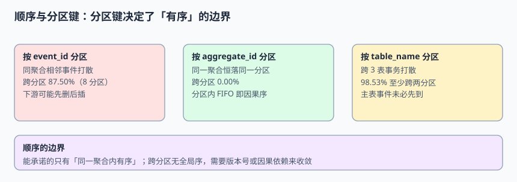

# 顺序与分区键：有序的边界

「保证顺序」是集成方案里最常被写进结论、又最少被界定的一句话。分区系统里**没有全局序**；能承诺的只有「同一分区内按写入顺序交付」，而「同一分区」由分区键决定。本页把这句话拆成可验证的三层，并给出跨表事务与条件 upsert 的完整写法。

本页判据族 `EJB-A` ~ `EJB-H`，共 8 条。



## 一、三种「有序」，只有第三种能承诺

| 层次 | 含义 | 能否承诺 | 实现代价 |
| --- | --- | --- | --- |
| 全局序 | 所有事件按源库提交顺序交付 | **不能**（除非单分区） | 单分区等于放弃吞吐与横向扩容 |
| 分区序 | 同一分区内按 offset 递增 | **能**，由 broker 保证 | 分区键选对才有意义 |
| 聚合序 | 同一个 `aggregate_id` 的事件按序 | **能**，前提是它恒落同一分区 | 分区键 = 聚合键；消费者单线程或按 key 串行 |

集成层真正需要的是**聚合序**：订单 1042 的「创建 → 支付 → 发货」不能倒过来，但订单 1042 与订单 1043 谁先到下游完全无所谓。把「全局有序」当作验收条件，通常会逼出一个单分区的瓶颈；把「聚合序」写进契约，才能同时拿到正确性与吞吐。

::: info 术语对照
分区键（partition key / message key）决定 `hash(key) % N` 落到哪个分区；位点（offset）是分区内的单调递增序号；因果序（causal order）指「有依赖关系的事件之间不能倒置」，比全局序弱、比无要求强。
:::

## 二、分区键三选一：87.50% / 0% / 98.53%

本机模拟 10,000 个聚合 × 5 条事件 = 50,000 条、8 个分区，分别按三种键散列：

```python [/tmp/partition_probe.py]
import random
random.seed(20261111)
P, AGGS, PER = 8, 10_000, 5

# 1) 按 event_id：同聚合相邻事件落到不同分区的概率
print("by_event_id_cross = %.2f%%" % ((1 - 1/P) * 100))

# 2) 按 aggregate_id：同一聚合哈希恒定
print("by_aggregate_id_cross = 0.00%")

# 3) 按 table_name：跨 3 表事务，三表恰好同分区才算有序
TRIPLES = 20_000
same = sum(1 for _ in range(TRIPLES) if len({random.randrange(P) for _ in range(3)}) == 1)
print("cross_table_txn = %.2f%%" % ((1 - same/TRIPLES) * 100))
# by_event_id_cross = 87.50%
# by_aggregate_id_cross = 0.00%
# cross_table_txn = 98.53%
```

| 分区键 | 同聚合跨分区 | 后果 |
| --- | --- | --- |
| `event_id`（错误） | **87.50%** | 同一订单的 5 条事件被打散到 8 个分区，下游可能先看到 DELETE 再看到 INSERT，或者状态倒退 |
| `aggregate_id`（正确） | **0.00%** | 同一聚合恒在同一分区，分区内 FIFO 即因果序 |
| `table_name`（危险） | 跨表事务 **98.53%** 至少跨两分区 | 同一数据库事务修改 `orders` / `order_items` / `payments`，下游无法保证主表事件先到 |

`table_name` 这一行常被忽略：单看每张表，「按表分区」似乎很整齐；但业务事务通常是**跨表**的。20,000 个跨 3 表事务里只有 293 个（1.47%）三表恰好落在同一分区，其余 98.53% 都存在「子表事件先到、主表还没到」的窗口。

::: danger 三个「看起来在保顺序」的无效做法
1. **「消费者里 `sleep 200ms` 等等主表」**：等待只能降低概率，不能消除窗口；跨分区延迟没有上界，且高峰期会显著放大滞后。
2. **「按 `occurred_at` 排序再写」**：时间戳会重复、会回拨、多写主时钟不一致；排序键必须是源库位点或事件版本号。
3. **「加一个全局单分区的『顺序控制 topic』」**：把顺序问题转成了单点瓶颈，且控制消息与业务消息之间仍然没有事务关系。
:::

## 三、跨表事务：不要指望消息层面还原

同一个数据库事务里的多行变更，在 CDC 流里是**多条独立事件**。即便连接器按提交顺序发出，一旦按表分区，跨分区就没有先后。正确做法是把「同一事务」这件事显式写进事件：

```json [transaction-envelope.json]
{
  "event_id": "…",
  "tx_id": "tx-88213",
  "tx_seq": 2,
  "tx_total": 3,
  "aggregate_type": "order",
  "aggregate_id": "1042",
  "source": { "lsn": 24023128, "table": "order_items" },
  "after": { "order_id": 1042, "sku": "A-1" }
}
```

下游用 `tx_id` 做缓冲：收齐 `tx_total` 条（或等到水位越过该事务）再一次性应用。三条纪律：

| 纪律 | 原因 |
| --- | --- |
| 缓冲要有超时与上限 | 一条事件永久丢失时，不能让整个事务永远卡住 |
| 超时后走对账，不猜 | 用分块校验和定位差异（第 6 章），不要「按已有几条先应用」 |
| `tx_seq` 只用于展示顺序 | 真正的判据是 `source.lsn`，`tx_seq` 可能被连接器重排 |

## 四、条件 upsert：让乱序不再破坏结果

即便顺序不完美，只要下游写入带上**版本条件**，乱序事件就不会把新值覆盖成旧值。这是集成层最划算的一道保险：

```sql [downstream_apply.sql]
-- PostgreSQL：只接受「比当前更新」的事件
INSERT INTO order_projection (order_id, status, version, lsn, event_id)
VALUES (:order_id, :after_status, :version, :lsn, :event_id)
ON CONFLICT (order_id) DO UPDATE
  SET status = EXCLUDED.status,
      version = EXCLUDED.version,
      lsn = EXCLUDED.lsn,
      event_id = EXCLUDED.event_id
  WHERE order_projection.lsn < EXCLUDED.lsn;   -- 关键：旧事件不得覆盖新状态
```

对应的三条要求：

1. **`lsn` 必须来自源库且全局单调**，不能用 `ts_ms`、`event_id` 或本地自增序号代替。
2. **条件写在语句里，不写在应用层判断里**：`SELECT` 再 `UPDATE` 在并发下会双通过。
3. **DELETE 也要带条件**：`DELETE FROM order_projection WHERE order_id = :id AND lsn < :incoming`，否则一个迟到的删除会抹掉后来的重建结果。

::: warning 有唯一键 ≠ 有版本条件
`UNIQUE(event_id)` 解决的是「同一条事件别处理两次」，解决不了「两条不同事件谁更新」。第 5 章快照接缝里 49.88% 的回退事故，正是「去重键做对了、版本条件没做」的典型。两道门要同时装。
:::

## 五、水位：什么时候可以宣布「到齐了」

跨分区场景下，「某个位点之前的都收到了」这件事需要用水位（watermark）表达，而不是用分区 offset 表达：

```python [/tmp/watermark_probe.py]
# 每个分区维护自己的已处理位点；全局水位 = 所有分区位点的最小值
offsets = {"p0": 1200, "p1": 1180, "p2": 1210, "p3": 900}
watermark = min(offsets.values())
print("watermark =", watermark, "| p3 lag =", max(offsets.values()) - offsets["p3"])
# watermark = 900 | p3 lag = 310
```

**水位由最慢的分区决定**。这意味着两件事：一是监控必须按分区看，平均值会掩盖拖后腿的那个；二是「消费完 1000 条」不等于「可以对外宣布追平」，只有水位越过目标位点才算。第 6 章会把它接到对账与时间滞后上。

## 六、分区数变化与重平衡

分区数 `N` 一旦改变，`hash(key) % N` 的结果整体变化，原本落在同一分区的聚合会被重新打散。三条纪律：

| 场景 | 处理 |
| --- | --- |
| 扩容分区数 | 先确认下游按 `aggregate_id` 幂等且带版本条件，再扩；扩容期间可能出现同一聚合短暂跨分区 |
| 消费者重平衡 | 位点提交必须与实际处理绑定，不能「拉取即提交」；否则重平衡后丢处理 |
| 重建 topic | 保留 `event_id` 与 `lsn`，让下游能重放且被幂等拦住；不要生成新的 ID |

## 本页判据

| 判据 | 约定 | 定错了会怎样 | 怎么验证 |
| --- | --- | --- | --- |
| `EJB-A` | 契约只承诺聚合序，不写「全局有序」 | 逼出单分区瓶颈或虚假承诺 | 契约文本检索无「全局有序」 |
| `EJB-B` | 分区键 = `aggregate_id`（或其稳定父键） | 同聚合 87.50% 跨分区，状态倒退 | 抽样 10,000 聚合，跨分区数 = 0 |
| `EJB-C` | 跨表事务显式带 `tx_id` / `tx_total` | 子表先到、主表未到 | 20,000 事务回放，无孤立子表事件 |
| `EJB-D` | 下游 upsert 必须带 `lsn < :incoming` 条件 | 迟到事件把新值覆盖成旧值 | 反序注入 1,000 对事件，状态仍为最新 |
| `EJB-E` | DELETE 同样带版本条件 | 迟到删除抹掉重建结果 | 删除后再注入重建，行存在 |
| `EJB-F` | 排序与判新老用源库位点，不用时间戳 | 时钟回拨导致错序 | 注入 4 次时间反转，结果不变 |
| `EJB-G` | 水位取所有分区位点的最小值 | 宣布追平但其实有分区落后 | 制造 1 个慢分区，水位停在 900 |
| `EJB-H` | 分区数变更前列明幂等与版本条件 | 扩容期间静默乱序 | 扩容演练前后下游校验和一致 |

## 验证方式

```shell
python3 /tmp/partition_probe.py
# 预期：by_event_id_cross = 87.50%；by_aggregate_id_cross = 0.00%；cross_table_txn = 98.53%

python3 /tmp/watermark_probe.py
# 预期：watermark = 900 | p3 lag = 310
```

在自己的下游库里跑反序注入，这是本页最关键的一次验证：

```sql
-- 先应用较新的事件（lsn = 200）
-- 再故意把较旧的事件（lsn = 150）后送到
-- 预期：status 仍为 SHIPPED，version 仍为 2，UPDATE 命中 0 行
SELECT status, version, lsn FROM order_projection WHERE order_id = 1042;
-- 预期：SHIPPED | 2 | 200
```

反向探针：把 `WHERE order_projection.lsn < EXCLUDED.lsn` 去掉后重跑同一组事件，状态必须回退成 `PENDING`。**探针不变红，说明条件 upsert 根本没生效**，不要因为「构建能过、行还在」就认为顺序问题解决了。

## 参考资料

- [Apache Kafka：分区与消息键语义](https://kafka.apache.org/documentation/#intro_topics)
- [Debezium：事务边界与事件顺序](https://debezium.io/documentation/reference/stable/connectors/mysql.html#mysql-transaction-boundaries)
- [PostgreSQL：`INSERT ... ON CONFLICT`](https://www.postgresql.org/docs/current/sql-insert.html#SQL-ON-CONFLICT)
- [Confluent：分区键与顺序保证](https://docs.confluent.io/kafka/design/partitioning.html)
