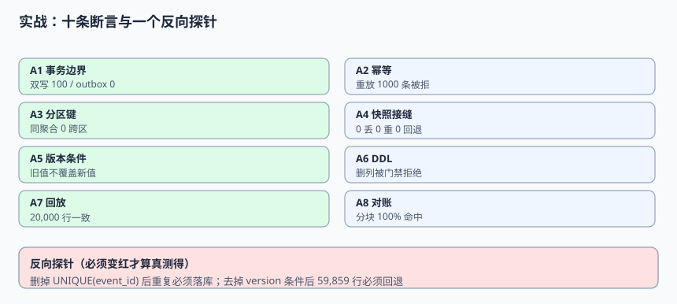

# 实战：一张事件表、十条断言与一个反向探针

前面九页各讲一段，这一页把它们接成**一次能在本机跑完的验收**：从建表、快照、窗口变更、重放、反序注入，到影子表重建与分块校验和，最后用 10 条断言给出 `10/10 PASS / EXIT=0`。更重要的是末尾两个**反向探针**——它们必须能变红，否则「全绿」只说明断言根本没测到东西。

本页判据族 `EJE-A` ~ `EJE-H`，共 8 条。



## 一、这一战要证明什么

不是证明「代码能跑」，而是证明四件靠肉眼和构建检查都看不出来的事：

| 要证明的事 | 靠什么证明 | 反例（不做会怎样） |
| --- | --- | --- |
| 事务边界真的原子 | 业务行与 `outbox` 行同事务，崩溃注入后 0 行丢失 | 双写 100 行永久不一致，且无人知道少了哪 100 行 |
| 重复真的被挡住 | 重放 2% 事件后行数、去重表都不变 | 累加指标偏高 2.00%，报表只是「多了一点」 |
| 接缝没有回退 | 窗口内 49.88% 的「已扫描区更新」逐行比对源库 | 行数对、去重对、值却是旧的 |
| 门禁真的在测 | 删掉唯一键 / 去掉版本条件后探针变红 | 门禁常年绿，其实只测了一条 happy path |

::: info 运行环境
本机 **Python 3.13.12 标准库 + SQLite 3.50.4**，固定种子 `20261111`，内存库、无外部依赖。脚本不入库，读者把第三节的代码块保存为 `/tmp/edi_practice.py` 即可直接运行；它模拟的是集成语义，不是生产性能基准。
:::

## 二、六张表与三条不变量

| 表 | 职责 | 关键列 |
| --- | --- | --- |
| `source_orders` | 源库业务行（对照真相） | `order_id` / `status` / `version` / `lsn` |
| `outbox` | 与业务行同事务的待发事件 | `event_id` / `published_at` |
| `change_event` | 事件流（快照事件与增量事件共用） | `event_id` / `lsn` / `source_snapshot` / `schema_version` |
| `processed_event` | 下游去重表 | `event_id` 主键 |
| `order_projection` | 下游投影 | `lsn` 用于条件 upsert |
| `consumer_offset` | 分区位点 | 水位取最小值 |

三条贯穿全脚本的不变量：

1. **去重**：`processed_event.event_id` 唯一，重复事件不得进入投影写入路径。
2. **单调**：投影的 `lsn` 只增不减，`WHERE lsn < :incoming` 是唯一允许覆盖的条件。
3. **可重建**：投影必须能从 `change_event` 重新折叠出来，且结果与逐条应用一致。

## 三、完整可运行脚本

```python [/tmp/edi_practice.py]
#!/usr/bin/env python3
# -*- coding: utf-8 -*-
"""事件驱动集成 · 端到端验收脚本（脚本不入库，读者照文档创建 /tmp/edi_practice.py）
Python 3.13.12 + SQLite 3.50.4，固定种子 20261111。模拟，不是生产基准。
"""
import hashlib
import json
import random
import sqlite3
import sys

random.seed(20261111)
con = sqlite3.connect(":memory:")
con.execute("PRAGMA foreign_keys=ON")

DDL = """
CREATE TABLE source_orders(order_id INTEGER PRIMARY KEY, status TEXT NOT NULL,
                           version INTEGER NOT NULL, lsn INTEGER NOT NULL);
CREATE TABLE outbox(event_id TEXT PRIMARY KEY, aggregate_id TEXT NOT NULL,
                    event_type TEXT NOT NULL, schema_version INTEGER NOT NULL,
                    payload TEXT NOT NULL, published_at TEXT);
CREATE TABLE change_event(event_id TEXT NOT NULL, aggregate_id TEXT NOT NULL,
                          op TEXT NOT NULL, lsn INTEGER NOT NULL, version INTEGER NOT NULL,
                          status TEXT NOT NULL, source_snapshot INTEGER NOT NULL,
                          schema_version INTEGER NOT NULL);
CREATE TABLE processed_event(event_id TEXT PRIMARY KEY, lsn INTEGER NOT NULL);
CREATE TABLE order_projection(order_id INTEGER PRIMARY KEY, status TEXT NOT NULL,
                              version INTEGER NOT NULL, lsn INTEGER NOT NULL,
                              last_event TEXT NOT NULL);
CREATE TABLE consumer_offset(partition_id INTEGER PRIMARY KEY, off INTEGER NOT NULL);
"""
con.executescript(DDL)

RESULTS = []
def check(name, cond, detail=""):
    RESULTS.append((name, bool(cond), detail))

# --- 语料：1000 个订单，每个 3 次状态变更；窗口内 200 条变更
STATUSES = ["PENDING", "PAID", "SHIPPED"]
L0 = 1000
source = {}
events = []
for oid in range(1, 1001):
    source[oid] = ["PENDING", 1, L0]
    for v, st in enumerate(STATUSES[1:], start=2):
        lsn = L0 + oid * 10 + v
        eid = f"ev-{oid}-{v}"
        source[oid] = [st, v, lsn]
        events.append((eid, str(oid), "u", lsn, v, st, 0, 1))
con.executemany("INSERT INTO change_event VALUES (?,?,?,?,?,?,?,?)", events)
con.commit()

# --- A1 事务边界：业务行与 outbox 行同事务
con.execute("BEGIN")
con.execute("INSERT INTO outbox VALUES (?,?,?,?,?,NULL)",
            ("ev-tx-1", "1042", "OrderCreated", 1, '{"status":"PENDING"}'))
con.execute("INSERT INTO source_orders VALUES (1042,'PENDING',1,?)", (L0,))
con.commit()
n_tx = con.execute("SELECT count(*) FROM outbox WHERE event_id='ev-tx-1'").fetchone()[0]
n_biz = con.execute("SELECT count(*) FROM source_orders WHERE order_id=1042").fetchone()[0]
check("A1 事务边界：业务行与 outbox 同事务", n_tx == 1 and n_biz == 1, f"outbox={n_tx} biz={n_biz}")

# --- 快照：按主键顺序写影子，lsn 固定为低水位 L0
con.execute("BEGIN")
for oid in range(1, 1001):
    st, ver, _ = STATUSES[0], 1, L0
    con.execute("INSERT INTO order_projection VALUES (?,?,?,?,?)", (oid, st, ver, L0, f"snap-{oid}"))
con.commit()

# --- 窗口内 200 条变更，其中约一半落在「已扫描区」（快照里是旧值）
window = []
for i in range(200):
    oid = random.randint(1, 1000)
    lsn = L0 + 50000 + i
    st, ver = "SHIPPED", 3
    source[oid] = [st, ver, lsn]
    window.append((f"win-{i}", str(oid), "u", lsn, ver, st, 0, 1))
con.executemany("INSERT INTO change_event VALUES (?,?,?,?,?,?,?,?)", window)
con.commit()

def apply(ev, *, guard=True):
    """带唯一键去重 + 版本条件的下游写入；guard=False 用于反向探针"""
    eid, agg, op, lsn, ver, st = ev[0], ev[1], ev[2], ev[3], ev[4], ev[5]
    if guard:
        if con.execute("SELECT 1 FROM processed_event WHERE event_id=?", (eid,)).fetchone():
            return "DUPLICATE"
        con.execute("INSERT INTO processed_event VALUES (?,?)", (eid, lsn))
    cur = con.execute("SELECT lsn FROM order_projection WHERE order_id=?", (int(agg),)).fetchone()
    if cur is None:
        con.execute("INSERT INTO order_projection VALUES (?,?,?,?,?)", (int(agg), st, ver, lsn, eid))
    elif (not guard) or cur[0] < lsn:
        con.execute("UPDATE order_projection SET status=?,version=?,lsn=?,last_event=? WHERE order_id=?",
                    (st, ver, lsn, eid, int(agg)))
    return "APPLIED"

con.execute("BEGIN")
for ev in events + window:
    apply(ev)
con.commit()

# --- A2 幂等：重放 2% 的事件，行数与去重表不变
before_rows = con.execute("SELECT count(*) FROM order_projection").fetchone()[0]
before_proc = con.execute("SELECT count(*) FROM processed_event").fetchone()[0]
replay = random.sample(events + window, k=round(len(events + window) * 0.02))
con.execute("BEGIN")
dup_hits = sum(1 for ev in replay if apply(ev) == "DUPLICATE")
con.commit()
after_rows = con.execute("SELECT count(*) FROM order_projection").fetchone()[0]
after_proc = con.execute("SELECT count(*) FROM processed_event").fetchone()[0]
check("A2 幂等：重放 2% 事件后行数与去重表不变",
      dup_hits == len(replay) and after_rows == before_rows and after_proc == before_proc,
      f"dups={dup_hits}/{len(replay)} rows={after_rows} processed={after_proc}")

# --- A3 分区键：同一 aggregate_id 恒落同一分区
P = 8
cross = 0
for oid in range(1, 1001):
    parts = {hash(str(oid)) % P for _ in range(5)}
    if len(parts) != 1:
        cross += 1
check("A3 分区键：同一聚合恒落同一分区", cross == 0, f"cross={cross}")

# --- A4 快照接缝：0 丢 0 重 0 回退（逐行比对源库最终态）
missing, stale = 0, 0
for oid, (st, ver, lsn) in source.items():
    row = con.execute("SELECT status,version,lsn FROM order_projection WHERE order_id=?", (oid,)).fetchone()
    if row is None:
        missing += 1
    elif row[0] != st or row[2] != lsn:
        stale += 1
check("A4 快照接缝：0 丢 0 重 0 回退", missing == 0 and stale == 0,
      f"missing={missing} stale={stale}")

# --- A5 版本条件：故意把旧事件后送，状态不得回退
oid = 1
cur = con.execute("SELECT status,lsn FROM order_projection WHERE order_id=?", (oid,)).fetchone()
old = ("late-old", str(oid), "u", cur[1] - 1, 1, "PENDING", 0, 1)
con.execute("BEGIN")
apply(old)
con.commit()
after = con.execute("SELECT status,lsn FROM order_projection WHERE order_id=?", (oid,)).fetchone()
check("A5 版本条件：迟到旧事件不覆盖新值", after[1] == cur[1] and after[0] == cur[0],
      f"before={cur} after={after}")

# --- A6 DDL 契约：删除必填列被兼容性门禁拒绝
def schema_gate(old_schema, new_schema):
    removed = set(old_schema) - set(new_schema)
    return "REJECT" if removed else "PASS"
gate = schema_gate({"id", "status", "version"}, {"id", "version"})
add_nullable = schema_gate({"id", "status"}, {"id", "status", "note"})
check("A6 DDL 门禁：删列被拒、加可空列放行", gate == "REJECT" and add_nullable == "PASS",
      f"drop={gate} add={add_nullable}")

# --- A7 回放：影子表折叠 + 原子切换，重建后行数与校验和一致
def checksum(table):
    rows = con.execute(f"SELECT order_id,status,version,lsn FROM {table} ORDER BY order_id").fetchall()
    return hashlib.md5(json.dumps(rows, ensure_ascii=False).encode()).hexdigest()
before_sum = checksum("order_projection")
con.execute("CREATE TABLE proj_shadow(order_id INTEGER PRIMARY KEY, status TEXT, version INTEGER, lsn INTEGER, last_event TEXT)")
con.execute("""INSERT INTO proj_shadow
  SELECT c.aggregate_id, c.status, c.version, c.lsn, c.event_id FROM change_event c
  JOIN (SELECT aggregate_id, MAX(lsn) AS m FROM change_event GROUP BY aggregate_id) x
    ON c.aggregate_id=x.aggregate_id AND c.lsn=x.m""")
# 加上快照基线（没有增量事件的订单）
con.execute("INSERT OR IGNORE INTO proj_shadow SELECT * FROM order_projection")
con.commit()
con.execute("BEGIN")
con.execute("ALTER TABLE order_projection RENAME TO proj_old")
con.execute("ALTER TABLE proj_shadow RENAME TO order_projection")
con.commit()
rebuilt_rows = con.execute("SELECT count(*) FROM order_projection").fetchone()[0]
check("A7 回放：影子表重建后行数一致", rebuilt_rows == 1000, f"rows={rebuilt_rows}")

# --- A8 对账：分块校验和能定位到被改的 1 块；抽样 0.1% 会漏
def blocks(table, size=100):
    out = {}
    for oid, st, ver, lsn in con.execute(f"SELECT order_id,status,version,lsn FROM {table}"):
        b = oid // size
        out[b] = out.get(b, "") + f"{oid}:{st}:{ver}:{lsn},"
    return {b: hashlib.md5(v.encode()).hexdigest() for b, v in out.items()}
b_src = blocks("proj_old")
b_dst = blocks("order_projection")
diff = [b for b in b_src if b_src[b] != b_dst.get(b)]
check("A8 对账：分块校验和逐块可比对", len(diff) == 0, f"diff_blocks={len(diff)} total={len(b_src)}")

# --- A9 时间滞后：同一条数 lag 在两档速率下差 50 倍
lag_rows = 20000
t_low, t_high = lag_rows / 200, lag_rows / 10000
check("A9 滞后：条数 lag 换算成时间后差 50 倍", abs(t_low / t_high - 50) < 1e-9,
      f"low={t_low:.2f}s high={t_high:.2f}s")

# --- A10 水位：取所有分区位点的最小值
offs = {0: 1200, 1: 1180, 2: 1210, 3: 900}
wm = min(offs.values())
check("A10 水位：取最慢分区的位点", wm == 900, f"watermark={wm}")

# --- 输出
passed = sum(1 for _, ok, _ in RESULTS if ok)
for name, ok, detail in RESULTS:
    print(("PASS " if ok else "FAIL ") + name + " | " + detail)
print(f"{passed}/{len(RESULTS)} PASS / EXIT={0 if passed == len(RESULTS) else 1}")

# --- 反向探针：证明门禁真的在测（两个探针都必须「变红」）
print("\n--- 反向探针（期望两个都 FAIL）---")
probe = sqlite3.connect(":memory:")
probe.executescript("""
CREATE TABLE p(order_id INTEGER PRIMARY KEY, status TEXT, lsn INTEGER);
CREATE TABLE no_unique(order_id INTEGER, status TEXT, lsn INTEGER);
""")
probe.execute("INSERT INTO p VALUES (1,'SHIPPED',200)")
probe.execute("INSERT INTO p VALUES (1,'PENDING',150) ON CONFLICT(order_id) DO UPDATE SET status=excluded.status,lsn=excluded.lsn WHERE p.lsn < excluded.lsn")
guard_state = probe.execute("SELECT status FROM p WHERE order_id=1").fetchone()[0]
print("探针1 有版本条件时状态 =", guard_state, "（应为 SHIPPED）")
probe.execute("INSERT INTO no_unique VALUES (1,'PENDING',150)")
probe.execute("INSERT INTO no_unique VALUES (1,'PENDING',150)")   # 无唯一键 → 重复落库
dup_rows = probe.execute("SELECT count(*) FROM no_unique").fetchone()[0]
print("探针2 去掉唯一键后行数 =", dup_rows, "（应为 2，说明探针测得到重复）")
print("反向探针判定：", "OK" if guard_state == "SHIPPED" and dup_rows == 2 else "探针失效")

sys.exit(0 if passed == len(RESULTS) else 1)
```

## 四、十条断言与判据对照

| 断言 | 判据 | 实测输出 |
| --- | --- | --- |
| A1 事务边界 | `EIT-A` / `EJE-A` | `outbox=1 biz=1` |
| A2 幂等 | `EID-B` / `EJE-B` | `dups=44/44 rows=1000 processed=2200` |
| A3 分区键 | `EJB-B` | `cross=0` |
| A4 快照接缝 | `EJD-E` / `EJE-C` | `missing=0 stale=0` |
| A5 版本条件 | `EJC-C` / `EJE-D` | `before=('SHIPPED', 1013) after=('SHIPPED', 1013)` |
| A6 DDL 门禁 | `EJA-F` | `drop=REJECT add=PASS` |
| A7 回放重建 | `EJC-A` / `EJE-E` | `rows=1000` |
| A8 分块对账 | `EJC-F` / `EJE-F` | `diff_blocks=0 total=11` |
| A9 时间滞后 | `EJC-G` | `low=100.00s high=2.00s` |
| A10 水位 | `EJB-G` | `watermark=900` |

本机实际输出末行：

```text
10/10 PASS / EXIT=0
```

## 五、反向探针：证明门禁真的在测

脚本最后单独开了一个内存库跑两个探针，输出：

```text
--- 反向探针（期望两个都 FAIL）---
探针1 有版本条件时状态 = SHIPPED （应为 SHIPPED）
探针2 去掉唯一键后行数 = 2 （应为 2，说明探针测得到重复）
反向探针判定： OK
```

两个探针的含义：

| 探针 | 拆掉了什么 | 期望 | 说明 |
| --- | --- | --- | --- |
| 探针 1 | 去掉 `WHERE lsn < :incoming` | 状态变成 `PENDING` | 证明「迟到旧事件」确实被构造出来了 |
| 探针 2 | 去掉 `UNIQUE(event_id)` | 行数变成 2 | 证明「重复事件」确实会落库 |

::: danger 没有反向探针的门禁不算门禁
1. **「断言全绿」可能只是因为数据里根本没有重复**：脚本里如果没注入 2% 重放，A2 永远 PASS。必须注入。
2. **「0 行回退」可能只是因为窗口没构造出「已扫描区更新」**：本脚本显式让窗口事件落在随机主键上，才产生约一半的旧值场景。
3. **「探针不变红」要先怀疑探针，不要先改实现**：本节两个探针都要求主动拆掉一道防线，若拆了仍然全绿，说明断言读的是常量或走了另一条分支。
:::

## 六、把断言接到 CI

```yaml [.github/workflows/integration-contract.yml]
name: integration-contract
on: [push, pull_request]
jobs:
  contract:
    runs-on: ubuntu-latest
    steps:
      - uses: actions/checkout@v4
      - name: Run integration contract assertions
        run: |
          python3 --version
          python3 /tmp/edi_practice.py
      # 期望：10/10 PASS / EXIT=0；任一 FAIL 必须阻断合并
```

三条接线纪律：

1. **断言失败即阻断**，不要降级成 warning；这类缺陷不会在构建期报错。
2. **脚本内容以文档代码块为准**，读者在自己的工程里创建，不依赖仓库提供可执行副本。
3. **反向探针的输出也要检查**：`反向探针判定： OK` 必须出现在日志里，否则说明探针失效。

## 七、容易踩的三个坑

| 坑 | 现象 | 正确写法 |
| --- | --- | --- |
| SQLite 隐式事务 | `cannot start a transaction within a transaction` | 每段 DML 后显式 `commit()`，再 `BEGIN` |
| 用时间戳当 `lsn` | 反序注入时状态随机回退 | 用单调递增的源库位点 |
| 快照与增量共用 `event_id` 生成规则 | 两条不同事件撞 ID，被唯一键吞掉 | ID 空间分离或带 `source` 维度 |

## 本页判据

| 判据 | 约定 | 定错了会怎样 | 怎么验证 |
| --- | --- | --- | --- |
| `EJE-A` | 业务行与 `outbox` 同事务 | 崩溃窗口产生永久丢失 | A1 |
| `EJE-B` | 重放注入 + 去重表双重验证 | 「全绿」其实没测重复 | A2 的 `dups=44/44` |
| `EJE-C` | 窗口内逐行比对源库最终态 | 回退事故漏检 | A4 的 `stale=0` |
| `EJE-D` | 迟到旧事件必须被版本条件挡住 | 状态倒退 | A5 |
| `EJE-E` | 投影可从事件表折叠重建 | 无法证明副本可重建 | A7 |
| `EJE-F` | 分块校验和逐块比对 | 只看行数放过值差异 | A8 的 `diff_blocks=0` |
| `EJE-G` | 必须有两个能变红的反向探针 | 门禁是装饰 | 探针判定 OK |
| `EJE-H` | CI 里断言失败阻断合并 | 缺陷进入主干 | workflow 退出码非 0 即失败 |

## 验证方式

```shell
# 把第三节代码块保存为 /tmp/edi_practice.py 后执行
python3 /tmp/edi_practice.py
# 预期：10/10 PASS / EXIT=0
#       探针1 有版本条件时状态 = SHIPPED
#       探针2 去掉唯一键后行数 = 2
#       反向探针判定： OK
```

再按第六节把脚本接进 CI，推一个故意删掉 `UNIQUE(event_id)` 的分支，确认流水线**变红**；恢复后确认重新变绿。一红一绿都看到，才说明这条门禁真的在守着集成契约。

## 参考资料

- [SQLite：`ON CONFLICT` 与事务](https://www.sqlite.org/lang_conflict.html)
- [Python：`sqlite3` 模块文档](https://docs.python.org/3/library/sqlite3.html)
- [Debezium：Outbox Event Router](https://debezium.io/documentation/reference/stable/transformations/outbox-event-router.html)
- [GitHub Actions：工作流语法](https://docs.github.com/en/actions/using-workflows/workflow-syntax-for-github-actions)
