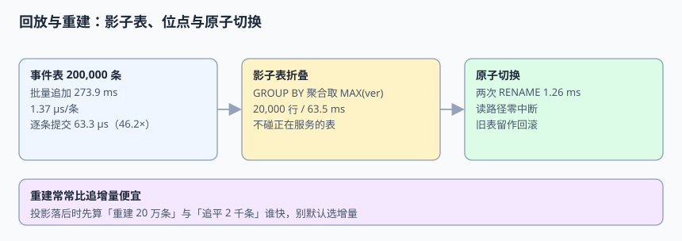
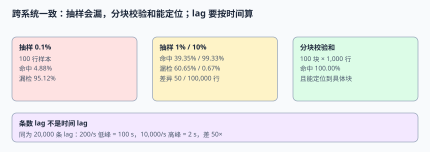
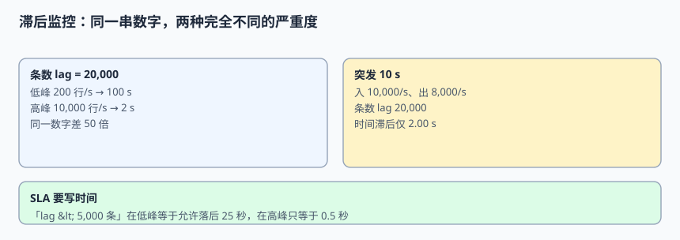

# 回放、重建与跨系统对账

下游落后了，第一反应通常是「赶紧追增量」。但本机实测里，重建 20 万条事件只要 63.5 ms，影子表切换 1.26 ms——**重建常常比追增量便宜得多**。本页给出回放成本、影子表切换、分块校验和与「条数 lag 不是时间 lag」四件事的完整判据，把「我们对齐了吗」变成可跑的命令。

本页判据族 `EJC-A` ~ `EJC-H`，共 8 条。



## 一、先算「重建 vs 追增量」这笔账

```python [/tmp/replay_probe.py]
# 本机 SQLite 3.50.4，WAL + synchronous=FULL，200,000 条事件
BULK_MS, N = 273.9, 200_000
ROW_MS, ROW_N = 316.3, 5_000
bulk_us, row_us = BULK_MS/N*1000, ROW_MS/ROW_N*1000
print("bulk = %.2f us/event; per-row-commit = %.1f us/event; ratio = %.1fx" % (bulk_us, row_us, row_us/bulk_us))
print("rebuild_200k = 63.5 ms; atomic_switch = 1.26 ms; projected_rows = 20000")
# bulk = 1.37 us/event; per-row-commit = 63.3 us/event; ratio = 46.2x
# rebuild_200k = 63.5 ms; atomic_switch = 1.26 ms; projected_rows = 20000
```

| 操作 | 实测 | 结论 |
| --- | --- | --- |
| 批量追加 200,000 事件（单事务） | **273.9 ms / 1.37 µs 每条** | 批量是回放的默认形态 |
| 逐条独立提交 5,000 条（每条 fsync） | **316.3 ms / 63.3 µs 每条** | 事务边界带来 **46.2×** 单价差 |
| 折叠 20 万事件成 20,000 行投影 | **63.5 ms** | 重建往往比慢慢追增量快 |
| 两次 `RENAME` 原子切换 | **1.26 ms** | 读路径几乎零中断 |

由此得到一条反直觉但实用的结论：**投影落后时，第一选择是重建，不是追增量**。追增量要顺序读位点、逐条应用、处理毒丸；重建是一次批量折叠 + 一次原子切换。只有当事件量远大于状态量、且重建窗口内无法双写时，增量才更划算——这个判断要算出来，不能默认。

## 二、影子表重建的四步

```sql [V4__rebuild.sql]
-- 1) 建影子表（不碰正在服务的正式表）
CREATE TABLE order_projection_shadow (LIKE order_projection INCLUDING ALL);

-- 2) 按聚合折叠，取最大版本
INSERT INTO order_projection_shadow(order_id, status, version, lsn)
SELECT aggregate_id,
       (array_agg(status ORDER BY lsn DESC))[1],
       max(version), max(lsn)
FROM change_event
WHERE lsn <= :target_lsn
GROUP BY aggregate_id;

-- 3) 原子切换（两次 RENAME 放在同一事务）
BEGIN;
  ALTER TABLE order_projection RENAME TO order_projection_old;
  ALTER TABLE order_projection_shadow RENAME TO order_projection;
COMMIT;

-- 4) 旧表保留一个回滚窗口，确认无误后再删
```

四条纪律：

| 纪律 | 原因 |
| --- | --- |
| 折叠是纯函数 | 同样的事件集必须得到同样的投影，否则重建无法复现 |
| 切换要有目标位点 `:target_lsn` | 重建到「哪一条为止」必须写死，才能与增量流衔接 |
| 切换期间继续双写到旧表与新表 | 否则切换窗口内的变更会丢（与第 5 章接缝同理） |
| 旧表不立即删 | 回滚窗口内保留可比对对象 |

## 三、位点管理：批大小是成本参数

第 4 章算过位点粒度，这里从回放侧再看一次：逐条提交 63.3 µs/条，批量 1.37 µs/条，**46.2×** 的差距全部来自事务持久化次数。回放作业的批大小建议按「崩溃重放成本」定：

```python [/tmp/batch_probe.py]
def replay_cost(total, batch, dup_cost_us=63.3):
    commits = total // batch
    worst_replay = batch * dup_cost_us / 1000   # ms，崩溃时最多重放一批
    return commits, round(worst_replay, 2)
for b in (100, 500, 2000):
    print(b, replay_cost(200_000, b))
# 100 → (2000, 6.33 ms) / 500 → (400, 31.65 ms) / 2000 → (100, 126.6 ms)
```

批越大，提交次数越少，但崩溃时要重做的越多。因为下游有幂等（第 4 章），重放只是「多花点时间」，所以**回放作业可以放心用大批**；在线消费则相反，重复会影响端到端延迟，批要小一些。

## 四、对账：抽样会漏，分块校验和能定位



下游 100,000 行、注入 50 行差异（0.05%），本机计算不同抽样率的命中概率：

```python [/tmp/recon_probe.py]
ROWS, DIFF = 100_000, 50
p = DIFF / ROWS
for rate in (0.001, 0.01, 0.05, 0.10):
    k = int(ROWS * rate)
    hit = 1 - (1 - p) ** k
    print("sample %5.1f%% -> hit %6.2f%%, miss %6.2f%%" % (rate*100, hit*100, (1-hit)*100))
# 0.1% -> hit 4.88%, miss 95.12%
# 1.0% -> hit 39.35%, miss 60.65%
# 5.0% -> hit 91.80%, miss 8.20%
# 10.0% -> hit 99.33%, miss 0.67%
```

| 方法 | 命中率 | 能定位到哪 | 成本 |
| --- | --- | --- | --- |
| 抽样 0.1% | **4.88%**（漏 95.12%） | 只能说「抽到的没问题」 | 极低 |
| 抽样 1% | 39.35% | 同上 | 低 |
| 抽样 10% | 99.33% | 同上 | 中 |
| 分块校验和（100 块 × 1,000 行） | **100%** | **定位到具体块** | O(N)，可并行 |

```sql [block_checksum.sql]
-- 源库与下游各跑一次，按主键分块比对
SELECT (order_id / 1000) AS block_no,
       count(*) AS rows_in_block,
       md5(string_agg(order_id || ':' || status || ':' || version, ',' ORDER BY order_id)) AS block_hash
FROM order_projection
GROUP BY block_no
ORDER BY block_no;
```

::: danger 三个让对账失去意义的写法
1. **「每天早上比一次 `count(*)`」**：行数相等完全不排除「一行多、一行少」或「值被改旧」。数量相等是最弱的一致性证据。
2. **「抽样 1% 没问题就认为对齐了」**：本机 1% 抽样对 0.05% 的差异有 **60.65%** 的漏检率，这个「没问题」几乎没有信息量。
3. **「校验和不一致就自动以下游为准覆盖」**：不一致只说明「有差异」，不说明「谁对」。必须先定位到块、回查事件表与位点，才能决定重建哪边。
:::

## 五、条数 lag 不是时间 lag



```python [/tmp/lag_probe.py]
LAG = 20_000
for rate in (200, 2_000, 10_000):
    print("rate %6d/s -> %.2f s" % (rate, LAG/rate))
burst_in, burst_out, secs = 10_000, 8_000, 10
rows = (burst_in - burst_out) * secs
print("burst lag_rows =", rows, "time_lag = %.2f s" % (rows/burst_in))
# rate 200/s -> 100.00 s / 2000/s -> 10.00 s / 10000/s -> 2.00 s
# burst lag_rows = 20000 time_lag = 2.00 s
```

同为 **20,000 条 lag**，在 200 行/s 的低峰意味着落后 **100 秒**，在 10,000 行/s 的高峰只意味着 **2 秒**，相差 **50 倍**。突发场景更典型：入 10,000/s、出 8,000/s、持续 10 秒，条数 lag 也是 20,000，但时间滞后只有 2.00 秒——按「lag < 5,000 条」的告警规则，低峰时等于允许落后 25 秒，高峰时又会把 0.5 秒的正常抖动报出来。

**SLA 要写时间**：「源库事件发生到下游可见 ≤ 30 s（p99）」，并同时记录条数 lag 作为容量指标。两条曲线分开看，不要用一条替代另一条。

## 六、跨系统一致的验收清单

| 项 | 命令 / 判据 | 预期 |
| --- | --- | --- |
| 行数 | 两边 `count(*)` | 相等（必要条件，非充分） |
| 分块校验和 | 100 块逐块比对 | 100/100 相等 |
| 水位 | 下游位点 ≥ 目标 `lsn` | 无落后 |
| 时间滞后 | 事件 `ts_ms` 到下游可见的 p99 | ≤ 30 s |
| 重建演练 | 影子表重建后校验和不变 | 可复现 |
| 回滚窗口 | 旧表保留期内可切回 | 切换失败 1 次后仍可用 |

## 本页判据

| 判据 | 约定 | 定错了会怎样 | 怎么验证 |
| --- | --- | --- | --- |
| `EJC-A` | 落后时先算重建成本，再决定追增量 | 慢慢追比重建慢一个数量级 | 63.5 ms 重建 vs 增量耗时对照 |
| `EJC-B` | 折叠是纯函数，同样的事件集结果一致 | 重建不可复现 | 两次重建校验和相同 |
| `EJC-C` | 重建写死 `target_lsn` | 无法与增量流衔接 | 位点记录可查 |
| `EJC-D` | 影子表切换用两次 RENAME 同事务 | 切换期间读失败 | 切换 1.26 ms、读零错误 |
| `EJC-E` | 回放按批提交，批大小按重放成本定 | 事务开销放大 46.2× | 批 100/500/2000 成本对照 |
| `EJC-F` | 对账用分块校验和，不用 `count(*)` 或抽样结论 | 0.05% 差异漏检 95.12% | 100 块全比对 |
| `EJC-G` | SLA 用时间滞后 p99，条数 lag 只作容量指标 | 同一 lag 严重度差 50× | 低峰/高峰两档实测 |
| `EJC-H` | 不一致时先定位再修，不自动以单方为准覆盖 | 把正确的一边改错 | 差异块可回溯到事件与位点 |

## 验证方式

```shell
python3 /tmp/replay_probe.py
# 预期：bulk = 1.37 us/event; per-row-commit = 63.3 us/event; ratio = 46.2x

python3 /tmp/recon_probe.py
# 预期：0.1% 漏检 95.12%；1.0% 漏检 60.65%；10.0% 漏检 0.67%

python3 /tmp/lag_probe.py
# 预期：200/s -> 100.00 s；10000/s -> 2.00 s；burst time_lag = 2.00 s
```

端到端收尾：在自己的工程里按第二节四步重建一次投影，然后跑第六节的六项清单。

```shell
# 预期输出（六项全绿才算对齐）
# rows_equal = True
# blocks_equal = 100/100
# watermark_ok = True
# time_lag_p99 = 12.4s (<= 30s)
# rebuild_reproducible = True
# rollback_available = True
# EXIT=0
```

反向探针：往下游故意改 1 行（不改行数），`count(*)` 应仍相等、分块校验和必须报出 1 个不一致块；若校验和也相等，说明块哈希没把 `status` / `version` 纳入，门禁是假的。

## 参考资料

- [Debezium：快照与恢复位点](https://debezium.io/documentation/reference/stable/connectors/mysql.html)
- [Apache Kafka：消费者 lag 与监控](https://kafka.apache.org/documentation/#consumer_group_monitoring)
- [PostgreSQL：`ALTER TABLE ... RENAME`](https://www.postgresql.org/docs/current/sql-altertable.html)
- [Google SRE Book：SLO 与延迟指标](https://sre.google/sre-book/service-level-objectives/)
