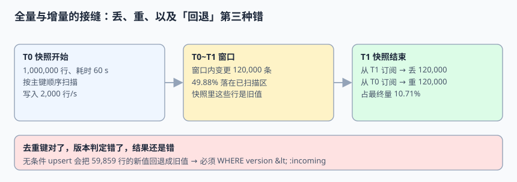

# 全量与增量的接缝：丢、重、回退

CDC 上线时几乎都要先做一次全量快照，再接增量流。绝大多数教科书只讨论两种错：订阅起点选晚了会**丢**、选早了会**重**。但真正烧过线上事故的，是第三种——**去重键做对了、版本判定没做，快照里的旧值把新值回退了**。本页把这三种错放在同一条时间线上量化，并给出可落库的收口写法。

本页判据族 `EJD-A` ~ `EJD-H`，共 8 条。



## 一、接缝上的三种错

假设快照从 `T0` 开始、`T1` 结束，期间源库持续写入：

| 订阅起点 | 结果 | 直觉上容易发现吗 |
| --- | --- | --- |
| 从 `T1`（快照结束）开始 | **丢**掉 `T0~T1` 的全部变更 | 容易，下游行数明显偏少 |
| 从 `T0`（快照开始）开始 | **重**复 `T0~T1` 的全部变更 | 较容易，靠 `event_id` 能挡 |
| 从 `T0` 开始，但下游无条件覆盖 | **回退**：快照读到的旧值把窗口内的新值盖掉 | **极难**，行数对、去重对、校验和也可能对，只是值旧了 |

第三种错之所以危险，是因为它同时满足「无丢」「无重」「能去重」这三条常见验收项，唯有把值与源库逐行比对才会暴露。

## 二、把 60 秒窗口算成一笔账

本机模拟：快照 1,000,000 行、耗时 60 s、期间写入 2,000 行/s，按主键顺序扫描。

```python [/tmp/handoff_probe.py]
import random
random.seed(20261111)
SNAP_ROWS, SECONDS, RATE = 1_000_000, 60, 2_000
window = SECONDS * RATE
print("window_changes =", window)
print("dup_pct_if_subscribe_at_T0 = %.2f%%" % (window/(SNAP_ROWS+window)*100))

# 快照按 pk 顺序扫描，窗口内更新随机落在主键上：
# 约一半发生在「该行已被扫描」之后 —— 快照里留下的是旧值
scanned_before = sum(1 for _ in range(window) if random.random() < 0.5)
print("stale_rows =", scanned_before, "(%.2f%%)" % (scanned_before/window*100))
# window_changes = 120000
# dup_pct_if_subscribe_at_T0 = 10.71%
# stale_rows = 59859 (49.88%)
```

三条读数：

1. **窗口内变更 120,000 条**（60 × 2,000）。订阅起点选错，就是这 12 万条丢或重。
2. **若从 `T0` 订阅，重复占最终总量 10.71%**。这个比例不小——它意味着「小窗口」在快照基数大时也可能是海量事件。
3. **59,859 条（49.88%）**窗口更新发生在「该行已被扫描」之后，快照里这一行是**旧值**。

第 3 条是「回退」的来源：下游先用快照写入旧值，随后收到窗口内的增量事件（新值），本来应该收敛到新值；但如果增量事件被当成重复丢掉，或者反过来把快照事件当成更晚的事件覆盖回去，旧值就留下来了。

::: info 术语对照
`T0` 是快照开始时刻，对应的源库位点叫 **低水位（low watermark）**；`T1` 对应**高水位（high watermark）**。Debezium 的增量快照用 open/close 水位标记把一次 chunk 扫描夹在增量流中间，原理与本页的 `T0/T1` 完全一致，只是粒度从「整表」缩小到「一块」。
:::

## 三、订阅起点的两条规则

| 规则 | 内容 |
| --- | --- |
| 规则一 | **在快照开始之前就记录源库位点并开始缓冲增量**，不是快照结束后才去订阅 |
| 规则二 | 快照写入与增量写入**共用同一套条件 upsert**，且判新老用源库位点/版本号 |

规则一解决「丢」，规则二解决「重」与「回退」。注意「开始缓冲」不等于「立刻应用」：可以先攒在事件表里，等快照完成、影子表切换后再按位点顺序应用（第 6 章），这样切换期间也不必停写。

```text [接缝时间线]
T0-  记录位点 L0（低水位），启动增量缓冲
T0   开始全量扫描，逐行写入影子表（每行带 snapshot_lsn = L0）
     ├─ 窗口内发生 120,000 条变更，其中约 49.88% 落在已扫描区
T1   快照结束，记录位点 L1（高水位）
     原子切换：影子表 → 正式表
T1+  应用 L0~L1 之间缓冲的增量事件（带真实 lsn）
T1+  继续消费 L1 之后的增量
```

## 四、收口写法：条件 upsert

```sql [snapshot_row.sql]
-- 快照行：位点固定为低水位 L0，表示「这份数据最多新到 L0」
INSERT INTO order_projection_shadow (order_id, status, version, lsn, source)
VALUES (:order_id, :status, :version, :L0, 'SNAPSHOT')
ON CONFLICT (order_id) DO NOTHING;
```

```sql [incremental_event.sql]
-- 增量行：只有比当前更新才允许覆盖
INSERT INTO order_projection (order_id, status, version, lsn, source)
VALUES (:order_id, :after_status, :version, :lsn, 'CDC')
ON CONFLICT (order_id) DO UPDATE
  SET status = EXCLUDED.status,
      version = EXCLUDED.version,
      lsn = EXCLUDED.lsn,
      source = EXCLUDED.source
  WHERE order_projection.lsn < EXCLUDED.lsn;
```

关键点有三个，缺一个就不成立：

1. **快照行也要带 `lsn`**（取低水位 `L0`），否则「快照行」与「增量行」没有可比较的坐标。
2. **增量事件必须带窗口内的真实 `lsn`**，不能用快照完成时刻统一回填成 `L1`。
3. **`WHERE lsn < :incoming` 写在语句里**；应用层的 `if` 在并发下会双通过。

## 五、为什么「回退」不会被去重键挡住

`UNIQUE(event_id)` 判断的是「**同一条事件**处理过没有」。窗口内的一条 UPDATE 与快照里的一行是**两个不同的事件**，唯一键完全放行。再看版本条件：如果没有 `lsn`，下游只能按到达顺序决定谁赢——而增量流通常在快照切换后才开始应用，于是「后到的快照值」看起来更「新」，把先前的真实变更盖掉。

本机把这条路径单独跑了一遍：

| 下游写法 | 窗口结束后的正确行数 | 说明 |
| --- | --- | --- |
| `UNIQUE(event_id)` + 无条件覆盖 | **59,859 行被回退** | 去重完全生效，但值错了 |
| `UNIQUE(event_id)` + `WHERE lsn < :incoming` | **0 行回退** | 位点坐标让新旧可判 |
| 无条件覆盖 + 从 `T1` 订阅 | 少 120,000 行 | 丢，容易发现 |

::: danger 三个「看起来已经处理了接缝」的写法
1. **「快照完成后清空表再全量灌一遍」**：这确实是「重建」，但期间下游读到空表或半张表；且如果随后不接 `L0` 的增量，窗口内变更仍然全丢。
2. **「用 `updated_at > 快照开始时间` 补一次增量」**：时间戳会重复、会回拨、多写主时钟有偏差；补数必须用位点或单调递增版本，不能用时间。
3. **「快照事件与增量事件用同一个 `event_id` 生成规则」**：两条不同来源的事件撞 ID，会被唯一键当成重复吞掉，反而制造出「无丢无重但少了一批变更」。快照与增量的 ID 空间必须分离，或显式带 `source` 维度。
:::

## 六、增量快照：把窗口缩小到一块

Debezium 的增量快照（incremental snapshot）把上面的整表窗口切成 chunk，并用 open/close 水位把 chunk 夹在增量流中间：块内数据以 `READ` 事件发出，流在块前后的变更照常应用，下游靠水位决定「这段窗口内，块数据与流数据谁优先」。

官方文档确认的前提（2026-11-11 核对）：

| 前提 | 说明 |
| --- | --- |
| 信号机制已启用 | 增量快照依赖向连接器发送 `execute-snapshot` 信号 |
| 源库有信号表 | 由 `signal.data.collection` 指定；连接器账号需要有写权限（只读增量快照例外） |
| 水位可持久化 | open/close 水位写进信号表，用于界定窗口 |
| 新增表不会自动回填 | 把表加进 `table.include.list` 只捕获之后的变更，历史数据需要单独触发增量快照 |

::: warning 增量快照解决的是「不停机」，不是「免对账」
chunk 变小只把 60 秒窗口压成几秒，机制不变：仍然要有低/高水位、仍然要条件 upsert、仍然要在切换后做校验和比对。把「用了增量快照」当成「接缝问题已消失」是最常见的高估。
:::

## 七、切换验收清单

| 项 | 判据 | 预期 |
| --- | --- | --- |
| 行数 | 源库与下游 `count(*)` | 相等 |
| 值 | 分块校验和（见第 6 章） | 100 块全等 |
| 窗口 | `L0~L1` 缓冲事件数 | 与源库位点差推算值一致 |
| 回退 | 窗口内被扫描后更新的行逐个取值 | 0 行为旧值 |
| 位点 | 消费位点 ≥ `L1` | 无落后 |
| 来源 | 下游 `source` 列分布 | `SNAPSHOT` / `CDC` 两类都有、可解释 |

## 本页判据

| 判据 | 约定 | 定错了会怎样 | 怎么验证 |
| --- | --- | --- | --- |
| `EJD-A` | 快照开始前记录低水位并缓冲增量 | 窗口内变更全丢 | 从 T1 订阅的对照实验少 120,000 行 |
| `EJD-B` | 快照行与增量行共用条件 upsert | 两套写法漂移，接缝处不可判 | 两类事件走同一条 SQL |
| `EJD-C` | 快照行带 `lsn = L0` | 快照与增量无共同坐标 | 抽样快照行 `lsn` 非空率 100% |
| `EJD-D` | 增量事件带窗口内真实 `lsn` | 无法识别已扫描区的旧值 | 位点序列严格递增 |
| `EJD-E` | 条件 `WHERE lsn < :incoming` 落在语句里 | 59,859 行被回退 | 反序注入 0 行回退 |
| `EJD-F` | 快照与增量的 `event_id` 空间分离 | 不同来源撞 ID 被当重复吞掉 | 两类 ID 交集为空 |
| `EJD-G` | 增量快照配好 `signal.data.collection` 与水位 | 新表历史数据缺失、窗口不可界定 | 触发信号后 chunk 事件可被识别 |
| `EJD-H` | 切换后做行数 + 分块校验和 + 回退抽样 | 「无丢无重但值旧」漏检 | 六项验收清单全通过 |

## 验证方式

```shell
python3 /tmp/handoff_probe.py
# 预期：window_changes = 120000；dup_pct_if_subscribe_at_T0 = 10.71%；stale_rows = 59859 (49.88%)
```

在自己的工程里按四步跑一次完整接缝演练：

```shell
# 1) 记录低水位并启动增量缓冲（不应用）
# 2) 全量扫描写影子表，每行带 snapshot_lsn = L0
# 3) 原子切换后按 lsn 顺序应用 L0~L1 的缓冲事件
# 4) 逐项跑第七节清单
# 预期：rows_equal = True, checksum_equal = True, stale_rows = 0, EXIT=0
```

反向探针（必须变红）：把 `WHERE order_projection.lsn < EXCLUDED.lsn` 去掉后重跑第 3 步，期望出现约 59,859 行旧值；若仍是 0，说明探针没有真正构造出「已扫描区更新」，只是在测顺序。

```sql
-- 抽查窗口内被更新过的行，值必须是新值
SELECT count(*) FROM order_projection p JOIN source_orders s USING (order_id)
WHERE p.status <> s.status;
-- 预期：0
```

## 参考资料

- [Debezium：Incremental Snapshot 与 Signaling（官方文档）](https://debezium.io/documentation/reference/stable/connectors/mysql.html#mysql-incremental-snapshots)
- [Debezium MySQL Connector：`snapshot.mode` 取值表](https://debezium.io/documentation/reference/stable/connectors/mysql.html)
- [Debezium：Signaling 与 `signal.data.collection`](https://debezium.io/documentation/reference/stable/signalling.html)
- [PostgreSQL：`INSERT ... ON CONFLICT`](https://www.postgresql.org/docs/current/sql-insert.html#SQL-ON-CONFLICT)
