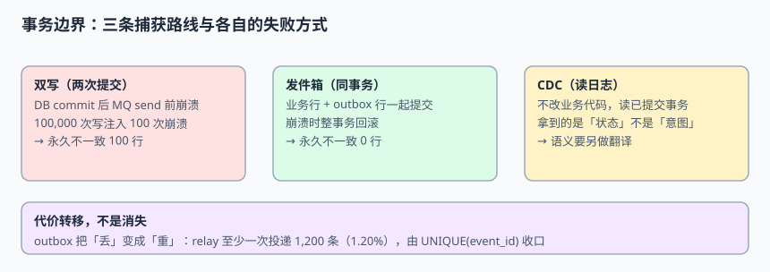

# 事务边界：双写、发件箱与读日志

一条变更要跨系统传播，第一个要回答的问题不是「用哪个 MQ」，而是「**这次写入和这次通知，是不是同一个原子动作**」。答错这一句，后面所有幂等、顺序、对账都只是在给一个已经丢掉的事实打补丁。本页给出三条捕获路线的崩溃窗口、完整 DDL 与可复跑的量化验证。

本页判据族 `EIT-A` ~ `EIT-H`，共 8 条。



## 一、三条路线，三种「不是原子」的位置

| 路线 | 英文 | 写入动作 | 不一致窗口在哪 | 适用场景 |
| --- | --- | --- | --- | --- |
| 双写 | Dual write | 先提交业务库，再发消息 | 两次提交之间的进程崩溃 | 只适合可容忍丢失的旁路（埋点、日志），**不适合对账对象** |
| 发件箱 | Transactional outbox | 业务行与 `outbox` 行在**同一个事务**里提交，relay 事后投递 | 无永久窗口；代价是至少一次重复 | 业务自己知道「发生了什么」，且要发出领域事件 |
| 读日志 | Log-based CDC | 不改业务代码，由连接器读已提交的事务日志 | 取决于位点是否持久化与日志保留 | 存量系统改造、无法改写入方、需要全量+增量 |

一句话区分：**发件箱发出的是「意图」，读日志发出的是「状态」**。前者能表达「订单已提交（含业务语义）」，后者只能表达「`orders` 表第 1042 行从 PENDING 变成 SHIPPED」；下游若需要「为什么变了」，读日志路线必须另做语义翻译。

::: info 术语对照
`outbox` 表常译作「发件箱表 / 本地消息表」，`relay` 是把它搬进消息中间件的进程（也可以用 CDC 直接捕获 `outbox` 表，这种做法叫 **outbox + CDC**）。事务边界（transaction boundary）指的是「哪些写入必须一起成功或一起失败」的那条线。
:::

## 二、崩溃窗口的量化：100 行永久不一致

下面这段模拟把「崩溃」注入到**数据库提交之后、消息发送之前**。它不是压力测试，只是把窗口的存在变成可数的行数：

```python [/tmp/boundary_probe.py]
import random
random.seed(20261111)

WRITES = 100_000
CRASHES = 100                     # 注入 100 次「commit 成功、send 未执行」的崩溃
crash_points = set(random.sample(range(WRITES), CRASHES))

dual_inconsistent = 0             # 双写：库里有了，消息没有
outbox_inconsistent = 0           # 发件箱：commit 未完成则整事务回滚

for i in range(WRITES):
    if i in crash_points:
        dual_inconsistent += 1    # 业务行已提交，MQ 里永远没有这条
        # outbox 路线：崩溃发生在 COMMIT 之前，业务行与 outbox 行一起回滚
    # 两条路线都继续正常写入

print("dual_write_permanently_missing =", dual_inconsistent)
print("outbox_permanently_missing     =", outbox_inconsistent)
# dual_write_permanently_missing = 100
# outbox_permanently_missing     = 0
```

关键在于**这个窗口无法用重试消除**：进程已经死了，没人记得该发哪条消息；即便事后扫库补发，也得先有一张记录「哪些行还没发」的表——那张表其实就是 `outbox`，只是晚建了。

::: danger 三个常见错误写法
1. **「把发送放进 `try`，失败就重试三次」**：重试解决的是 MQ 暂时不可用，解决不了「进程在两次提交之间被 kill」；三次重试都发生在同一个已经死掉的进程里。正确做法是让待发消息与业务行同事务落库。
2. **「先发消息再提交库，消费者查不到就等一下」**：把不一致方向反过来而已，消费者可能永远等不到那次提交（事务回滚、唯一键冲突、超时）。
3. **「用本地内存队列攒着，批量刷」**：进程重启即丢，且没有任何可核对的位点。持久化队列必须在**数据库里**，不在进程内存里。
:::

## 三、发件箱表的完整 DDL

PostgreSQL 语法；MySQL 读者把 `BIGSERIAL` 换成 `BIGINT AUTO_INCREMENT`、`TIMESTAMPTZ` 换成 `TIMESTAMP` 并统一写 UTC。

```sql [V1__outbox.sql]
CREATE TABLE outbox (
  event_id       UUID            PRIMARY KEY,
  aggregate_type TEXT            NOT NULL,
  aggregate_id   TEXT            NOT NULL,
  event_type     TEXT            NOT NULL,
  schema_version INT             NOT NULL,
  payload        JSONB           NOT NULL,
  occurred_at    TIMESTAMPTZ     NOT NULL,
  trace_id       TEXT,
  published_at   TIMESTAMPTZ,              -- NULL = 未发布；relay 唯一关心的列
  publish_tries  INT             NOT NULL DEFAULT 0
);

-- relay 的扫描索引：只扫未发布、按时间顺序
CREATE INDEX ix_outbox_unpublished ON outbox (occurred_at) WHERE published_at IS NULL;

-- 业务写入必须和 outbox 是同一个事务，见下一节
CREATE TABLE orders (
  order_id  BIGSERIAL PRIMARY KEY,
  status    TEXT        NOT NULL,
  version   BIGINT      NOT NULL,          -- 乐观锁，也是下游条件 upsert 的依据
  updated_at TIMESTAMPTZ NOT NULL
);
```

`published_at IS NULL` 的部分索引是本表最重要的设计：表会长期增长，但「待发布」的集合始终很小，relay 每轮扫描的成本不随历史数据膨胀。

### 3.1 业务写入的唯一正确形状

```sql [app/order_repository.sql]
BEGIN;
  INSERT INTO orders(order_id, status, version, updated_at)
  VALUES (1042, 'PENDING', 1, now());

  INSERT INTO outbox(event_id, aggregate_type, aggregate_id, event_type,
                     schema_version, payload, occurred_at)
  VALUES ('9f1c2d7e-0000-4000-8000-000000000001', 'order', '1042',
          'OrderCreated', 1, '{"status":"PENDING"}'::jsonb, now());
COMMIT;   -- 两行同时可见，或同时不可见
```

::: warning 为什么不让应用直接发 MQ 再删 outbox
把「发消息」留在 `COMMIT` 之后是对的（事务没提交就发消息会发出「不存在的事实」），但「删 outbox 行」不要做：删掉就失去了核对能力。用 `published_at` 标记 + 定期归档，任何时刻都能回答「有哪些事件还没发出去」。
:::

## 四、relay：把「丢」换成「重」

发件箱消灭了永久丢失，但没有消灭不确定性。relay 的典型循环是「读一批 → 发送 → 更新 `published_at`」，崩溃若发生在**发送之后、标记之前**，这批会被再发一次。

```python [/tmp/relay_probe.py]
BATCH, BATCHES, CRASH_RATE = 500, 100, 0.02
total = BATCH * BATCHES
crash_batches = round(BATCHES * CRASH_RATE)
duplicates = crash_batches * BATCH
print("events =", total, "replayed =", duplicates,
      "dup_rate = %.2f%%" % (duplicates / total * 100))
# events = 50000 replayed = 1000 dup_rate = 2.00%
```

本机模拟（固定种子 `20261111`）：10 万次业务写入、注入 100 次崩溃，**双写永久不一致 100 行、发件箱 0 行**；但 relay 至少一次投递带来 **1,200 条重复事件（1.20%）**。这两组数字要一起看：

| 指标 | 双写 | 发件箱 + relay |
| --- | --- | --- |
| 永久丢失 | 100 行 | **0 行** |
| 重复事件 | 0 条 | 1,200 条（1.20%） |
| 下游无幂等时的后果 | 少 100 行，且不可发现 | 多 1,200 行，累加指标偏高 |
| 下游有 `UNIQUE(event_id)` | 无法补救 | **0 行偏差** |

结论只有一句：**发件箱把「不可恢复的丢」换成了「可判定的重」**。重复是可以用唯一键在下游收口的，丢失则连「少了哪一条」都无从知道。第 4 章会展开去重，这里先记住这个代价转移的方向。

## 五、读日志路线的能力边界

CDC 不改业务代码，听起来最省事，但它拿到的是**已提交事务的物理/逻辑结果**，不是业务意图。下表是选路线前必须逐条确认的：

| 需求 | 读日志能否直接满足 | 说明 |
| --- | --- | --- |
| 「这行变了」 | 能 | `before` / `after` 是连接器直接给出的 |
| 「为什么变」 | 不能 | 日志里没有业务动作、操作人、`trace_id`；需要关联旁路表或改发件箱 |
| 「一次业务操作产生多行、要一起发」 | 需要额外处理 | 同一事务的多行变更在流里是多条事件，跨表分区后顺序不保证（见第 3 章） |
| 「DELETE 之前的完整行」 | 取决于配置 | PostgreSQL 默认 `REPLICA IDENTITY DEFAULT` 时 `before` 只有主键，需 `FULL`（见第 2 章） |
| 「只发部分表、且历史数据也要」 | 需要快照 | 新增表进 `table.include.list` 不会自动回填历史，需要增量快照 |
| 「上游 DBA 改了列名」 | 会传播到下游 | DDL 进 schema history，契约不兼容时消费者直接失败 |

**选择顺序**：能改写入方且要表达业务语义 → 发件箱；不能改写入方、只要状态副本 → 读日志；两者可以叠加（业务事件走发件箱、状态副本走读日志），但**同一个下游不要混用两种来源**，否则「谁是最新的」没有判据。

## 六、路线选择清单

| 判据 | 选双写 | 选发件箱 | 选读日志 |
| --- | --- | --- | --- |
| 允许永久丢失 | 是 | 否 | 否 |
| 能改业务写入代码 | 任意 | **必须能** | 不必 |
| 需要业务语义 | 任意 | **强项** | 弱项 |
| 需要全量历史数据 | 否 | 否 | **强项**（快照） |
| 上游表结构频繁变动 | 影响小 | 影响小 | **风险高** |
| 下游必须可核对 | 否 | 是（靠 `outbox` 表） | 是（靠位点） |

::: tip 一句话收尾
不要问「要不要用 CDC」，先问「**这条变更丢了能不能被发现**」。能被发现，才有资格讨论用哪种捕获方式；不能被发现，任何捕获方式都只是把事故推迟到下一次对账。
:::

## 本页判据

| 判据 | 约定 | 定错了会怎样 | 怎么验证 |
| --- | --- | --- | --- |
| `EIT-A` | 业务行与待发事件必须同事务提交 | 双写崩溃窗口产生永久丢失 | 注入 100 次 commit 后崩溃，检查下游是否少 100 行 |
| `EIT-B` | `outbox` 表必须有「未发布」可判定的列与部分索引 | relay 无法知道哪些没发，扫描随历史膨胀 | `EXPLAIN` 确认命中 `ix_outbox_unpublished` |
| `EIT-C` | 发布完成用标记而非物理删除 | 失去核对与重投依据 | 查 `published_at IS NULL` 能列出待发集合 |
| `EIT-D` | 发送动作必须在 `COMMIT` 之后 | 发出「后来回滚了」的事实 | 事务回滚后 MQ 中不得出现对应事件 |
| `EIT-E` | 每条事件带稳定 `event_id` 与 `schema_version` | 下游无法去重、无法解释历史 | 事件 JSON 两字段非空且全局唯一 |
| `EIT-F` | 读日志路线要显式说明「只发状态、不发意图」 | 下游误把行变更当业务动作 | 契约文档里逐项列出缺失的业务字段 |
| `EIT-G` | 同一下游不混用发件箱与读日志两种来源 | 「谁最新」无判据，出现互相覆盖 | 下游表只记录一个来源标识 |
| `EIT-H` | 崩溃窗口的注入测试要能反向验证 | 门禁常年绿、实际没测到 | 去掉同事务后，断言必须变红 |

## 验证方式

在自己的工程里创建本节两份 DDL，然后依次执行：

```shell
python3 /tmp/boundary_probe.py
# 预期：dual_write_permanently_missing = 100；outbox_permanently_missing = 0

python3 /tmp/relay_probe.py
# 预期：events = 50000 replayed = 1000 dup_rate = 2.00%
```

数据库侧的反向探针（这一步必须**失败**才算门禁真的生效）：把业务写入改成两个独立事务后重跑，期望 `outbox_permanently_missing` 从 0 变成 100。若仍是 0，说明探针没测到事务边界，只是在测代码路径。

```sql
-- 期望：两行在同一事务里同时可见
BEGIN;
INSERT INTO orders(order_id, status, version, updated_at) VALUES (1042,'PENDING',1,now());
INSERT INTO outbox(event_id, aggregate_type, aggregate_id, event_type, schema_version, payload, occurred_at)
VALUES (gen_random_uuid(),'order','1042','OrderCreated',1,'{"status":"PENDING"}'::jsonb,now());
COMMIT;
SELECT (SELECT count(*) FROM orders WHERE order_id=1042) AS orders_rows,
       (SELECT count(*) FROM outbox WHERE aggregate_id='1042' AND published_at IS NULL) AS pending;
-- 预期：orders_rows = 1，pending = 1
```

## 参考资料

- [Debezium：Outbox Event Router（官方 SMT 文档）](https://debezium.io/documentation/reference/stable/transformations/outbox-event-router.html)
- [Debezium MySQL Connector 配置文档](https://debezium.io/documentation/reference/stable/connectors/mysql.html)
- [PostgreSQL：事务与 `BEGIN` / `COMMIT`](https://www.postgresql.org/docs/current/tutorial-transactions.html)
- [microservices.io：Transactional outbox 模式](https://microservices.io/patterns/data/transactional-outbox.html)
