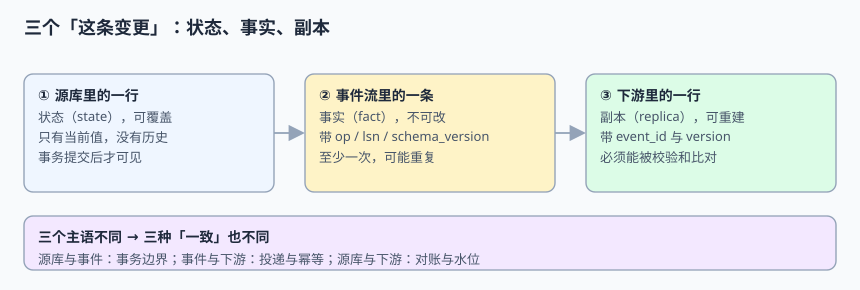
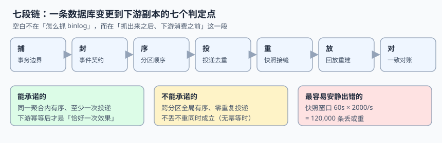

# 事件驱动集成与 CDC 工程

一条数据库里的变更，从「提交成功」到「下游系统敢用它」，中间隔着七道判定：事务边界、事件契约、顺序、投递、快照接缝、回放、对账。这些判定几乎都不报错——接口返回 200、监控一片绿、页面能开，只有某天有人拿源库和下游对账时，才发现少了 12 万行，或者有 5.9 万行的值被悄悄改回了旧值。

本册讲的是**变更捕获之后、下游消费之前的那一段**：怎么把「一行状态」变成「一条可被独立复核的事实」，再变成「一份可以被重建、被校验的副本」。至于怎么读 binlog、怎么装 Debezium、消息中间件本身怎么配，都不在这里。

::: info 本册定位与版本
适用对象：要做跨系统数据同步、事件驱动集成、搜索索引/缓存/数仓入湖的后端与平台工程师；读者已有基本的消息队列与事务知识。

版本事实联网核对（2026-11-11 检索，以官方页面为准）：[Debezium Releases](https://debezium.io/releases/) 显示**最新稳定版 3.7.1.Final（2026-11-06）**、开发中 3.8.0.Alpha1（2026-11-02）、旧稳定线 **2.7.4.Final（2024-12-11）**；[Apache Kafka Downloads](https://kafka.apache.org/downloads) 显示**最新受支持版本 4.4.0（2026-10-22）**。官方 [MySQL Connector 配置文档](https://debezium.io/documentation/reference/stable/connectors/mysql.html) 中 `snapshot.mode` 的当前取值为 `always` / `initial` / `initial_only` / `no_data` / `recovery` / `when_needed` / `configuration_based` / `custom`，`schema_only` 与 `schema_only_recovery` 已标 **Deprecated**（分别指向 `no_data` 与 `recovery`），`never` 不在取值表中；`schema.history.internal.kafka.topic` 明确要求 **partition count = 1**；增量快照依赖 `signal.data.collection` 指定的信号表。

本册全部读数来自本机 **Python 3.13.12 标准库 + SQLite 3.50.4** 的模拟与实测（固定种子 `20261111`，脚本不入库、读者可照文档复现），**不是生产系统基准**；涉及吞吐、延迟、体积的结论，上线前请以本地实测替换。
:::

## 一、为什么是「改层不改题」

轮换表第 270 行原题「事件驱动集成与 CDC 工程」，建议章节为总览、变更捕获、事件契约、顺序与去重、回放与重建、跨系统一致、实战、FAQ。动手前按「**邻页行数 + 未回答的问题**」双判据逐项核查：

| 邻页 | 规模 | 它已经回答了什么 | 本册不重复什么 |
| --- | --- | --- | --- |
| [数据同步与 CDC](../../DB/CDC/index.md) | 10 页 / 约 1,037 行 | binlog 格式、Canal、Debezium、Flink CDC 的安装与选型、基础一致性 | 不再讲工具怎么装、连接器怎么起 |
| [事件溯源与 CQRS](../EventSourcing/index.md) | 9 页成建制专题 | 以事件为真相的存储模型、投影、快照、折叠、重放 | 不再讲「怎么把系统建成事件存储」 |
| [消息队列](../MessageQueue/index.md) | 成建制专题 | 中间件语义、分区、消费组、位点、重试 | 不再讲 broker 的配置与运维 |
| [幂等与状态机](../IdempotencyStateMachine/index.md) | 成建制专题 | 请求级幂等键、状态迁移、去重表 | 不再讲单个接口怎么防重复提交 |
| [离线批次与补数](../BatchPipeline/index.md) | 11 页成建制专题 | 调度日/数据日、分区就绪、补数与回刷 | 不再讲批任务的调度与 SLA |
| [分布式事务](../Microservices/DistributedTransaction/index.md) | 8 页成建制专题 | Saga、TCC、本地消息表、悬挂与空回滚 | 不再讲跨服务事务编排 |

逐词检索（`git grep`，2026-11-11）：「事件契约」在 `docs/` 下只有 **3 篇**顺带提及，「因果序」**1 篇**，「捕获延迟」**0 篇**，「binlog 位点」**2 篇**；「快照+增量」「全量加增量」「水位线/watermark」基本 **0 命中**；`docs/Backend/` 下没有任何 `EventIntegration` / `CDC*` 独立主题。

::: danger 判「已覆盖」不能只看关键词命中数
「回放」243 篇、「对账」487 篇、「快照」486 篇，看起来全被写过了；但打开会发现它们分散在事件溯源、批次补数、账务结算、报表各自的一节里，回答的是**本业务内部**的那一段。**空白不在主题，在层**：没有一处系统回答「一条已提交的数据库变更，凭什么在另一个系统里仍然可判定、可重建、可被第三方复核」。所以本册保留题名，把范围收窄到**集成契约层**。
:::

## 二、三个「这条变更」

| 名字 | 英文 | 定义 | 能证明什么 | 典型误用 |
| --- | --- | --- | --- | --- |
| 状态 | State / Row | 源库表里当前的一行，提交后可见 | 只证明「现在是什么」 | 拿它当「发生过什么」的历史 |
| 事实 | Fact / Change event | 事件流里一条不可改的记录，带位点与解释版本 | 证明「某时刻发生过某次变更」 | 不带 `lsn` / `schema_version`，事后无法解释 |
| 副本 | Replica / Projection | 下游按事件折叠出的一行，可重建、可校验 | 证明「下游与源库对齐」 | 把它当成真相，不允许重建 |

三者主语不同，「一致」也就不是一件事：

1. **源库 ⇄ 事件**的一致，靠**事务边界**（第 1 章）；
2. **事件 ⇄ 下游**的一致，靠**投递语义与幂等**（第 4 章）；
3. **源库 ⇄ 下游**的一致，靠**水位、校验和与重建**（第 6 章）。

把三者混成一句「数据同步要做到不丢不重」，是这类系统最常见的需求写法，也是最难验收的写法。

## 三、七段链与六个安静的失败

| 段 | 做什么 | 安静的失败 | 本册实测 |
| --- | --- | --- | --- |
| 捕 | 选事务边界：双写 / 发件箱 / 读日志 | DB 提交后、消息发送前崩溃 | 10 万次写注入 100 次崩溃：双写**永久不一致 100 行**，发件箱 **0 行** |
| 封 | 定义信封、解释版本与兼容策略 | 事件里不带 `schema_version` | 单条 JSON **302 B**，信封占 **223 B（73.8%）**，载荷只有 79 B |
| 序 | 选分区键、界定「有序」的范围 | 按 `event_id` 分区把同一聚合打散 | 8 分区下同聚合相邻事件跨分区 **87.50%**；跨 3 表事务至少跨两分区 **98.53%** |
| 投 | 处理至少一次、位点与重复 | 位点提交前崩溃，整批重放 | 50,000 条重放 1,000 条（**2.00%**），无幂等时下游多 1,000 行 |
| 重 | 全量快照与增量流的接缝 | 订阅起点选错，或无条件覆盖 | 60 s × 2,000 行/s = **120,000 条**丢或重；其中 **59,859 行（49.88%）**会被旧值回退 |
| 放 | 回放、重建、影子表与原子切换 | 追增量比重建还慢，却默认选追 | 折叠 20 万事件 **63.5 ms**、两次 RENAME 切换 **1.26 ms** |
| 对 | 校验和、水位、时间滞后 | 抽样对账与「条数 lag 达标」 | 抽样 0.1% 漏检 **95.12%**；同为 20,000 条 lag，低峰 100 s、高峰 2 s（**50×**） |

## 四、三条贯穿全册的主张

1. **「恰好一次」不是投递属性，是下游写入属性。** 发件箱把「丢」变成 0，代价是把「丢」换成 **1.20%** 的重复事件；只有 `UNIQUE(event_id)` 与条件 upsert 才能让最终效果归零。把「恰好一次」写进中间件选型结论，等于把一个需要下游配合的性质外包给了配置。
2. **幂等不等于正确。** 去重键只保证「同一条不处理两次」，不保证「处理后的值是最新的」。快照接缝里 49.88% 的窗口更新发生在已扫描区，无条件 upsert 会把新值回退成旧值——去重键对了、版本判定错了，结果一样错。
3. **顺序的边界由分区键决定，不由配置决定。** 分区系统里没有全局序，能承诺的只有「同一聚合内有序」。跨分区要靠版本号、因果依赖或重建收敛，不能靠调大分区数或加 `for` 之类的等待。

::: tip 一句话理解
工具层回答「怎么把变更抓出来」，本册回答「**抓出来之后，另一个系统凭什么敢信**」。前者错了会在联调当天暴露，后者错了往往要等一次快照重跑、一次 DDL 变更或一次跨系统对账才暴露。
:::

## 五、版本目录：按采集栈代际拆，不按数据库年份拆

本主题确实存在**同一份需求、两套不兼容配置写法**，因此按 `AGENTS.md` 第 3 节「大版本管理」建两个版本目录，旧内容原样保留、标注状态、不覆盖：

| 目录 | 覆盖内容 | 维护状态 | 新项目是否使用 |
| --- | --- | --- | --- |
| [旧版采集栈（仅存量项目使用）](LegacyConnector/index.md) | Debezium 1.x / 2.7.4.Final 一代写法：`schema_only`、初始快照全局读锁、旧 schema history 键 | **仅存量项目使用 · 已停止新增** | 否，只用于维护存量与做迁移映射 |
| [当前主线采集栈](ModernConnector/index.md) | Debezium 3.7.1.Final + Kafka 4.4.0：`no_data`、增量快照信号表、单分区 schema history | **当前主线 · 持续维护** | 是 |

三条理由写在这里，避免后来者误判：

1. **换代的是采集栈的配置契约，不是判据。** 本册 10 族判据（事务边界、契约、顺序、投递、接缝、回放、对账……）在两代产品上都成立，按「问题」切成正文；若硬按产品把全部章节复制两遍，90% 正文会重复。
2. **真正需要版本目录的是「同一件事两套写法」。** `schema_only` 在当前文档已标 Deprecated、`never` 不在取值表，而旧线上配置还在用；增量快照还需要额外一张 `signal.data.collection`。这与库内 [Spring5 / Spring6](../index.md)、`Vue2 / Vue3`、`Graphql16 / Graphql17` 是同一类差异，故只把**写法与迁移映射**拆成两个版本目录。
3. **数据库大版本不是这里的分界。** MySQL 5.7 与 8.x 的 `binlog_row_metadata` 差异影响的是事件里有没有列名元数据，用一行表格说明即可；按年份建目录会造出多份几乎相同的正文。

::: warning 旧版目录的处置纪律
`LegacyConnector/` 的内容不改写、不删除、不与新版合并；目录页与侧边栏同时保留入口（折叠展示），并在该页顶部标注「仅存量项目使用 · 已停止新增」。需要新增能力时一律写进 `ModernConnector/`，需要迁移说明时只在旧页补一张映射表。
:::

## 六、本册结构与判据族

| 页 | 判据族 | 这一族管什么 | 条数 |
| --- | --- | --- | --- |
| [事务边界：双写、发件箱与读日志](TransactionBoundary/index.md) | `EIT-A` ~ `EIT-H` | 三条捕获路线与崩溃窗口 | 8 |
| [事件契约：信封、解释版本与 DDL 联动](EventContract/index.md) | `EJA-A` ~ `EJA-H` | 字段契约与兼容策略 | 8 |
| [顺序与分区键：有序的边界](OrderingPartition/index.md) | `EJB-A` ~ `EJB-H` | 分区键、因果序与跨表事务 | 8 |
| [投递语义与去重：至少一次之后](DeliveryDedup/index.md) | `EID-A` ~ `EID-H` | 位点、重放与幂等写入 | 8 |
| [全量与增量的接缝：丢、重、回退](SnapshotHandoff/index.md) | `EJD-A` ~ `EJD-H` | 水位、订阅起点与条件 upsert | 8 |
| [回放、重建与跨系统对账](ReplayReconcile/index.md) | `EJC-A` ~ `EJC-H` | 影子表、切换、校验和与滞后 | 8 |
| [旧版采集栈（仅存量项目使用）](LegacyConnector/index.md) | `ELC-A` ~ `ELC-H` | 旧写法与迁移映射（版本目录） | 8 |
| [当前主线采集栈](ModernConnector/index.md) | `EMC-A` ~ `EMC-H` | 当前配置契约（版本目录） | 8 |
| [实战：一张事件表、十条断言与一个反向探针](Practice/index.md) | `EJE-A` ~ `EJE-H` | 端到端可运行验收 | 8 |
| [常见问题与分诊](FAQ/index.md) | `EFQ-A` ~ `EFQ-H` | 五步分诊与反模式 | 8 |

合计 10 章 / 10 族 80 条判据，每章 8 条，逐族 `git grep -o` 实测无撞号。

## 七、建议阅读顺序

1. 先读[事务边界](TransactionBoundary/index.md)——「这条变更从哪儿来」没定，后面所有契约都是空中楼阁。
2. 再读[事件契约](EventContract/index.md)与[顺序分区](OrderingPartition/index.md)，把「一条事件长什么样」「有序承诺到哪儿为止」写死。
3. 然后按需要选读[投递去重](DeliveryDedup/index.md)、[快照接缝](SnapshotHandoff/index.md)、[回放对账](ReplayReconcile/index.md)——这三条是独立的工程线，也是线上事故的高发区。
4. 用[版本目录](ModernConnector/index.md)选采集栈（存量系统先看[旧版迁移映射](LegacyConnector/index.md)），照[实战](Practice/index.md)跑一遍断言，出问题时用[分诊](FAQ/index.md)按「少了/多了/乱了/旧了」定位。

## 八、参考资料

- [Debezium 官方站点与 Releases](https://debezium.io/releases/)
- [Debezium MySQL Connector 配置文档](https://debezium.io/documentation/reference/stable/connectors/mysql.html)
- [Debezium：Incremental Snapshot 与 Signaling](https://debezium.io/documentation/reference/stable/connectors/mysql.html#mysql-incremental-snapshots)
- [Apache Kafka Downloads（版本与支持状态）](https://kafka.apache.org/downloads)
- [PostgreSQL：Logical Replication 与 REPLICA IDENTITY](https://www.postgresql.org/docs/current/sql-altertable.html#SQL-ALTERTABLE-REPLICA-IDENTITY)
- [MySQL：binlog_row_metadata 与二进制日志](https://dev.mysql.com/doc/refman/8.4/en/replication-options-binary-log.html)
- [Confluent：Schema Registry 与兼容性策略](https://docs.confluent.io/platform/current/schema-registry/index.html)
