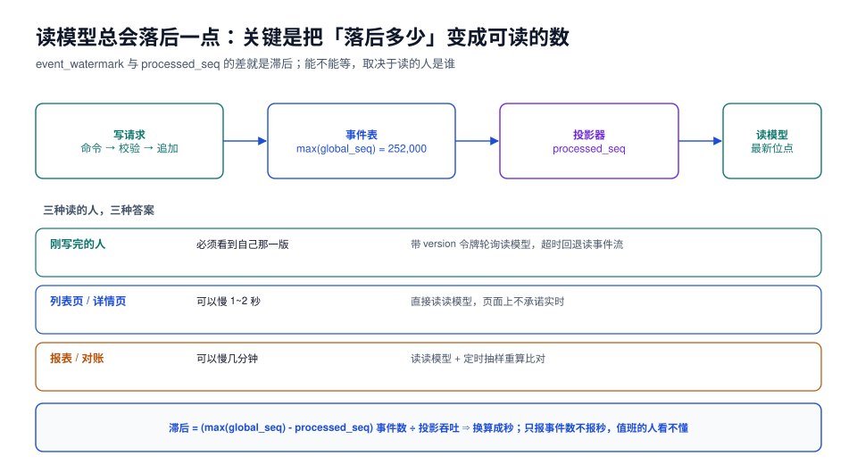

# 读写一致性：水位、滞后与读己之写

本页判据族 `ESC-A` ~ `ESC-H`，共 8 条。定义表在第七节。

CQRS 的系统里，「数据不一致」不是 bug，而是**设计里明写的滞后**。真正会变成事故的是另外三件事：**滞后没有度量**（不知道落后多少）、**读己之写不成立**（用户刚下单看不到订单）、**滞后被当成 bug 去修**（加 `sleep`、加双写，把可恢复问题改成不可恢复问题）。

本页把「落后多少」变成可读的数字，并给出三种读者各自该拿到的答案。



## 一、两个水位

| 水位 | 含义 | 取法 |
| --- | --- | --- |
| **事件水位**（event watermark） | 事件表当前最大全局序号 | `SELECT max(global_seq) FROM events` |
| **投影水位**（projection watermark） | 投影器已处理到的全局序号 | `SELECT processed_seq FROM projection_checkpoint WHERE name = …` |

滞后有两个口径，必须同时报：

```sql
SELECT
  (SELECT max(global_seq) FROM events)                            AS event_seq,
  c.processed_seq                                                  AS processed_seq,
  (SELECT max(global_seq) FROM events) - c.processed_seq           AS lag_events,
  round(((SELECT max(global_seq) FROM events) - c.processed_seq)
        / NULLIF($2::numeric, 0), 1)                               AS lag_seconds_est   -- $2 = 实测吞吐（事件/秒）
FROM projection_checkpoint c
WHERE c.name = 'order_list';
```

- **事件数**（`lag_events`）：判断「还要处理多少」；
- **秒数**（`lag_seconds_est`）：判断「用户还要等多久」。

只报事件数是值班时最常见的沟通失败——`lag_events = 42,000` 到底是 0.4 秒还是 40 秒，取决于吞吐。用[投影](../Projection/index.md)里实测的 10 万事件/秒，4.2 万条 ≈ 0.42 秒；如果投影因为一条毒丸卡住，吞吐变 0，那就是**无限久**。

::: danger 用 `count(*)` 算滞后会拖垮库
`SELECT count(*) FROM events WHERE global_seq > processed_seq` 在大表上是一次全索引扫描，滞后监控每分钟跑一次就是给自己的库上压力。用**两个 max 相减**，O(1)。
:::

## 二、三种读者，三种答案

| 读者 | 能接受什么 | 实现 |
| --- | --- | --- |
| **刚写完的人** | 必须看到自己那一版 | 读己之写（第二节末） |
| **列表页 / 详情页** | 慢 1~2 秒可接受 | 直接读读模型，不承诺实时 |
| **报表 / 对账** | 慢几分钟可接受 | 读模型 + 定时抽样重算 |

把这三类混成一句「最终一致」，就会得到两种坏结果：**给报表做实时**（成本高、收益零），或者**给写者做最终一致**（用户投诉「刚下的单没了」）。

## 三、读己之写：用版本令牌，不要用 sleep

用户下单成功后跳转详情页，详情页读的是读模型——此时投影可能还没追上。正确做法是**把「我写到哪一版」带过去，等读模型追到这一版**：

```java
// 写侧：追加成功后，把 (streamId, version) 作为令牌返回
record WriteAck(String orderNo, long version, long globalSeq) {}

// 读侧：带令牌查询，最多等 300 ms
public Optional<OrderView> readOwn(String orderNo, long minVersion, Duration timeout) {
    var deadline = System.nanoTime() + timeout.toNanos();
    while (System.nanoTime() < deadline) {
        var v = readModel.find(orderNo);
        if (v.isPresent() && v.get().lastVersion() >= minVersion) return v;
        LockSupport.parkNanos(Duration.ofMillis(20).toNanos());   // 短轮询，别打满库
    }
    return readModel.find(orderNo);   // 超时降级：返回可能旧的数据，由前端提示「处理中」
}
```

三种实现对比：

| 方案 | 机制 | 优点 | 缺点 |
| --- | --- | --- | --- |
| **版本令牌 + 短轮询** | 读模型里的 `last_version` 与令牌比较 | 无额外组件；失败可见 | 最坏等满超时 |
| **回退读事件流** | 令牌没追上就折叠该流 | 一定拿到最新 | 慢（见[重建](../Replay/index.md)的成本） |
| **同步投影（写完就投影）** | 写事务里顺手投影 | 无滞后 | 等于双写，违反[投影](../Projection/index.md)的禁令 |

::: tip 令牌应该是「全局序号」还是「流版本」
两种都行，但含义不同：**流版本**（`stream_version`）只能验证「这个订单的最新状态」，**全局序号**（`global_seq`）能验证「整个读模型都追到这了」。

页面只需要自己的订单 → 用流版本；页面还要展示「和这个订单相关的库存、支付」 → 用全局序号。混用时最容易出的错是：拿全局序号去比一个只记了流版本的读模型，永远等不到。
:::

## 四、滞后监控的四个指标

| 指标 | 定义 | 告警建议 |
| --- | --- | --- |
| `projection_lag_events` | 事件水位 − 投影水位 | 持续 5 分钟 > 10,000 告警 |
| `projection_lag_seconds` | 事件数 ÷ 实测吞吐 | 持续 5 分钟 > 30 s 告警 |
| `projection_rate` | 每秒处理事件数 | 掉到基线的 20% 以下告警（**比滞后更早发现停摆**） |
| `projection_errors_total` | 处理失败计数 | 任意增长即告警（毒丸的早期信号） |

第三个指标最容易被漏掉，但它是最灵敏的：**投影停摆时，滞后是慢慢涨的，速率是瞬间掉到 0 的**。滞后告警要等 5 分钟才触发，速率告警 30 秒就能发现。

```text
# 投影速率（Prometheus 口径示意）
rate(projection_processed_events_total{projection="order_list"}[1m])

# 滞后（由投影器每次提交后上报，避免额外扫库）
projection_lag_events{projection="order_list"}
```

## 五、对账：抽样重算

监控只能告诉你「落后多少」，不能告诉你「算得对不对」。对账要回答后者：

```sql
-- ① 抽样 1,000 个流，从事件重算，与读模型比对
WITH sampled AS (
  SELECT stream_id FROM events TABLESAMPLE SYSTEM (0.1) LIMIT 1000
), recomputed AS (
  SELECT e.stream_id,
         sum(CASE WHEN e.event_type = 'OrderPaid' THEN (e.payload->>'amount')::bigint ELSE 0 END) AS paid,
         count(*) AS events_cnt
  FROM events e JOIN sampled s USING (stream_id)
  GROUP BY e.stream_id
)
SELECT count(*) FILTER (WHERE r.paid <> m.total_cents) AS mismatch_rows,
       count(*)                                        AS checked_rows
FROM recomputed r JOIN order_list m USING (stream_id);
-- 期望：mismatch_rows = 0
```

对账频率与代价：

| 范围 | 频率 | 代价 |
| --- | --- | --- |
| 抽样 1,000 流 | 每小时 | 秒级 |
| 全量按天分区 | 每天凌晨 | 分钟级 |
| 全量逐流 | 每周 / 发布前 | 与重建同量级 |

::: danger 对账发现不一致时，先别重建
先把不一致的行捞出来（`stream_id`、读模型值、重算值、各自的 `last_version`），判断是**投影少处理了事件**（读模型的 `last_version` 落后）还是**投影算错了**（版本一致但值不同）。

- 前者：追位点即可，不用重建；
- 后者：投影器逻辑 bug，修完重建。

不分青红皂白直接重建，会把「本来只是落后」的问题变成一次全量重放，风险大得多。
:::

## 六、降级：投影挂了页面怎么活

| 场景 | 降级策略 |
| --- | --- |
| 投影滞后但仍在追 | 页面标注「数据可能延迟」，接口返回 `stale: true` |
| 投影停摆 | 详情页回退到「折叠该流」（限流，只对大客户/关键页） |
| 读模型损坏 | 切到影子表或上一个快照版本；必要时只读事件流 |
| 事件表不可写 | **停写**（事件存储不可用没有降级方案，只能拒单） |

最后一行很重要：**事件存储是全系统唯一真相，它不可写时没有「降级为 CRUD」这种选项**——那会产生一份并行真相，事后无法合并。

## 七、本页判据

| 编号 | 判据 | 看什么现象 | 不满足时改哪里 |
| --- | --- | --- | --- |
| `ESC-A` | 每个投影都有 `lag_events` 与 `lag_seconds` 两个指标 | 监控面板能看到两条曲线 | 补换算（吞吐来自投影速率） |
| `ESC-B` | 滞后计算用两个 max 相减，不用 `count(*)` | SQL 里没有 `count(*) FROM events WHERE global_seq >` | 改写 |
| `ESC-C` | 写接口返回版本令牌（流版本或全局序号） | 响应体有 `version`/`seq` | 补 |
| `ESC-D` | 关键页面有读己之写，且超时后有明确降级 | 代码有 `readOwn` 或等价逻辑 | 补；禁止 `sleep` |
| `ESC-E` | 有 `projection_rate` 指标与告警 | 有速率曲线 | 补；它比滞后更早发现停摆 |
| `ESC-F` | 有抽样对账任务，且结果可查 | 定时任务 + 结果表 | 补 |
| `ESC-G` | 对账不一致时的处置有书面顺序（先分落后/算错） | 值班手册有此节 | 补 |
| `ESC-H` | 页面能显示「数据可能延迟」状态 | 接口有 `stale` 字段 | 补；否则用户投诉无从解释 |

## 八、验证方式

```sql
-- ① 人为制造滞后：暂停投影器，写入 1,000 条事件
--    期望：lag_events 增长、projection_rate = 0，页面仍能读（读到旧值）

-- ② 令牌等待：写一条事件后立刻用返回的版本读，
--    期望：最多等 300 ms 拿到新值；恢复投影器后等待时间趋近 0

-- ③ 对账抽样：期望 mismatch_rows = 0
--    （SQL 见第五节）
```

```shell
# ④ 确认滞后是 O(1) 查询（不是全表扫描）
docker exec evs-lab psql -U postgres -d evs -c \
  'EXPLAIN (ANALYZE, COSTS OFF) SELECT max(global_seq) FROM events;'
# 期望：Limit -> Index Only Scan Backward，耗时 < 1 ms
```

## 参考资料

- PostgreSQL 18 Documentation: *Index-Only Scans*、`TABLESAMPLE`
- Prometheus Documentation: *Query basics*（`rate()`）
- 本仓库相邻专题：[投影与读模型](../Projection/index.md)、[监控与告警](../../../Ops/Monitoring/index.md)、[幂等与状态机工程](../../IdempotencyStateMachine/index.md)
