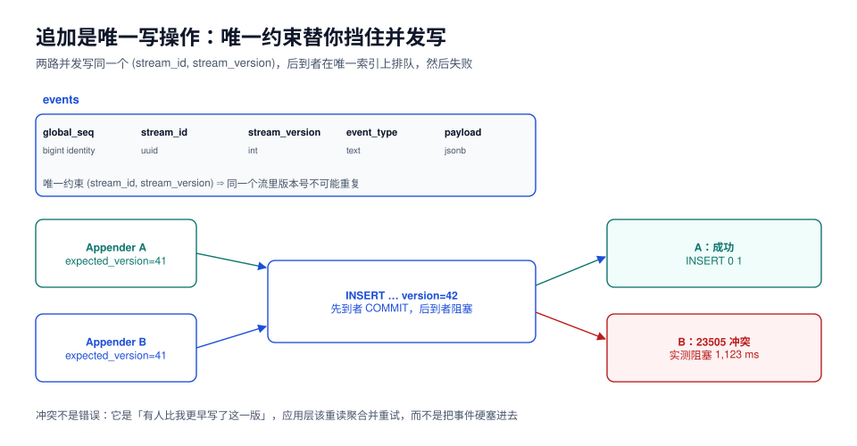

# 事件存储：追加、顺序与并发

本页判据族 `EST-A` ~ `EST-H`，共 8 条。定义表在第九节。

事件存储只有**一个写操作**：追加。所有复杂度都来自这一个操作要同时保证三件事——**同一个流里版本号不重复**（并发正确性）、**所有流之间有一个全局可比的顺序**（订阅与投影的基础）、**追加尽可能快**（写放大要能接受）。

本页用 PostgreSQL 18.6 把这三件事写成可执行的 DDL 与命令，读数都在本机实测。



## 一、表的形状

```sql
CREATE TABLE events (
  global_seq     bigint GENERATED ALWAYS AS IDENTITY PRIMARY KEY,
  stream_id      uuid        NOT NULL,
  stream_version int         NOT NULL,
  event_type     text        NOT NULL,
  event_version  smallint    NOT NULL DEFAULT 1,
  payload        jsonb       NOT NULL,
  metadata       jsonb       NOT NULL DEFAULT '{}'::jsonb,
  occurred_at    timestamptz NOT NULL DEFAULT now(),
  CONSTRAINT events_stream_version_uniq UNIQUE (stream_id, stream_version),
  CONSTRAINT events_version_positive  CHECK (stream_version > 0),
  CONSTRAINT events_type_naming       CHECK (event_type ~ '^[A-Z][A-Za-z]+$')
);
```

每一列都有理由，缺一列就会在某个环节补不回来：

| 列 | 作用 | 缺了会怎样 |
| --- | --- | --- |
| `global_seq` | 全局顺序，订阅与投影的游标 | 只能用 `occurred_at` 排序，同毫秒内顺序不定 |
| `stream_id` | 聚合标识，也是折叠的分组键 | 无法定位「这个订单发生过什么」 |
| `stream_version` | 流内版本，乐观锁的一半 | 并发写会插进两条同版本事件 |
| `event_type` | 折叠器的分派键 | 折叠器只能靠猜 payload 结构 |
| `event_version` | 载荷版本，给 upcaster 用 | 改结构后历史事件读不出来（见[版本](../Versioning/index.md)） |
| `payload` | 事实内容 | — |
| `metadata` | `trace_id`、`user_id`、`command_id` 等**非业务**信息 | 排障时找不到是哪个请求写的 |
| `occurred_at` | 业务发生时间 | 只能用入库时间，时钟偏移无法还原 |

::: danger 三个「先加上，以后再补」的代价
1. **`global_seq` 后补**：`bigint identity` 列加到千万级大表上要重写整表（PG 11+ 加有默认值的列不重写，但 identity 需要回填），期间锁表。
2. **`stream_version` 后补**：历史数据没有版本号，只能按 `global_seq` 临时编号——但并发写入的历史顺序本来就不可靠，等于承认历史无法正确重放。
3. **`metadata` 后补**：过去的事件永远没有 `trace_id`，出问题时只能靠时间范围猜请求。
:::

## 二、唯一约束就是乐观锁

并发追加的核心问题：两个请求同时读到「当前版本 41」，都要写 42。数据库层面只有一个可靠答案——**让第二个失败**。

```sql
-- 会话 A
BEGIN;
INSERT INTO events (stream_id, stream_version, event_type, payload)
VALUES ('0199f2c1-0000-7000-8000-000000000001', 42, 'OrderPaid', '{"amount": 12800}');
SELECT pg_sleep(1.5);
COMMIT;
```

```sql
-- 会话 B（与 A 并发，同样写 version = 42）
INSERT INTO events (stream_id, stream_version, event_type, payload)
VALUES ('0199f2c1-0000-7000-8000-000000000001', 42, 'OrderPaid', '{"amount": 12800}');
```

本机实测：**B 阻塞 1,123 ms 后报错**，而不是立刻失败——因为唯一索引要等 A 的事务结束才能判定。

```text
ERROR:  duplicate key value violates unique constraint "events_stream_version_uniq"
DETAIL:  Key (stream_id, stream_version)=(0199f2c1-…, 42) already exists.
```

这个「阻塞」有两个必须理解的含义：

1. **它是行锁，不是重试**：B 的等待时间约等于 A 的事务长度。长事务会把这个流上的所有写请求排队——所以事件追加事务里**不要放任何外部调用**。
2. **它给出的错误是「有人比我早」**，不是「系统坏了」。应用层的正确动作是**重读聚合 → 重新决策 → 再追加**，而不是把 `23505` 当 500 抛给用户。

::: tip 幂等键与版本号是两件事
`command_id`（或业务幂等键）保证「同一个请求不生效两次」；`stream_version` 保证「同一个流不出现两个第 42 条」。前者靠唯一索引 + `ON CONFLICT DO NOTHING`，后者靠唯一索引 + 重试。只有一条时，会分别丢掉幂等或丢掉并发正确性。
:::

用 `ON CONFLICT DO NOTHING` 做幂等追加，实测 0.346 ms 返回 `INSERT 0 0`：

```sql
INSERT INTO events (stream_id, stream_version, event_type, payload, metadata)
VALUES ('0199f2c1-0000-7000-8000-000000000001', 1, 'OrderCreated',
        '{"orderNo": "NO20261022001"}', '{"commandId": "cmd-7f3a"}')
ON CONFLICT (stream_id, stream_version) DO NOTHING;
```

```text
INSERT 0 0
```

**注意这里的选择**：`DO NOTHING` 适合「同一命令重投」；不适合「并发写同一流」——后者需要知道冲突并重新决策，`DO NOTHING` 会让业务以为成功而实际什么都没写。区分方式：冲突的是**同一个 version**（幂等重投，可以忽略）还是**期望版本落后**（并发，必须重试）。

## 三、全局顺序：为什么不能只靠时间戳

投影器要回答的问题是「我处理到哪儿了」。它需要一个**单调、无洞、可比较**的水位，时间戳三条都不满足：

| 方案 | 单调 | 无洞 | 并发安全 | 结论 |
| --- | --- | --- | --- | --- |
| `occurred_at`（应用时钟） | 否（NTP 回拨、多实例漂移） | 是 | 否 | 只能用于展示 |
| `clock_timestamp()`（库时钟） | 近似 | 是 | 否（并发事务提交顺序 ≠ 取号顺序） | 排序会错 |
| `bigserial` / `identity` | 是 | **否**（事务回滚留洞） | 是 | 正确选择 |
| 逻辑复制 LSN | 是 | 否 | 是 | 绑定具体数据库，跨库不可比 |

`identity` 的「洞」是已知特性：回滚的事务会消耗掉序号，所以 `global_seq` 会出现 `…, 1001, 1003, …`。投影器**不能**用「`processed_seq + 1` 是否存在」来判断有没有漏，只能用 `> processed_seq` 的范围扫描。

```sql
-- 投影器取下一批（洞会被自然跳过）
SELECT global_seq, stream_id, stream_version, event_type, payload
FROM events
WHERE global_seq > $1
ORDER BY global_seq
LIMIT 500;
```

::: danger 别用「按时间窗口」拉事件
`WHERE occurred_at > now() - interval '1 minute'` 看起来简单，实际上会**漏事件**：一个长事务在 10:00 开始、10:05 提交，它的 `occurred_at`（默认 `now()`，事务开始时间）落在 10:00，而你在 10:01 已经扫过那一段了。要么用 `clock_timestamp()`，要么老老实实用 `global_seq`。
:::

多实例写同一个库时，`identity` 由序列统一分配，天然全局。**分库之后就不再全局了**：两个库各自的 `global_seq` 不可比，这时需要一个独立的排序服务（或按 `stream_id` 哈希分区，让同一聚合永远落在一个库）。这是[运维](../Ops/index.md)里分区策略的由来。

## 四、关系库与专用事件库的对照

| 能力 | PostgreSQL 表 | EventStoreDB | Kafka（当事件存储用） |
| --- | --- | --- | --- |
| 流内乐观锁 | `unique(stream_id, stream_version)` | `expectedVersion` 参数 | 无原生支持（要自己校验） |
| 全局顺序 | `identity` 列 | `$all` 流的位置 | 分区内有序，全局无序 |
| 按流读 | 索引扫描 | `readStream` | 需要按 key 分区且从头消费 |
| 按类型订阅 | `WHERE event_type = …`（可加索引） | 服务端过滤（较新版本） | 每类型一个 topic 或客户端过滤 |
| 保留策略 | 自己写归档 | 可按流设置 | 按时间/大小删除（**与事件不可变冲突**） |
| 事务性写入 | 与业务表同事务（outbox 友好） | 单流原子追加 | 无事务 |

选型结论很朴素：**你要和业务表同事务写，就用关系库；你要跨语言、跨服务的强订阅能力，就用专用事件库**。用 Kafka 当事件存储的最大的坑是保留策略——它会删旧消息，而事件存储的语义是「永不删除」。

## 五、批量追加：一次事务 vs 每条一个事务

写放大是事件溯源最容易被低估的成本。本机实测两种写法（同为 20 万条事件）：

| 写法 | 总耗时 | 单条成本 | 说明 |
| --- | --- | --- | --- |
| 单事务批量 `INSERT … SELECT generate_series` | **3,626 ms** | **0.018 ms** | 约 55,200 事件/秒 |
| 每条独立事务（500 条实测后外推） | 273.2 ms / 500 条 | **0.545 ms** | 约 1,830 事件/秒 |

**差距 30 倍**，全部来自每次提交的 `fsync`。这条读数直接决定两个设计：

1. **业务侧**：一次命令产生的事件（订单 + 明细 + 库存预占）必须在**同一个事务**里追加，不要一条一个事务。
2. **导入侧**：历史数据迁移、压测造数，必须分批提交（每批 500~5,000 条），批量大小受 `max_wal_size` 与锁持有时间约束。

```java
// 一次命令 → 一个事务 → 多条事件
@Transactional
public void handle(CreateOrderCommand cmd) {
    var stream = StreamId.of(cmd.orderNo());
    var expected = eventStore.versionOf(stream);          // select max(stream_version)
    var events = order.decide(cmd);                        // 纯函数，产出事件列表
    eventStore.append(stream, expected, events);           // 唯一索引负责并发
}
```

## 六、读：按流读与按全局读

| 读法 | SQL | 用途 | 索引 |
| --- | --- | --- | --- |
| 按流读全量 | `WHERE stream_id = $1 ORDER BY stream_version` | 重建单个聚合 | `(stream_id, stream_version)` 唯一索引 |
| 按流读尾巴 | `… AND stream_version > $2` | 快照 + 尾巴 | 同上 |
| 按全局区间读 | `WHERE global_seq > $1 ORDER BY global_seq LIMIT n` | 投影、订阅 | 主键 |
| 按类型读 | `WHERE event_type = $1 AND global_seq > $2` | 特定投影只关心一种事件 | 可选 `(event_type, global_seq)` |

本机实测（50,000 条的长流，全量折叠）：

```text
Aggregate (actual time=20.431..20.432 rows=1)
  Buffers: shared hit=1253 read=249
  ->  Bitmap Heap Scan on events (actual time=2.940..8.785 rows=50000)
        Heap Blocks: exact=1253
        ->  Bitmap Index Scan on events_stream_version_uniq (rows=50000)
```

读 5 万条事件 = **1,253 个堆页 + 249 个索引页**，耗时 17~20 ms。这条读数说明两件事：**按流读本身不慢**（慢的是折叠与传输），以及**事件要被读多次**——所以快照是必需的（见[重建与快照](../Replay/index.md)）。

::: warning 按类型索引不是免费的
`(event_type, global_seq)` 索引能让「只关心 `OrderPaid` 的投影」快很多，但它会让每次追加多维护一个索引。事件类型少的系统（< 20 种）收益明显；类型上百的系统（每种业务动作一个类型）不如让投影自己过滤——**索引的选择要看投影数量，不是看类型数量**。
:::

## 七、存储成本

本机实测：252,001 条事件，载荷 100~150 B。

| 项 | 大小 | 换算 |
| --- | --- | --- |
| 表总大小（含 TOAST 与索引） | 72 MB | **≈ 300 B/事件** |
| 其中索引 | 15 MB | 约 21% |
| 堆表 | 57 MB | 约 237 B/事件 |

按 300 B/事件外推：1 亿事件约 **30 GB**，10 亿约 **300 GB**。这个量级对关系库不算大，但要注意三件事：

1. **索引占比会随索引数量上升**，每多一个二级索引，写入就多一次随机 IO；
2. **`jsonb` 超过 2 KB 会进 TOAST**，读的时候多一次间接寻址，大载荷（图片、文档）应该存引用而不是内容；
3. **`VACUUM` 不会回收事件表的空间**（没有删除），但**归档删分区**会——分区策略见[运维](../Ops/index.md)。

## 八、不该放进事件表的东西

| 内容 | 为什么不该放 | 放哪 |
| --- | --- | --- |
| 大对象（图片、PDF、附件） | `jsonb` 进 TOAST，读放大；备份体积爆炸 | 对象存储，事件里放 URI + 校验和（见[对象存储](../../ObjectStorage/index.md)） |
| 可变的查询辅助字段（`status`、`updated_at`） | 一旦有人 `UPDATE` 它，事件就不再是不可变历史 | 投影表 |
| 外部系统的原始回调 | 不是本聚合的事实，重放时无法折叠 | 单独的回调日志表 |
| 密码、令牌、身份证号 | 事件永不删除，等于永久留存敏感数据 | 加密字段或引用；删除诉求用「加密擦除」处理（见[FAQ](../FAQ/index.md)） |
| 计数器的高频自增（浏览量） | 每次 +1 一条事件，存储爆炸 | 普通表 + 定期快照事件 |

## 九、本页判据

| 编号 | 判据 | 看什么现象 | 不满足时改哪里 |
| --- | --- | --- | --- |
| `EST-A` | 事件表存在 `(stream_id, stream_version)` 唯一约束 | `\d events` 有唯一索引 | 加约束；历史重复数据先清理 |
| `EST-B` | 事件表有单调的全局顺序列（`identity`/序列），且被投影用作游标 | 投影 SQL 用 `global_seq > $1` | 加列并用它替换时间窗口 |
| `EST-C` | 事件表**没有任何**业务 `UPDATE`/`DELETE` | 代码检索为空 | 改成补偿事件 |
| `EST-D` | 一次命令的多条事件在同一个事务内追加 | 应用服务方法有 `@Transactional` 且只 append 一次 | 合并事务 |
| `EST-E` | 追加事务内没有外部调用（HTTP/MQ/文件） | 事务方法体里无远程调用 | 挪到事务提交后（outbox） |
| `EST-F` | 冲突（`23505`）被当作「重读重试」，不是 500 | 异常映射里有对应处理 | 加重试策略与上限 |
| `EST-G` | 事件载荷 < 2 KB，大内容走引用 | 抽样 `pg_column_size(payload)` | 大字段外置到对象存储 |
| `EST-H` | 有按流的读取路径且走 `(stream_id, stream_version)` 索引 | `EXPLAIN` 显示 Index/Bitmap Index Scan | 补索引或改写查询 |

## 十、验证方式

```shell
# ① 起一个干净的库
docker run -d --name evs-lab -e POSTGRES_PASSWORD=dev -e POSTGRES_DB=evs \
  -p 55444:5432 docker.m.daocloud.io/library/postgres:18
docker exec evs-lab pg_isready -U postgres
# 期望：/var/run/postgresql:5432 - accepting connections

# ② 建表后确认约束存在
docker exec evs-lab psql -U postgres -d evs -c '\d events'
# 期望：看到 "events_stream_version_uniq" UNIQUE CONSTRAINT

# ③ 并发冲突：另开一个会话先写 version=42 并 hold 1.5 秒，
#    当前会话再写同一版本，期望阻塞约 1 秒后报 23505
```

```sql
-- ④ 幂等追加：同一版本写两次，第二次期望 INSERT 0 0
INSERT INTO events (stream_id, stream_version, event_type, payload)
VALUES ('0199f2c1-0000-7000-8000-0000000000aa', 1, 'OrderCreated', '{}')
ON CONFLICT (stream_id, stream_version) DO NOTHING;

-- ⑤ 存储成本：期望 ≈ 300 B/事件（载荷 100~150 B 时）
SELECT pg_total_relation_size('events') / count(*) AS bytes_per_event FROM events;
```

## 参考资料

- PostgreSQL 18 Documentation: *Constraints*（`UNIQUE`）、*Identity Columns*、`pg_total_relation_size`
- EventStoreDB Documentation: *Appending events*（`expectedVersion`）、`$all`
- Apache Kafka Documentation: *Topic Configurations*（`retention.ms`）
- 本仓库相邻专题：[投影与读模型](../Projection/index.md)、[重建与快照](../Replay/index.md)、[对象存储](../../ObjectStorage/index.md)
