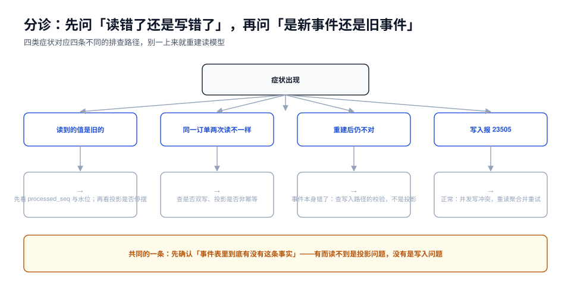

# 常见问题与分诊

本页判据族 `ESQ-A` ~ `ESQ-H`，共 8 条。定义表在第七节。

这一页收的是「真的会卡住人」的问题：不是「什么是事件溯源」（那是[总览](../Overview/index.md)），而是「我们已经上了，现在这个症状怎么办」。



## 一、先分诊：读错了，还是写错了

| 症状 | 第一件要查的事 | 大概率原因 | 去哪一页 |
| --- | --- | --- | --- |
| 读到的值是旧的 | `processed_seq` 与事件水位的差 | 投影滞后 / 投影停摆 | [一致性](../Consistency/index.md) |
| 同一订单两次读结果不同 | 有没有双写、投影是否幂等 | 双写或非幂等投影 | [投影](../Projection/index.md) |
| 重建之后还是不对 | 手工 SQL 折叠该流，与读模型比 | 事件本身错了（写入路径） | 本页 Q4 |
| 写入报 `23505` | 是不是并发写同一个流 | 正常冲突，重读重试 | [事件存储](../EventStore/index.md) |
| 详情页很慢 | 该流的事件条数与是否有快照 | 没有快照，每次全量折叠 | [重建与快照](../Replay/index.md) |
| 事件表越来越大 | 分区与归档策略 | 没有归档机制 | [运维](../Ops/index.md) |

::: tip 分诊的第一句话
**「事件表里到底有没有这条事实？」** 有而读不到 → 投影问题；没有 → 写入问题。这一步能省掉 80% 的排查时间。
:::

## 二、十二个高频问题

### Q1：事件表会不会无限长，最后拖垮数据库？

会长，但可控。本机实测 **300 B/事件**：1 亿事件约 30 GB，10 亿约 300 GB。真正的风险不是总量，而是**没有归档机制**——按 `global_seq` 分区后，冷分区可以整段 `DETACH` + `DROP`，同时把 dump 存进对象存储。见[运维](../Ops/index.md)。

反过来说，如果某个聚合**每次交互都产生事件**（浏览量、心跳、坐标上报），它就不该用事件溯源——那不是「事件表会长」，而是「用错了」。

### Q2：事件溯源一定比 CRUD 慢吗？

写侧多一次追加（实测单条约 0.5 ms，批量 0.018 ms/条）；读侧如果每次都折叠，5 万条要 17 ms。但**读侧加了快照与读模型后，线上读根本不折叠**（0.17 ms）。

结论：**读多的系统不会更慢，写密集且聚合热的系统会更慢**。

### Q3：能不能 `UPDATE` 一条写错的事件？

不能。事件是历史，历史不可改。三种情况三种解法：

| 情况 | 解法 |
| --- | --- |
| 事件内容有误（金额写错） | 追加补偿事件 `OrderAmountCorrected` |
| 事件本来就不该发生（误操作） | 追加冲正事件 `OrderCancelled`，而不是删 |
| 事件流污染（测试数据进了生产） | 在投影层过滤（按 `metadata.source`），事件保留 |

### Q4：读模型和事件对不上，第一步做什么？

```sql
-- 手工折叠该流，与读模型对比
SELECT sum(CASE WHEN event_type='OrderPaid' THEN (payload->>'amount')::bigint ELSE 0 END) AS paid,
       max(stream_version) AS last_version
FROM events WHERE stream_id = $1;

SELECT paid_cents, last_version FROM order_list WHERE order_no = $2;
```

- 两个 `last_version` 不同 → 投影落后，追位点即可；
- 版本相同但值不同 → 投影逻辑 bug，修完重建；
- **事件折叠出来的值本身就不对** → 写入路径 bug，追加补偿事件。

### Q5：投影能多实例并行吗？

能，但只能**按聚合分区**（`hash(stream_id) % N`），并且位点要分段。按 `global_seq` 区间并行的前提是「事件之间没有跨流因果依赖」——大多数业务做不到。默认建议单实例 + 批量 500，本机实测单实例可到 10 万事件/秒。

### Q6：快照和读模型有什么区别？都有状态，不是重复了吗？

| | 快照 | 读模型 |
| --- | --- | --- |
| 服务对象 | **写侧**（折叠一个聚合） | **读侧**（页面查询） |
| 形态 | 一个聚合的完整状态（JSON） | 面向查询的宽表/多表 |
| 能否丢弃 | 能，删了只是变慢 | 能，删了重建即可 |
| 谁写 | 追加路径或后台任务 | 投影器 |

快照是「折叠的缓存」，读模型是「查询的物化视图」，两者可以同时存在，也可以都没有（小系统）。

### Q7：能不能用 Kafka 当事件存储？

不建议。三个硬伤：**保留策略会删数据**（与不可变冲突）、**分区内有序但全局无序**（没有全局水位）、**没有流内乐观锁**（要自己实现）。Kafka 适合做**事件分发**（从事件表派生集成事件后投出去），不适合当真相。

### Q8：要不要直接上框架（Axon / EventStoreDB）？

| 场景 | 建议 |
| --- | --- |
| 已在 PostgreSQL 上，事件量与业务表同库 | 先自己写（一张表 + 一个投影器），代码量比接框架少 |
| 跨语言、需要强订阅与内建快照 | 用 EventStoreDB |
| Java 生态、要聚合/命令/事件总线全套 | Axon，但要接受它的心智模型与升级成本 |

判据不是「框架好不好」，而是「**你的团队能不能独立排查折叠、位点、重放三件事**」。不能，上框架也救不了。

### Q9：一次命令应该写几条事件？

**同一个事务里写完全部**，数量由聚合决定（订单创建通常是 1~3 条：`OrderCreated`、`StockReserved`、可能的 `CouponApplied`）。不要为了「一条事件对应一个表操作」而拆成多次事务——那会破坏原子性，出现「订单建了但库存没占」。

### Q10：事件里能放手机号、身份证、地址吗？

能不放进就不放。事件永不删除，等于**永久留存敏感数据**，与「用户要求删除」直接冲突。

三种处置：**加密字段**（密钥可销毁 → 加密擦除）、**只存引用**（`customerRef`，详情在可删除的用户表）、**脱敏存快照**（只留「当时等级」这类不可逆信息）。GDPR 式的删除诉求用「加密擦除」实现：删掉密钥，密文留着但不可读，历史与合规两边都能交代。

### Q11：重构聚合之后，折叠器怎么改？

分两步：**先加新分支（兼容旧事件），再删旧分支（在所有相关流归档之后）**。中间态必须能同时处理新旧两种事件。删旧分支前跑一遍[版本](../Versioning/index.md)里的 golden event 测试，确认历史事件仍有对应处理路径。

### Q12：从 CRUD 迁移，第一步做什么？

不要「把主表改成事件表」。推荐路径：

1. **选一个聚合**（有审计诉求、状态变化清晰的，比如订单）；
2. **先加 outbox + 事件表**，业务仍写主表（双轨），事件只是旁证；
3. **建第一个读模型**，从事件派生，与主表比对（对账跑一周）；
4. **把读切到读模型**，主表变成「遗留」；
5. **停止写主表**，事件成为唯一真相；
6. 重复下一个聚合。

第 3 步的对账是关键关口：**读模型与主表连续一周零差异**，才谈得上切换。

## 三、五个反模式

| 反模式 | 表现 | 为什么错 |
| --- | --- | --- |
| **事件表当日志** | 主表还在，事件只是「顺手记一下」 | 两套真相，迟早不一致 |
| **读模型当真相** | 手工改读模型修数 | 重建能力被废掉 |
| **投影里发消息** | 投影器处理事件时发 MQ | 重建会把所有通知重发一遍 |
| **同步投影** | 写事务里顺手写读模型 | 等于双写，故障时不可恢复 |
| **快照当存储** | 只读快照不读事件 | 快照错了无从发现，历史丢失 |

::: danger 最贵的一个反模式：为了「实时」而放弃事件存储
团队遇到延迟投诉时，最常见的错误解法是「写的时候顺便把读模型也写了」。这会把一个**可恢复的滞后问题**换成一个**不可恢复的一致性问题**——一旦双写有一边失败，事件与读模型永久分叉，而重建会把业务写入抹掉。

正确解法是[一致性](../Consistency/index.md)里的读己之写：**给需要实时的人一条专用路径，而不是给所有人放弃事件存储**。
:::

## 四、性能问题的三个数量级

| 现象 | 常见原因 | 量级差 |
| --- | --- | --- |
| 详情页 1~3 秒 | 每次读都全量折叠长流 | 17 ms → 0.17 ms（加快照，100×） |
| 下单接口 200 ms+ | 每条事件一个事务 | 0.545 ms → 0.018 ms/条（批量，30×） |
| 批量导入几小时 | 逐条提交 + 每条都触发投影 | 分批 + 投影异步，10× 以上 |

三个都**不是**「事件溯源本身慢」，而是「没用对」——都是可配置项，不是架构缺陷。

## 五、什么时候应该放弃事件溯源

诚实地说，以下情况应该退回去用 CRUD + 审计表：

1. 聚合更新极频繁（计数器、在线状态、实时位置），事件量会失控；
2. 团队里没有人能独立排查「读到的值是旧的」；
3. 只有审计诉求，没有时间旅行与多视图诉求——**审计表就够**；
4. 业务规则还在剧烈变化，事件类型每周改一次，upcaster 链会失控。

退回去不是失败：**事件溯源解决的是「历史与多视图」，不是「先进」**。

## 六、本页判据

| 编号 | 判据 | 看什么现象 | 不满足时改哪里 |
| --- | --- | --- | --- |
| `ESQ-A` | 值班手册有「先查事件表有没有这条事实」这一步 | 手册第一节 | 补 |
| `ESQ-B` | 有「手工折叠 vs 读模型」对比的 SQL 模板 | 手册/脚本里有 | 补 |
| `ESQ-C` | 写错事件一律走补偿事件，代码里无 `DELETE FROM events` | 代码检索 | 改 |
| `ESQ-D` | 投影器不发消息、不调外部接口 | 代码检索 | 挪到独立投递器 |
| `ESQ-E` | 敏感字段有加密或引用方案，且有删除诉求的处置说明 | 设计文档 | 补 |
| `ESQ-F` | 迁移路径按「双轨 → 对账 → 切片」执行，有对账记录 | 迁移文档 | 补 |
| `ESQ-G` | 明确记录了「哪些聚合不用事件溯源」及理由 | 设计文档有清单 | 补 |
| `ESQ-H` | 性能问题先对照「三个数量级」表，不先改架构 | 有性能排查清单 | 补 |

## 七、验证方式

```sql
-- ① 反模式自查：事件表与主表是否并存（并存说明还在双轨期，应有对账任务）
SELECT table_name FROM information_schema.tables
WHERE table_schema = 'public' AND table_name IN ('orders','events');

-- ② 投影是否幂等（同一批跑两次，行数不变）
--    见 Projection 页第九节

-- ③ 死信是否清空
SELECT count(*) FROM projection_dead_letter WHERE resolved_at IS NULL;
-- 期望：0
```

```shell
# ④ 事件表上不应出现 UPDATE/DELETE 语句
git grep -n -i -E "(update|delete from) +events" -- '*.java' '*.sql' '*.kt' | grep -v archive
# 期望：无输出（归档脚本里的 DROP PARTITION 除外）
```

## 参考资料

- Martin Fowler, *Event Sourcing*、*CQRS*
- Greg Young, *Versioning in an Event Sourced System*
- 本仓库相邻专题：[总览](../Overview/index.md)、[投影与读模型](../Projection/index.md)、[运维](../Ops/index.md)、[领域驱动设计](../../DDD/index.md)
