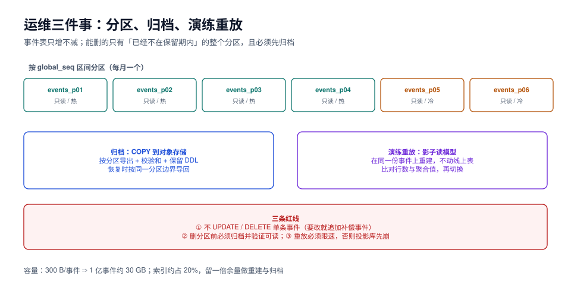

# 运维：分区、归档与重放演练

本页判据族 `ESM-A` ~ `ESM-H`，共 8 条。定义表在第七节。

事件表只增不减，这是设计而非缺陷。它带来三个运维问题：**表会不会无限长**（分区）、**旧数据能不能挪走**（归档）、**出了事能不能重放**（演练）。三个问题的答案互相牵制——分区方式决定了归档粒度，归档粒度决定重放能回到多细。

本页给一套「不动线上、可反复演练」的做法。



## 一、分区：按 `global_seq` 区间，不按时间

```sql
CREATE TABLE events (
  global_seq     bigint      NOT NULL,
  stream_id      uuid        NOT NULL,
  stream_version int         NOT NULL,
  event_type     text        NOT NULL,
  payload        jsonb       NOT NULL,
  occurred_at    timestamptz NOT NULL DEFAULT now(),
  PRIMARY KEY (global_seq)
) PARTITION BY RANGE (global_seq);
```

为什么按序号而不按 `occurred_at`：

| 方案 | 分区裁剪 | 归档时能否「整段搬走」 | 风险 |
| --- | --- | --- | --- |
| `RANGE (global_seq)` | 投影按 `global_seq >` 查询能精确裁剪 | 能，区间边界稳定 | 需要预测序号增长速度 |
| `RANGE (occurred_at)` | 时间范围查询友好 | 能，但跨月的长事务会写进旧分区 | **分区键不可变**：`occurred_at` 在事务内是开始时间，事后补写会插到「过去」 |
| `HASH (stream_id)` | 只有按流的查询友好 | 不能整段归档 | 投影全表扫描要扫所有分区 |

选 `global_seq` 的另一个好处：**投影的位点就是分区键**。`WHERE global_seq > 500_000_000` 会自动跳过前面所有分区，不会因为「表大」而变慢。

```sql
-- 每月一个分区（序号按当前增速预估，留 20% 余量）
CREATE TABLE events_p2026_11 PARTITION OF events FOR VALUES FROM (520000000) TO (560000000);
CREATE TABLE events_p2026_12 PARTITION OF events FOR VALUES FROM (560000000) TO (600000000);
```

::: danger 分区的三个常见坑
1. **没有默认分区**：序号涨过最后一个边界时，写入直接失败（`no partition of relation found for row`）。要么留一个 `DEFAULT` 分区，要么提前建好下个月。
2. **唯一约束必须包含分区键**：PostgreSQL 的分区表上，唯一索引必须包含分区键，所以 `UNIQUE (stream_id, stream_version)` **不能**直接建在分区父表上——这是很多人第一次分区时踩的坑。
3. **`identity` 列与分区**：父表的 `GENERATED ALWAYS AS IDENTITY` 在分区表上可用，但序号是全局的（正是我们要的）。
:::

第二条的解法有两个，选哪个取决于你更在意什么：

| 解法 | 做法 | 代价 |
| --- | --- | --- |
| **保留唯一索引在父表（不分区）** | 数据量 < 5 亿时干脆不分区 | 归档只能按 `DELETE` + `VACUUM` |
| **应用层保证 + 局部唯一索引** | 每个分区建 `(stream_id, stream_version)` 唯一索引 | 跨分区不唯一（同一流的事件理论上会跨分区） |

实践建议：**先用一张不分区的大表跑到 5 亿行**，再用 `pg_partman` 或手工滚动建分区。分区不是为了「性能」，而是为了**归档能整段 `DROP`**。

## 二、归档：整分区导出，校验后再删

```shell
# ① 导出（只读，不锁写）
docker exec eoh-postgres pg_dump -U postgres -d eoh \
  --table=events_p2026_06 --data-only --format=custom \
  -f /tmp/events_p2026_06.dump

# ② 校验：行数、最大序号、校验和
docker exec eoh-postgres psql -U postgres -d eoh -c \
  "SELECT count(*), min(global_seq), max(global_seq), md5(string_agg(global_seq::text, ',' ORDER BY global_seq))
   FROM events_p2026_06;"
```

```sql
-- ③ 归档表登记（谁、什么时候、覆盖哪个区间、校验和）
CREATE TABLE archived_partitions (
  partition_name text PRIMARY KEY,
  seq_from       bigint      NOT NULL,
  seq_to         bigint      NOT NULL,
  row_count      bigint      NOT NULL,
  checksum       text        NOT NULL,
  object_uri     text        NOT NULL,
  archived_at    timestamptz NOT NULL DEFAULT now()
);

-- ④ 校验通过后再摘分区（先 DETACH，别直接 DROP）
ALTER TABLE events DETACH PARTITION events_p2026_06;
DROP TABLE events_p2026_06;
```

::: danger 归档的三条红线
1. **不 `UPDATE` / `DELETE` 单条事件**。要修正事实就追加补偿事件——删一条历史等于让「当时为什么」永久消失，而这正是当初选事件溯源的唯一理由。
2. **删分区前必须验证导出可读**：把 dump 恢复到临时库，跑一次行数与校验和比对，再删。
3. **归档必须在投影水位追过该分区之后**。位点还在分区里就删掉，投影会「跳过」那一段且**不报错**——它只会从下一段继续，读模型永久少一块。
:::

第三条是最隐蔽的：`DROP PARTITION` 不会让任何人报错，投影器下一次查询直接拿不到那些行。防线只有一条——**归档任务先查 `min(processed_seq)`，与待删分区的上界比较**：

```sql
SELECT min(processed_seq) AS min_checkpoint,
       (SELECT seq_to FROM archived_partitions WHERE partition_name = 'events_p2026_06') AS drop_bound
FROM projection_checkpoint;
-- 期望：min_checkpoint >= drop_bound，否则拒绝删除
```

## 三、重放演练：影子读模型 + 只读事件表

重放是这套架构的核心能力，也是最容易「演练时才发现不能用」的能力。演练要满足三个条件：**不动线上读模型、限速、可中断**。

```text
① 建影子表：order_list_new（LIKE order_list INCLUDING ALL）
② 起一个独立投影进程，--target=order_list_new --rate=2000/s --from=0
③ 跑到当前位点，比对行数与聚合
④ 一个事务内 RENAME 切换
⑤ 观察 30 分钟，再删旧表
```

| 演练项 | 目标 | 判据 |
| --- | --- | --- |
| **全量重放** | 读模型能从头重建 | 行数/聚合与线上一致 |
| **限速重放** | 不影响线上查询 | 重放期间线上 P99 波动 < 20% |
| **中断续跑** | 进程被杀后能从位点继续 | 杀掉再起，结果一致 |
| **快照缺失重放** | 删掉快照仍能重建 | 只变慢，不变错 |
| **归档分区重放** | 从归档恢复后能重放 | 导入归档 → 重放 → 结果一致 |

::: tip 每季度做一次「删库重建」演练
在预发环境，把读模型全删、位点归零，只留事件表，然后按手册重建。**能在一小时内重建完**，说明这套架构真的可运维；需要一天，说明投影依赖了太多外部状态，该重构了。
:::

## 四、事故处置：四种典型场景

| 场景 | 现象 | 处置顺序 |
| --- | --- | --- |
| **投影污染**（错误逻辑写入了错数据） | 对账不一致，版本却一致 | 修投影器 → 影子表重建 → 切换；**不要**手工 `UPDATE` 修正 |
| **位点丢失**（checkpoint 被误删/回滚） | 从 0 开始重放，读模型被重复写入 | 立刻停投影器 → 从备份恢复 checkpoint → 追平；追加型投影靠 `UNIQUE(event_id)` 兜底 |
| **事件写错**（业务校验缺失导致错事件） | 事件流里有一条不该存在的事实 | 追加补偿事件（`OrderCorrected`），折叠器认它；**绝不** `DELETE` |
| **归档误删** | 某段事件消失，重建缺一段 | 从对象存储恢复 dump → 导回临时表 → 用 `global_seq` 拼回 → 重建 |

### 补偿事件怎么写

```json
{
  "event_type": "OrderAmountCorrected",
  "event_version": 1,
  "payload": {
    "correctedFrom": 12800,
    "correctedTo": 11800,
    "reason": "优惠券未生效（工单 T-2026-1022-07）",
    "approvedBy": "finance.zhang"
  }
}
```

折叠器把它当作一次新的事实：`s.withPaid(11800)`。这样「为什么金额变了」在时间线上有答案，而历史 `OrderPaid` 仍然是当时真实发生的事——**两条都是事实，只是后者修正了前者**。

## 五、容量规划

| 项 | 实测/换算 | 用途 |
| --- | --- | --- |
| 单事件存储 | **300 B**（载荷 100~150 B） | 估算总量 |
| 索引占比 | 约 **21%** | 加索引时重算 |
| 1 亿事件 | **≈ 30 GB** | 单实例可承受，但备份窗口要算 |
| 10 亿事件 | **≈ 300 GB** | 必须分区 + 归档 |
| 重建读放大 | 全量重建读一遍全部事件 | 200,000 事件 108 ms；1 亿事件约 54 s（线性外推） |

备份策略要区分两件事：**事件表是「不可重建」的**（备份必须做，且要能 PITR），**读模型是「可重建」的**（可以不备份，出事重建即可）。这条区分能省掉大量备份空间——很多团队把读模型也当宝，结果备份里 70% 是可再生数据。

## 六、监控清单

| 指标 | 阈值 | 说明 |
| --- | --- | --- |
| `projection_lag_events` | > 10,000 持续 5 min | 见[一致性](../Consistency/index.md) |
| `projection_rate` | < 基线 20% | 停摆的早期信号 |
| `events_insert_rate` | 突增 3 倍 | 可能是重试风暴或重复消费 |
| `partition_headroom` | 剩余序号 < 20% | 提前建下个分区 |
| `checkpoint_age` | > 10 min 未推进 | 投影卡住（毒丸） |
| `dead_letter_unresolved` | > 0 | 必须有人处理 |

最后一项最容易被忽略：死信表有未解决记录时，**读模型是「已知不完整」的**，这时候看板上所有数字都要打折扣。

## 七、本页判据

| 编号 | 判据 | 看什么现象 | 不满足时改哪里 |
| --- | --- | --- | --- |
| `ESM-A` | 事件表按 `global_seq` 区间分区，且有下一个分区的提前创建机制 | `\d+ events` 显示分区 | 补；并留 `DEFAULT` 分区兜底 |
| `ESM-B` | 归档前校验行数 + 校验和 + 可恢复性 | 有 `archived_partitions` 记录 | 补 |
| `ESM-C` | 删分区前校验 `min(processed_seq) >= 分区上界` | 归档脚本有该检查 | 补；否则静默丢读模型数据 |
| `ESM-D` | 不存在 `UPDATE`/`DELETE` 单条事件的语句 | 代码检索为空 | 改补偿事件 |
| `ESM-E` | 有可中断、可限速的重放脚本 | 脚本支持 `--rate`、`--from` | 补 |
| `ESM-F` | 每季度有一次读模型重建演练记录 | 演练文档 | 补 |
| `ESM-G` | 备份策略区分「事件表必须备份」与「读模型可重建」 | 备份清单 | 补 |
| `ESM-H` | 有 `checkpoint_age` 与死信积压告警 | 告警规则 | 补 |

## 八、验证方式

```sql
-- ① 确认分区裁剪生效（应只扫一个分区）
EXPLAIN (ANALYZE, COSTS OFF)
SELECT count(*) FROM events WHERE global_seq > 560000000;
-- 期望：Append 下只有 events_p2026_12（或更后的分区）

-- ② 确认序号余量
SELECT max(global_seq) AS now_seq,
       (SELECT max(seq_to) FROM archived_partitions) AS last_bound;
```

```shell
# ③ 归档可恢复性验证（导出 → 临时库 → 行数比对）
docker exec eoh-postgres pg_dump -U postgres -d eoh --table=events_p2026_06 --data-only -f /tmp/p06.dump
docker exec eoh-postgres createdb -U postgres restore_check
docker exec eoh-postgres pg_restore -U postgres -d restore_check /tmp/p06.dump
docker exec eoh-postgres psql -U postgres -d restore_check -c 'SELECT count(*) FROM events_p2026_06;'
# 期望：与归档记录的 row_count 相同

# ④ 限速重放演练（影子表，不动线上）
java -jar projection.jar --target=order_list_new --from=0 --rate=2000
# 期望：线上 P99 无明显波动；重放完成后行数与 order_list 一致
```

## 参考资料

- PostgreSQL 18 Documentation: *Table Partitioning*（`DETACH PARTITION`、分区表上的唯一约束限制）
- PostgreSQL 18 Documentation: *pg_dump*、*Continuous Archiving and Point-in-Time Recovery*
- 本仓库相邻专题：[重建与快照](../Replay/index.md)、[备份与容灾](../../../Ops/BackupDR/index.md)、[数据库变更与在线 Schema 演进](../../../DB/SchemaEvolution/index.md)
