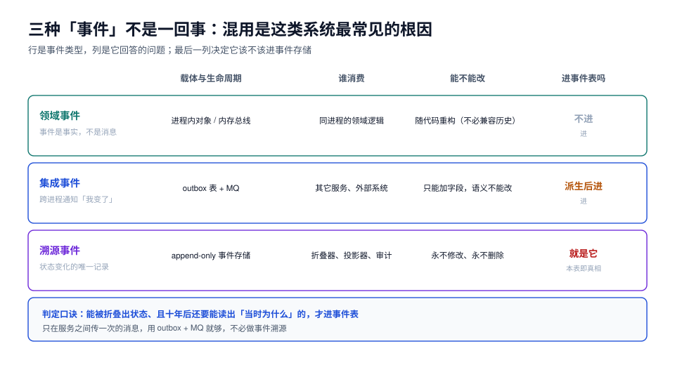

# 总览：三种事件、两条路径与五个必失点

本页判据族 `ESO-A` ~ `ESO-H`，共 8 条。定义表在第七节。

「事件溯源」这四个字最容易被当成「加个事件表记日志」。真正的分界线只有一条：**这张表是给人看的旁证，还是系统状态的唯一来源**。前者叫审计日志，后者才叫事件存储——前者丢了可以从主表补，后者丢了就什么都没了。

本页先把「事件」这个词拆成三种，再给两条读写路径，最后列五个一旦踩中就很难回头的必失点。



## 一、三种「事件」不是一回事

同一个系统里，三种事件的名字都叫「事件」，但它们的生命周期、消费方、可变性完全不同：

| 类型 | 定义 | 载体 | 谁消费 | 能不能改 |
| --- | --- | --- | --- | --- |
| **领域事件**（Domain Event） | 聚合内部发生了值得记录的事，用于同进程内的解耦 | 进程内的对象 / 内存总线 | 同进程的领域逻辑、应用服务 | 随代码版本演进，不需要历史兼容 |
| **集成事件**（Integration Event） | 跨进程通知别的东西「我变了」 | outbox 表 + MQ | 其它服务、外部系统 | 只能加字段，语义不能改（见[契约演进](../../ContractEvolution/index.md)） |
| **溯源事件**（Event Sourcing Event） | 本服务**状态变化的唯一记录** | append-only 事件存储 | 折叠器、投影器、审计与对账 | **永不修改、永不删除** |

三者的关系不是「一个比一个高级」，而是**职责不同**：领域事件可以随手重构，集成事件要讲契约，溯源事件要讲历史责任。

::: danger 把溯源事件当集成事件用，会同时失去两边的能力
1. **事件表按「发出去就行」设计**：没有 `stream_version`、没有唯一约束、没有全局顺序 → 重放时顺序不定、重复版本混进来，折叠出来的状态是错的。
2. **集成事件按「反正要留档」塞进事件存储**：外部系统的通知、MQ 的重试消息、别人家的 webhook 全进主表 → 事件流里混进不属于本聚合的事实，重建时无从判断哪些该折叠。
3. **最隐蔽的一种**：直接拿溯源事件当对外契约发出去，业务一改事件结构，外部消费者集体崩——正确做法是**溯源事件留在本地，另外从它派生集成事件**（做法见第五节「五个必失点」第 1、5 条：事件表不许长成业务表、事件字段不许改语义）。
:::

## 二、两条路径：状态存储与事件存储

| 维度 | 状态存储（CRUD） | 事件存储（Event Sourcing） |
| --- | --- | --- |
| 写操作 | `INSERT` / `UPDATE` / `DELETE` | 只有 `INSERT`（追加） |
| 存的是什么 | 现在的样子 | 变成这样的每一步 |
| 读当前状态 | 直接读一行 | 折叠该流的全部事件（或「快照 + 尾巴」） |
| 审计 | 另建审计表，容易漏 | 天生完整，漏不了 |
| 改一条历史 | `UPDATE` 一行 | 不可能，只能追加补偿事件 |
| 存储成本 | 一行定长 | 随变更次数线性增长 |
| 迁移/重建 | 从备份恢复 | 换读模型重建即可 |

这里有个常见的误解：**「事件溯源一定比 CRUD 慢」**。写侧确实多一次追加，但读侧如果把折叠结果缓存成读模型，线上读根本不走折叠。本机实测的折叠成本是 **0.35 µs/事件**（见[重建与快照](../Replay/index.md)），5 万条的长流一次重建 17 ms——慢的是「每次读都折叠」，不是「用事件存状态」。

::: tip 判据式的取舍
如果一条业务记录**平均只改 1~2 次、也永远不需要回答「当时为什么」**，用 CRUD 更省。事件溯源的成本不在存储，在**你必须为每一次读准备一个投影**——没有投影的事件存储，读一次就要折叠一次。
:::

## 三、状态是事件的折叠结果

同一个订单流，两种存法读出来的东西必须一致：

```sql
-- 状态存储：读一行
select order_no, status, total_cents from orders where order_no = 'NO20261022001';

-- 事件存储：折叠一个流（按版本号顺序）
select
  count(*)                                              as events,
  min(occurred_at)                                      as created_at,
  max(occurred_at)                                      as last_event_at,
  (array_agg(event_type order by stream_version desc))[1] as last_event,
  sum(case when event_type = 'OrderPaid'
           then (payload->>'amount')::bigint else 0 end) as paid_cents
from events
where stream_id = '0199f2c1-0000-7000-8000-000000000001';
```

折叠在代码里就是一个纯函数：`state = events.fold(initial, apply)`。它必须满足三条：

1. **纯**：不读时钟、不查库、不调外部接口——否则同一个流重放两次会得到两个状态；
2. **顺序敏感**：必须按 `stream_version` 严格递增折叠，乱序会得到「先发货后支付」这种不存在的状态；
3. **全量覆盖**：折叠器遇到不认识的 `event_type` 要**显式报错**或**显式忽略并记账**，不能默默跳过（沉默跳过会让状态悄悄少一块，见[版本](../Versioning/index.md)）。

## 四、CQRS 的两级：拆读模型，还是拆存储

「CQRS」在实践中被用来指两件强度差很多的事，混着谈就会得出「CQRS 太重」的结论：

| 级别 | 做法 | 典型收益 | 代价 |
| --- | --- | --- | --- |
| **一级：读模型分离** | 同一个库，另建投影表（列表页、搜索页、报表页各一张） | 查询不用 JOIN 大表；每张表按查询建索引 | 要维护位点与重建；有滞后 |
| **二级：存储分离** | 事件存储与读库分开（不同库 / 不同引擎，如 ES + ClickHouse） | 读写互不抢资源；读侧可以换引擎 | 多一套同步链路与故障域；跨库无法同事务 |

本专题的默认口径是**一级**：事件表与投影表同库，位点与投影同事务提交——这是最容易做对、也最容易验证的形态。二级只在读侧有明显不同的引擎需求时才值得，且**同步链路必须按「至少一次 + 幂等」设计**，不要指望 exactly-once。

::: warning 一级 CQRS 的一个硬约束
投影表**不能**和事件表放在同一个事务里被业务代码直接写。一旦业务事务同时写事件与读模型，你就同时拥有了「双写不一致」和「重建会覆盖业务写入」两个问题。投影只能由**投影器**从事件派生（见[投影](../Projection/index.md)）。
:::

## 五、五个必失点

这五条是这类系统上线后最常见的翻车方式，后面每一章对应解决其中一个：

| # | 必失点 | 症状 | 对应章节 |
| --- | --- | --- | --- |
| 1 | **事件表长成业务表** | 加了 `status`、`updated_at` 列并 `UPDATE` 它 | [事件存储](../EventStore/index.md) |
| 2 | **把读模型当真相** | 读模型对不上就改读模型，改完和历史永久分叉 | [投影](../Projection/index.md) |
| 3 | **没有快照还硬重放** | 一条 30 万事件的流，详情页 3 秒才出来 | [重建与快照](../Replay/index.md) |
| 4 | **投影滞后被当 bug** | 用户刚下单看不到订单，开发去加 `Thread.sleep` | [一致性](../Consistency/index.md) |
| 5 | **改事件字段名/语义** | 历史事件被按新含义解释，账目悄悄错 | [版本](../Versioning/index.md) |

::: danger 第 2 条为什么最致命
读模型是**派生数据**，它的正确性只能由「用同一份事件重建一次是否一致」来定义。一旦允许「手工改一下读模型把数修对」，你就再也无法判断下一次对不上是投影 bug 还是手工改错了——**重建能力被自己废掉了**。

正确姿势：读模型错了就修投影器，然后**从事件重建**；如果确实是事件本身错了（写侧 bug），追加一条补偿事件，而不是改历史。
:::

## 六、成本账：什么时候不值得

| 成本项 | 量级 | 什么时候会失控 |
| --- | --- | --- |
| 存储 | 300 B/事件（本机实测，载荷 100~150 B） | 高频更新的聚合（每次 `UPDATE` 都变一条事件），如计数器、心跳 |
| 写放大 | 每次业务操作 1 次追加 + 1 次唯一索引维护 | 批量导入、定时任务大批量改写 |
| 读侧复杂度 | 每类查询一个投影 + 位点 + 重建脚本 | 查询形态特别多、且都不稳定 |
| 团队认知 | 折叠、重放、滞后、补偿事件四套概念 | 团队里没人能独立排查「读到的值是旧的」 |

反过来，三种情况下它几乎稳赚：**需要完整审计**（钱、库存、权限）、**需要时间旅行**（对账、纠纷、回溯）、**同一份事实要供多个视图**（列表、搜索、报表、风控）。

## 七、本页判据

| 编号 | 判据 | 看什么现象 | 不满足时改哪里 |
| --- | --- | --- | --- |
| `ESO-A` | 事件表里**没有** `UPDATE` / `DELETE` 语句（除归档删分区） | `git grep -i "update events\|delete from events"` 为空 | 改成追加补偿事件 |
| `ESO-B` | 三类事件在文档/代码里有明确归属，不混用一张表 | 架构文档有一张分类表 | 按第一节的三行表补 |
| `ESO-C` | 折叠函数是纯函数：不读时钟、不查库 | 折叠器签名不接收 `Clock`/`Repository` | 把时间、外部数据放进事件载荷 |
| `ESO-D` | 折叠器对未知 `event_type` 有显式策略 | 代码里有 `default -> throw` 或 `default -> ignore + metric` | 补默认分支并打点 |
| `ESO-E` | 读模型声明为**派生数据**，仓库里有重建脚本 | 存在 `rebuild` 命令/脚本 | 补；没有重建能力的读模型不算读模型 |
| `ESO-F` | 事件里带 `stream_version` 且作为唯一约束的一部分 | `\d events` 能看到唯一索引 | 加约束（见[事件存储](../EventStore/index.md)） |
| `ESO-G` | 有「哪些聚合用了事件溯源」的清单与理由 | 设计文档列出聚合与取舍 | 补；不是所有聚合都该事件溯源 |
| `ESO-H` | 对外只发**派生**的集成事件，不直接暴露溯源事件 | 检查 MQ 消息体与本地事件类型是否同名同构 | 加一层转换，防止内部结构外泄 |

## 与「采购到付款（P2P）与三单匹配工程」的分工（第 224 天补充）

| 这件事 | 本页负责 | [采购到付款专题](../../ProcureToPay/index.md) 负责 |
| --- | --- | --- |
| 变更的记账方式 | 事件流、重放、快照、投影 | 单据版本快照（`po_version`）与变更下限校验 |
| 「当时长什么样」 | 用事件重放到某一时刻 | 用版本号直接查当时的数量/价格/税率 |
| 一致性 | 读模型重建、投影滞后 | 三份文件之间的一致性（匹配） |
| 审计 | 事件不可变、补偿事件 | 变更原因、审批人、生效时间 |

一句话：**事件流回答「怎么变成现在这样」，版本快照回答「当时允许收多少」**。

::: danger 本页特有的一个坑（与 P2P 相关）
**不要用事件流代替订单版本快照**。重放 200 个事件才能得到「v3 时的允许收货量」，而收货过账时要在一个事务里做几十次这种判断；更麻烦的是事件结构一旦演进（字段改名），重放旧事件得到的是**新语义**，超收判定会静默偏移。正确做法：改版时**物化一份快照**（数量/价格/税率/条款），事件流作为审计与重建的**第二来源**，两者用 `version` 对齐。
:::

## 参考资料

- Greg Young, *Event Sourcing*（2014）；*CQRS Documents*
- Martin Fowler, *Event Sourcing*、*CQRS*（bliki 条目）
- PostgreSQL 18 Documentation: *JSON Types*、`uuidv7()`、*Indexes on Expressions*
- 本仓库相邻专题：[领域驱动设计](../../DDD/index.md)、[幂等与状态机工程](../../IdempotencyStateMachine/index.md)、[消息队列](../../MessageQueue/index.md)
