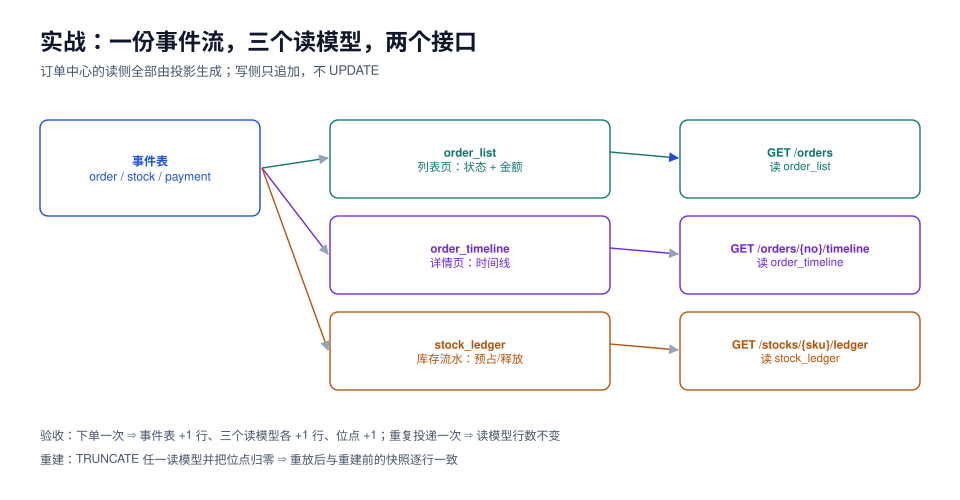

# 实战：订单中心的事件时间线与三个读模型

本页判据族 `ESX-A` ~ `ESX-H`，共 8 条。定义表在第七节。

前面六页讲的都是单点。这一页把它们装成一个能跑的东西：**一份订单事件流，三个读模型，两个接口**，并且给出「怎么验证它真的对」的命令——不是「跑起来不报错」，而是「事件加一条，三个读模型各加一条，位点加一；重复投递一次，行数不变」。

素材来自本仓库的 [EventOrderHub](../../../../project/Complete/EventOrderHub/index.md) 项目（周期 7）。项目侧的建表与工程骨架在那边，本页只负责「事件读侧怎么落地、怎么验收」。



## 一、要做的三张读模型

| 读模型 | 服务谁 | 主键 | 关键列 | 更新频率 |
| --- | --- | --- | --- | --- |
| `order_list` | 列表页、搜索页 | `order_no` | 状态、金额、下单时间、最后事件时间 | 每事件 |
| `order_timeline` | 详情页时间线 | `(order_no, seq)` 自增 | 事件类型、发生时间、人话描述 | 每事件（追加） |
| `stock_ledger` | 库存流水、对账 | `(sku, seq)` 自增 | 预占/释放数量、来源单号 | 每事件（追加） |

三张表刻意选了不同的形态：`order_list` 是**覆盖型**（UPSERT），另两张是**追加型**（INSERT）。这两种形态的幂等策略不一样，正好把[投影](../Projection/index.md)里的两种做法都用一遍。

```sql
CREATE TABLE order_list (
  order_no      text PRIMARY KEY,
  tenant_id     text        NOT NULL,
  status        text        NOT NULL,
  total_cents   bigint      NOT NULL,
  paid_cents    bigint      NOT NULL DEFAULT 0,
  last_version  int         NOT NULL,
  last_event_at timestamptz NOT NULL,
  updated_at    timestamptz NOT NULL DEFAULT now()
);
CREATE INDEX order_list_tenant_status_idx ON order_list (tenant_id, status, last_event_at DESC);

CREATE TABLE order_timeline (
  order_no   text        NOT NULL,
  seq        bigint      GENERATED ALWAYS AS IDENTITY,
  event_id   uuid        NOT NULL,
  event_type text        NOT NULL,
  summary    text        NOT NULL,
  occurred_at timestamptz NOT NULL,
  PRIMARY KEY (order_no, seq),
  UNIQUE (event_id)                       -- 追加型投影的幂等靠这个
);

CREATE TABLE stock_ledger (
  sku        text   NOT NULL,
  seq        bigint GENERATED ALWAYS AS IDENTITY,
  event_id   uuid   NOT NULL,
  delta      int    NOT NULL,             -- 正=释放，负=预占
  order_no   text   NOT NULL,
  occurred_at timestamptz NOT NULL,
  PRIMARY KEY (sku, seq),
  UNIQUE (event_id)
);
```

::: danger 追加型投影的幂等只能靠唯一约束
`order_timeline` 与 `stock_ledger` 都是「来一条事件加一行」，天然不幂等。`UNIQUE (event_id)` 是唯一可靠的兜底：重复投递时 `INSERT … ON CONFLICT DO NOTHING` 影响 0 行，既不报错也不重复。

没有这个约束，一次重放就会让时间线出现两条「已支付」，用户看到的是「付了两次钱」。
:::

## 二、投影器：一个批、一个事务、一个位点

```java
@Component
public class OrderProjection {
    private static final int BATCH = 500;

    @Transactional
    public int projectOnce() {                       // 返回本轮处理条数；0 表示追平
        var cp = checkpoint.load("order_projection");          // FOR UPDATE，防多实例并发
        var events = store.readAfter(cp.processedSeq(), BATCH); // ORDER BY global_seq
        if (events.isEmpty()) return 0;

        for (var e : events) {
            switch (e.type()) {
                case "OrderCreated"   -> { upsertList(e, "CREATED"); appendTimeline(e, "创建订单"); }
                case "StockReserved"  -> { upsertList(e, null);      appendLedger(e, -e.qty()); }
                case "StockReleased"  -> appendLedger(e, +e.qty());
                case "OrderPaid"      -> { upsertList(e, "PAID");    appendTimeline(e, "支付成功"); }
                case "OrderShipped"   -> { upsertList(e, "SHIPPED"); appendTimeline(e, "已发货"); }
                case "OrderRefunded"  -> { upsertList(e, "REFUNDED"); appendTimeline(e, "已退款"); }
                default -> throw new IllegalStateException("未映射事件: " + e.type());  // 毒丸，进死信
            }
        }
        checkpoint.advance("order_projection", events.getLast().globalSeq());  // 同事务
        return events.size();
    }
}
```

三个细节决定它能不能上生产：

1. **`FOR UPDATE` 锁位点行**：多实例部署时只有一个实例能推进同一段，避免重复处理；
2. **`default -> throw`**：新事件类型上线但投影没跟上时立刻暴露，而不是静默丢数据；
3. **`advance` 在同一个事务**：这是[投影](../Projection/index.md)的禁令一，任何「先写库再推进位点」都会在故障时留下坏账。

## 三、两个接口

```http
GET /api/orders?status=PAID&page=1&size=20
```

```sql
SELECT order_no, status, total_cents, last_event_at
FROM order_list
WHERE tenant_id = $1 AND status = $2
ORDER BY last_event_at DESC
LIMIT 20 OFFSET 0;          -- 走 (tenant_id, status, last_event_at) 复合索引
```

```http
GET /api/orders/{orderNo}/timeline
```

```sql
SELECT seq, event_type, summary, occurred_at
FROM order_timeline WHERE order_no = $1 ORDER BY seq;
```

两个接口都**只读读模型**，谁都不去折叠事件流。唯一的例外是详情页的「读己之写」：写接口返回 `lastVersion`，详情页带上它，最多等 300 ms（见[一致性](../Consistency/index.md)）。

## 四、端到端验收：六条断言

这不是「点一下页面没报错」，而是六条能自动判定的断言：

| # | 操作 | 期望 | 判定命令 |
| --- | --- | --- | --- |
| 1 | 下一单（`POST /api/orders`） | 事件表 +1（`OrderCreated`），`order_list` +1 行，`order_timeline` +1 行，位点 +1 | 见下方 SQL |
| 2 | 同一 `commandId` 再下一次 | 事件表不变（幂等），读模型不变 | `count(*)` 前后相等 |
| 3 | 支付回调（`OrderPaid`） | `order_list.paid_cents` = 金额，状态 `PAID` | 查询比对 |
| 4 | 重复投递同一条事件（重放同一区间） | 三个读模型行数不变 | 位点回退 1 后重跑 |
| 5 | `TRUNCATE order_list` 后重建 | 行数与聚合值与重建前一致 | 重建脚本 + 校验 SQL |
| 6 | 投影器停 30 秒再恢复 | `lag_events` 先涨后归零，页面不 5xx | 监控 + 接口探活 |

```sql
-- 断言 1：一条命令之后，四处都要 +1
SELECT
  (SELECT count(*) FROM events WHERE stream_id = $1)                       AS events_cnt,
  (SELECT count(*) FROM order_list WHERE order_no = $2)                    AS list_cnt,
  (SELECT count(*) FROM order_timeline WHERE order_no = $2)                 AS timeline_cnt,
  (SELECT processed_seq FROM projection_checkpoint WHERE name='order_projection') AS checkpoint;
-- 期望：events_cnt = 1，list_cnt = 1，timeline_cnt = 1，checkpoint 与 max(global_seq) 相等

-- 断言 4：重放不改变结果
UPDATE projection_checkpoint SET processed_seq = processed_seq - 1 WHERE name = 'order_projection';
-- 重跑投影器后
SELECT count(*) FROM order_timeline WHERE order_no = $2;   -- 期望：仍为 1（不是 2）
SELECT sum(delta) FROM stock_ledger WHERE order_no = $2;    -- 期望：与重放前一致
```

::: tip 断言 5 才是这套架构的真正价值
「删掉读模型还能一模一样地重建回来」——这一条过了，说明读模型确实是派生数据；这一条不过，说明有人在某处手工改过读模型，或者投影依赖了外部状态。

演练方法：`TRUNCATE` 三张读模型 → 位点归零 → 跑重建 → 与重建前的快照（`pg_dump -t order_list`）逐行 `EXCEPT` 比对。
:::

## 五、本机实测的读数（可以直接对照）

用 25 万条事件的库跑这三张读模型：

| 项 | 读数 | 说明 |
| --- | --- | --- |
| 全量重建 200,000 事件 → 2,000 行 `order_list` | **108 ms** | 集合聚合，约 185 万事件/秒 |
| 增量投影 2,000 事件（逐行 UPSERT） | **19.8 ms** | 约 10 万事件/秒 |
| 单流折叠 50,000 事件（无快照） | **17.4 ms** | 详情页不能用这条路 |
| 单流折叠 200 事件（有快照） | **0.17 ms** | 详情页正常路径 |
| 追加 1 条事件（含唯一索引） | 约 **0.5 ms** | 单事务、单条 |
| 存储 | **300 B/事件** | 1 亿事件 ≈ 30 GB |

一条经验：**重建比追增量快**（108 ms 处理 20 万 vs 19.8 ms 处理 2 千）。所以「投影落后很多」时，正确动作往往是**直接重建读模型**，而不是慢慢追。

## 六、排错顺序

读侧出问题时，按这个顺序看，能少走很多弯路：

```text
1. SELECT max(global_seq) FROM events;                     -- 事件写进来了吗
2. SELECT * FROM projection_checkpoint;                     -- 位点停在哪
3. SELECT * FROM projection_dead_letter WHERE resolved_at IS NULL;  -- 有没有毒丸
4. 用手工 SQL 折叠该流，与读模型对比                        -- 是投影错还是事件错
5. 只有确认投影逻辑错，才重建
```

第 4 步是分水岭：**事件对而读模型错 → 投影问题；事件本身就错 → 写入路径问题**。跳过这一步直接重建，等于把「写入 bug」也一起重放一遍。

## 七、本页判据

| 编号 | 判据 | 看什么现象 | 不满足时改哪里 |
| --- | --- | --- | --- |
| `ESX-A` | 三个读模型都有明确的主键与幂等策略（覆盖型 UPSERT / 追加型 `UNIQUE(event_id)`） | `\d` 能看到约束 | 补约束 |
| `ESX-B` | 投影器 `switch` 的 `default` 是抛错 + 进死信，不是静默跳过 | 代码可见 | 改 |
| `ESX-C` | 位点行在投影事务里被 `FOR UPDATE` 锁定 | 有 `SELECT … FOR UPDATE` | 补，防多实例重复处理 |
| `ESX-D` | 列表接口走复合索引，`EXPLAIN` 无 Seq Scan | `EXPLAIN` 输出 | 补索引 |
| `ESX-E` | 「重复投递不改变行数」有自动化用例 | 测试用例存在并通过 | 补 |
| `ESX-F` | 「TRUNCATE 后重建结果一致」有演练记录 | 演练文档 + 校验输出 | 补 |
| `ESX-G` | 排错顺序写进值班手册，且第 4 步（手工折叠对比）有 SQL 模板 | 手册有该节 | 补 |
| `ESX-H` | 读侧有滞后指标，写侧返回版本令牌 | 监控 + 响应体 | 补 |

## 八、验证方式

```shell
# ① 起本地栈（三个容器：PG / Kafka / 应用）
docker compose -f deploy/compose.yaml up -d
curl -s localhost:8080/actuator/health | jq '.components | keys'
# 期望：["db","diskSpace","kafka","ping"]

# ② 下单
curl -s -X POST localhost:8080/api/orders \
  -H 'Content-Type: application/json' -H 'Idempotency-Key: cmd-001' \
  -d '{"sku":"SKU-1","qty":2,"amountCents":12800}' | jq
# 期望：返回 orderNo 与 version（读己之写用的令牌）

# ③ 三张读模型各有 1 行
docker exec eoh-postgres psql -U postgres -d eoh -c \
  "SELECT (SELECT count(*) FROM order_list) list, (SELECT count(*) FROM order_timeline) timeline, (SELECT count(*) FROM stock_ledger) ledger;"
# 期望：list=1 timeline=1 ledger=1

# ④ 幂等：同一 Idempotency-Key 再下二次
curl -s -X POST localhost:8080/api/orders -H 'Idempotency-Key: cmd-001' -d '{...}' | jq
docker exec eoh-postgres psql -U postgres -d eoh -c "SELECT count(*) FROM events;"
# 期望：事件数不变（仍为 1）
```

## 参考资料

- 本仓库项目：[EventOrderHub 项目总览](../../../../project/Complete/EventOrderHub/index.md)、[第 2 周第 1 步·工程骨架](../../../../project/Complete/EventOrderHub/Bootstrap/index.md)
- 本仓库相邻专题：[投影与读模型](../Projection/index.md)、[读写一致性](../Consistency/index.md)、[电商系统设计](../../Ecommerce/index.md)
- PostgreSQL 18 Documentation: *INSERT … ON CONFLICT*、*Partial Indexes*
