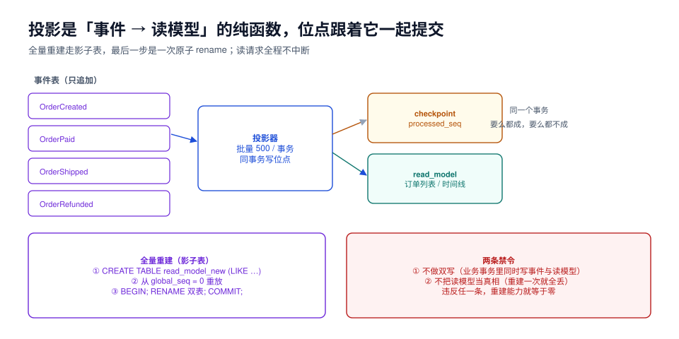

# 投影与读模型：位点、幂等与重建

本页判据族 `ESP-A` ~ `ESP-H`，共 8 条。定义表在第七节。

投影（Projection）是「事件 → 读模型」的函数。它看起来只是「把事件写到另一张表」，但真正决定这套系统能不能运维的是三件事：**位点跟读模型一起提交**（不重不漏的边界）、**重复投递不改变结果**（幂等）、**随时能重建**（派生数据的定义）。

本页给出一套能落地的投影器骨架，以及两个必须提前立下的禁令。



## 一、投影是纯函数，位点是它的书签

```text
read_model = project(events[0..watermark])
```

这句式里有两个东西必须**在同一个事务里**落盘，否则一定出现「事件处理了但位点没动」或「位点动了但事件没处理」：

```sql
BEGIN;

-- ① 投影业务写入（幂等：同一事件处理两次结果相同）
INSERT INTO order_list (order_no, status, total_cents, updated_at)
VALUES ($1, $2, $3, now())
ON CONFLICT (order_no) DO UPDATE
  SET status = EXCLUDED.status,
      total_cents = EXCLUDED.total_cents,
      updated_at = EXCLUDED.updated_at
  WHERE order_list.updated_at <= EXCLUDED.updated_at;   -- 防旧事件覆盖新状态

-- ② 位点推进（同一个事务）
UPDATE projection_checkpoint
   SET processed_seq = $4, updated_at = now()
 WHERE name = 'order_list';

COMMIT;
```

```sql
CREATE TABLE projection_checkpoint (
  name          text PRIMARY KEY,
  processed_seq bigint      NOT NULL DEFAULT 0,
  updated_at    timestamptz NOT NULL DEFAULT now(),
  note          text
);
```

::: danger 位点与读模型分开提交，必然出现两种坏账
1. **先写读模型、后推进位点**：位点推进失败 → 下一轮重新处理同一批 → 如果投影非幂等（比如 `total = total + amount`），结果被算两遍；
2. **先推进位点、后写读模型**：读模型写失败 → 那批事件永久丢失 → 读模型永远少一块，而且**没有任何报错**。

第二种更致命，因为它不会自愈。**位点和读模型必须在同一个事务里**，这是投影器唯一不可让步的设计。
:::

## 二、幂等的三种实现与各自的边界

| 实现 | 写法 | 适用 | 边界 |
| --- | --- | --- | --- |
| **UPSERT 覆盖** | `ON CONFLICT DO UPDATE SET … = EXCLUDED.…` | 读模型是「当前状态」的镜像 | 事件乱序时会用旧值覆盖新值（要加版本比较） |
| **事件去重表** | 处理前 `INSERT INTO processed(event_id) ON CONFLICT DO NOTHING`，影响 0 行就跳过 | 累加型投影（流水、计数） | 多一张表，随事件量增长 |
| **天然幂等写** | `SET status = 'PAID'`（绝对值而非增量） | 状态机类读模型 | 需要事件本身携带绝对值 |

最稳的组合是「**UPSERT 覆盖 + 版本比较**」：不用去重表，也不会被乱序打回旧值。

```sql
INSERT INTO order_list (order_no, status, total_cents, last_version)
VALUES ($1, $2, $3, $4)
ON CONFLICT (order_no) DO UPDATE
  SET status       = EXCLUDED.status,
      total_cents  = EXCLUDED.total_cents,
      last_version = EXCLUDED.last_version
  WHERE order_list.last_version < EXCLUDED.last_version;  -- 只接受更新的版本
```

::: tip 累加型投影必须用去重表
「今日 GMV +128 元」这种投影，天然不幂等：同一事件处理两次就多算一次。这时 `processed(event_id)` 表不是可选项。

```sql
INSERT INTO projection_processed (projection, event_id) VALUES ('gmv_daily', $1)
ON CONFLICT DO NOTHING;   -- 影响 0 行 → 说明处理过，直接跳过本条事件
```
代价是这张表会跟事件表一样大，需要按时间分区并定期归档。
:::

## 三、批量、背压与位点的推进粒度

投影器通常按批处理，批大小决定三件事：**吞吐、滞后、失败重放的范围**。

| 批大小 | 吞吐 | 失败时重放 | 建议 |
| --- | --- | --- | --- |
| 1 | 最低（每事件一次事务） | 1 条 | 只用于调试 |
| 100~500 | 高 | 一批 | **默认值** |
| 5,000+ | 略高 | 一大批 | 只在补数据时用 |

本机实测的投影吞吐（同一份事件，SQL 侧聚合）：

| 操作 | 数据量 | 耗时 | 吞吐 |
| --- | --- | --- | --- |
| 全量投影（200,000 事件 → 2,000 行读模型） | 20 万 | **108 ms** | 约 185 万事件/秒（聚合型） |
| 增量投影（2,000 事件 → UPSERT 2,000 行） | 2,000 | **19.8 ms** | 约 10 万事件/秒（逐行 UPSERT） |

两个数字差 18 倍，原因不是「聚合比 UPSERT 快」，而是**全量那条是集合操作（一次扫描 + 一次写入），增量那条是 2,000 次索引查找**。这解释了一个常见现象：**重建往往比追增量快**——所以「投影落后了就直接重建」经常是更划算的选择。

## 四、重建：影子表 + 原子切换

重建的正确姿势不是「先 TRUNCATE 再重放」——那段时间读接口会返回空。用影子表：

```sql
-- ① 建影子表（结构与正式表一致）
CREATE TABLE order_list_new (LIKE order_list INCLUDING ALL);

-- ② 从 0 重放，写影子表（可以限速、可以断点续跑）
--    投影器接受一个 --target=order_list_new 参数即可
INSERT INTO order_list_new (order_no, status, total_cents, last_version)
SELECT ... FROM events WHERE global_seq > 0 ORDER BY global_seq;

-- ③ 校验：行数、关键聚合、抽样逐行
SELECT (SELECT count(*) FROM order_list) AS old_rows,
       (SELECT count(*) FROM order_list_new) AS new_rows,
       (SELECT sum(total_cents) FROM order_list) AS old_sum,
       (SELECT sum(total_cents) FROM order_list_new) AS new_sum;

-- ④ 原子切换（一个事务内完成，读请求只会看到旧表或新表）
BEGIN;
ALTER TABLE order_list RENAME TO order_list_old;
ALTER TABLE order_list_new RENAME TO order_list;
COMMIT;

-- ⑤ 观察一段时间后再删旧表
DROP TABLE order_list_old;
```

::: danger 重建期间的三个陷阱
1. **重建时还在追增量**：影子表建好后、切换前，线上又有新事件。做法是**切换前把影子表追平到位点**（再跑一轮增量到影子表），或切换后在正式表上补一个小窗口。
2. **切换时锁表**：`RENAME` 需要 `ACCESS EXCLUSIVE` 锁，长事务会挡住它。切换前先 `SELECT pg_terminate_backend` 清掉长事务，或用 `lock_timeout` 快速失败重试。
3. **忘了重建 `checkpoint`**：新表上线但位点还是旧的 → 下一批从旧位点开始 → 重复处理（幂等则无害，非幂等则翻倍）。切换时把位点一起重置。
:::

## 五、两条禁令

::: danger 禁令一：不做双写
「业务事务里同时写事件表与读模型」看起来省事，实际上同时引入了两个问题：

- **不一致**：两个写有一个失败，就出现「事件有、读模型没有」或反之；
- **重建失效**：重建会覆盖业务写入，重建完读模型里会出现「事件里没有的状态」。

正确做法：读模型只能由投影器从事件派生。需要「立即看到」的场景，用[一致性](../Consistency/index.md)里的读己之写方案，而不是双写。
:::

::: danger 禁令二：不手工修读模型
读模型对不上时，唯一允许的动作是「修投影器 → 重建」。手工 `UPDATE` 一行会让这个流与历史永久分叉，而且**下一次重建会把你的修正抹掉**——问题会在某个不确定的时间以更隐蔽的方式回来。
:::

## 六、投影的分区与并行

单线程投影器在事件量上去之后会成为瓶颈。三种并行方式：

| 方式 | 做法 | 前提 | 风险 |
| --- | --- | --- | --- |
| **按聚合分区** | `hash(stream_id) % N`，每个 worker 负责一部分流 | 投影结果只依赖单流事件 | 跨流聚合（如「全站 GMV」）不能这么拆 |
| **按事件类型拆投影** | `OrderPaid` 一个投影器、`StockReserved` 一个 | 各投影互不依赖 | 每个投影器各自扫一遍事件表，IO 翻倍 |
| **按 `global_seq` 区间** | 每段一个 worker，位点分段 | 事件之间无因果依赖 | 有因果依赖时会读到自己还没写的状态 |

默认建议：**先按聚合分区**（最安全），把「全站统计」单独做成一个低频批处理投影。硬要按 `global_seq` 并行，必须能证明事件之间没有跨流的因果依赖——大多数业务做不到这一点。

## 七、本页判据

| 编号 | 判据 | 看什么现象 | 不满足时改哪里 |
| --- | --- | --- | --- |
| `ESP-A` | 位点与读模型在**同一个事务**提交 | 投影器代码里 commit 只有一处 | 合并事务 |
| `ESP-B` | 每类投影有独立的 `checkpoint` 记录（`name` 唯一） | `projection_checkpoint` 有多行 | 一个投影一行，别共用 |
| `ESP-C` | 投影幂等：同一批事件跑两次，行数与聚合值不变 | 演练过（重放同一区间） | 加 UPSERT 版本比较或去重表 |
| `ESP-D` | 存在重建脚本，且走影子表 + 原子切换 | 有 `rebuild` 命令与 `*_new` 表 | 补；禁止 TRUNCATE 重建 |
| `ESP-E` | 业务代码里**没有**直接写读模型 | 检索 `INSERT INTO order_list` 只在投影器里 | 删掉双写 |
| `ESP-F` | 投影失败有记录与重试，不是静默跳过 | 有 `projection_error` 表或日志 + 指标 | 补（毒丸事件见第八节） |
| `ESP-G` | 投影器可限速（每秒事件数可配） | 有 `rateLimit` 参数 | 补；重建会打满库 |
| `ESP-H` | 重建后有校验（行数 + 聚合 + 抽样） | 有校验 SQL 或脚本 | 补；只对行数不够 |

## 八、毒丸事件：投影卡在一条事件上怎么办

一条反序列化失败或违反约束的事件会让投影器**永远卡在那条**，位点不动，滞后无限增长。处置顺序：

1. **不要跳过**：跳过等于永久丢失一条事实；
2. **先隔离**：把这批事件的 `global_seq`、`event_type`、错误信息写进 `projection_dead_letter`；
3. **修投影器**：多数情况是投影器没处理某个新事件类型（见[版本](../Versioning/index.md)）；
4. **确实处理不了**：追加一条补偿事件让状态可折叠，而不是删原事件；
5. **恢复**：修好后从位点重跑，死信表里的记录标记已解决。

```sql
CREATE TABLE projection_dead_letter (
  id          bigserial PRIMARY KEY,
  projection  text   NOT NULL,
  global_seq  bigint NOT NULL,
  event_type  text   NOT NULL,
  error       text   NOT NULL,
  resolved_at timestamptz,
  created_at  timestamptz NOT NULL DEFAULT now()
);
```

## 九、验证方式

```sql
-- ① 幂等：同一批事件投两次，读模型必须不变
--    （把 checkpoint 回退一批，再跑一次投影器）
UPDATE projection_checkpoint SET processed_seq = processed_seq - 500 WHERE name = 'order_list';
-- 跑投影器后对比：
SELECT count(*), sum(total_cents) FROM order_list;
-- 期望：与回退前完全一致

-- ② 位点与读模型一致：读模型里的最大版本不应超过位点
SELECT max(last_version) AS model_version,
       (SELECT processed_seq FROM projection_checkpoint WHERE name = 'order_list') AS checkpoint
FROM order_list;
-- 期望：model_version <= checkpoint（允许读模型只到某个事件，不允许超前）

-- ③ 重建校验
SELECT count(*) FROM order_list;        -- 与 order_list_new 比对
SELECT sum(total_cents) FROM order_list;
```

## 参考资料

- PostgreSQL 18 Documentation: *INSERT … ON CONFLICT*、*ALTER TABLE*（`RENAME` 与锁级别）
- Martin Fowler, *CQRS*（读模型与投影）
- 本仓库相邻专题：[读写一致性](../Consistency/index.md)、[运维：分区、归档与重放演练](../Ops/index.md)、[数据库变更与在线 Schema 演进](../../../DB/SchemaEvolution/index.md)
