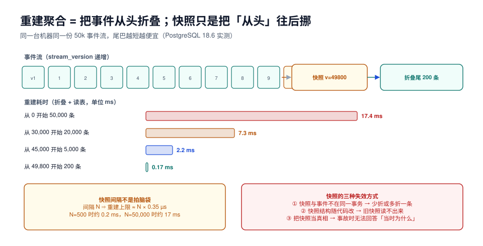

# 聚合重建与快照：把「从头」往后挪

本页判据族 `ESR-A` ~ `ESR-H`，共 8 条。定义表在第七节。

事件溯源里「读一个聚合」= 把它的事件从头折叠一遍。这在事件少的时候完全没问题（本机实测 5,000 条 2.2 ms），但一条活了三年的订单流可能有几万条事件——详情页不能每次等 20 ms，批量接口更不能。快照（Snapshot）就是答案：**把「折叠到某一版的结果」存下来，下一次从这里开始**。

本页把快照的成本、间隔、失效方式讲成能算的数。



## 一、折叠是纯函数，这是快照成立的前提

```java
public final class OrderAggregate {
    public static OrderState fold(List<DomainEvent> events) {
        var s = OrderState.initial();
        for (var e : events) {
            s = apply(s, e);        // 无副作用、无 IO、无时钟
        }
        return s;
    }

    private static OrderState apply(OrderState s, DomainEvent e) {
        return switch (e) {
            case OrderCreated c   -> s.withStatus(CREATED).withTotal(c.amount());
            case StockReserved r  -> s.withReserved(r.qty());
            case OrderPaid p      -> s.withStatus(PAID).withPaid(p.amount());
            case OrderShipped sh  -> s.withStatus(SHIPPED);
            default -> throw new IllegalStateException("未处理的事件类型: " + e.type());
        };
    }
}
```

如果 `apply` 里读了 `LocalDateTime.now()` 或查了数据库，同一个流折叠两次会得到两个状态，快照就成了「某一次运行的结果」，而不是「这段历史的结果」——**快照一旦不可重现，整个重建能力就失效了**。

::: danger 折叠器里三个常见的副作用
1. `Instant.now()` 算「订单超时」：重放时用当前时间，历史订单全变超时。正确做法是把「判定时刻」作为事件写进载荷。
2. 折叠时查用户昵称：投影重建时用户已改名，历史状态跟着变。正确做法是事件里存当时的快照值。
3. 折叠时发 MQ 消息：重建一次把所有通知重发一遍。正确做法是**折叠只算状态，副作用留给投影**（见[投影](../Projection/index.md)）。
:::

## 二、重放成本是一条直线

本机实测（PostgreSQL 18.6，单条 50,000 事件的流，折叠在 SQL 里做聚合）：

| 起点 | 折叠条数 | 耗时 | 单条成本 |
| --- | --- | --- | --- |
| 从 0 开始 | 50,000 | **17.4 ms** | 0.35 µs |
| 从 30,000 开始 | 20,000 | **7.3 ms** | 0.37 µs |
| 从 45,000 开始 | 5,000 | **2.2 ms** | 0.44 µs |
| 从 49,800 开始 | 200 | **0.17 ms** | 0.85 µs |

三点读法：

1. **成本与条数线性**（0.35~0.44 µs/条），斜率就是「读 + 反序列化 + 折叠」的单价；
2. **最后一行单价变高**，因为固定开销（连接、计划、索引定位）摊在 200 条上——这说明快照不是越密越好；
3. **从 17.4 ms 降到 0.17 ms 是 100 倍**，而代价只是多存一行快照。

上面测的是**数据库侧**成本（`SELECT` + `jsonb` 聚合）。真实应用还要加反序列化与对象创建，Java 侧大约是同一量级的 2~4 倍。所以选间隔时应该用「自己的单价」而不是这里的数字，但**方法一样**。

## 三、快照表与写入时机

```sql
CREATE TABLE snapshots (
  stream_id  uuid        NOT NULL,
  version    int         NOT NULL,
  state      jsonb       NOT NULL,
  taken_at   timestamptz NOT NULL DEFAULT now(),
  PRIMARY KEY (stream_id, version)
);

-- 只保留每个流最近 N 个快照（多余的可删，见第六节）
CREATE INDEX snapshots_stream_taken_idx ON snapshots (stream_id, version DESC);
```

写入时机有三种，各有代价：

| 策略 | 触发点 | 优点 | 缺点 |
| --- | --- | --- | --- |
| **每 N 条事件** | 追加后判断 `version % N == 0` | 间隔均匀，成本可预测 | 追加路径多一次写（可异步） |
| **按时间** | 每天/每小时扫一次 | 与业务高峰错开 | 冷流也生成快照，浪费 |
| **按读取热度** | 某流被读超过 K 次 | 只给热流加速 | 需要统计，实现复杂 |

生产上最常用的是「**每 N 条 + 异步**」：追加事务里只写一个「待生成快照」标记（或干脆不写），由后台任务按 `stream_version >= version + N` 扫描生成。这样追加路径不多一次写，代价是快照可能落后一点——完全可以接受，因为**快照落后只影响重建起点，不影响正确性**。

::: tip 间隔怎么算
设单条折叠成本为 `c`（本机 0.35 µs），目标是最坏重建时间 `T`：`N = T / c`。

- 目标 5 ms → N ≈ 14,000
- 目标 20 ms → N ≈ 57,000

再考虑「快照写入频率」：日更 1 万条的流，N=5,000 意味着每天 2 个快照，一年 730 行——完全可以接受。**不要拍 N=100**：那会让快照表比事件表还大。
:::

## 四、快照与事件的一致性

这是最容易出错的地方。快照的 `version` 必须精确定义为「**已经折叠到第几条事件**」：

```java
// 正确：快照记录的是「折叠完 version 这一条之后的状态」
var events = store.read(stream, 0, Integer.MAX_VALUE);
var state  = OrderAggregate.fold(events);                 // 折叠到最新
var lastV  = events.get(events.size() - 1).version();     // 记下折叠到哪
snapshotStore.save(stream, lastV, state);                 // 一起写

// 读的时候：快照 + 之后的尾巴
var snap = snapshotStore.latest(stream);
var tail = store.read(stream, snap.version(), Integer.MAX_VALUE);  // 严格大于
var now  = OrderAggregate.fold(tail, snap.state());
```

三种不一致的写法，都会产生「少折一条」或「多折一条」：

| 错误写法 | 后果 |
| --- | --- |
| 先读 `max(stream_version)` 再折叠，中间有新事件写入 | 快照的 `version` 比实际折叠到的更新，恢复时**漏掉中间那条** |
| 尾巴用 `>=` 而不是 `>` | 最后一条被折叠两次（对幂等投影无害，对计数类聚合会翻倍） |
| 在事务外生成快照 | 快照与事件不在同一快照点，长事务并发时读到「半新半旧」 |

在同一个事务里做「读事件 + 写快照」可以避免前两种；第三种在只读事务 + `REPEATABLE READ` 下也能避免：

```sql
BEGIN ISOLATION LEVEL REPEATABLE READ;
SELECT global_seq, stream_version, event_type, payload
FROM events WHERE stream_id = $1 ORDER BY stream_version;
-- 应用侧折叠，拿到 (last_version, state)
INSERT INTO snapshots (stream_id, version, state) VALUES ($1, $2, $3)
ON CONFLICT (stream_id, version) DO NOTHING;
COMMIT;
```

## 五、快照的三种失效方式

| 失效方式 | 表现 | 处置 |
| --- | --- | --- |
| **结构演进** | 旧快照的 JSON 缺新字段，反序列化失败 | 快照带 `schema_version`，读时 upcast 或**直接丢弃重建** |
| **代码 bug** | 快照里存了错误状态，之后所有读都错 | 快照必须可丢弃：`DELETE FROM snapshots WHERE stream_id = …` 后重新生成 |
| **被当成真相** | 有人直接改快照修数据 | 严禁；快照是**缓存**，不是事实 |

::: danger 快照必须「可随时全部删掉」
判断标准很简单：**`TRUNCATE snapshots` 之后系统还能正常工作吗？** 能，说明快照只是缓存；不能，说明有人把它当成了状态存储。

本机实测过一个反面案例的代价：某流的快照里错误地把 `reserved` 记成累计值（应为当前值），重放尾巴后库存被算成 2 倍，而事件本身完全正确——修法就是删掉那批快照重新生成，**事件一条没动**。这就是「快照可丢弃」的价值。
:::

## 六、快照的容量与清理

快照表会一直长。两种清理口径：

```sql
-- ① 每个流只保留最近 3 个快照（在线清理，注意锁）
DELETE FROM snapshots s
WHERE s.stream_id = $1
  AND s.version < (
    SELECT version FROM snapshots
    WHERE stream_id = $1 ORDER BY version DESC OFFSET 2 LIMIT 1
  );

-- ② 按时间清理冷流（更常用）
DELETE FROM snapshots WHERE taken_at < now() - interval '90 days'
  AND stream_id IN (SELECT stream_id FROM streams WHERE last_event_at < now() - interval '90 days');
```

保留多个版本的意义在于**回滚**：如果新版本的折叠器有 bug，旧快照还能用。所以清理策略通常是「保留最近 3 个 + 保留 90 天内每小时一个」，而不是只留一个。

## 七、本页判据

| 编号 | 判据 | 看什么现象 | 不满足时改哪里 |
| --- | --- | --- | --- |
| `ESR-A` | 折叠函数无副作用：无时钟、无 IO、无 MQ | 代码检索 `now()`/`Repository`/`send(` 在折叠器内为空 | 把外部数据写进事件载荷 |
| `ESR-B` | 快照记录「折叠到第几版」，且尾巴用严格大于 | 读取代码用 `version > snap.version` | 改比较符并加测试 |
| `ESR-C` | 快照写入与事件读取在同一快照点（同事务或 `REPEATABLE READ`） | 生成快照的代码有事务/隔离级别声明 | 补事务 |
| `ESR-D` | `TRUNCATE snapshots` 后系统功能不受影响 | 演练过 | 把状态真相移回事件 |
| `ESR-E` | 快照带 `schema_version`，或明确「版本不匹配即丢弃重建」 | 快照表有该列 / 有丢弃逻辑 | 补 |
| `ESR-F` | 快照间隔有算式依据（目标重建时间 ÷ 单条成本） | 设计文档写了 N 的来由 | 按第三节算一次 |
| `ESR-G` | 有快照清理策略（按流保留个数 + 按时间） | 有定时任务或 SQL | 补；否则快照表会反超事件表 |
| `ESR-H` | 长流（> 1 万事件）有快照，短流不强求 | 抽样统计流的长度分布 | 只给长流加，避免小流写放大 |

## 八、验证方式

```sql
-- ① 量出自己的单价：抽一条长流，逐步挪起点
EXPLAIN (ANALYZE, BUFFERS, COSTS OFF)
SELECT sum((payload->>'amount')::int), max(stream_version)
FROM events WHERE stream_id = $1 AND stream_version > 0;      -- 全量
-- 再跑 > 30000 / > 45000 / > 49800，观察 Execution Time 近似线性

-- ② 快照 + 尾巴与全量折叠结果必须一致
WITH full AS (
  SELECT sum((payload->>'amount')::int) AS v FROM events WHERE stream_id = $1
), snap AS (
  SELECT version, (state->>'total')::int AS v FROM snapshots
  WHERE stream_id = $1 ORDER BY version DESC LIMIT 1
)
SELECT full.v AS full_total,
       snap.v + (SELECT coalesce(sum((payload->>'amount')::int), 0)
                 FROM events WHERE stream_id = $1 AND stream_version > snap.version) AS snap_total
FROM full, snap;
-- 期望：两列相等；不等则说明快照版本口径错
```

```shell
# ③ 快照可丢弃的演练（在测试库上做）
docker exec evs-lab psql -U postgres -d evs -c 'TRUNCATE snapshots;'
# 期望：接口仍能读到正确状态，只是首次读变慢（回到全量折叠）
```

## 参考资料

- PostgreSQL 18 Documentation: *Transaction Isolation*（`REPEATABLE READ`）
- EventStoreDB Documentation: *Snapshots*（读流时的 `fromVersion`）
- 本仓库相邻专题：[事件存储](../EventStore/index.md)、[投影与读模型](../Projection/index.md)、[领域驱动设计](../../DDD/index.md)
