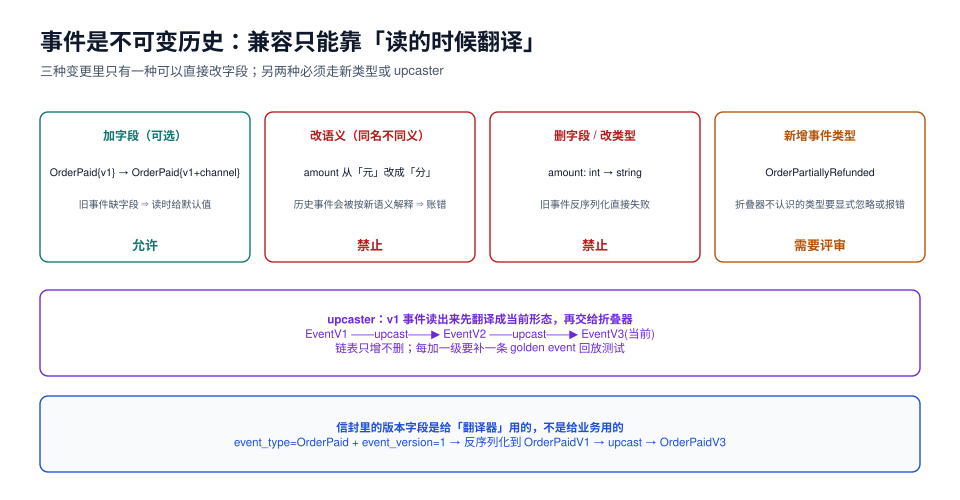

# 事件版本与兼容：只增不改的翻译链

本页判据族 `ESV-A` ~ `ESV-H`，共 8 条。定义表在第六节。

事件存储的核心承诺是「历史不可变」。这条承诺与「业务会变」直接冲突：三个月后 `OrderPaid` 要多一个 `channel` 字段，半年后 `amount` 的单位从「元」改成「分」。**解法不是改历史，而是改读取方式**——旧事件保持原样，读的时候翻译成当前形态。

本页把「哪种变更可以直接做、哪种必须换新类型、哪种永远禁止」写成一张表，并给出可测试的翻译链。



## 一、先分类：四种变更，三种待遇

| 变更 | 例子 | 对历史事件的影响 | 待遇 |
| --- | --- | --- | --- |
| **加可选字段** | `OrderPaid{v1}` → 加 `channel` | 旧事件没有该字段，读时给默认值 | ✅ 允许直接改结构 |
| **加新的必填语义** | 加 `taxRate` 且折叠要用它算 | 旧事件无法算出税额 | ⚠️ 需要 upcaster 补默认，或换新类型 |
| **改字段语义** | `amount` 从「元」变「分」 | 历史事件被按新语义解释，**账目错** | ❌ 禁止；必须新类型 |
| **删字段 / 改类型** | `amount: int → string` | 旧事件反序列化失败 | ❌ 禁止；必须新类型 |

判据不在「改不改代码」，而在「**旧事件读出来还能不能被正确解释**」。这一句话可以挡住 90% 的误改。

::: danger 改语义是最难发现的错
加字段的 bug 会立刻报错（反序列化失败），改语义的 bug 不会——它会安静地把 2023 年的 100 元解释成 100 分，跑完对账才有人发现差了 100 倍。

**判定方法**：把 `git diff` 里事件结构的变更逐条问「旧载荷按新代码解释，结果与当时一致吗？」不一致就必须走新类型。
:::

## 二、信封：版本号放在哪

事件信封（envelope）与事件载荷（payload）是两层，版本号属于信封：

```json
{
  "event_id": "0199f2c1-0000-7000-8000-0000000000f1",
  "event_type": "OrderPaid",
  "event_version": 2,
  "stream_id": "0199f2c1-0000-7000-8000-000000000001",
  "stream_version": 42,
  "occurred_at": "2026-10-22T06:12:31.442Z",
  "payload": { "amountCents": 12800, "channel": "web" }
}
```

| 字段 | 谁在用 | 说明 |
| --- | --- | --- |
| `event_type` + `event_version` | 反序列化器 | 决定用哪个类、走哪条 upcast 链 |
| `payload` | 折叠器 | **只有**载荷结构受版本约束 |
| 其余字段 | 存储/投影/排障 | 不随业务版本变化 |

::: warning 不要把版本号塞进 `event_type`
`OrderPaidV2` 这种命名看起来省事，代价是**折叠器要为每个版本写一个分支**，而且投影按类型过滤时要写 `event_type IN ('OrderPaid','OrderPaidV2','OrderPaidV3')`——每加一版，所有过滤条件都要改。版本号放信封，类型保持稳定。
:::

## 三、upcaster：读的时候翻译

```java
public interface EventUpcaster {
    boolean supports(String type, int version);
    RawEvent upcast(RawEvent raw);              // 升一级
}

// v1 → v2：元改分（唯一一处允许「换算」的地方，且必须写测试）
class OrderPaidV1ToV2 implements EventUpcaster {
    public boolean supports(String type, int v) { return type.equals("OrderPaid") && v == 1; }
    public RawEvent upcast(RawEvent raw) {
        var p = raw.payload();
        return raw.withVersion(2).withPayload(Map.of(
            "amountCents", ((Number) p.get("amount")).longValue() * 100,
            "channel", "legacy"));                 // 旧事件没有渠道，标为 legacy
    }
}

// 链式应用：v1 → v2 → v3 → 当前
RawEvent current(RawEvent raw) {
    while (raw.version() < CURRENT) {
        raw = upcasters.stream()
            .filter(u -> u.supports(raw.type(), raw.version()))
            .findFirst()
            .orElseThrow(() -> new IllegalStateException("缺少 upcaster: " + raw.type() + " v" + raw.version()))
            .upcast(raw);
    }
    return raw;
}
```

三条纪律：

1. **链只增不删**：删掉一级，所有还在库里的更老事件立刻读不出来；
2. **每一级都要有 golden event 回放测试**（第六节）；
3. **upcaster 不许查库**：它必须是从一条旧事件到一条新事件的纯函数，否则重建结果依赖外部状态。

## 四、语义变更：新类型 + 迁移事件

如果 `amount` 的单位必须变（比如接入多币种），正确做法不是改旧类型，而是**定义新类型**，并给存量流追加一条迁移事件：

```json
{ "event_type": "OrderPaidInCents", "event_version": 1, "payload": { "amountCents": 12800, "currency": "CNY" } }
```

折叠器两个类型都认：

```java
case OrderPaid p        -> s.withPaid(Money.ofYuan(p.amount()));       // 旧类型，按元解释
case OrderPaidInCents c -> s.withPaid(Money.ofCents(c.amountCents())); // 新类型，按分解释
```

不追加迁移事件也可以（历史就按旧语义解释），但**折叠器必须永远保留旧分支**——这条分支的删除时机是「所有相关流都已归档且不再需要重建」，通常是永远。

::: tip 什么时候值得追加迁移事件
只有当「旧类型的解释逻辑本身要改」时才需要。比如税率算法改了，旧订单的税额需要用新算法重算：追加一条 `TaxRecalculated` 事件，把新值写进流里，而不是改历史 `OrderPaid`。这样「为什么这个订单的税额和当初显示的不一样」在事件流里有答案。
:::

## 五、兼容矩阵：谁能读谁

| 生产者 \ 消费者 | 旧代码 | 新代码（加可选字段） | 新代码（改语义） |
| --- | --- | --- | --- |
| 旧事件 | ✅ | ✅（默认值） | ❌ 必须 upcast |
| 新事件（加字段） | ⚠️ 忽略未知字段则可用 | ✅ | — |
| 新事件（新类型） | ❌ 不认识 | ✅ | — |

灰度发布期间的顺序很重要：**先发能读新旧两种事件的消费者，再发生产者**。反过来，新事件会被旧消费者当成未知类型——如果消费者对未知类型是「报错」，整条投影就卡住（见[投影](../Projection/index.md)的毒丸一节）。

## 六、回放测试：golden events

每个事件类型保留一组真实样本（脱敏），固定为测试夹具，任何结构变更都要跑一遍：

```text
src/test/resources/golden/
├─ OrderPaid.v1.json          # 2023 年的真实事件（金额单位：元）
├─ OrderPaid.v2.json          # 2024 年加 channel 后
├─ OrderPaidInCents.v1.json   # 2025 年多币种改造后
└─ expected/
   └─ order_state.after.json  # 折叠到当前代码后的期望状态
```

```java
@Test
void golden_events_折叠结果必须稳定() {
    for (var file : goldenFiles()) {
        var raw = readRaw(file);                       // 原始信封
        var current = upcasterChain.current(raw);      // 走完 upcast
        var state = OrderAggregate.fold(List.of(current));
        assertThat(state).isEqualTo(readExpected(file)); // 与期望状态逐字段比
    }
}
```

这条测试的价值在于：**它会在改结构的那一次 CI 里就红**，而不是三个月后对账时才发现。

## 七、本页判据

| 编号 | 判据 | 看什么现象 | 不满足时改哪里 |
| --- | --- | --- | --- |
| `ESV-A` | 信封有 `event_type` + `event_version`，且版本号不拼进类型名 | 抽样事件 JSON | 拆开 |
| `ESV-B` | 事件结构的变更在 PR 里被分类（加可选 / 加必填 / 改语义 / 删字段） | PR 模板有勾选项 | 补模板 |
| `ESV-C` | 改语义或删字段时使用**新类型**，旧类型分支保留 | 折叠器 `switch` 里有旧类型 | 补分支 |
| `ESV-D` | upcaster 是纯函数（不查库、不读时钟） | 代码里无 `Repository`/`now()` | 改 |
| `ESV-E` | upcast 链缺少某一级时**报错**，不静默返回原事件 | 有 `orElseThrow` | 改 |
| `ESV-F` | 每类事件有 golden event 回放测试 | 测试资源目录存在样本 | 补 |
| `ESV-G` | 灰度顺序为「消费者先、生产者后」 | 发布单写明顺序 | 补 |
| `ESV-H` | 消费者对未知 `event_type` 有显式策略（死信而非崩溃） | 代码有 default 分支 + 死信表 | 补 |

## 八、验证方式

```shell
# ① 回放全部 golden 事件（CI 与本地同一条命令）
./gradlew test --tests '*GoldenEventTest*'
# 期望：全部通过；改结构后不通过的那条就是你要处理的兼容问题

# ② 抽样检查库里的历史版本分布
docker exec evs-lab psql -U postgres -d evs -c \
  "SELECT event_type, event_version, count(*) FROM events GROUP BY 1,2 ORDER BY 1,2;"
# 期望：能看到 v1/v2 并存；只有 v1 说明还没开始演进，只有最新版才需要担心 upcast 链缺失
```

```sql
-- ③ 找出「折叠器不认识」的类型（应为空）
SELECT DISTINCT event_type FROM events
WHERE event_type NOT IN ('OrderCreated','StockReserved','OrderPaid','OrderPaidInCents','OrderShipped','OrderRefunded');
```

## 参考资料

- Martin Fowler, *Event Sourcing*（版本与 upcasting 一节）
- Greg Young, *Versioning in an Event Sourced System*
- 本仓库相邻专题：[契约演进与兼容](../../ContractEvolution/index.md)、[投影与读模型](../Projection/index.md)、[数据库变更与在线 Schema 演进](../../../DB/SchemaEvolution/index.md)
