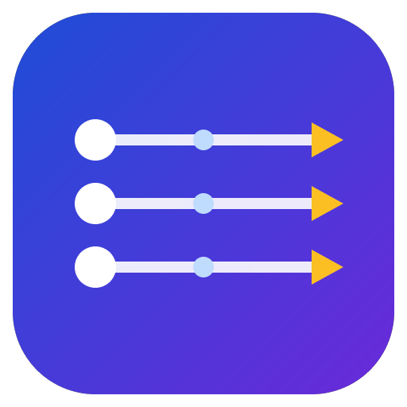
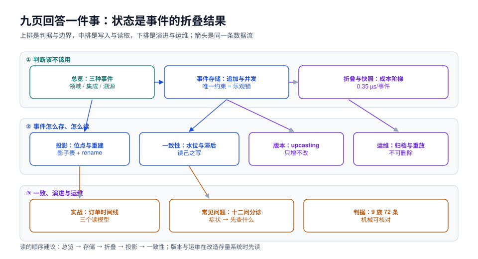

# 事件溯源与 CQRS 落地

事件溯源（Event Sourcing，事件溯源）把「状态」换成「状态的变化序列」：不存订单**现在**是 `PAID`，存的是「创建过、预占过、支付过」这三条事实，当前状态由它们**折叠**（fold）出来。CQRS（Command Query Responsibility Segregation，命令查询职责分离）把读模型从写模型里拆出去：写侧只追加事实，读侧按查询需要重建自己的表。

这两件事经常被一起提，但它们是**两个独立决定**：只用事件溯源不拆读写，读的时候照样折叠；只做 CQRS 不存事件，读模型靠 binlog 或双写同步。本专题把它们拆开讲，再讲它们合在一起时新增的那几个坑。

面向要把「审计能追到每一步、状态能回到任意时刻、同一份事实要供多个视图」做扎实的后端，以及被「读模型和主表对不上」折磨过的团队。

::: tip 一句话理解
**状态是事件的折叠结果，不是一张可以随便 UPDATE 的表。** 写侧只做一件事——追加；读侧想怎么建就怎么建，重建一次就全对。
:::

::: info 与相邻专题的分工
- **领域事件怎么建模、聚合边界怎么划** → [领域驱动设计](../DDD/index.md)：那里管「事件该叫什么、由谁发布」，本专题管「事件怎么存、怎么读回来」。
- **状态机怎么防非法迁移、幂等键怎么设计** → [幂等与状态机工程](../IdempotencyStateMachine/index.md)：那里管「一次命令只生效一次」，本专题管「一次事实只记一条、读的时候怎么重放」。
- **事件怎么可靠地投递给别的服务** → [消息队列](../MessageQueue/index.md)：那里是 outbox + MQ 的投递语义，本专题是**同一份事件同时是本服务的真相**——这是两者最容易混淆的地方，[总览](Overview/index.md)第二节专门划这条线。
- **事件契约怎么演进、消费者怎么兼容** → [契约演进与兼容](../ContractEvolution/index.md)：那里管 API/消息契约的兼容矩阵，本专题的[版本](Versioning/index.md)只讲事件这一种载荷。
- **表结构怎么在线改** → [数据库变更与在线 Schema 演进](../../DB/SchemaEvolution/index.md)：事件表的 DDL 变更走那套 expand-contract，本专题只强调「事件载荷本身不能靠 DDL 改」。
- **一致性边界怎么划、跨服务怎么最终一致** → [微服务](../Microservices/index.md)：本专题的一致性只到「读模型滞后多少」这一层。
- **订单状态机长什么样** → [电商系统设计](../Ecommerce/index.md)：领域模型在那页，本专题拿它当实战素材。
- **周期 7 项目的工程落地** → [EventOrderHub](../../../project/Complete/EventOrderHub/index.md)：项目侧把本专题的判据落到订单中心。
:::

## 目录

- [总览：三种事件、两条路径与五个必失点](Overview/index.md)
- [事件存储：追加、顺序与并发](EventStore/index.md)
- [聚合重建与快照：把「从头」往后挪](Replay/index.md)
- [投影与读模型：位点、幂等与重建](Projection/index.md)
- [读写一致性：水位、滞后与读己之写](Consistency/index.md)
- [事件版本与兼容：只增不改的翻译链](Versioning/index.md)
- [实战：订单中心的事件时间线与三个读模型](Practice/index.md)
- [运维：分区、归档与重放演练](Ops/index.md)
- [常见问题与分诊](FAQ/index.md)

## 专题地图

## 判据纪律

沿用全库写法：**每页 8 条，编号形如 `ESO-A`**，逐页前缀唯一，可被 `utils/audit` 下的判据类巡检机械核对。每条判据都要能回答三件事：**看什么现象、判成什么、不满足时改哪里**。

| 页 | 判据族 | 条数 | 这一族管什么 |
| --- | --- | --- | --- |
| 总览 | `ESO-A` ~ `ESO-H` | 8 | 事件分类、该不该用、五个必失点 |
| 事件存储 | `EST-A` ~ `EST-H` | 8 | 表结构、唯一约束、全局顺序、批量 |
| 重建与快照 | `ESR-A` ~ `ESR-H` | 8 | 折叠纯函数、快照间隔、快照失效 |
| 投影 | `ESP-A` ~ `ESP-H` | 8 | 位点、幂等、重建、双写禁令 |
| 一致性 | `ESC-A` ~ `ESC-H` | 8 | 水位、滞后、读己之写、对账 |
| 版本 | `ESV-A` ~ `ESV-H` | 8 | 变更分类、upcaster、回放测试 |
| 实战 | `ESX-A` ~ `ESX-H` | 8 | 三个读模型、端到端断言 |
| 运维 | `ESM-A` ~ `ESM-H` | 8 | 分区、归档、重放、容量 |
| 常见问题 | `ESQ-A` ~ `ESQ-H` | 8 | 症状分诊与反模式 |

合计 **9 族 72 条**。

## 事实与版本速览（2026-10 核对）

| 项 | 现状 | 对本专题的影响 |
| --- | --- | --- |
| PostgreSQL 18 | 当前稳定线 **18.6**；内置 `uuidv7()` | 流 ID 用时间有序 UUID，索引更紧凑；实测见[事件存储](EventStore/index.md) |
| `jsonb` 存储 | 支持 TOAST 压缩，可建 GIN 索引 | 事件载荷放 `jsonb`，读出来直接折叠，不必先反序列化成对象 |
| Kafka 4.x | 4.x 起仅 KRaft，不再依赖 ZooKeeper | 事件对外分发时，[消息队列](../MessageQueue/index.md)那套运维结论仍适用 |
| Java 21 / Spring Boot 4.1 | 与库内 [Spring Boot](../Java/Frame/SpringBoot/index.md) 专题口径一致 | 示例用 `record` + 虚拟线程写折叠器与投递器 |
| 产品化方案 | Axon、EventStoreDB、Marten 等 | 本专题只讲判据，不绑定框架；换成任何方案，判据照样成立 |

::: warning 关于「版本目录」这个决定
本库对**两代技术栈并存**的主题按版本建目录（[Spring5](../Java/Frame/Spring/Spring5/index.md) 与 [Spring6](../Java/Frame/Spring/Spring6/index.md)、[Vue2](../../Frontend/Frame/Vue/Vue2/index.md) 与 [Vue3](../../Frontend/Frame/Vue/Vue3/index.md)、`MySQL57` 与 `MySQL84`）。本专题**不按版本建目录**，三条理由：

1. **它不是一套可替换的 API。** 「Spring 5 怎么写 Bean」和「Spring 6 怎么写」是两套能独立阅读的用法；「用 PostgreSQL 存事件」和「用 EventStoreDB 存事件」共享 80% 的判据，差别集中在少数几个能力（全局订阅、投影管理、快照内建），拆成两套目录会立刻产生两份高度重复的正文。
2. **换代的是产品，不是判据。** `EST` 那一族讲的是「唯一约束怎么当乐观锁」，PostgreSQL 上是 `unique(stream_id, stream_version)`，EventStoreDB 上是 `expectedVersion`——措辞不同，判据同一句。判据应该跟着**问题**走，不跟着**实现**走。
3. **旧内容不覆盖。** [领域驱动设计](../DDD/index.md)、[幂等与状态机工程](../IdempotencyStateMachine/index.md)里讲事件与重放的既有页面**一条都没有删改**，本专题只在需要时追加「与事件溯源的关系」一小节并回链。

真需要两套并存的地方只有一处例外：**同一份事件在关系库与专用事件库上的建表/建流差异**，本专题放在[事件存储](EventStore/index.md)第四节做对照表，而不是拆目录。
:::

::: info 关于实测的诚实标注
本专题的读数分两档，页面里逐处标注：

1. **本机实测**：`docker run` 一个 **PostgreSQL 18.6** 容器，单表 252,001 条事件（200,000 条分散在 2,000 条流 + 1 条 50,000 条的长流），载荷 100~150 B，总量 72 MB、索引 15 MB。所有 SQL 与命令都可以照着复跑。
2. **文档结论（未实测）**：Kafka 订阅位点、EventStoreDB 的 `$all` 订阅、框架侧的快照策略——按官方文档编写，页内不写实测读数。

**一条必须提前说的边界**：本机读数是「单机 + 空载 + 数据全在 shared_buffers 附近」的理想值，不要直接当成线上容量。它的用途是**比大小**（哪个方案快一个数量级），不是**报数字**（线上 P99 是多少）。
:::
