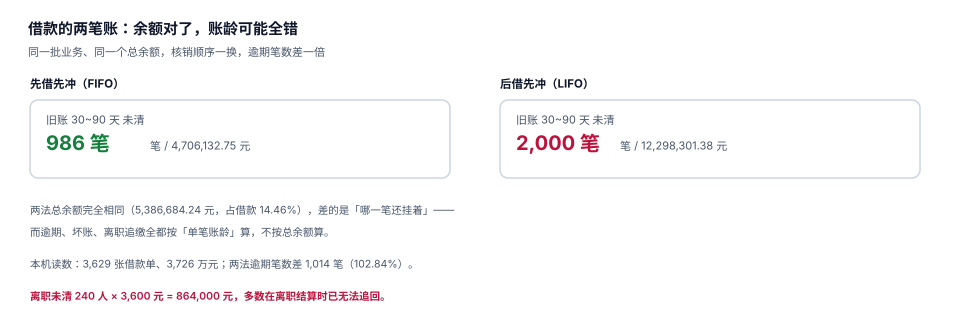

# 借款与核销：余额对了，账龄可能全错

出差前借 5,000 元备用金，回来报 2,520 元，剩下的 2,480 元还给公司。这件事看起来只有「借」和「还」两个动作，但系统里必须同时维护**三个数**：借款金额、已核销金额、未清余额。三个数里任何一个错，都不会有人当场发现——因为总余额往往还是对的。

这一页讲清一件事：**总余额相同，不代表账龄相同**；而逾期、坏账、离职追缴，全都按单笔账龄算。

## 一、备用金的四种形态

| 形态 | 触发 | 与报销的关系 | 常见问题 |
| --- | --- | --- | --- |
| 事前借款 | 出差前申请 | 报销时核销 | 借了不报，长期挂账 |
| 定额备用金 | 岗位需要（如采购） | 定期报销补足 | 定额被当成「额度」花完再借 |
| 预付卡 / 公务卡 | 公司统一办理 | 消费直接入账 | 卡在个人名下，责任不清 |
| 垫付后报销 | 无借款 | 直接打款 | 无（这是最常见形态） |

本机读数：12,000 张单据里 3,629 张挂了借款（30.24%），借款合计 37,262,295.78 元，未核销余额 5,386,684.24 元（**14.46%**）。

14.46% 这个比例不算高，但它意味着**每年有 538 万挂在员工名下**。这笔钱在报表上是「其他应收款」，不是费用——它既不在差旅费里，也不在任何成本中心里，只在资产负债表上安静地待着。

## 二、核销顺序：两种都「合理」，结果差一倍

同一个员工有两笔借款：旧账 8,000 元（出差 60 天前借的）、新账 6,000 元（5 天前借的）。这次报销 7,000 元。

| 核销顺序 | 旧账余额 | 新账余额 | 逾期（旧账 > 30 天未清） |
| --- | --- | --- | --- |
| 先借先冲（FIFO） | 1,000 | 6,000 | **是**（还挂 1,000） |
| 后借先冲（LIFO） | 8,000 | 0 | **是**（还挂 8,000） |

两种顺序的**总余额都是 7,000**，但「哪一笔还挂着」完全不同。而考核指标算的是「逾期未清借款笔数/金额」，不是总余额。



本机读数：2,000 组「旧账 + 新账 + 一笔报销」的模拟中，

| 口径 | 逾期未清 | 逾期金额 |
| --- | --- | --- |
| 先借先冲（FIFO） | 986 笔 | 4,706,132.75 |
| 后借先冲（LIFO） | 2,000 笔 | 12,298,301.38 |

**同一批业务，口径一换，逾期笔数差 1,014 笔（102.84%），逾期金额差 2.6 倍**，而总余额完全相同。这就是「余额对了、账龄全错」的具体形态。

::: danger 核销顺序必须写进制度，不能留给实现
1. **默认 FIFO**：先冲最早的借款，符合「先欠先还」的常识，也能让账龄指标反映真实情况。
2. **不要按「金额最小优先」**：那会让大额旧账永远挂着，账龄突破任何阈值。
3. **核销顺序变更必须重算历史**：改顺序等于改账龄，历史报表会全部变脸，所以要按生效期切。
:::

## 三、表结构：借款与核销必须分表

```sql
-- 借款主表：一张借款单一行，balance 是派生值但必须落库（性能与约束双重要求）
CREATE TABLE advance (
  advance_id INTEGER PRIMARY KEY,
  advance_no TEXT NOT NULL UNIQUE,
  emp_no     TEXT NOT NULL,
  amount     REAL NOT NULL CHECK (amount > 0),
  balance    REAL NOT NULL CHECK (balance >= 0),
  paid_at    TEXT NOT NULL,
  due_date   TEXT NOT NULL,                -- 借款后 N 天必须核销
  status     TEXT NOT NULL CHECK (status IN ('OPEN','PARTIAL','CLOSED','WRITTEN_OFF'))
);

-- 核销流水：只追加，一行代表一次冲销
CREATE TABLE advance_settlement (
  settlement_id INTEGER PRIMARY KEY,
  advance_id    INTEGER NOT NULL REFERENCES advance(advance_id),
  claim_id      INTEGER NOT NULL REFERENCES expense_claim(claim_id),
  amount        REAL NOT NULL CHECK (amount > 0),
  settled_at    TEXT NOT NULL
);

-- 余额不得为负：数据库层兜底，防止「多冲」
CREATE TRIGGER trg_advance_no_overdraft
BEFORE UPDATE OF balance ON advance
FOR EACH ROW WHEN NEW.balance < 0
BEGIN
  SELECT RAISE(ABORT, 'E_ADVANCE_NEG');
END;
```

`balance` 是冗余字段（可以由 `amount − Σ settlement` 算出），但它必须落库：一是为了让 `CHECK (balance >= 0)` 生效，二是为了避免每次查询都做聚合。代价是**两条写入路径必须同步**——这也是为什么余额校验要用触发器，而不是只靠应用层。

### 余额的三种算法必须一致

| 算法 | 写法 | 风险 |
| --- | --- | --- |
| 派生 | `amount − Σ settlement` | 准，但每次要聚合 |
| 落库 + 同步更新 | `balance = balance − x` | 快，但漏更新就永久错 |
| 落库 + 触发器 | 同上，但由触发器校验 | 快且不越界，推荐 |

本机实测里，N2 用例（核销超过余额）在触发器存在时被 `E_ADVANCE_NEG` 拒绝；如果只靠应用层判断，并发下两个请求各读到 `balance=1000`，各冲 800，余额变 −600，且两条流水都「成功」。

## 四、核销的三种写法与它们的产物

```sql
-- 写法一：FIFO，按 paid_at 升序逐笔冲销（推荐）
WITH open_adv AS (
  SELECT advance_id, balance,
         row_number() OVER (ORDER BY paid_at, advance_id) AS rn
  FROM advance
  WHERE emp_no = :emp_no AND balance > 0
), budget AS (SELECT :claim_amount AS remain)
SELECT advance_id, min(balance, remain) AS settle
FROM open_adv, budget
WHERE rn = 1;
-- 实际实现要循环：冲完第一笔再冲第二笔，直到报销金额用完
```

```sql
-- 写法二：一次性按比例分摊（不推荐）
-- 把报销金额按各笔余额比例分摊到所有未清借款
-- 问题：账龄失去意义，每笔都「部分还了」，没有一笔真正关闭
```

```sql
-- 写法三：指定借款单号（特殊场景，如「这笔报销专冲 3 月那笔」）
INSERT INTO advance_settlement(advance_id, claim_id, amount, settled_at)
SELECT :advance_id, :claim_id, min(balance, :amount), datetime('now')
FROM advance WHERE advance_id = :advance_id AND balance > 0;
```

写法二是最容易被「看起来公平」误导的一种：它让所有借款都变成 `PARTIAL`，没有任何一笔能 `CLOSED`，于是「已结清借款」永远为 0，账龄统计全部失真。

## 五、超额报销：不是「多退」，是「转应付」

报销金额大于借款余额时，多出来的部分是**公司欠员工的钱**，不是「借款余额变负」。

| 情形 | 借款 5,000 / 报销 6,200 | 正确产物 |
| --- | --- | --- |
| 核销 | 5,000 冲借款，`balance = 0`，`status = CLOSED` | 借款结清 |
| 差额 | 1,200 转「其他应付款 — 员工」 | 应付 1,200 |
| 实付 | 1,200 | 现金流出 1,200 |

如果实现成「`balance = −1,200`」，会同时破坏三件事：`CHECK (balance >= 0)` 被绕过、账龄统计出现负数、报表上「其他应收款」变成负数（本该是应付款）。

## 六、离职清算：唯一能真正止住坏账的时点

本机读数：离职未清 240 人（2.00%）、人均 3,600 元、敞口 864,000 元。

这 86 万在员工离职后**基本收不回来**：劳动关系已解除，扣工资没有依据，诉讼成本远高于金额。所以唯一的防线是**离职流程里的硬闸门**：

```sql
-- 离职前置校验：有未清借款的，离职流程不得进入「结算完成」
SELECT a.emp_no, count(*) AS 未清笔数, sum(a.balance) AS 未清金额
FROM advance a
WHERE a.emp_no = :emp_no AND a.balance > 0
GROUP BY a.emp_no;
-- 返回行 → 阻断离职结算，或从最后一个月工资中代扣（需员工书面同意）
```

代扣这一步有法律边界：**必须有员工书面同意**，且代扣后不得低于当地最低工资标准。系统层面能做的，是把「未清金额」和「同意书编号」一起挂在离职单上，而不是自动扣。

::: warning 离职清单里最常漏的三项
1. 未清借款（本页）——挂在「其他应收款」，最容易被忘。
2. 未交回的资产（见[资产台账](../../FixedAsset/Overview/index.md)）——账实不符。
3. 未报销的垫付（反向）——员工走了才来报销，无人审批。
:::

## 七、对账：三个数必须每天对上

| 数 | 来源 | 对不上的含义 |
| --- | --- | --- |
| 借款主表余额合计 | `sum(advance.balance)` | 系统自己的账 |
| 核销流水倒算 | `sum(amount) − sum(settlement.amount)` | 两条写入路径是否同步 |
| 总账「其他应收款」 | 财务系统 | 是否全部入账 |

三者每天对一次，差异按「漏记核销 / 重复核销 / 未入账借款」三类归因。本机实测的 C4 自检（借款余额 = 借款额 − 核销额）在正确实现下为 0，但只要有任意一条路径漏更新，它就会变成非零——这是最便宜的一个哨兵。

## 八、判据族 `EXV-A ~ EXV-H`

本页判据族 `EXV-A` ~ `EXV-H`，共 8 条。八条都能被单独判定，任何一条不成立就不算这篇文档写完。

| 判据 | 断言 | 验证方式 |
| --- | --- | --- |
| `EXV-A` | 借款与核销分表，核销流水只追加 | `advance_settlement` 无 UPDATE/DELETE |
| `EXV-B` | 余额不得为负，数据库层兜底 | 触发器 `E_ADVANCE_NEG`，并发冲销被拒 |
| `EXV-C` | 核销顺序默认为 FIFO 且写进制度 | 两笔借款一笔报销，旧账先关 |
| `EXV-D` | 超额报销转「其他应付款」，不出现负余额 | 报销 > 余额时，`balance = 0` 且有应付 |
| `EXV-E` | 账龄按单笔 `paid_at` 计算，不按员工汇总 | 同一员工两笔借款，账龄可分别查询 |
| `EXV-F` | 离职前未清借款阻断结算 | 离职校验 SQL 返回该员工即阻断 |
| `EXV-G` | 代扣有书面同意书编号 | 离职单上两字段同时非空 |
| `EXV-H` | 三个余额口径每天对账，差异可归因 | 三数相等，或有归因记录 |

## 九、验证方式

```shell
# 1. 借款 5,000，报销 6,200：余额应为 0，差额 1,200 转应付
sqlite3 :memory: "
create table a(id int primary key, amount real, balance real);
insert into a values (1, 5000.00, 5000.00);
update a set balance = balance - min(balance, 6200.00) where id = 1;
select balance, 6200.00 - 5000.00 as 应付款 from a;"
# 期望：0.0 | 1200.0

# 2. 超额核销必须被拒（余额不得为负）
sqlite3 :memory: "
create table a(id int primary key, balance real check (balance >= 0));
insert into a values (1, 100.00);
update a set balance = balance - 800 where id = 1;"
# 期望：CHECK constraint failed: balance >= 0

# 3. 逾期口径：同一批业务，FIFO 与 LIFO 的逾期笔数不同
#    见第 2 节的读数表，差 1,014 笔
```

第 2 步的意义在于：**「不会出现负数」这件事必须由数据库保证**。应用层的 `if balance >= amount` 在并发下形同虚设——两个请求同时读到 100，各冲 80，余额 −60，而两条流水都写着「成功」。

## 参考资料

- 财政部《中央和国家机关差旅费管理办法》（财行〔2013〕531 号）第二十四条：住宿费、机票支出等按规定用公务卡结算（备用金的替代形态）。
- 《企业会计准则第 22 号——金融工具确认和计量》关于「其他应收款」的减值要求（长期挂账的借款需评估信用风险）。
- 与本页相邻：[支付与代付](../Payment/index.md)、[成本归属与期间](../Allocation/index.md)、[资金管理](../../Treasury/Overview/index.md)。
