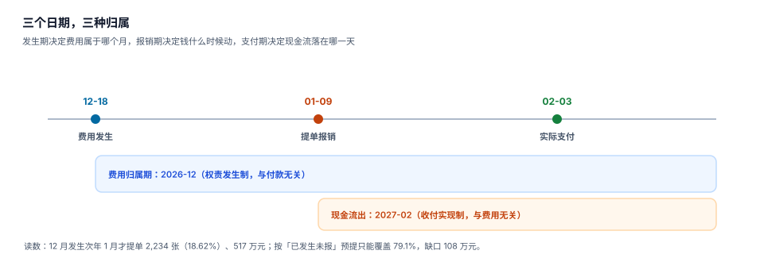

# 成本归属与期间：三个日期，三种归属

一张报销单上有三个日期：**费用发生日**、**提单日**、**支付日**。它们分属三套账——权责发生制、流程时效、收付实现制。把三者合成一个「日期」字段，是报销系统最常见的建模错误，也是最难事后修复的一种。

这一页讲清三件事：费用该进哪个月、该进哪个成本对象、跨年时该怎么处理。

## 一、三个日期，各管一件事

| 日期 | 决定什么 | 谁在看 | 用错会怎样 |
| --- | --- | --- | --- |
| 发生日 `occur_date` | 费用属于哪个会计期间 | 财务、审计 | 12 月的费用进 1 月报表 |
| 提单日 `submitted_at` | 流程时效（审批周期） | 管理者 | 时效指标失真 |
| 支付日 `paid_at` | 现金流出，影响头寸 | 出纳、资金 | 现金流预测偏差 |



本机读数：12,000 张单据里，12 月发生、次年 1 月才提单的 **2,234 张（18.62%）**，金额 **5,174,285.90 元**（占全年 19.23%）。

18.62% 这个比例不是异常，是**年终的常态**：12 月下旬出差、1 月回来贴票、财务催着关账。所以系统必须能回答「12 月的费用里，有多少还没报回来」——这就是预提。

## 二、预提：在「不知道金额」的时候先记一笔

12 月 31 日关账时，有些费用已经发生但还没提单。此时只能估：

| 估法 | 依据 | 本机读数 |
| --- | --- | --- |
| 按上月同期 | 12 月 ≈ 11 月 × 季节因子 | 覆盖 79.1% |
| 按已提交未审批 | 只看在途单据 | 覆盖约 62% |
| 按部门预算余额倒推 | 预算 − 已用 | 波动极大 |

本机读数：按「已发生未报」估出 **4,093,680.63 元**，实际报回 **5,174,285.90 元**，**缺口 1,080,605.27 元（20.88%）**。

```sql
-- 预提：按部门 × 费用类型，用近 3 个月同期均值 × 季节因子
WITH hist AS (
  SELECT dept_id, claim_type,
         avg(month_amount) AS avg_month
  FROM (
    SELECT dept_id, claim_type,
           substr(occur_date, 1, 7) AS ym,
           sum(total_amount) AS month_amount
    FROM expense_claim
    WHERE status IN ('APPROVED','PAID')
      AND occur_date >= date(:period_start, '-3 months')
      AND occur_date <  :period_start
    GROUP BY dept_id, claim_type, ym
  ) GROUP BY dept_id, claim_type
), season AS (
  SELECT dept_id, claim_type, factor FROM season_factor WHERE month_no = :month_no
)
SELECT h.dept_id, h.claim_type,
       round(h.avg_month * coalesce(s.factor, 1.0), 2) AS accrual_amount
FROM hist h LEFT JOIN season s USING (dept_id, claim_type);
```

预提的关键不是「算得准」，而是**可回冲**：1 月实际报回后，预提要按实际数冲回，差额进当期。所以预提必须落成一张带 `accrual_id` 的凭证明细，而不是直接改费用科目。

### 预提的三条纪律

1. **预提与实报必须能对上**：每条预提记录要能被一张或多张实际单据「认领」，认领后自动冲回。
2. **预提不跨年重复**：12 月预提、1 月报回、1 月冲回——不能 1 月再预提一次。
3. **预提差额单独列示**：20.88% 的缺口不是「估得不准」，是**系统性低估**，要作为管理信息暴露，而不是悄悄冲掉。

## 三、跨年：三种情形，三条处理

| 情形 | 例子 | 处理 |
| --- | --- | --- |
| 费用在 12 月，票在 1 月 | 12 月 28 日出差，1 月 5 日开票 | 费用记 12 月（预提），1 月冲回 |
| 费用在 12 月，票日期是次年 | 12 月 31 日住宿，酒店 1 月 1 日开票 | 同上，但票据日期落次年，需附说明 |
| 费用本身在次年，员工补报上年 | 上年的票今年才报 | 进「以前年度损益调整」 |

第三种最容易出错。本机读数：12 月发生的单据里，票据日期落在次年的 **1,027,575.00 元**（占该批 19.86%）。

《企业所得税税前扣除凭证管理办法》（2018 年第 28 号）第十七条规定：以前年度应当取得而未取得凭证、且当年未税前扣除的支出，在以后年度取得合规凭证后，**可以追补至支出发生年度扣除，但追补年限不得超过五年**。

这意味着系统必须能回答：「这笔支出属于哪一年？那年扣了没有？凭证是哪年取得的？」三个字段缺一不可：

```sql
ALTER TABLE expense_claim ADD COLUMN fiscal_year INTEGER;      -- 归属年度（按发生日）
ALTER TABLE expense_claim ADD COLUMN deducted_year INTEGER;    -- 实际扣除年度
ALTER TABLE expense_claim ADD COLUMN voucher_year INTEGER;     -- 凭证取得年度
```

三个字段的组合决定了税务处理：

| `fiscal_year` | `deducted_year` | 处理 |
| --- | --- | --- |
| 2026 | 2026 | 正常，当期扣除 |
| 2026 | 2027 | 追补扣除，需专项申报，5 年内有效 |
| 2026 | NULL | 未扣除，跨 5 年后永久性差异 |

## 四、成本对象：部门、项目、订单

一笔费用可能同时要归到三个地方：

| 维度 | 典型字段 | 用途 |
| --- | --- | --- |
| 责任中心 | `dept_id` / `cost_center` | 部门费用考核 |
| 项目 | `project_code` | 项目成本核算 |
| 订单 / 合同 | `order_no` / `contract_no` | 单笔业务毛利 |

三者不是互斥的，而是**层层细化**：部门是必填，项目可选，订单更可选。但系统里常见两种错法：

1. **只填部门**：项目成本永远算不准，项目经理拿不到真实成本。
2. **三个都必填**：行政、财务等支持部门的费用没有项目，填不出来就乱填。

正确做法是**按费用类型决定必填层级**：

| 费用类型 | 部门 | 项目 | 订单 |
| --- | --- | --- | --- |
| 差旅（拜访客户） | 必填 | 选填 | 建议填 |
| 差旅（项目实施） | 必填 | **必填** | 选填 |
| 业务招待 | 必填 | 选填 | **必填**（挂客户） |
| 日常办公 | 必填 | 不适用 | 不适用 |

```sql
-- 归属完整性：按类型检查必填层级，缺失即拒
CREATE TABLE claim_required_dim (
  claim_type TEXT NOT NULL,
  need_project INTEGER NOT NULL CHECK (need_project IN (0,1)),
  need_order   INTEGER NOT NULL CHECK (need_order IN (0,1)),
  PRIMARY KEY (claim_type)
);

SELECT c.claim_id, c.claim_type
FROM expense_claim c
JOIN claim_required_dim r ON r.claim_type = c.claim_type
WHERE (r.need_project = 1 AND (c.project_code IS NULL OR c.project_code = ''))
   OR (r.need_order = 1 AND (c.order_no IS NULL OR c.order_no = ''));
```

## 五、科目映射：一张单影响 25% 的税

| 费用类型 | 科目 | 税前扣除规则 |
| --- | --- | --- |
| 差旅费 | 管理费用 — 差旅费 | 据实扣除（有合规凭证） |
| 业务招待费 | 管理费用 — 业务招待费 | 发生额 60% 且不超过销售收入 5‰ |
| 职工福利费 | 应付职工薪酬 — 福利费 | 不超过工资薪金总额 14% |
| 职工教育经费 | 应付职工薪酬 — 职工教育经费 | 不超过工资薪金总额 8% |

本机读数里没有直接的税额，但这条规则的量级可以算：如果一张 4,200 元的招待费被错记成差旅费，在企业所得税 25% 下，**永久性差异 4,200 × 25% = 1,050 元**（假设招待费已超限额）。

所以科目不能由员工选，必须由「费用类型 + 政策」自动映射：

```sql
SELECT m.account_code, m.account_name
FROM expense_account_map m
WHERE m.claim_type = :claim_type
  AND m.effective_from <= :occur_date
  AND (m.effective_to IS NULL OR :occur_date < m.effective_to)
ORDER BY m.effective_from DESC
LIMIT 1;
```

员工填的是「这笔钱花在什么事上」，系统决定「记哪个科目」。让员工选科目，等于让最不了解税务规则的人做税务判断。

## 六、分摊：一笔费用分到多个成本对象

会议费、团建费、共用差旅，常常需要按人头或按工时分摊到多个部门。分摊的第一原则是**守恒**：

```sql
-- 按人头分摊，最大余数法处理尾差（保证分完不剩、不超）
WITH base AS (
  SELECT :total_amount AS total,
         sum(headcount) AS hc
  FROM allocation_target WHERE event_id = :event_id
), raw AS (
  SELECT t.dept_id, t.headcount,
         :total_amount * t.headcount / b.hc AS exact
  FROM allocation_target t, base b
  WHERE t.event_id = :event_id
), floored AS (
  SELECT dept_id, floor(exact * 100) / 100 AS amt, exact FROM raw
)
SELECT dept_id, amt,
       amt + CASE WHEN row_number() OVER (ORDER BY exact - amt DESC)
                       <= cast((:total_amount - (SELECT sum(amt) FROM floored)) * 100 AS INTEGER)
                  THEN 0.01 ELSE 0 END AS final_amt
FROM floored;
```

逐行四舍五入会不闭合（本库其它专题实测 20%~29% 的单据不闭合），最大余数法可以做到 0 不闭合。分摊不闭合的后果很具体：**各部门费用之和 ≠ 公司总费用**，而对账的人通常只看总额。

## 七、月结：五条必须过的闸

| 闸 | 检查 | 不过的后果 |
| --- | --- | --- |
| ① 期间闭合 | 本期无 `DRAFT` / `SUBMITTED` 挂单 | 费用漏记 |
| ② 金额守恒 | 单据总额 = 明细之和 | 总账与明细不符 |
| ③ 归属完整 | 必填维度齐全 | 成本分析缺块 |
| ④ 预提对齐 | 预提有认领或明确未认领 | 次年冲回混乱 |
| ⑤ 跨年标记 | `fiscal_year` 与 `deducted_year` 均已定 | 汇算清缴返工 |

```sql
-- 月结前的一次性体检（期望全部 0）
SELECT
  (SELECT count(*) FROM expense_claim
   WHERE status IN ('DRAFT','SUBMITTED') AND occur_to < :period_end) AS 挂单,
  (SELECT count(*) FROM (
     SELECT c.claim_id FROM expense_claim c JOIN claim_line l USING (claim_id)
     GROUP BY c.claim_id HAVING abs(c.total_amount - sum(l.amount)) > 0.005)) AS 不守恒,
  (SELECT count(*) FROM expense_claim
   WHERE status = 'PAID' AND (dept_id IS NULL OR fiscal_year IS NULL)) AS 归属缺失;
```

## 八、判据族 `EXL-A ~ EXL-H`

本页判据族 `EXL-A` ~ `EXL-H`，共 8 条。八条都能被单独判定，任何一条不成立就不算这篇文档写完。

| 判据 | 断言 | 验证方式 |
| --- | --- | --- |
| `EXL-A` | 三个日期分列存储，互不覆盖 | 表结构含 `occur_date` / `submitted_at` / `paid_at` |
| `EXL-B` | 费用归属期按发生日确定 | 12 月发生 1 月支付的单，`fiscal_year = 上年` |
| `EXL-C` | 预提可回冲，且能被实际单据认领 | 预提表有 `accrued_amount` / `reversed_amount` |
| `EXL-D` | 跨年支出记录三个年度字段 | `fiscal_year` / `deducted_year` / `voucher_year` |
| `EXL-E` | 必填维度按费用类型驱动 | `claim_required_dim` 检查返回 0 行 |
| `EXL-F` | 科目由类型映射，不由员工选 | `expense_account_map` 命中唯一科目 |
| `EXL-G` | 分摊守恒（最大余数法，0 不闭合） | 分摊明细之和 = 总额 |
| `EXL-H` | 月结五闸全部可执行且返回 0 | 第 7 节体检 SQL |

## 九、验证方式

```shell
# 1. 三个日期不相等时，费用归属应跟「发生日」走
sqlite3 :memory: "
create table c(id int, occur text, submit text, paid text);
insert into c values (1,'2026-12-28','2027-01-09','2027-02-03');
select occur, substr(occur,1,4) as fiscal_year,
       substr(paid,1,4) as cash_year from c;"
# 期望：2026-12-28 | 2026 | 2027 —— 费用在 2026，现金在 2027

# 2. 预提缺口：估 4,093,680.63、实报 5,174,285.90
sqlite3 :memory: "select 5174285.90 - 4093680.63, (5174285.90-4093680.63)/5174285.90;"
# 期望：1080605.27 | 0.2088...

# 3. 分摊守恒：三部门按人头 5/3/2 分 1,000.00
sqlite3 :memory: "
with t(dept,hc) as (values ('A',5),('B',3),('C',2)),
     b as (select sum(hc) hc from t)
select dept, round(1000.0*hc/(select hc from b), 2) as amt from t;"
# 期望：500.0 | 300.0 | 200.0，合计 1000.0
```

第 1 步是全年最重要的一条口径：**费用跟发生日，现金跟支付日**。两个年度不同，是常态，不是异常。

## 参考资料

- 《企业会计准则——基本准则》第九条：权责发生制。
- 国家税务总局《企业所得税税前扣除凭证管理办法》（国家税务总局公告 2018 年第 28 号）第十七条：追补至支出发生年度扣除，追补年限不得超过 5 年。
- 《企业所得税法实施条例》第四十三条（业务招待费）、第四十条（职工福利费 14%）、第四十二条（职工教育经费 8%）。
- 与本页相邻：[成本核算](../../CostAccounting/Overview/index.md)、[全面预算](../../Budgeting/Overview/index.md)、[记账与分录](../../Ledger/DoubleEntry/index.md)。
