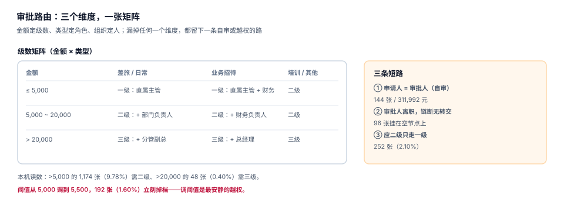

# 审批路由：阈值、矩阵与自审

审批的本质是「谁有权说这笔钱可以花」。这句话在系统里必须落成三个可查的东西：**级数**（要几个人点头）、**角色**（哪几个人）、**时限**（多久必须点）。三个里少一个，就会出现自审、越级、或者单据挂在一个已经离职的节点上。

这一页给出审批路由的矩阵写法和三条短路的检测方法，并用本机读数说明「阈值调 500 元」的真实代价。

## 一、级数矩阵：两个维度起步，三个维度才够

最小可用矩阵是「金额 × 类型」：

| 金额 | 差旅 / 日常 | 业务招待 | 培训 / 其他 |
| --- | --- | --- | --- |
| ≤ 5,000 | 一级：直属主管 | 一级：直属主管 + 财务 | 二级 |
| 5,000 ~ 20,000 | 二级：+ 部门负责人 | 二级：+ 财务负责人 | 二级 |
| > 20,000 | 三级：+ 分管副总 | 三级：+ 总经理 | 三级 |



为什么要按类型分开：**同样是 4,000 元，差旅是「必要支出」，招待是「敏感支出」**。招待费的税前扣除限额是当年销售收入的 5‰（且不超过发生额 60%），超额部分永久性差异——所以它天然需要多一双眼睛。

本机金额分布：P50 1,347.30 元、P90 4,935.02 元、最大 84,517.51 元；> 5,000 的 1,174 张（9.78%），> 20,000 的 48 张（0.40%）。

这组数字说明一个设计要点：**绝大多数单据落在一级**。所以「一级审批」的体验决定了整个系统的口碑，而「二级以上」的设计决定了风控水平——两者的优化目标不同，不能混在一起做。

## 二、路由是一条 SQL，不是一个 if 链

```sql
-- 审批级数与角色：一张表 + 一条查询，替代代码里的 if/else 链
CREATE TABLE approval_route (
  route_id     INTEGER PRIMARY KEY,
  claim_type   TEXT NOT NULL,
  amount_from  REAL NOT NULL,
  amount_to    REAL,                       -- NULL 表示无上限
  levels       INTEGER NOT NULL CHECK (levels BETWEEN 1 AND 3),
  roles        TEXT NOT NULL,              -- 逗号分隔，如 'MANAGER,FINANCE'
  sla_hours    INTEGER NOT NULL,           -- 该级的时限
  CHECK (amount_to IS NULL OR amount_to > amount_from)
);

-- 解析：按类型 + 金额命中唯一一行
SELECT levels, roles, sla_hours
FROM approval_route
WHERE claim_type = :claim_type
  AND :amount >= amount_from
  AND (amount_to IS NULL OR :amount < amount_to)
ORDER BY amount_from DESC
LIMIT 1;
```

`ORDER BY amount_from DESC LIMIT 1` 与差标的写法是同一个道理：区间必须写成半开，且用「取最大下界」兜住重叠。差别在于差标按**发生日**解析，审批按**提交时金额**解析——金额一旦提交就冻结，不会再变。

## 三、三条短路，三种检测

### 短路一：申请人 = 审批人（自审）

本机读数：144 张（1.20%）、涉及金额 311,992.28 元（1.16%）。

自审的成因通常不是恶意，而是组织设计：小团队主管自己出差，直线上级就是他本人；或者代理审批期间，代理人和申请人恰好同一人。

```sql
-- 自审检测：审批人 == 申请人，或审批人是申请人的直属下级
SELECT a.claim_id, a.level, a.approver, c.emp_no
FROM approval a
JOIN expense_claim c ON c.claim_id = a.claim_id
WHERE a.approver = c.emp_no
   OR a.approver IN (SELECT emp_no FROM employee WHERE manager_no = c.emp_no);
-- 期望：0 行。有行就必须「上跳一级」，而不是放过
```

正确的处理不是「拒绝」，而是**上跳**：检测到自审时，路由自动跳到上一级。拒绝会让小团队无法报销，放过则等于没有审批。

### 短路二：审批人离职，链断

本机读数：96 张（0.80%）挂在空节点上。

```sql
-- 断链检测：待审批单据的当前节点，审批人已离职或已停用
SELECT c.claim_id, c.claim_no, a.approver, e.status
FROM expense_claim c
JOIN approval a ON a.claim_id = c.claim_id AND a.action IS NULL
LEFT JOIN employee e ON e.emp_no = a.approver
WHERE e.emp_no IS NULL OR e.status <> 'ACTIVE';
```

这条 SQL 应该在**每天凌晨跑一次**，而不是等员工来催。挂单超过 SLA 的单据，是「流程体验差」投诉的第一名。

### 短路三：应二级只走一级（越级）

本机读数：252 张（2.10%）。

成因通常是「审批人权限配置错」或「代他人审批」。检测方式是**对照路由表与实际审批流水**：

```sql
-- 越级检测：实际审批级数 < 路由要求的级数，且状态已是 APPROVED
WITH need AS (
  SELECT c.claim_id, r.levels
  FROM expense_claim c
  JOIN approval_route r
    ON r.claim_type = c.claim_type
   AND c.total_amount >= r.amount_from
   AND (r.amount_to IS NULL OR c.total_amount < r.amount_to)
), got AS (
  SELECT claim_id, count(*) AS done
  FROM approval WHERE action = 'APPROVE' GROUP BY claim_id
)
SELECT need.claim_id, need.levels, coalesce(got.done, 0) AS 实际级数
FROM need LEFT JOIN got USING (claim_id)
WHERE need.levels > coalesce(got.done, 0);
```

## 四、阈值：最容易被「顺手调」的口子

| 阈值 | 需二级的单据 | 占比 |
| --- | --- | --- |
| 5,000 | 1,174 | 9.78% |
| 5,500 | 982 | 8.18% |

**只是把 5,000 改成 5,500，就有 192 张（1.60%）从二级掉到一级**。这 192 张没有任何一张「看起来有问题」——它们只是金额落在 5,000 到 5,500 之间。

::: danger 阈值变更必须走变更审批
1. **不要把阈值写在代码常量里**：写进配置表，带 `effective_from`，与差标同一套生效期机制。
2. **不要允许「临时调整」**：一次临时调整会让当月所有单据的路由不可复现。
3. **变更必须留痕**：谁改的、什么时候、影响多少张在途单据——这三项要能在一次查询里回答。
:::

## 五、时限与升级：SLA 是审批的一部分

每个级数都有 `sla_hours`。超时不是「提醒一下」，而是**自动升级**：

| 超时时长 | 动作 |
| --- | --- |
| 50% SLA | 提醒审批人（站内 + 邮件） |
| 100% SLA | 提醒 + 抄送其上级 |
| 150% SLA | 自动升级到上一级，原节点标记「超时未处理」 |

「自动升级」这一条必须有，否则审批人会形成「不点也不影响」的预期——本机读数里退回单平均多耗 1.9 天，其中相当一部分耗在「审批人没看见」。

## 六、代理与转交：两种语义要分开

| 动作 | 语义 | 留痕 |
| --- | --- | --- |
| 代理（delegate） | 我休假，期间我的审批由 A 代做 | `approval_delegate(from, to, start, end)` |
| 转交（transfer） | 这一张单我不批，转给 A 批 | `approval` 行新增一条，记录 `transferred_from` |

代理是**时间区间**，转交是**单张单据**。把两者合成一个「代理人」字段，会出现「休假结束后代理人还能批」的越权。

```sql
CREATE TABLE approval_delegate (
  delegate_id INTEGER PRIMARY KEY,
  principal   TEXT NOT NULL,        -- 被代理人
  agent       TEXT NOT NULL,        -- 代理人
  start_at    TEXT NOT NULL,
  end_at      TEXT NOT NULL,
  CHECK (end_at > start_at),
  CHECK (principal <> agent)        -- 自己代理自己 = 自审
);
```

`CHECK (principal <> agent)` 这一行，就是「代理不能代理自己」的硬约束。

## 七、判据族 `EXA-A ~ EXA-H`

本页判据族 `EXA-A` ~ `EXA-H`，共 8 条。八条都能被单独判定，任何一条不成立就不算这篇文档写完。

| 判据 | 断言 | 验证方式 |
| --- | --- | --- |
| `EXA-A` | 级数矩阵按「金额 × 类型」命中唯一一行 | 边界值 4,999.99 / 5,000.00 分别命中不同行 |
| `EXA-B` | 阈值来自配置表且带生效期，不在代码里 | 改配置后新单路由变化、旧单不变 |
| `EXA-C` | 自审被检测并上跳，不放过也不拒绝 | 构造申请人=主管的单，审批人为其上级 |
| `EXA-D` | 审批人离职时单据不静默挂起 | 断链检测 SQL 返回 0 行，或有告警 |
| `EXA-E` | 实际级数 ≥ 路由要求级数 | 越级检测 SQL 返回 0 行 |
| `EXA-F` | 代理有区间且不能代理自己 | `CHECK (principal <> agent)`，跨区间代理无效 |
| `EXA-G` | 超时按 SLA 自动升级，原节点有记录 | 构造超时单，审批落到上一级 |
| `EXA-H` | 每次审批动作写流水，含时间与意见 | `approval` 行数 = 动作次数，无 UPDATE |

## 八、验证方式

```shell
# 1. 路由解析：4,999.99 与 5,000.00 应命中不同级数
sqlite3 :memory: "
create table r(t text, f real, t2 real, lv int);
insert into r values ('TRAVEL',0,5000,1),('TRAVEL',5000,null,2);
select total_amount,
       (select lv from r where t='TRAVEL' and total_amount>=f
          and (t2 is null or total_amount<t2) order by f desc limit 1) as levels
from (select 4999.99 as total_amount union all select 5000.00);"
# 期望：4999.99|1  5000.0|2

# 2. 自审检测（期望 0 行）
#    复用第 3 节的 SQL

# 3. 阈值敏感性：统计 5000~5500 之间的单据数
sqlite3 :memory: "select 192 * 1.0 / 12000;"
# 期望：0.016 —— 1.60% 的单据因阈值调 500 元而掉档
```

第 1 步的两行输出就是路由的核心：**边界值属于上一档**（半开区间），这一条写错，5,000 元的单子会在两档之间来回跳。

## 参考资料

- 财政部《中央和国家机关差旅费管理办法》（财行〔2013〕531 号）第二十四条：差旅费报销应提供出差审批单，事前审批是报销的前提。
- 《企业所得税法实施条例》第四十三条：业务招待费按发生额 60% 扣除，且不超过当年销售（营业）收入的 5‰。
- 与本页相邻：[制度与差标](../Policy/index.md)、[单据模型](../ClaimModel/index.md)、[工作流引擎](../../WorkflowEngine/Overview/index.md)。
