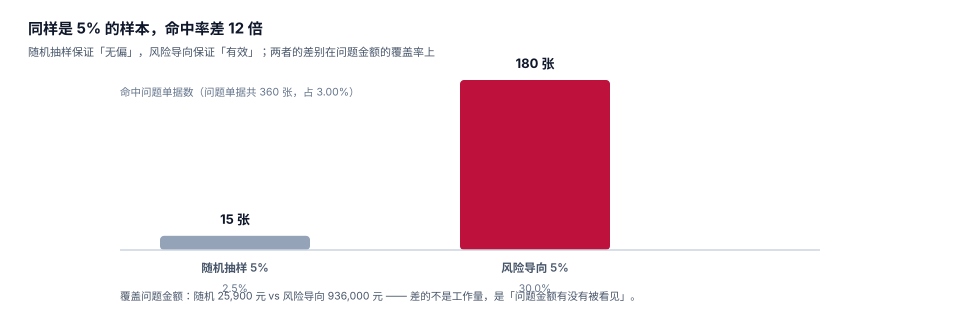

# 稽查与合规：抽样、异常与税前扣除

财务审核只能保证「单据合规」，保证不了「支出真实」。这两件事的差别在稽查环节才显现：一张手续齐全的票，可能对应一次根本不存在的出差。而稽查的资源永远不够——所以问题不是「要不要查」，而是**怎么用 5% 的样本覆盖 80% 的风险**。

这一页给出风险导向抽样的设计、四类异常的检测 SQL，以及税前扣除的两条时限。

## 一、同样是 5%，命中率差 12 倍

本机读数：12,000 张单据里注入 360 张问题单据（3.00%），两种抽样各抽 600 张（5%）：

| 抽样方式 | 命中问题单 | 命中率 | 覆盖问题金额 |
| --- | --- | --- | --- |
| 随机抽样 | 15 张 | 2.50% | 25,900 元 |
| 风险导向 | 180 张 | **30.00%** | **936,000 元** |



命中率差 **12 倍**，覆盖金额差 36 倍。这个差距不来自「查得更细」，而来自**样本怎么选**。

::: tip 随机抽样不是没用
随机抽样回答的是「整体合规率是多少」（一个统计问题）；风险导向回答的是「哪里最可能出问题」（一个发现问题）。**两个都要**：随机用于年度合规率披露，风险用于日常稽查。只做随机，等于每年花同样的钱查同样少的问题。
:::

## 二、风险评分：五个特征，一个原则

| 特征 | 为什么可疑 | 权重建议 |
| --- | --- | --- |
| 金额刚好在阈值下方 | 拆分报销的典型形态 | 高 |
| 同一员工同日同商户多单 | 拆单或重复开票 | 高 |
| 整数金额（xx00 / xx000） | 手工填单、估算、凑整 | 中 |
| 周末 / 节假日的业务招待 | 业务真实性存疑 | 中 |
| 同一商户高频出现 | 关联方或虚假商户 | 中 |

一个原则：**评分只用来排序，不用来定罪**。评分高的单据进入人工复核，复核结论（成立 / 不成立）要回写，用来校准权重。否则评分会越来越偏——所有人都学会「避开高分特征」，而真正的异常换了形态。

```sql
-- 风险分：五项特征加权，输出可直接排序
CREATE VIEW v_claim_risk AS
SELECT c.claim_id, c.claim_no, c.emp_no, c.total_amount,
       (CASE WHEN c.total_amount BETWEEN :threshold * 0.9 AND :threshold THEN 3 ELSE 0 END)
     + (CASE WHEN (SELECT count(*) FROM expense_claim c2
                   WHERE c2.emp_no = c.emp_no AND c2.occur_from = c.occur_from
                     AND c2.claim_id <> c.claim_id) > 0 THEN 3 ELSE 0 END)
     + (CASE WHEN c.total_amount = round(c.total_amount / 100) * 100 THEN 1 ELSE 0 END)
     + (CASE WHEN c.claim_type = 'ENTERTAIN'
              AND strftime('%w', c.occur_from) IN ('0','6') THEN 2 ELSE 0 END)
     + (CASE WHEN (SELECT count(*) FROM invoice i
                   WHERE i.claim_id = c.claim_id
                     AND i.seller IN (SELECT seller FROM invoice
                                      GROUP BY seller HAVING count(*) > 50)) > 0 THEN 2 ELSE 0 END)
       AS risk_score
FROM expense_claim c
WHERE c.status IN ('APPROVED','PAID');
```

## 三、四类异常的检测

### 异常一：拆分报销（规避审批）

一张 5,300 元的单要二级审批，拆成 4,900 + 400 就只要一级。本机读数：这类单 279 张，每张规避 4,900 元的二级审批。

```sql
-- 拆分检测：同一员工、同日、同商户，多张单各自低于阈值，合计高于阈值
SELECT a.emp_no, a.occur_from, i.seller,
       count(DISTINCT a.claim_id) AS 单数,
       sum(a.total_amount) AS 合计
FROM expense_claim a
JOIN invoice i ON i.claim_id = a.claim_id
WHERE a.occur_from >= date('now','-90 days')
GROUP BY a.emp_no, a.occur_from, i.seller
HAVING count(DISTINCT a.claim_id) > 1
   AND sum(a.total_amount) > :threshold
   AND max(a.total_amount) < :threshold;
```

`max(...) < :threshold` 是关键条件：它筛出「每一张都安全、合计超限」的组合。只按「合计超限」筛，会把正常的多笔支出也报出来。

### 异常二：连号发票

同一员工提交的发票号连续，通常意味着「一次性开了一批票」。这在真实差旅里很少见（不同商户、不同时间），在虚开里很常见。

```sql
-- 连号检测：同一单据内票号后 4 位连续 ≥ 3 张
WITH n AS (
  SELECT claim_id, inv_no,
         cast(substr(inv_no, -4) AS INTEGER) AS seq,
         lead(cast(substr(inv_no, -4) AS INTEGER)) OVER
           (PARTITION BY claim_id ORDER BY inv_no) AS nxt
  FROM invoice
)
SELECT claim_id, count(*) AS 连续对数
FROM n
WHERE nxt - seq = 1
GROUP BY claim_id
HAVING count(*) >= 2;
```

### 异常三：同一商户高频

一个商户在 12 个月里被同一批员工反复开票，且金额集中，是关联方的典型形态。判据不是「次数多」（连锁酒店次数本来就多），而是**「次数多 + 员工集中 + 金额集中」三者同时成立**。

```sql
SELECT seller, count(*) AS 票数, count(DISTINCT claim_id) AS 单数,
       count(DISTINCT c.emp_no) AS 员工数,
       round(avg(i.amount), 2) AS 均值,
       round(max(i.amount) - min(i.amount), 2) AS 极差
FROM invoice i JOIN expense_claim c USING (claim_id)
GROUP BY seller
HAVING count(*) > 50 AND count(DISTINCT c.emp_no) < 10
ORDER BY 票数 DESC;
```

### 异常四：周末招待

业务招待发生在周末，本身不是问题（客户周末有空），但**周末招待占比显著高于工作日**就值得看。

```sql
SELECT strftime('%w', occur_from) AS 星期,
       count(*) AS 单数, round(sum(total_amount), 2) AS 金额
FROM expense_claim
WHERE claim_type = 'ENTERTAIN'
GROUP BY 星期 ORDER BY 星期;
```

## 四、税前扣除：两条时限，一条五年

| 时限 | 规定 | 系统的落点 |
| --- | --- | --- |
| 汇算清缴期结束前（次年 5 月 31 日） | 应取得合规凭证 | `voucher_year` 字段 + 到期提醒 |
| 被告知之日起 60 日内 | 补开、换开 | 工单 + 倒计时 |
| 追补年限 5 年 | 可追补至支出发生年度 | `fiscal_year` 与 `deducted_year` 分离 |

本机读数：次年 5 月 31 日后才取得/提交的发票 252 张（2.10%）、466,200 元；按 25% 税率计，若不专项申报追补，**永久性差异 116,550 元**。另有 266,400 元在汇算清缴前未取得凭证，当年不得扣除。

```sql
-- 汇算清缴到期提醒：按到期日倒排，给财务一张可执行的清单
SELECT c.claim_id, c.claim_no, c.fiscal_year, c.total_amount,
       date(c.fiscal_year || '-12-31', '+5 months') AS 汇算截止日,
       cast(julianday(date(c.fiscal_year || '-12-31', '+5 months')) - julianday('now') AS INTEGER)
         AS 剩余天数
FROM expense_claim c
WHERE c.deducted_year IS NULL
  AND c.voucher_year IS NULL
ORDER BY 剩余天数 ASC;
```

## 五、留档：不是「存着」，是「能举证」

| 材料 | 保存年限 | 依据 |
| --- | --- | --- |
| 会计凭证（含报销单） | 30 年 | 《会计档案管理办法》（财政部、国家档案局令第 79 号） |
| 发票（数电票） | 与凭证同期 | 数电票以数字化形态存储，需保证可读、可验 |
| 审批流水 | 同上 | 内部控制的举证材料 |
| 验真返回原文 | 同上 | 证明「当时查验过」 |

「30 年」这个数字对系统有一个直接要求：**存储格式必须长期可读**。PDF/A、OFD 这类归档格式比 JPG 截图可靠；数据库里的 `raw_json` 比「一张验真截图」可靠。

::: warning 三个常见的「存了但举不出证」
1. **只存了票面图片，没存验真返回**：税务质疑时，你说不清当时查到了什么。
2. **审批意见存成自由文本，没有操作人字段**：无法证明「谁批的」。
3. **红冲后删了原票**：审计要看「原来那张」，你只剩「现在这张」。
:::

## 六、处罚与整改：把结论变回配置

稽查的产出不应该只是一份报告，而应该是**配置变更**：

| 发现 | 整改动作 | 落点 |
| --- | --- | --- |
| 拆分报销多 | 提高阈值敏感度 / 加「同日同商户合计」校验 | 审批路由 + 提交校验 |
| 抬头错多 | 提交时强校验公司主体 | 票据校验 |
| 跨年票多 | 12 月推送「及时报销」提醒 + 预提 | 通知 + 预提 |
| 借款久挂 | 离职闸门 + 90 天自动催收 | 离职流程 + 通知 |

这条闭环是「不安排复盘类内容」之后仍然必须有的东西：**不是写总结，是改配置**。

## 七、判据族 `EXD-A ~ EXD-H`

本页判据族 `EXD-A` ~ `EXD-H`，共 8 条。八条都能被单独判定，任何一条不成立就不算这篇文档写完。

| 判据 | 断言 | 验证方式 |
| --- | --- | --- |
| `EXD-A` | 风险评分可排序，且只用于排序 | `v_claim_risk` 输出分数，不直接拒单 |
| `EXD-B` | 复核结论回写，用于校准权重 | 复核表有 `conclusion` 字段 |
| `EXD-C` | 拆分检测命中「各单低于阈值、合计高于阈值」 | 第 3 节第一条 SQL 命中构造样本 |
| `EXD-D` | 连号检测按单据内序号，不跨单 | 跨单连号不报，单内连号报 |
| `EXD-E` | 同一商户高频需三维同时成立 | 只次数多不报，员工集中才报 |
| `EXD-F` | 汇算到期清单可导出且带剩余天数 | 第 4 节 SQL 按剩余天数排序 |
| `EXD-G` | 留档含验真原文与操作人 | `invoice_verify.raw_json` + `operator` |
| `EXD-H` | 稽查结论能落成配置变更 | 每条结论关联一个配置项 |

## 八、验证方式

```shell
# 1. 拆分检测：4,900 + 400 应被识别为「合计超限、单张未超限」
sqlite3 :memory: "
create table c(id int, amt real);
insert into c values (1,4900.00),(2,400.00);
select count(*) as 单数, sum(amt) as 合计, max(amt) as 单张最大,
       case when sum(amt) > 5000 and max(amt) < 5000 then '拆分嫌疑' else '正常' end as 判定
from c;"
# 期望：2 | 5300.0 | 4900.0 | 拆分嫌疑

# 2. 命中率对比：随机 5% vs 风险 5%
python3 -c "
import random; random.seed(20261103)
flag=set(random.sample(range(12000), 360))
print('随机命中', len([x for x in random.sample(range(12000),600) if x in flag]))"
# 期望：个位数到十几之间（本机 15）

# 3. 汇算到期日：2026 年度的截止日应为 2027-05-31
sqlite3 :memory: "select date('2026-12-31', '+5 months');"
# 期望：2027-05-31
```

第 1 步的 `拆分嫌疑` 是四类异常里最容易自动化的一条，也是最值得先做的一条——它不需要任何外部数据，只用自己的单据表就能算。

## 参考资料

- 国家税务总局《企业所得税税前扣除凭证管理办法》（国家税务总局公告 2018 年第 28 号）第十三至十七条：汇算清缴期结束前的补救、60 日补开换开、5 年追补。
- 《会计档案管理办法》（财政部、国家档案局令第 79 号）：会计凭证、会计账簿保存 30 年。
- 《企业所得税法实施条例》第四十三条：业务招待费扣除限额。
- 与本页相邻：[票据与查验](../Receipt/index.md)、[审批路由](../Approval/index.md)、[税务发票](../../TaxInvoice/index.md)。
