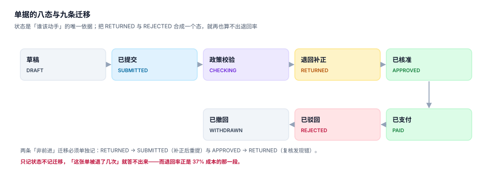

# 单据模型：八态、三层与九条迁移

报销单的状态机看起来很简单：填完、提交、批了、付了。但只要开始做「退回补正」「撤回重填」「批了之后发现错」这三件事，状态就会从四个变成八个——而**多出来的四个，恰好是全部争议的来源**。

这一页给出一套能落地的单据模型：八态九迁移、单据/明细/票据三层、金额守恒、以及三个不能混用的语义（撤回、退回、驳回）。

## 一、为什么是八态

| 状态 | 谁该动手 | 能否改金额 | 能否删除 |
| --- | --- | --- | --- |
| `DRAFT` 草稿 | 员工 | 能 | 能（唯一可删的态） |
| `SUBMITTED` 已提交 | 系统（待校验） | 不能 | 不能 |
| `CHECKING` 政策校验中 | 系统 / 财务 | 不能 | 不能 |
| `RETURNED` 退回补正 | 员工 | 能（仅被退回的行） | 不能 |
| `APPROVED` 已核准 | 出纳（待付） | 不能 | 不能 |
| `PAID` 已支付 | 无（终态） | 不能 | 不能 |
| `REJECTED` 已驳回 | 无（终态） | 不能 | 不能 |
| `WITHDRAWN` 已撤回 | 员工（可重新提交为新单） | 不能 | 不能 |



### 九条迁移，一条都不能省

| # | 迁移 | 触发者 | 为什么必须有 |
| --- | --- | --- | --- |
| 1 | `DRAFT → SUBMITTED` | 员工 | 冻结金额，进入流程 |
| 2 | `SUBMITTED → CHECKING` | 系统 | 政策校验是异步的（要调查验平台） |
| 3 | `CHECKING → RETURNED` | 系统 / 财务 | 票不合规、缺附件 |
| 4 | `RETURNED → SUBMITTED` | 员工 | 补正后重提，**次数要计数** |
| 5 | `CHECKING → APPROVED` | 审批人 | 正常通过 |
| 6 | `CHECKING → REJECTED` | 审批人 | 终态，不可复活 |
| 7 | `SUBMITTED → WITHDRAWN` | 员工 | 提交后自己发现填错 |
| 8 | `APPROVED → PAID` | 出纳 / 批量代付 | 打款成功 |
| 9 | `APPROVED → RETURNED` | 财务复核 | 批了之后发现错（少见但要支持） |

第 9 条是最容易被省略的一条。省略它的后果：一旦核准，任何错误都只能「付了再冲」，于是系统里永远没有「核准后修正」这个动作，只有「红冲重开」——而红冲重开会把一张单变成两张，退回率、单据量、审计轨迹全部失真。

::: danger 三个语义不能混用
1. **撤回（WITHDRAWN）**：员工主动收回，单据作废，可重新建单。**不是**退回。
2. **退回（RETURNED）**：审批人把单子打回让员工改，单据还活着，**退回次数是考核指标**。
3. **驳回（REJECTED）**：终态，业务上不成立（不是「填错了」，是「不该报」）。
:::

把三者合成一个「未通过」状态，就再也算不出「一次通过率」——而本机读数里，这个指标是 63%，退回 37%，退回造成的返工成本约 168,720 元。

## 二、三层结构：单据、明细、票据

```sql
-- 第一层：单据（一张报销单）
CREATE TABLE expense_claim (
  claim_id     INTEGER PRIMARY KEY,
  claim_no     TEXT NOT NULL UNIQUE,           -- 业务单号，对外可见
  emp_no       TEXT NOT NULL,
  claim_type   TEXT NOT NULL CHECK (claim_type IN ('TRAVEL','DAILY','ENTERTAIN','TRAINING')),
  occur_from   TEXT NOT NULL,                  -- 费用最早发生日
  occur_to     TEXT NOT NULL,                  -- 费用最晚发生日
  total_amount REAL NOT NULL CHECK (total_amount >= 0),
  status       TEXT NOT NULL CHECK (status IN
                 ('DRAFT','SUBMITTED','CHECKING','RETURNED','APPROVED','PAID','REJECTED','WITHDRAWN')),
  submitted_at TEXT,
  version      INTEGER NOT NULL DEFAULT 1,     -- 乐观锁，同时是「第几次提交」
  CHECK (occur_to >= occur_from)
);

-- 第二层：明细（这张单包含哪几笔支出）
CREATE TABLE claim_line (
  line_id    INTEGER PRIMARY KEY,
  claim_id   INTEGER NOT NULL REFERENCES expense_claim(claim_id),
  line_type  TEXT NOT NULL CHECK (line_type IN ('LODGING','MEAL','LOCAL','TRAFFIC','OTHER')),
  occur_date TEXT NOT NULL,
  amount     REAL NOT NULL CHECK (amount >= 0),
  approved_amount REAL,                        -- 政策校验后的允许金额
  note       TEXT
);

-- 第三层：票据（每笔支出由哪些票证明）
CREATE TABLE invoice (
  invoice_id INTEGER PRIMARY KEY,
  claim_id   INTEGER NOT NULL REFERENCES expense_claim(claim_id),
  line_id    INTEGER REFERENCES claim_line(line_id),
  inv_no     TEXT NOT NULL UNIQUE,             -- 一票一报的硬约束
  inv_date   TEXT NOT NULL,
  seller     TEXT NOT NULL,
  amount     REAL NOT NULL CHECK (amount > 0),
  title      TEXT NOT NULL,
  tax_no     TEXT NOT NULL
);
```

三层的必要性在于**它们是一对多对多**：一张单有多条明细，一条明细可能有多张票（比如一餐两张票），一张票也可能跨明细（比如住宿含早餐）。把票据塞进明细分号字段，是最常见的建模错误——一旦出现「一票多行」，就只能复制票号，而复制票号会让「一票一报」的去重失效。

## 三、金额守恒：三条必须成立的等式

| 等式 | 含义 | 违反时的现象 |
| --- | --- | --- |
| `claim.total_amount = Σ line.amount` | 单据总额等于明细之和 | 单据显示 2,580，明细加总 2,520 |
| `Σ invoice.amount ≥ claim.total_amount` | 票据覆盖全部申报金额 | 报了 2,580，票只有 2,000 |
| `Σ line.approved_amount = 核准额` | 核准额逐行可解释 | 核准额比明细少 300，查不出是哪一行 |

第三条最容易缺。很多系统只存一个 `approved_total`，不存逐行的 `approved_amount`，于是「为什么少了 300」只能靠人工翻政策——而这正是财务 90% 的工单内容。

```sql
-- 守恒自检：三条等式一次跑完，期望全部 0
SELECT
  (SELECT count(*) FROM (
     SELECT c.claim_id FROM expense_claim c
     JOIN claim_line l ON l.claim_id = c.claim_id
     GROUP BY c.claim_id
     HAVING abs(c.total_amount - sum(l.amount)) > 0.005)) AS 单据与明细不符,
  (SELECT count(*) FROM (
     SELECT c.claim_id FROM expense_claim c
     LEFT JOIN invoice i ON i.claim_id = c.claim_id
     GROUP BY c.claim_id
     HAVING coalesce(sum(i.amount), 0) + 0.005 < c.total_amount)) AS 票据覆盖不足,
  (SELECT count(*) FROM expense_claim c
   WHERE c.status IN ('APPROVED','PAID')
     AND abs(c.total_amount - (SELECT coalesce(sum(approved_amount),0)
                               FROM claim_line WHERE claim_id = c.claim_id)) > 0.005) AS 核准额不可解释;
```

## 四、单号：三种号，三个用途

| 号 | 形态 | 用途 | 生成方式 |
| --- | --- | --- | --- |
| 业务单号 `claim_no` | `BX-2026-0001` | 人看、对账、工单引用 | 按年重置的序列，**不能**用自增主键 |
| 主键 `claim_id` | 整数 | 关联、索引 | 自增或雪花 |
| 幂等键 `request_id` | UUID | 防重复提交 | 客户端生成，服务端唯一索引 |

用自增主键当业务单号，会有两个后果：跨环境对不上（测试库是 137、生产库是 8,421），以及**暴露单量**（竞争对手下十单就知道你的月单量）。

```sql
-- 幂等：同一请求重复提交只落一张单
CREATE UNIQUE INDEX ux_claim_request ON expense_claim(request_id);
-- 插入时用 ON CONFLICT DO NOTHING，然后按 request_id 回查，而不是捕获异常后猜
```

::: tip 幂等键要客户端生成
服务端生成幂等键等于没有幂等键：用户双击、网络重试、前端重发，三次请求各自拿到不同的键，落三张单。正确做法是**打开表单时生成一次**，整个生命周期复用。
:::

## 五、只追加：状态与金额都不能改，只能写新行

报销单是审计对象，历史不可改。但「不可改」不等于「不能修正」，正确做法是两条：

1. **状态迁移写流水**，不覆盖状态字段上的「历史」——`claim_status_log` 每次迁移一行。
2. **金额修正用版本**，不 update 原行——`version` 自增，旧版本保留。

```sql
CREATE TABLE claim_status_log (
  log_id     INTEGER PRIMARY KEY,
  claim_id   INTEGER NOT NULL REFERENCES expense_claim(claim_id),
  from_status TEXT,
  to_status   TEXT NOT NULL,
  actor       TEXT NOT NULL,
  reason      TEXT,
  acted_at    TEXT NOT NULL
);
```

有了这张表，「这张单被退了几次」「谁在什么时候改的」都能查出来；没有它，`version` 只能告诉你「改过」，不能告诉你「谁改的、为什么」。

## 六、退回率：37% 的成本从哪来

本机读数：12,000 张单据，一次通过 7,560 张（63.00%），退回 4,440 张（37.00%）。

| 退回原因 | 张数 | 占比 |
| --- | --- | --- |
| 票据不合规 | 1,509 | 34% |
| 超标未说明 | 932 | 21% |
| 缺事前申请 | 799 | 18% |
| 预算/项目号错 | 666 | 15% |
| 借款未清 | 532 | 12% |

每张退回平均多耗 1.9 天日历时间 + 约 0.4 小时人力，按 95 元/小时计，**168,720 元**。这笔钱不进任何科目，因为它不是费用，是**流程摩擦**。

前两类占 55%，且都可以在提交时拦住：

- 票据不合规 → 提交时同步验真 + 校验抬头与税号（见[票据与查验](../Receipt/index.md)）
- 超标未说明 → 政策校验时就要求填说明，而不是等审批人退回

::: warning 「退回」是一种昂贵的前置校验
把校验放在提交时，成本是一次接口调用（毫秒级）；放在审批人手里，成本是 1.9 天 + 两次人工。**能在提交时拦的，绝不留到审批时**——这是报销系统唯一有效的性能优化。
:::

## 七、判据族 `EXC-A ~ EXC-H`

本页判据族 `EXC-A` ~ `EXC-H`，共 8 条。八条都能被单独判定，任何一条不成立就不算这篇文档写完。

| 判据 | 断言 | 验证方式 |
| --- | --- | --- |
| `EXC-A` | 八个状态、九条迁移全部可达，无非法迁移 | 迁移表 × 状态机穷举，非法组合抛错 |
| `EXC-B` | 撤回/退回/驳回三语义分列，各有独立状态 | 三个动作分别执行，状态不同 |
| `EXC-C` | 单据总额 = 明细之和 | 第 3 节第一条 SQL 为 0 |
| `EXC-D` | 票据金额覆盖单据总额 | 第 3 节第二条 SQL 为 0 |
| `EXC-E` | 核准额可逐行解释 | 第 3 节第三条 SQL 为 0 |
| `EXC-F` | 业务单号与主键分离，按年重置不重复 | 跨年插入 2 条，单号连续且唯一 |
| `EXC-G` | 同一 `request_id` 重复提交只落一单 | 并发插两次，`count(*) = 1` |
| `EXC-H` | 状态迁移与金额修正只追加，可回溯 | `claim_status_log` 行数 = 迁移次数 |

## 八、验证方式

```shell
# 1. 建表 + 造一张单，验证金额守恒
sqlite3 :memory: "
create table c(id int primary key, total real, status text);
create table l(id int, cid int, amt real);
insert into c values (1, 2580.00, 'DRAFT');
insert into l values (1,1,1800.00),(2,1,400.00),(3,1,320.00);
select c.total, (select sum(amt) from l where cid=c.id) as s,
       c.total - (select sum(amt) from l where cid=c.id) as diff from c;"
# 期望：2580.0 | 2520.0 | 60.0 —— 差 60 就是「两个错互相掩盖」的那 60 元

# 2. 把明细改成 1800/440/340（正确的三项），diff 应为 0.0

# 3. 幂等：同一 request_id 插两次，第二次必须被 UNIQUE 索引拒绝
sqlite3 :memory: "
create table cl(id integer primary key, request_id text unique);
insert into cl(request_id) values ('r-001');
insert into cl(request_id) values ('r-001');"
# 期望：UNIQUE constraint failed: cl.request_id
```

第 1 步的 `60.0` 值得盯一会儿：它说明**单据总额与明细之和不等，但两边都「看起来合理」**。这类差 60 元的单子，永远不会被人抽到，却会让年度费用总额悄悄偏掉。

## 参考资料

- 财政部《中央和国家机关差旅费管理办法》（财行〔2013〕531 号）第二十四条：报销时应提供出差审批单、机票、车票、住宿费发票等凭证。
- 国家税务总局《企业所得税税前扣除凭证管理办法》（国家税务总局公告 2018 年第 28 号）第四条至第七条：真实性、合法性、关联性原则。
- 与本页相邻：[制度与差标](../Policy/index.md)、[票据与查验](../Receipt/index.md)、[审批路由](../Approval/index.md)。
