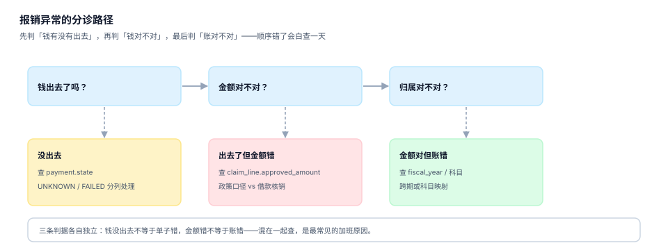

# 常见问题与分诊

报销系统的工单有一个共同点：**提问的人已经知道「不对劲」，但说不清哪里不对**。所以第一件事不是回答，是分诊——把钱的问题、单的问题、账的问题分开，否则会在错误的表里查一整天。

这一页给出一张十二行分诊表、十二个高频问题、一套止血五步，以及术语表。

## 一、分诊：先问三个问题



| 顺序 | 问题 | 判据 | 走哪张表 |
| --- | --- | --- | --- |
| ① | 钱出去了吗 | `payment.state` | `payment` / 银行回执 |
| ② | 金额对不对 | `claimed` vs `approved` vs `paid` | `expense_claim` / `claim_line` |
| ③ | 账对不对 | 期间、科目、成本对象 | `expense_claim` / 凭证 |

顺序不能反：先查账再查钱，很可能查了半天发现「根本没付」。

## 二、十二行分诊表

| 现象 | 最可能的原因 | 先查什么 | 处置 |
| --- | --- | --- | --- |
| 员工说「钱没到」 | 批次在 `UNKNOWN` 或账户错 | `payment.state`、`bank_ref` | 拉对账文件匹配，勿重付 |
| 报销金额比预期少 | 住宿按限额砍了 / 借款核销 | `claim_line.approved_amount` | 给出逐行差额说明 |
| 报销金额比预期多 | 按夜数发了整天补贴 | `occur_from`/`occur_to` | 修天数口径，追回差额 |
| 同一张票报不了 | 已被别的单据占用 | `invoice.inv_no` 查询 | 告知占用单号，走冲销 |
| 票验真显示「查无此票」 | 离线开票未上传 / 超 5 年 / 录入错 | 查验平台 + 票面 | 等 T+1 或让开票方重传 |
| 抬头错被退 | 与公司主体不一致 | `company_entity` | 让员工换开，勿「模糊纠正」 |
| 单子挂在某人名下不动 | 审批人离职 / 代理过期 | `approval` + `employee` | 上跳一级或重新路由 |
| 超标却全额报了 | 说明字段为空但审批通过 | `approval.reason` | 补说明或追回 |
| 借款一直显示未清 | 核销顺序导致旧账还挂着 | `advance_settlement` | 按 FIFO 重算并补核销 |
| 12 月费用进了 1 月 | 按支付期入账 | `fiscal_year` | 调期间，补预提 |
| 招待费被记成差旅费 | 员工选错类型 | `claim_type` + 科目映射 | 改类型重映射，评估税额 |
| 月结总额对不上明细 | 明细被改过 / 分摊不闭合 | C1 自检 | 用守恒 SQL 定位单据 |

## 三、十二个高频问题

### 1. 为什么「住宿 680 只报 600」？

因为住宿是**限额内实报**：`min(实际, 限额)`。超出的 80 元按制度由个人自理，除非填了超标说明并审批通过。这是「限额」而不是「定额」——两者的区别见[制度与差标](../Policy/index.md)。

### 2. 为什么出差 4 天只发了 3 天补贴？

因为实现用了「住宿夜数」当出差天数。制度原文是「按出差自然（日历）天数计算」，4 天 3 夜应发 4 天。本机实测这个错误会让全公司少发 14.96%。

### 3. 票验真通过了，为什么还是不能抵扣？

验真只回答「税务局有没有这张票」。抬头与税号错、抬头为个人，都能验真通过但不可抵扣。本机读数：这三类占 10.09%。

### 4. 同一张发票能不能报两次？

不能。数据库层 `UNIQUE(inv_no)` 直接拒绝。如果历史上出现过「一票两报」，通常是应用层「先查后插」在并发下失效。

### 5. 红冲的票怎么处理？

原票标 `is_red=1` 并关联红票号，新票用新票号入账。不要删原票——删了就举不出证。

### 6. 借款没还清，能不能先报这一单？

可以，但核销后余额仍 > 0 的单据，应在提交时提示「尚有 X 元未清」。若制度要求「先清后报」，就在提交时硬拦，并给出还款入口。

### 7. 为什么两张单的「超标率」算出来不一样？

分母不同：按「单据数」算与按「住宿夜数」算差很多。统一口径：`超标单数 / 有住宿的单据数`，并在报表里写明分母。

### 8. 审批人调走了，单子挂住怎么办？

先跑断链检测 SQL（见[审批路由](../Approval/index.md)），再上跳一级。不要「让管理员代点」——那会在流水里留下一个没有权限依据的审批动作。

### 9. 12 月的票 1 月才报，算哪个月的费用？

算 12 月。费用归属看发生日，现金流出看支付日，两者本来就可以不同年。跨年时记 `fiscal_year`，并在汇算清缴前确认凭证已取得。

### 10. 招待费为什么单独审批？

税前扣除限额不同：招待费按发生额 60% 且不超过销售收入 5‰ 扣除，超额部分永久性差异。差旅费据实扣除。一张 4,200 元的单记错科目，税额差约 1,050 元。

### 11. 批量代付出现「未知」怎么办？

不得重付。拉银行对账文件按 `bank_ref` 或「金额 + 账号 + 日期」匹配，命中置 `SUCCESS`，未命中且过 T+1 才置 `FAILED`。本机读数：未知态占 0.25%，误重付就是 43 笔重复付款。

### 12. 为什么月结前要跑五条 SQL？

因为月结一旦关账，改一张单要开调整凭证。五条闸（期间闭合、金额守恒、归属完整、预提对齐、跨年标记）各拦一类问题，跑一遍不到 1 秒。

## 四、止血五步

线上出问题时，顺序比技巧重要：

| 步 | 动作 | 目的 |
| --- | --- | --- |
| ① 停 | 暂停相关批次 / 关闭提交入口 | 防止问题扩大（尤其是重复付款） |
| ② 圈 | 用一条 SQL 圈出受影响单据范围 | 知道「有多少、多大金额」 |
| ③ 证 | 保留现场：`payment`、`invoice_verify`、日志 | 事后能举证、能复盘根因 |
| ④ 修 | 只修数据，不改历史流水（用冲销/新增） | 保持审计轨迹 |
| ⑤ 防 | 把根因落成一条约束或断言 | 同一个坑不踩第二次 |

```sql
-- 第 ② 步「圈范围」的模板：按批次号圈出全部受影响单据
SELECT c.claim_id, c.claim_no, c.total_amount, p.state, p.bank_ref
FROM payment p JOIN expense_claim c USING (claim_id)
WHERE p.batch_no = :batch_no
ORDER BY c.claim_id;
```

::: danger 止血时最常见的三个错误
1. **直接 `UPDATE` 支付状态**：审计轨迹断裂，事后说不清「当时是什么状态」。
2. **对未知态统一重付**：这是重复付款的第一大来源。
3. **先修数据再取证**：修完就再也证明不了「问题存在过」。
:::

## 五、术语表

| 术语 | 含义 | 易混淆点 |
| --- | --- | --- |
| 申报额 | 员工填的合计 | 不等于可报金额 |
| 核准额 | 政策与审批后的允许金额 | 不等于实付金额 |
| 实付额 | 扣除借款核销后的打款额 | 不是费用 |
| 限额内实报 | `min(实际, 限额)` | 与「定额包干」不同 |
| 定额包干 | 按天数 × 标准发，与实际无关 | 涉及个税 |
| 一票一报 | 同一票号只能报一次 | 红冲票是两张票 |
| 自然（日历）天数 | `结束 − 开始 + 1` | 不是住宿夜数 |
| 预提 | 已发生未取得凭证时先估一笔 | 必须可回冲 |
| 追补扣除 | 以前年度支出在以后年度扣除 | 不超过 5 年 |
| 永久性差异 | 永远不能扣除的金额 | 与「时间性差异」不同 |
| 级联否决 | 一项缺失导致多项失效 | 无住宿票 → 四项全不报 |
| 拆分报销 | 拆成多张规避审批阈值 | 每张都低于阈值 |

## 六、验证方式

```shell
# 1. 用分诊表定位一张「员工说没收到钱」的单
sqlite3 expense.db "
select c.claim_no, c.total_amount, p.state, p.bank_ref
from expense_claim c left join payment p using (claim_id)
where c.claim_no = 'BX-2026-0001';"
# 期望：state 为 SUCCESS 且 bank_ref 非空；若为 UNKNOWN，先查对账文件，不要重付

# 2. 确认「一票两报」不存在
sqlite3 expense.db "select inv_no, count(*) from invoice group by inv_no having count(*) > 1;"
# 期望：无输出

# 3. 确认月结五闸全过
sqlite3 expense.db < checks.sql
# 期望：五行全 0
```

第 1 条查询是本页最有用的命令：它一次回答「单子多少钱、付了没有、银行流水是多少」。绝大多数「钱没到」的工单，答案就在这三列里。

## 参考资料

- 财政部《中央和国家机关差旅费管理办法》（财行〔2013〕531 号）：限额内实报、自然天数、级联否决三条口径的出处。
- 国家税务总局《企业所得税税前扣除凭证管理办法》（国家税务总局公告 2018 年第 28 号）：汇算清缴、60 日补开、5 年追补。
- 国家税务总局公告 2024 年第 11 号：数电票 20 位号码与法律效力。
- 与本页相邻：[总览](../Overview/index.md)、[实战](../Practice/index.md)、[稽查与合规](../Audit/index.md)。
