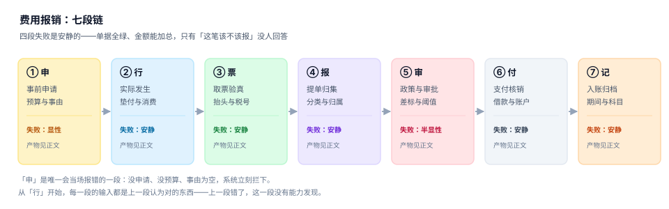

# 总览：七段链与三个「报了多少钱」

一张报销单的输入是一段真实发生的出差，输出是一个打款金额。中间隔着七段作业，每段都会产出一个「结论」，而结论之间并不天然一致——员工填 2,580，政策算出 2,520，出纳打了 1,620。三个数字都对，因为它们回答的是三个不同的问题。

这一页做三件事：把七段链讲清楚、把三个金额分开、把四个必失接缝标出来。后面九页都在补这三件事的细节。

## 一、七段链：每段都在产生一个「结论」

| 段 | 输入 | 动作 | 产物 | 结论形态 | 失败是否安静 |
| --- | --- | --- | --- | --- | --- |
| ① 申 | 出差意图 | 填申请、占预算 | `travel_request` | 「这次出差被批准了」 | 显性 |
| ② 行 | 批准的行程 | 订票、住宿、市内交通 | 消费流水 | 「实际花了多少」 | **安静** |
| ③ 票 | 消费凭据 | 取票、验真、验抬头 | `invoice` | 「这笔支出有合法凭据」 | **安静** |
| ④ 报 | 消费 + 票据 | 提单、分类、挂归属 | `expense_claim` | 「这是一张什么单」 | **安静** |
| ⑤ 审 | 单据 | 政策校验、路由审批 | `approval` | 「公司同意付这笔钱」 | 半显性 |
| ⑥ 付 | 核准结论 | 核销借款、批量代付 | `payment` | 「钱确实出去了」 | **安静** |
| ⑦ 记 | 核准 + 支付 | 归属期间、入账、归档 | 凭证 + `period` | 「这笔费用属于哪个月」 | **安静** |



**为什么只有第 ① 段是显性的**：事前申请是唯一「外部输入直接进系统」的环节，没有申请单号、没有预算余额、事由为空，校验当场就能拦。从第 ② 段开始，每一段的输入都是**上一段认为对的东西**——上一段错了，这一段没有能力发现。

最典型的例子：第 ④ 段把「客户招待」选成了「差旅」，第 ⑤ 段按差旅标准校验（限额更宽）通过，第 ⑦ 段记进「差旅费」科目。全过程没有一处报错，只在税务检查时被发现：**招待费有扣除限额，差旅费没有**。一张单的科目分类，值 25% 的企业所得税。

## 二、三个「报了多少钱」

| 口径 | 公式 | 谁在关心 | 常见错法 |
| --- | --- | --- | --- |
| 申报额 | `Σ 明细行金额` | 员工 | 把个人消费混进公务支出 |
| 核准额 | `Σ 政策允许金额` | 审批人 / 财务 | 用「限额」直接当核准额 |
| 实付额 | `核准额 − 借款核销 − 已预付` | 出纳 / 员工 | 把「核销借款」记成「费用减少」 |


### 一个必须自己算一遍的例子

出差 4 天 3 夜，一线城市，P6：住宿限额 600/夜、伙食补助 100/天、市内交通 80/天。住宿实际 680/夜，出发前借了 5,000 元备用金。

| 步骤 | 计算 | 结果 |
| --- | --- | --- |
| 申报额 | 住宿 680×3 + 伙食 100×4 + 交通 80×4 | 2,580.00 |
| 政策校验 | 住宿 min(680,600)×3 = 1,800；伙食 400；交通 320 | 2,520.00 |
| 借款核销 | 2,520 − 已核销 3,120（先冲旧账，余额不足部分转应付） | 1,620.00 |

**注意第二行到第三行不是「扣了 900」**：借款 5,000、已核销 3,120，说明这张单的 2,520 里有 2,520 冲了借款，实际现金只付 1,620——但「费用」仍然是 2,520。把实付额当费用入账，是最常见的会计错，也是「费用总额对不上」的第一大来源。

::: danger 三件事必须分列存
1. **不要用一个 `amount` 字段装三个数**：合并之后没有任何一条 SQL 能区分「少报了」与「该少报」。
2. **不要把借款核销做成负号明细**：负号明细会让「费用合计」变成净额，预算与成本分析全错。借款核销是**负债的减少**，不是费用的减少。
3. **不要用「实付额」做报表口径**：员工垫付、公司后付，实付额受付款节奏影响，与「这个月花了多少」无关。
:::

## 三、四个必失接缝

接缝是两段之间的交界，也是「两边都以为对方会管」的地方。

| 接缝 | 左边认为 | 右边认为 | 实际丢失的东西 | 本机读数 |
| --- | --- | --- | --- | --- |
| ②→③ | 「花了多少系统知道」 | 「票上有金额」 | 消费流水与票的对不上（一餐多票、票大于实际） | 票据金额 ≥ 单据额才通过，只校了「够不够」 |
| ③→④ | 「票验过真了」 | 「票合规了」 | 抬头/税号错：能报但不能扣 | 抬头错 5.20% + 税号错 3.10% |
| ④→⑤ | 「分类是员工选的」 | 「分类是政策认的」 | 招待记成差旅，扣除限额消失 | 分类错误无任何校验 |
| ⑥→⑦ | 「付了就是发生了」 | 「发生了才入账」 | 跨期：12 月的费用进 1 月报表 | 12 月发生次年提单 18.62% |

四个接缝的共同点：**它们都不是「数据丢了」，而是「两边各有一半，没人负责拼起来」**。

### 接缝 ③→④ 值得单独说

「票验过真」与「票能扣」是两件事。全国增值税发票查验平台只能回答「税务局有没有这张票」，回答不了「这张票的抬头是不是你公司」「税号对不对」「这笔支出和这次出差有没有关系」。

本机实测：12,000 张单据里，抬头与公司全称不完全一致 624 张（5.20%）、税号错 372 张（3.10%）、抬头为个人 215 张（1.79%）。这三类合计 1,211 张，占 10.09%——**都能报销，但都不能抵扣**。其中抬头为个人的 397,750 元还要并入工资薪金代扣个税。

## 四、五个角色，五种「对不对」

| 角色 | 关心的判定 | 判据不成立时的后果 |
| --- | --- | --- |
| 员工 | 我垫的钱能不能全额回来 | 少报、慢报、干脆不报（票据过期） |
| 直属主管 | 这笔支出业务上是否必要 | 预算被「合理」地花掉 |
| 财务审核 | 政策、票据、归属是否合规 | 税务风险与内审问题 |
| 出纳 | 付给谁、付多少、付几次 | 重复付款、付错账户 |
| 税务/内审 | 能不能税前扣除、有没有异常 | 补税、滞纳金、处罚 |

五个角色看同一张单，看到的是五个不同的「对」。系统如果只提供一个状态字段，就必然有一方在猜。

## 五、七个必失点与代价

| 必失点 | 典型形态 | 一次代价 |
| --- | --- | --- |
| 天数口径 | 按夜数算补贴 | 单次少发 180 元，全公司年差 54 万 |
| 限额口径 | 全额实报或按限额发 | 多承担 5.94%（本机 736,006 元） |
| 票号去重 | 只取票号后 8 位 | 误删 62.58% 的票 |
| 抬头税号 | 只验真不验抬头 | 10.09% 的单据不可抵扣 |
| 审批阈值 | 顺手调高 500 元 | 1.60% 的单据掉档 |
| 核销顺序 | 先冲新账 | 逾期笔数虚高 102.84% |
| 跨期归属 | 按支付期入账 | 20.88% 的预提缺口 |

::: tip 一句话记法
七段链里，**会喊的那一段（① 申请）几乎不会错，不会喊的五段才是成本**。所以工程上的投入顺序应该是反的：先把 ③④⑥⑦ 的校验做厚，再优化 ① 的填写体验。
:::

## 六、本专题的判据族

本页判据族 `EXN-A` ~ `EXN-H`，共 8 条。八条都能被单独判定，任何一条不成立就不算这篇文档写完。

| 族 | 覆盖 | 页 |
| --- | --- | --- |
| `EXN-A ~ EXN-H` | 七段链、三个金额、四个接缝、五个角色、必失点、边界、版本组织、验收入口 | 本页 |
| `EXP-A ~ EXP-H` | 制度条款、差标矩阵、生效期、适用判定、天数口径、限额口径、定额项、超标说明 | [制度与差标](../Policy/index.md) |
| `EXC-A ~ EXC-H` | 八态、三层结构、单号、幂等、金额守恒、撤回、退回、只追加 | [单据模型](../ClaimModel/index.md) |
| `EXR-A ~ EXR-H` | 票号解析、验真、抬头、税号、一票一报、票种、红冲、留痕 | [票据与查验](../Receipt/index.md) |
| `EXA-A ~ EXA-H` | 级数矩阵、阈值、自审、断链、越级、代理、时限、留痕 | [审批路由](../Approval/index.md) |
| `EXV-A ~ EXV-H` | 备用金、核销顺序、余额、账龄、离职、超额、转账、对账 | [借款与核销](../Advance/index.md) |
| `EXY-A ~ EXY-H` | 批次、账户三一致、去重、银行文件、回执三态、退回、手续费、重付 | [支付与代付](../Payment/index.md) |
| `EXL-A ~ EXL-H` | 三个日期、预提、分摊、科目、项目号、跨年、冲销、月结 | [成本归属与期间](../Allocation/index.md) |
| `EXD-A ~ EXD-H` | 抽样、拆分、连号、关联方、税前扣除、追补、留档、处罚 | [稽查与合规](../Audit/index.md) |
| `EXQ-A ~ EXQ-H` | 七张表、三个触发器、九条断言、四个负向、验收 SQL、复跑、性能、交付 | [实战](../Practice/index.md) |

### 本页 8 条判据

| 判据 | 约定 | 定错了会怎样 | 怎么验证 |
| --- | --- | --- | --- |
| `EXN-A` | 七段链每一段都有一个可查询的产物（表或字段），且逐段标注「失败是否安静」 | 段与段之间没有落库凭证，出错时无法定位在哪一段 | 对照第一节的产物列，逐个确认表名存在 |
| `EXN-B` | 申报额、核准额、实付额三列分存，任何一处不得合并成一个金额字段 | 合并后差异无法解释，对账时只能人工解释 | 单据表里三个字段并存 |
| `EXN-C` | 实付额 = 核准额 − 借款核销 − 已预付；核销不是费用减少 | 把核销记成费用减少，总账会做小 | 一条 SQL 用三个数复算实付额 |
| `EXN-D` | 四个接缝（申请→行、行→票、票→报、报→审）各有一道唯一键或幂等键 | 重复提交产生双份单据与双份付款 | 四个接缝各查一条唯一索引 |
| `EXN-E` | 五个角色（员工、审批人、财务、出纳、税务）各自只对一处判定负责 | 权责交叉，越级审批与自审无法识别 | 角色—判定矩阵可逐格点人 |
| `EXN-F` | 必失点在本页登记成清单，每条指向一处校验位置 | 安静的失败变成无人负责 | 清单每条都有落点 |
| `EXN-G` | 与制度、票据、审批、借款、支付、归属、稽查七册的分工各写一行 | 同一口径两处实现，半年后开始漂移 | 分工表可被引用 |
| `EXN-H` | 本页给出的命令能在空库上直接跑通，并输出三个金额 | 文档不可执行，读者只能「看懂」不能「验证」 | 复制第七节命令到空库执行 |

## 七、验证方式

读完本页，用三条命令确认「三个金额确实要分列」：

```shell
# 1. 建一张最小的三列视图，看合并后会丢什么
sqlite3 :memory: "
create table c(id int, claimed real, approved real, paid real);
insert into c values (1, 2580.00, 2520.00, 1620.00);
select sum(claimed) as 申报, sum(approved) as 核准, sum(paid) as 实付,
       sum(approved) - sum(paid) as 非现金部分 from c;"
# 期望：2580.0 | 2520.0 | 1620.0 | 900.0

# 2. 确认「费用合计」不等于「实付合计」（差的正是借款核销）
# 3. 检查你的系统：expense 表里有没有 approved_amount 与 paid_amount 两个字段
```

第 1 条命令的 `900.0` 就是「借款核销」，它既不是费用，也不是收入，是负债的减少。任何把 900 塞进费用表的实现，都会让当月费用少 900。

## 参考资料

- 财政部《中央和国家机关差旅费管理办法》（财行〔2013〕531 号）第二十三至二十五条：住宿限额内实报、补贴按自然天数、无住宿发票则四项均不得报销。
- 国家税务总局《企业所得税税前扣除凭证管理办法》（国家税务总局公告 2018 年第 28 号）。
- 国家税务总局《关于推广应用全面数字化电子发票的公告》（国家税务总局公告 2024 年第 11 号）。
- 与本专题相邻的册子：[记账与分录](../../Ledger/DoubleEntry/index.md)、[资金管理](../../Treasury/Overview/index.md)、[全面预算](../../Budgeting/Overview/index.md)。
