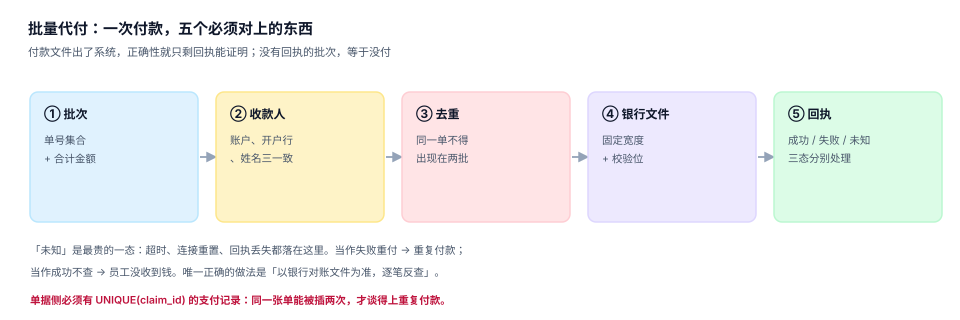

# 支付与代付：五个必须对上的东西

钱一旦出了公司账户，正确性就只剩「回执」能证明。报销系统里最贵的故障不是「审批慢」，而是**同一张单付了两次**——它不会报错，只在月末对账时表现为「银行流水比账面多」。

这一页把「一次批量代付」拆成五个必须对上的环节，并给出回执三态的处理方式。

## 一、五个环节，一条链

| # | 环节 | 必须对上什么 | 常见错法 |
| --- | --- | --- | --- |
| ① 批次 | 单号集合 + 合计金额 | 批次总额 ≠ 单据总额之和 | 边选单边付款，批次金额是「当前选中」 |
| ② 收款人 | 账户、开户行、姓名三一致 | 只校账号，不校户名 | 户名不符被银行退回，重付再退 |
| ③ 去重 | 同一单不得出现在两批 | 只按「批次内」去重 | 跨批次重复 |
| ④ 银行文件 | 固定宽度、校验位、金额格式 | 金额单位是元还是分 | 放大 100 倍或缩小 100 倍 |
| ⑤ 回执 | 成功 / 失败 / 未知三态 | 把「未知」当失败重付 | 重复付款 |



五个环节里，**只有第 ⑤ 个是「出了系统」的**，也是唯一无法用代码保证的。所以整个设计的重心应该放在「怎么让第 ⑤ 个的错误可恢复」——而可恢复的前提是第 ③ 个：**支付记录必须唯一**。

## 二、唯一约束：一行 DDL 挡住重复付款

```sql
-- 一张单只能有一条支付记录
CREATE TABLE payment (
  payment_id INTEGER PRIMARY KEY,
  claim_id   INTEGER NOT NULL UNIQUE REFERENCES expense_claim(claim_id),
  batch_no   TEXT NOT NULL,
  amount     REAL NOT NULL CHECK (amount > 0),
  paid_at    TEXT NOT NULL,
  channel    TEXT NOT NULL CHECK (channel IN ('BANK_BATCH','BANK_SINGLE','CASH')),
  state      TEXT NOT NULL CHECK (state IN ('SENT','SUCCESS','FAILED','UNKNOWN')),
  bank_ref   TEXT,                      -- 银行流水号，回执后回填
  UNIQUE (batch_no, claim_id)           -- 同一批次内也不允许重复
);
```

三个约束各管一件事：

| 约束 | 挡住什么 |
| --- | --- |
| `claim_id UNIQUE` | 跨批次重复付款（同一单进两批） |
| `UNIQUE(batch_no, claim_id)` | 同一批次内重复（选单时重复勾选） |
| `amount > 0` | 零元付款、负数冲正 |

本机读数：12,000 笔付款中，「超时 / 未知态」43 笔、66,501.38 元（0.25%）。如果这 43 笔被当成失败重付，就是 **43 笔重复付款、6.65 万元**——而它们每一笔在系统里都「成功过两次」。

::: danger 回执三态不能合并成两态
1. **成功**：银行返回明确成功，回填 `bank_ref`，单据置 `PAID`。
2. **失败**：银行返回明确失败（账号错、户名不符、账户冻结），单据回 `APPROVED`，可重付。
3. **未知**：超时、连接重置、回执文件缺失。**不得重付**，只能等对账文件或人工查询，确认后再决定。
:::

## 三、账户三一致：账号、户名、开户行

| 校验 | 数据来源 | 不校验的后果 |
| --- | --- | --- |
| 账号格式（长度、开头） | 银行规则 | 提交即失败，浪费一个批次 |
| 户名与账号匹配 | 银行「账户核验」接口 | 退款、退票、重付三次 |
| 开户行与账号匹配 | 联行号（CNAPS） | 跨行路由错误，T+1 退回 |

本机读数：账号错 82 笔、户名不符 151 笔，合计失败 233 笔、500,481.89 元。

更值得警惕的是**账户变更**：353 人年内改过收款账户（2.94%），其中 71 人（20.11%）**未走独立审批**。账户变更是报销场景里最典型的欺诈路径——改一个账号，钱就进了别人口袋。

```sql
-- 账户变更必须留旧值 + 审批，且 30 天内不得再次变更
CREATE TABLE emp_bank_account (
  account_id  INTEGER PRIMARY KEY,
  emp_no      TEXT NOT NULL,
  bank_name   TEXT NOT NULL,
  branch_no   TEXT NOT NULL,           -- 联行号
  account_no  TEXT NOT NULL,
  account_name TEXT NOT NULL,
  is_active   INTEGER NOT NULL DEFAULT 1,
  changed_at  TEXT NOT NULL,
  approved_by TEXT,                    -- NULL = 未审批，付款前必须拦
  CHECK (approved_by IS NOT NULL OR is_active = 0)
);
```

`CHECK (approved_by IS NOT NULL OR is_active = 0)` 的意思是：**未审批的账户不能是「生效」状态**。这条约束把「先改账号再付款」的路径直接堵死。

## 四、银行文件：三个必须核对的格式项

| 项 | 典型要求 | 错法 |
| --- | --- | --- |
| 金额单位 | 多为「分」，也有「元」带两位小数 | 元当分用 → 缩小 100 倍 |
| 定长补位 | 账号左补 0 到固定宽度 | 不补位 → 银行截断前导 0 |
| 文件校验 | 记录数 + 金额合计写在文件头/尾 | 头尾不写 → 银行整批拒收 |

最阴险的是第一条。本机不涉及真实银行文件，但这条规则的形态值得记住：**金额单位错，不会报错，只会让每个人收到 1% 或 100 倍的钱**，而且要到员工投诉才发现。

```shell
# 生成银行文件后，先在本地做一次「头尾自校验」
awk -F',' 'NR>1{n++; s+=$3} END{printf "records=%d total=%.2f\n", n, s}' pay_batch.csv
# 期望与批次表的 count(*)、sum(amount) 完全一致，不一致就不许上传
```

## 五、回执处理：一张状态机，三条路径

```text
SENT ──成功回执──> SUCCESS  → 单据 PAID
  │
  ├──失败回执──> FAILED    → 单据回 APPROVED，可重付（新批次、新 payment 行）
  │
  └──超时/无回执──> UNKNOWN → 冻结，等对账文件；不得重付
```

「冻结」这个动作必须有，且要能被人看见：一张单卡在 `UNKNOWN` 超过 24 小时，就应该出现在运营看板上，而不是躺在某张表里。

### 未知态的正确恢复流程

1. 拉当日银行对账文件（成功流水清单）。
2. 按 `bank_ref` 或「金额 + 收款账号 + 日期」匹配。
3. 命中 → 置 `SUCCESS`；未命中且已过 T+1 → 置 `FAILED` 后重付。
4. 全程留痕：谁点的、依据哪份文件、匹配到哪条流水。

## 六、手续费与成本：批量 vs 逐笔

| 方式 | 单价 | 12,000 笔合计 |
| --- | --- | --- |
| 逐笔跨行 | 2 元/笔 | 24,000.00 |
| 批量代发 | 0.5 元/笔 | 6,000.00 |
| 差额 | — | **18,000.00** |

手续费不进「差旅费」，进「财务费用」。它不影响报销金额，但它是「为什么必须做批量」的直接理由——而批量的前提是「批次内去重 + 批次可重投」，也就是本页第 二、三节讲的东西。

## 七、对账：三条流水必须闭合

| 流水 | 来源 | 与谁对 |
| --- | --- | --- |
| 单据支付记录 | `payment` | 批次合计 |
| 批次文件 | 生成的银行文件 | 银行回执 |
| 银行对账单 | 银行 | 总账「银行存款」 |

三条闭合的判据是：`Σ payment.amount（本批）= 文件合计 = 银行成功流水合计`。任何一条不等，都要能定位到**具体哪一笔**，而不是只知道「总额差了 300」。

```sql
-- 批次三方对账：单据侧 vs 文件侧 vs 银行侧
SELECT p.batch_no,
       count(*) AS 单据笔数,
       sum(p.amount) AS 单据金额,
       sum(CASE WHEN p.state = 'SUCCESS' THEN 1 ELSE 0 END) AS 成功笔数,
       sum(CASE WHEN p.state = 'SUCCESS' THEN p.amount ELSE 0 END) AS 成功金额,
       sum(CASE WHEN p.state = 'UNKNOWN' THEN 1 ELSE 0 END) AS 未知笔数
FROM payment p
WHERE p.batch_no = :batch_no
GROUP BY p.batch_no;
```

## 八、判据族 `EXY-A ~ EXY-H`

本页判据族 `EXY-A` ~ `EXY-H`，共 8 条。八条都能被单独判定，任何一条不成立就不算这篇文档写完。

| 判据 | 断言 | 验证方式 |
| --- | --- | --- |
| `EXY-A` | 一张单只有一条支付记录 | `claim_id UNIQUE`，重复插被拒 |
| `EXY-B` | 批次总额 = 批内单据金额之和 | 批次汇总 SQL 与文件合计一致 |
| `EXY-C` | 回执三态分列，未知态不得重付 | `UNKNOWN` 状态下重付被拒 |
| `EXY-D` | 未审批的收款账户不得生效 | `CHECK (approved_by IS NOT NULL OR is_active = 0)` |
| `EXY-E` | 银行文件金额单位与头部合计自校验 | 文件 `records/total` 与批次表一致 |
| `EXY-F` | 失败可重付，且生成新的付款记录（不覆盖旧的） | 重付后 `payment` 两行，旧行 `FAILED` |
| `EXY-G` | 手续费进财务费用，不进报销金额 | 科目归属检查 |
| `EXY-H` | 三方流水按批次可闭合，差异可定位到单 | 批次对账 SQL 三列相等 |

## 九、验证方式

```shell
# 1. 同一张单付两次：第二次必须被 UNIQUE 拒绝
sqlite3 :memory: "
create table p(id integer primary key, claim_id int unique, amt real, state text);
insert into p(claim_id,amt,state) values (1001, 2520.00, 'SUCCESS');
insert into p(claim_id,amt,state) values (1001, 2520.00, 'SUCCESS');"
# 期望：UNIQUE constraint failed: p.claim_id

# 2. 未知态重付：必须在应用层被拦（SQL 演示判定条件）
sqlite3 :memory: "
create table p(claim_id int, state text);
insert into p values (1001,'UNKNOWN');
select count(*) from p where claim_id=1001 and state='UNKNOWN';
-- 应用层拿到 1 就应该拒绝重付，而不是插新行"

# 3. 批次合计自校验
awk -F',' 'NR>1{n++; s+=$3} END{printf "records=%d total=%.2f\n", n, s}' pay_batch.csv
```

第 1 步是整页最重要的一条：**重复付款是可以被数据库挡住的**，前提是你把 `claim_id` 设成唯一。把它设成普通索引、靠应用层「先查有没有付过」，在并发批量下必然失效。

## 参考资料

- 《人民币银行结算账户管理办法》（中国人民银行令〔2003〕第 5 号）：单位账户收付款的户名一致性要求。
- 中国人民银行《关于优化企业开户服务的指导意见》与联行号（CNAPS）编码规则。
- 与本页相邻：[借款与核销](../Advance/index.md)、[成本归属与期间](../Allocation/index.md)、[资金管理](../../Treasury/Overview/index.md)。
