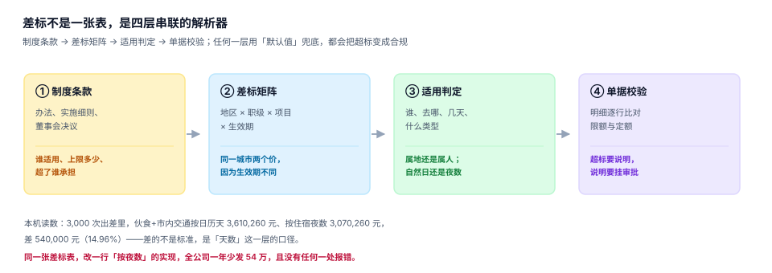

# 制度与差标：一张表背后的四层

「住宿一线城市 600、二线 400」这句话，在制度文件里是一段话，在系统里必须变成一张能回答四个问题的表：**谁适用、在哪适用、什么时候适用、超了怎么办**。少答一个，这张表就只是一个建议值。

这一页把差标拆成四层，并给出每一层最常见的错法。核心结论先放在这里：**差标不是一个数，是一次解析**——同一张单在不同时间提交，可能解析出两套标准，而两套都「有依据」。

## 一、四层结构

| 层 | 输入 | 产物 | 错了会怎样 |
| --- | --- | --- | --- |
| ① 制度条款 | 管理办法、实施细则、董事会决议 | 「谁、多少、超了谁承担」 | 条款理解错，全公司口径错 |
| ② 差标矩阵 | 地区 × 职级 × 费用类型 × 生效期 | 一行限额 | 矩阵维度缺一个，就有一类人算错 |
| ③ 适用判定 | 谁、去哪、几天、什么类型 | 解析后的标准 | 属人/属地、自然日/夜数选错 |
| ④ 单据校验 | 明细逐行 | 核准额 + 超标说明 | 用默认值兜底，超标变合规 |



### 制度条款：三句话决定三件事

以《中央和国家机关差旅费管理办法》（财行〔2013〕531 号）为例，三句原文对应三个实现点：

| 原文 | 实现点 | 常见错法 |
| --- | --- | --- |
| 「住宿费在标准限额之内凭发票据实报销」 | `min(实际, 限额)` | 按限额直接发（把节省变成补贴） |
| 「伙食补助费按出差自然（日历）天数计算」 | `天数 = 结束日 − 开始日 + 1` | 用住宿夜数当天数（少 1 天） |
| 「实际发生住宿而无住宿费发票的，不得报销住宿费以及城市间交通费、伙食补助费和市内交通费」 | 四条明细**级联否决** | 只扣住宿那一项 |

第三句是最容易被漏掉的一条：它不是「扣一项」，是「四项一起失去依据」。系统里如果按「明细逐行独立校验」实现，这条规则根本无法表达——**它是一条跨明细的否决规则**。

## 二、差标矩阵：四个维度，一个都不能少

```sql
-- 差标矩阵：四个维度 + 生效期，唯一键必须包含生效期
CREATE TABLE expense_policy (
  policy_id      INTEGER PRIMARY KEY,
  grade          TEXT NOT NULL,          -- 职级：P5- / P6 / P7+
  city_tier      TEXT NOT NULL,          -- 地区档：一线 / 新一线 / 二线 / 其他
  expense_type   TEXT NOT NULL,          -- 费用类型：LODGING / MEAL / LOCAL
  limit_amount   REAL NOT NULL CHECK (limit_amount >= 0),
  limit_mode     TEXT NOT NULL CHECK (limit_mode IN ('CAP','FLAT')),  -- 限额内实报 / 定额包干
  effective_from TEXT NOT NULL,
  effective_to   TEXT,                   -- NULL 表示现行
  UNIQUE (grade, city_tier, expense_type, effective_from)
);
```

四个维度里，`expense_type` 最容易被省略——很多系统只有「住宿标准」一张表，把伙食与交通硬编码在代码里。结果是**调标必须发版**，而调标一年至少两次（差旅旺季上浮、地区档调整）。

`limit_mode` 是第二个关键字段：`CAP` 表示「限额内实报」（住宿），`FLAT` 表示「定额包干」（伙食、市内交通）。两种模式的算法完全不同：

| 模式 | 算法 | 实际发生 0 元时 | 实际发生 800 元（限额 600）时 |
| --- | --- | --- | --- |
| `CAP` 限额内实报 | `min(actual, limit)` | 报 0 | 报 600，超 200 自理 |
| `FLAT` 定额包干 | `limit × 天数` | 照发 | 照发（与实际发生无关） |

把 `FLAT` 写成 `CAP`，员工出差期间吃泡面也一分不补；把 `CAP` 写成 `FLAT`，住 300 块的快捷酒店也能领 600——后者在税务上属于「补贴」，要并入工资代扣个税。

## 三、生效期：历史单据必须能重算

差标会调。2026 年 7 月 1 日起一线城市住宿从 600 调到 650，那么 6 月 28 日发生、7 月 5 日提交的单据按哪个标准？

::: danger 三个都不能选的做法
1. **按「提交日的现行标准」**：员工可以通过「晚几天提交」拿到更高的标准，制度形同虚设。
2. **按「标准表的当前行」**：一旦调标，所有历史单据重算，已支付的单子金额会「变」。
3. **把旧标准删掉**：最省事，也最致命——去年审计要复算，你连依据都没了。
:::

正确做法只有一条：**按「费用发生日」解析当时的生效行**，且旧行永不删除。

```sql
-- 按发生日解析标准（半开区间 [effective_from, effective_to)）
SELECT limit_amount, limit_mode
FROM expense_policy
WHERE grade = :grade
  AND city_tier = :city_tier
  AND expense_type = :expense_type
  AND effective_from <= :occur_date
  AND (effective_to IS NULL OR :occur_date < effective_to)
ORDER BY effective_from DESC
LIMIT 1;
```

`ORDER BY effective_from DESC LIMIT 1` 这一句是必须的：如果维护时留下了重叠区间（7 月 1 日新行生效，旧行的 `effective_to` 忘了写），没有它就会返回两行，应用层拿到哪一行取决于数据库的执行计划——**同一张单两次提交算出两个数**。

### 用一条 SQL 找出重叠区间

```sql
-- 自连接找重叠：同一 (grade, city_tier, expense_type) 下两行区间相交
SELECT a.policy_id AS old_id, b.policy_id AS new_id,
       a.effective_from, a.effective_to, b.effective_from
FROM expense_policy a
JOIN expense_policy b
  ON a.grade = b.grade AND a.city_tier = b.city_tier
 AND a.expense_type = b.expense_type
 AND a.policy_id < b.policy_id
WHERE (a.effective_to IS NULL OR a.effective_to > b.effective_from)
  AND b.effective_from >= a.effective_from;
-- 期望：0 行。有行就说明有人调标时忘了关闭旧行
```

## 四、适用判定：三个必须当场决定的口径

### 口径一：自然日还是住宿夜

制度写的是「按出差自然（日历）天数计算」。本机读数：3,000 次出差，总日历天 20,057、总住宿夜 17,057。

| 口径 | 伙食+市内交通合计 | 差额 |
| --- | --- | --- |
| 按日历天（正确） | 3,610,260.00 | — |
| 按住宿夜数 | 3,070,260.00 | **−540,000.00（−14.96%）** |

3,000 次出差里，2,841 次长途各少算 1 天（180 元/次），159 次当日往返少算整天（180 元/次）。**没有一次会报错**：天数是个正整数，夜数也是个正整数，两者都「看起来对」。

### 口径二：属人还是属地

| 判定方式 | 规则 | 问题 |
| --- | --- | --- |
| 属人 | 按员工职级取标准 | 高职级去低消费城市，标准虚高 |
| 属地 | 按出差城市档取标准 | 需要「城市 → 档位」的映射表，且会调档 |
| 混合 | 职级定系数、城市定基数 | 最常见，也最容易被实现成「只取职级」 |

混合模式的正确写法是 `限额 = 城市基数 × 职级系数`，而不是「职级标准表里恰好有一列叫一线城市」。后者在增加城市档时会爆炸成 `N 职级 × M 城市档` 行，且每次调档都要插一批新行。

### 口径三：旺季上浮

制度允许「住宿价格季节性变化明显的城市，旺季可适当上浮」。这句话在系统里必须落成**区间**，不是布尔值：

```sql
-- 旺季上浮：用「日期区间 + 上浮比例」表达，不要写成 if 语句
CREATE TABLE policy_season (
  season_id     INTEGER PRIMARY KEY,
  city_tier     TEXT NOT NULL,
  start_md      TEXT NOT NULL,   -- '07-01'
  end_md        TEXT NOT NULL,   -- '08-31'
  uplift_ratio  REAL NOT NULL CHECK (uplift_ratio BETWEEN 0 AND 1),
  CHECK (start_md <= end_md)
);
```

用 `start_md`/`end_md`（月日）而不是具体日期，是因为旺季每年重复；用 `uplift_ratio` 而不是新标准，是因为上浮比例相对稳定、基数会调。

## 五、单据校验：超标必须留「说明」

限额内实报意味着超标部分自理。但「自理」不等于「系统自动砍掉」——很多超标是合理的（展会、临时改期、当地只有一家酒店）。正确的实现是三态：

| 情形 | 处理 | 留痕 |
| --- | --- | --- |
| 未超标 | 全额进核准额 | 无 |
| 超标且有说明 + 审批通过 | 全额进核准额（公司承担） | 说明文本 + 审批人 |
| 超标且无说明 | 只进限额部分 | 差额标记「个人自理」 |

本机读数：9,000 张住宿单、31,360 夜，超标 1,034 张（11.49%）、超标金额 736,006.55 元（占实际发生 5.94%），单张最高超 95%。

| 口径 | 公司承担 | 员工自理 |
| --- | --- | --- |
| 限额内实报 | 11,652,945.21 | 736,006.55 |
| 全额实报 | 12,388,951.76 | 0 |

**差 736,006.55 元（5.94%）**。这个数不算大，但它决定了「超标」这件事在系统里是否存在——如果一律全额实报，`超标率` 这个指标永远是 0，管理动作也就无从谈起。

## 六、级联否决：没有住宿票，四项全不报

```sql
-- 级联否决：本次出差没有住宿发票 → 住宿/长途/伙食/交通四条明细全部置 0
WITH trip AS (
  SELECT c.claim_id
  FROM expense_claim c
  WHERE c.claim_type = 'TRAVEL'
    AND NOT EXISTS (SELECT 1 FROM invoice i
                    WHERE i.claim_id = c.claim_id AND i.category = 'LODGING')
)
SELECT c.claim_id, c.total_amount,
       coalesce(sum(CASE WHEN l.line_type IN ('LODGING','TRAFFIC','MEAL','LOCAL')
                         THEN l.amount END), 0) AS 应否决金额
FROM expense_claim c
JOIN claim_line l ON l.claim_id = c.claim_id
WHERE c.claim_id IN (SELECT claim_id FROM trip)
GROUP BY c.claim_id;
```

这条 SQL 的价值在于：它把「一项缺失导致四项失效」写成了一个**可执行的判据**，而不是一段口头规则。上线前跑一次，就能知道历史数据里有多少单子其实不符合这一条（通常是当年新员工的第一张单）。

::: warning 这一条和「无票也能报」的业务现实冲突
不少公司为了体验，允许「住宿无票按 60% 报」或者「按定额包干」。这不是错，但它已经**不是**这套制度的算法了——一旦采用，就必须在制度文件里改口径，而不是在代码里加一个 `if`。代码里加 `if` 的后果是：审计时你说不清依据在哪。
:::

## 七、判据族 `EXP-A ~ EXP-H`

本页判据族 `EXP-A` ~ `EXP-H`，共 8 条。八条都能被单独判定，任何一条不成立就不算这篇文档写完。

| 判据 | 断言 | 验证方式 |
| --- | --- | --- |
| `EXP-A` | 矩阵四维齐全（职级/地区/类型/生效期），唯一键含生效期 | 查 `UNIQUE` 约束定义 |
| `EXP-B` | 解析按「费用发生日」，不按提交日 | 构造跨调标日的单据，两次提交结果一致 |
| `EXP-C` | 区间半开且无重叠 | 第 3 节的重叠自连接 SQL 返回 0 行 |
| `EXP-D` | `CAP` 与 `FLAT` 两种模式都能表达，且算法不同 | 实际 0 元时 `CAP` 报 0、`FLAT` 照发 |
| `EXP-E` | 天数取「日历天」，当日往返为 1 天 | `结束日 − 开始日 + 1`，用 4 天 3 夜验证 |
| `EXP-F` | 超标必须带说明才全额进核准额 | 构造无说明超标单，核准额等于限额 |
| `EXP-G` | 无住宿票时四项级联否决 | 第 6 节 SQL 命中该单，且四项金额均为 0 |
| `EXP-H` | 旧标准可查、可重算、不被覆盖 | 调标后重算历史单，金额不变 |

## 八、验证方式

```shell
# 1. 建最小策略表并插入两行（含一次调标）
sqlite3 :memory: "
create table p(grade text, tier text, typ text, amt real, mode text, ef text, et text);
insert into p values ('P6','一线','LODGING',600,'CAP','2026-01-01','2026-07-01');
insert into p values ('P6','一线','LODGING',650,'CAP','2026-07-01',null);
-- 6 月 28 日发生：应取 600
select amt from p where grade='P6' and tier='一线' and typ='LODGING'
  and ef<='2026-06-28' and (et is null or '2026-06-28'<et)
  order by ef desc limit 1;"
# 期望：600.0

# 2. 把上面的日期换成 2026-07-05，期望 650.0 —— 证明按「发生日」而非「提交日」解析

# 3. 重叠检测（期望 0 行）
#    直接复用第 3 节第二条 SQL
```

第 1、2 步合起来就是 `EXP-B` 的验收：**同一张单，发生日固定，无论哪天提交，解析结果都不变**。

## 参考资料

- 财政部《中央和国家机关差旅费管理办法》（财行〔2013〕531 号），第十二至十四条（住宿）、第十六条（伙食按自然天数）、第二十条（市内交通 80 元/天）、第二十三至二十五条（报销与级联否决）。
- 财政部《关于调整中央和国家机关差旅住宿费标准等有关问题的通知》（财行〔2015〕497 号）、《赴地方差旅住宿费标准明细表》（财行〔2016〕71 号）。
- 财政部办公厅《关于规范差旅伙食费和市内交通费收交管理有关事项的通知》（财办行〔2019〕104 号）。
- 国家税务总局《企业所得税税前扣除凭证管理办法》（国家税务总局公告 2018 年第 28 号）第十二条：不合规发票不得作为税前扣除凭证。
