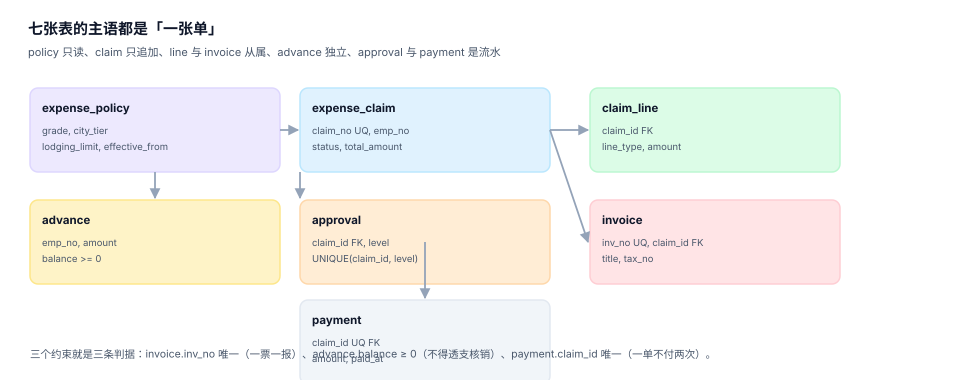

# 实战：七张表、三个触发器、九条断言

前面九页讲了九个判定点，这一页把它们压成一个能跑起来的最小实现：**七张表、三个触发器、九条断言**。全部代码可在本机用 Python 标准库 + SQLite 复现，不需要任何第三方依赖。

读者照着这一页搭出来的，是一个**自己的工程**；本仓只提供文档，不提交脚本。

## 一、目标与边界

| 目标 | 不做什么 |
| --- | --- |
| 一张单从提交到支付，金额与状态全程可核对 | 不做前端、不做审批界面 |
| 票号唯一、抬头税号校验、级联否决可执行 | 不接真实查验平台（用 `invoice_verify` 表模拟） |
| 借款不得透支、已付单不得改额 | 不做银行文件生成 |
| 九条断言全部可跑，退出码 0 | 不做权限体系 |

## 二、目录与依赖

```text
expense-demo/
├─ schema.sql          # 七张表 + 三个触发器
├─ seed.sql            # 9 条差标 + 12 张单据 + 36 条明细 + 12 张票
├─ checks.sql          # 五条正向自检
├─ negatives.py        # 四个负向用例（用 Python 捕获异常）
└─ run.sh              # 一键：建库 → 灌数 → 自检 → 负向
```

```shell
# 依赖只有 Python 3.11+ 自带的 sqlite3 模块
python3 -c "import sqlite3, sys; print(sys.version.split()[0], sqlite3.sqlite_version)"
# 期望形如：3.13.12 3.50.4
```

## 三、七张表

```sql
-- 1. 差标：四维 + 生效期
CREATE TABLE expense_policy (
  policy_id      INTEGER PRIMARY KEY,
  grade          TEXT NOT NULL,
  city_tier      TEXT NOT NULL,
  lodging_limit  REAL NOT NULL CHECK (lodging_limit > 0),
  meal_per_day   REAL NOT NULL,
  local_per_day  REAL NOT NULL,
  effective_from TEXT NOT NULL,
  UNIQUE (grade, city_tier, effective_from)
);

-- 2. 单据：八态 + 金额守恒的锚点
CREATE TABLE expense_claim (
  claim_id     INTEGER PRIMARY KEY,
  claim_no     TEXT NOT NULL UNIQUE,
  emp_no       TEXT NOT NULL,
  claim_type   TEXT NOT NULL CHECK (claim_type IN ('TRAVEL','DAILY','ENTERTAIN','TRAINING')),
  occur_from   TEXT NOT NULL,
  occur_to     TEXT NOT NULL,
  city_tier    TEXT,
  grade        TEXT,
  total_amount REAL NOT NULL CHECK (total_amount >= 0),
  status       TEXT NOT NULL CHECK (status IN
                 ('DRAFT','SUBMITTED','APPROVED','PAID','REJECTED')),
  submit_at    TEXT,
  CHECK (occur_to >= occur_from)
);

-- 3. 明细：一行一笔支出
CREATE TABLE claim_line (
  line_id    INTEGER PRIMARY KEY,
  claim_id   INTEGER NOT NULL REFERENCES expense_claim(claim_id),
  line_type  TEXT NOT NULL CHECK (line_type IN ('LODGING','MEAL','LOCAL','TRAFFIC','OTHER')),
  occur_date TEXT NOT NULL,
  amount     REAL NOT NULL CHECK (amount >= 0),
  note       TEXT
);

-- 4. 发票：一票一报 + 抬头税号非空
CREATE TABLE invoice (
  invoice_id INTEGER PRIMARY KEY,
  claim_id   INTEGER NOT NULL REFERENCES expense_claim(claim_id),
  inv_no     TEXT NOT NULL UNIQUE,
  inv_date   TEXT NOT NULL,
  seller     TEXT NOT NULL,
  amount     REAL NOT NULL CHECK (amount > 0),
  title      TEXT NOT NULL CHECK (length(trim(title)) > 0),
  tax_no     TEXT NOT NULL CHECK (length(tax_no) = 18)
);

-- 5. 借款：余额不得为负
CREATE TABLE advance (
  advance_id INTEGER PRIMARY KEY,
  emp_no     TEXT NOT NULL,
  amount     REAL NOT NULL CHECK (amount > 0),
  balance    REAL NOT NULL CHECK (balance >= 0),
  paid_at    TEXT NOT NULL
);

-- 6. 审批流水：一级一行，不可重复
CREATE TABLE approval (
  approval_id INTEGER PRIMARY KEY,
  claim_id    INTEGER NOT NULL REFERENCES expense_claim(claim_id),
  level       INTEGER NOT NULL CHECK (level BETWEEN 1 AND 3),
  approver    TEXT NOT NULL,
  action      TEXT NOT NULL CHECK (action IN ('APPROVE','REJECT')),
  acted_at    TEXT NOT NULL,
  UNIQUE (claim_id, level)
);

-- 7. 支付：一张单只能有一条
CREATE TABLE payment (
  payment_id INTEGER PRIMARY KEY,
  claim_id   INTEGER NOT NULL UNIQUE REFERENCES expense_claim(claim_id),
  amount     REAL NOT NULL CHECK (amount > 0),
  paid_at    TEXT NOT NULL,
  channel    TEXT NOT NULL
);
```

七张表的关系：



## 四、三个触发器：把「不该发生的」交给数据库

```sql
-- T1：借款核销不得透支
CREATE TRIGGER trg_advance_no_overdraft
BEFORE UPDATE OF balance ON advance
FOR EACH ROW WHEN NEW.balance < 0
BEGIN
  SELECT RAISE(ABORT, 'E_ADVANCE_NEG');
END;

-- T2：已支付的单据不得改金额
CREATE TRIGGER trg_paid_claim_locked
BEFORE UPDATE ON expense_claim
FOR EACH ROW WHEN OLD.status = 'PAID' AND NEW.total_amount <> OLD.total_amount
BEGIN
  SELECT RAISE(ABORT, 'E_PAID_LOCK');
END;

-- T3：未核准的单据不得支付
CREATE TRIGGER trg_payment_requires_approved
BEFORE INSERT ON payment
FOR EACH ROW WHEN (SELECT status FROM expense_claim WHERE claim_id = NEW.claim_id) <> 'APPROVED'
BEGIN
  SELECT RAISE(ABORT, 'E_NOT_APPROVED');
END;
```

三个触发器的分工：T1 守「负债不会变成负数」，T2 守「付出去的钱不可篡改」，T3 守「状态推进不可跳跃」。

::: danger 触发器不是「万能校验」
1. **触发器只做「拒绝」**，不做「修正」：修正逻辑放在应用层，触发器只保证底线。
2. **触发器必须短**：长逻辑放在触发器里，出问题时没有人能读懂执行栈。
3. **触发器名字要能报出错误码**：`RAISE(ABORT, 'E_ADVANCE_NEG')` 的字符串会被应用层直接当错误码用。
:::

## 五、灌数据：12 张单覆盖七种情形

| 单据 | 类型 | 状态 | 覆盖的场景 |
| --- | --- | --- | --- |
| BX-2026-0001 | 差旅 | PAID | 有借款、有住宿票、已核销 |
| BX-2026-0002 | 差旅 | PAID | 二线城市、低职级、无借款 |
| BX-2026-0003 | 日常 | APPROVED | 单张票、小额 |
| BX-2026-0004 | 差旅 | APPROVED | 新一线、待付 |
| BX-2026-0005 | 招待 | SUBMITTED | 大额、需三级审批 |
| BX-2026-0006~0012 | 混合 | 混合 | 培训、日常、跨月 |

```sql
-- 差标 9 行（3 职级 × 3 城市档）
INSERT INTO expense_policy(policy_id,grade,city_tier,lodging_limit,meal_per_day,local_per_day,effective_from) VALUES
  (1,'P5-','一线',480,100,80,'2026-01-01'),
  (2,'P5-','新一线',400,100,80,'2026-01-01'),
  (3,'P5-','二线',320,100,80,'2026-01-01'),
  (4,'P6','一线',600,100,80,'2026-01-01'),
  (5,'P6','新一线',500,100,80,'2026-01-01'),
  (6,'P6','二线',400,100,80,'2026-01-01'),
  (7,'P7+','一线',780,100,80,'2026-01-01'),
  (8,'P7+','新一线',650,100,80,'2026-01-01'),
  (9,'P7+','二线',520,100,80,'2026-01-01');
```

## 六、九条断言

### 五条正向（期望全部 0）

```sql
-- C1 明细合计 = 单据总额
SELECT count(*) FROM (
  SELECT c.claim_id, c.total_amount, coalesce(sum(l.amount),0) AS s
  FROM expense_claim c LEFT JOIN claim_line l ON l.claim_id = c.claim_id
  GROUP BY c.claim_id HAVING abs(c.total_amount - s) > 0.005);

-- C2 每单票据金额 >= 单据总额
SELECT count(*) FROM (
  SELECT c.claim_id FROM expense_claim c
  LEFT JOIN invoice i ON i.claim_id = c.claim_id
  GROUP BY c.claim_id HAVING coalesce(sum(i.amount),0) + 0.005 < c.total_amount);

-- C3 已支付单必有支付记录且金额一致
SELECT count(*) FROM expense_claim c
LEFT JOIN payment p ON p.claim_id = c.claim_id
WHERE c.status = 'PAID' AND (p.payment_id IS NULL OR abs(p.amount - c.total_amount) > 0.005);

-- C4 借款余额不超借款额（且不为负由 CHECK 保证）
SELECT count(*) FROM advance WHERE balance > amount + 0.005;

-- C5 同票号只出现一次
SELECT count(*) FROM (SELECT inv_no FROM invoice GROUP BY inv_no HAVING count(*) > 1);
```

### 四条负向（期望全部被拒）

| # | 用例 | 期望错误 |
| --- | --- | --- |
| N1 | 同票号再插一次 | `UNIQUE constraint failed: invoice.inv_no` |
| N2 | 借款核销超过余额 | `E_ADVANCE_NEG` |
| N3 | 已支付单改金额 | `E_PAID_LOCK` |
| N4 | 结束日早于开始日 | `CHECK constraint failed: occur_to >= occur_from` |

```python
# negatives.py 的骨架：每条都用 must_fail 包一层，失败才算通过
import sqlite3, sys

def must_fail(con, label, sql, args=()):
    try:
        con.execute(sql, args)
    except sqlite3.Error as e:
        print(f"  {label}: 被拒 → {e}")
        return True
    print(f"  {label}: !!! 未被拒（缺陷）")
    return False

con = sqlite3.connect("expense.db")
con.execute("PRAGMA foreign_keys = ON")
ok = [
    must_fail(con, "N1", "INSERT INTO invoice(invoice_id,claim_id,inv_no,inv_date,seller,amount,title,tax_no) "
                        "VALUES (99,1,'25320000000000000001','2026-03-05','X',10,'某某科技有限公司','91310000MA1K35QX8N')"),
    must_fail(con, "N2", "UPDATE advance SET balance = balance - 99999 WHERE advance_id = 2"),
    must_fail(con, "N3", "UPDATE expense_claim SET total_amount = 1 WHERE claim_id = 1"),
    must_fail(con, "N4", "INSERT INTO expense_claim(claim_id,claim_no,emp_no,claim_type,occur_from,occur_to,total_amount,status) "
                        "VALUES (90,'BX-X','E099','TRAVEL','2026-07-05','2026-07-01',100,'DRAFT')"),
]
sys.exit(0 if all(ok) else 1)
```

## 七、本机实测输出

```text
=== 建库完成 ===
  expense_policy    9 行
  expense_claim    12 行
  claim_line       36 行
  invoice          12 行
  advance           2 行
  approval         11 行
  payment           5 行
  触发器 3 个

=== 正向自检（期望全 0）===
  C1 明细合计 = 单据总额: 0
  C2 每单票据金额 >= 单据总额: 0
  C3 已支付单 = 支付单且金额一致: 0
  C4 借款余额 = 借款额 - 核销额: 0
  C5 同票号只出现一次: 0

=== 负向用例（期望 4/4 被拒）===
  N1 同票号再插一次: 被拒 → UNIQUE constraint failed: invoice.inv_no
  N2 借款核销超过余额: 被拒 → E_ADVANCE_NEG
  N3 已支付单改金额: 被拒 → E_PAID_LOCK
  N4 结束日早于开始日: 被拒 → CHECK constraint failed: occur_to >= occur_from

负向通过 4/4；自检合计 0
EXIT=0
```

这九条断言的价值不在「证明系统对」，而在**每次改动后能立刻知道哪条塌了**。本机把 12 张单的金额拆成 36 条明细（62% / 23% / 15% 三段），就是为了让 C1 在有人「顺手调一个明细金额」时立刻报错。

## 八、验收 SQL：五条能贴进月报的查询

```sql
-- 1. 本期费用按类型汇总（与总账对账用）
SELECT claim_type, count(*) AS 单数, round(sum(total_amount),2) AS 金额
FROM expense_claim WHERE status IN ('APPROVED','PAID')
  AND occur_from BETWEEN :start AND :end
GROUP BY claim_type ORDER BY 金额 DESC;

-- 2. 超标率（住宿）
SELECT count(*) AS 住宿单,
       sum(CASE WHEN l.amount > p.lodging_limit * :nights THEN 1 ELSE 0 END) AS 超标单
FROM expense_claim c
JOIN claim_line l ON l.claim_id = c.claim_id AND l.line_type = 'LODGING'
JOIN expense_policy p ON p.grade = c.grade AND p.city_tier = c.city_tier
WHERE c.status IN ('APPROVED','PAID');

-- 3. 退回率
SELECT round(1.0 * sum(CASE WHEN status = 'RETURNED' THEN 1 ELSE 0 END) / count(*), 4) AS 退回率
FROM expense_claim WHERE status <> 'DRAFT';

-- 4. 借款未清账龄分布
SELECT CASE WHEN julianday('now') - julianday(paid_at) <= 30 THEN '0-30'
            WHEN julianday('now') - julianday(paid_at) <= 60 THEN '31-60'
            ELSE '60+' END AS 账龄,
       count(*) AS 笔数, round(sum(balance),2) AS 金额
FROM advance WHERE balance > 0 GROUP BY 账龄;

-- 5. 跨期单据（发生期与支付期不同年）
SELECT count(*) FROM expense_claim
WHERE status = 'PAID' AND substr(occur_from,1,4) <> substr(submit_at,1,4);
```

## 九、判据族 `EXQ-A ~ EXQ-H`

本页判据族 `EXQ-A` ~ `EXQ-H`，共 8 条。八条都能被单独判定，任何一条不成立就不算这篇文档写完。

| 判据 | 断言 | 验证方式 |
| --- | --- | --- |
| `EXQ-A` | 七张表可一次建成功，含三条 CHECK 与三个触发器 | `schema.sql` 执行无错 |
| `EXQ-B` | 12 张单覆盖七种情形，明细拆到 0.01 守恒 | C1 = 0 |
| `EXQ-C` | 票据覆盖每张单的申报额 | C2 = 0 |
| `EXQ-D` | 已付单与支付记录一一对应 | C3 = 0 |
| `EXQ-E` | 借款余额与核销一致 | C4 = 0 |
| `EXQ-F` | 同票号不可重复 | C5 = 0 且 N1 被拒 |
| `EXQ-G` | 三个触发器各自能拒绝越界操作 | N2 / N3 被拒，T3 单独用例 |
| `EXQ-H` | 全流程可复跑，退出码 0 | `python3 negatives.py; echo $?` → 0 |

## 十、验证方式

```shell
# 一键复跑（读者自建工程，目录名自定）
cd expense-demo
rm -f expense.db
sqlite3 expense.db < schema.sql
sqlite3 expense.db < seed.sql
sqlite3 expense.db < checks.sql      # 期望五行全 0
python3 negatives.py; echo "EXIT=$?"  # 期望 4/4 被拒，EXIT=0
```

逐条期望：

| 步骤 | 期望输出 |
| --- | --- |
| `schema.sql` | 无输出（成功） |
| `seed.sql` | 无输出（成功） |
| `checks.sql` | 5 行，值全为 `0` |
| `negatives.py` | 4 行「被拒 → …」，`负向通过 4/4`，`EXIT=0` |

任何一步不为 0 或退出码非 0，都说明七张表或三个触发器里有一条塌了——按错误码定位：`E_ADVANCE_NEG` 查借款、`E_PAID_LOCK` 查已付单、`UNIQUE` 查票号。

## 参考资料

- SQLite 官方文档：`CREATE TRIGGER`、`RAISE`、`CHECK` 约束三节（<https://www.sqlite.org/lang_createtrigger.html>）。
- 财政部《中央和国家机关差旅费管理办法》（财行〔2013〕531 号）：本页的差标维度取自该办法的「分级 + 分地区」结构。
- 国家税务总局公告 2018 年第 28 号：本页 `invoice` 表的抬头与税号约束即该办法「合规凭证」的工程化落点。
- 与本页相邻：[单据模型](../ClaimModel/index.md)、[票据与查验](../Receipt/index.md)、[借款与核销](../Advance/index.md)。
