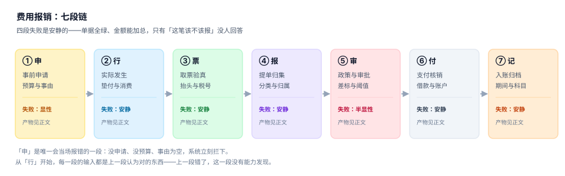

# 费用报销与差旅费控工程

<p style="text-align:center;"></p>

一个员工出差四天，回来贴六张票，填一张单，等十天才拿到钱。这件事在财务眼里是「一笔费用」，在员工眼里是「我先垫的钱什么时候还我」，在税务眼里是「这张票能不能扣」。三个视角对应三个数，而这三个数在绝大多数系统里被存成了同一个字段。

费用报销最难的地方不是「流程能不能走完」，而是**同一笔支出必须在四道门上都留下证据**：政策允许、业务真实、票据合法、归属正确。四道门里只有第一道会当场报错，其余三道都是安静的——单据能提交、审批能通过、钱能打出去，只有年末汇算清缴或者内审进场时，问题才会一次性浮出来。

::: tip 一句话理解
报销不是「贴票换钱」，而是**把一次消费翻译成一条可以被税务、审计、预算三方复核的记录**——翻译过程要留依据，依据要能重放，重放出来的金额必须和三本账都对得上。
:::

## 一、这个专题讲什么

从「我想出差」到「这笔钱进了正确的科目和正确的月份」，要走七段：

| 段 | 这一段在做什么 | 产物 | 失败是否安静 |
| --- | --- | --- | --- |
| ① 申 | 事前申请，占预算、定事由 | `travel_request` | 显性（无事由/无预算当场拒） |
| ② 行 | 实际发生，员工垫付 | 消费流水 | **安静**（花了不该花的也能花） |
| ③ 票 | 取票、验真、验抬头 | `invoice` | **安静**（假票、错抬头都能提交） |
| ④ 报 | 提单、分类、挂归属 | `expense_claim` + `claim_line` | **安静**（归错部门不报错） |
| ⑤ 审 | 政策校验 + 审批路由 | `approval` | 半显性（超权限会被拦） |
| ⑥ 付 | 支付、核销借款 | `payment` + `advance` | **安静**（重复付款要等对账） |
| ⑦ 记 | 入账、跨期、归档 | 凭证 + `period` | **安静**（进错月份只是报表变了） |



七段里**五段的失败是安静的**。它们的共同形态是：单子状态是对的、金额能加总、报表是平的，只有「这笔钱该不该报、该记在哪」没人能回答。

本机实测最能说明问题的一组读数：3,000 次出差，伙食补助与市内交通按**日历天**算是 3,610,260 元，按**住宿夜数**算是 3,070,260 元——差 **540,000 元（14.96%）**。两套算法都能在制度里找到「依据」，因为制度写的是「按出差自然天数计算」，而实现里把「住宿夜数」当成了天数。改一行代码，全公司一年少发 54 万，没有任何一处报错。

## 二、三个「报了多少钱」

| 口径 | 定义 | 谁在关心 | 常见错法 |
| --- | --- | --- | --- |
| 申报额 | 员工在单子上填的合计 | 员工 | 把「个人消费」混进「公务支出」 |
| 核准额 | 政策校验与审批后允许的金额 | 审批人 / 财务 | 用「限额」直接当核准额（定额项与实报项混算） |
| 实付额 | 扣借款、扣已预付后的打款金额 | 出纳 / 员工 | 把「核销借款」当成「报销减少」 |

三者必须分列存。合在一个 `amount` 字段里，就再也回答不了「这张单为什么只报了 4,100」——而这个问题，是报销系统 90% 工单的来源。

### 一个必须自己算一遍的例子

出差 4 天 3 夜，一线城市，P6 职级：住宿限额 600/夜，伙食补助 100/天，市内交通 80/天。住宿实际 680/夜。

| 项目 | 正确算法 | 错误算法 | 差额 |
| --- | --- | --- | --- |
| 住宿 | `min(680, 600) × 3 = 1,800` | `680 × 3 = 2,040` | 240 |
| 伙食补助 | `100 × 4 = 400` | `100 × 3 = 300` | −100 |
| 市内交通 | `80 × 4 = 320` | `80 × 3 = 240` | −80 |
| 合计 | **2,520** | 2,580 | +60 |

**两个错误方向相反、部分抵消**：住宿超标的 240 元被多报，补贴少算的 180 元被少报，最后差 60 元——正好落在「看起来差得不多」的区间里，于是没人查。这类「两个错互相掩盖」是报销系统最典型的缺陷形态。

::: danger 三件事必须写进实现，不能留给「财务口头把关」
1. **住宿是「限额内实报」，不是「定额包干」**：`min(实际, 限额)` 与「按限额发」是两种口径，后者会把省下来的钱发给员工，性质上属于补贴，涉及个税。
2. **伙食与市内交通是「日历天包干」，不是「住宿夜数」**：制度原文是「按出差自然（日历）天数计算」，当日往返也要发一天。
3. **没有住宿发票时，四项全不报**：住宿费、城市间交通费、伙食补助、市内交通费一起失去依据，不是只扣住宿那一项。
:::

## 三、与其它专题的分工

库里写「钱」和「流程」的册子不少，问的问题完全不同：

| 你关心的问题 | 该读哪一册 | 为什么不是本册 |
| --- | --- | --- |
| 「这张凭证借贷平不平」 | [记账与分录](../Ledger/DoubleEntry/index.md) | 那册判**横平**，本册判**这笔支出该不该发生** |
| 「钱什么时候打出去、头寸够不够」 | [资金管理](../Treasury/Overview/index.md) | 那册判**余额的时间**，本册判**报销单的金额** |
| 「这笔费用算在哪个成本对象上」 | [成本核算](../CostAccounting/Overview/index.md) | 那册判**金额守恒**，本册判**费用归属的责任中心** |
| 「额度还剩多少、能不能批」 | [全面预算](../Budgeting/Overview/index.md) | 那册判**授权与占用**，本册只**读**预算余额 |
| 「发票本身合不合规、能不能抵」 | [税务发票](../TaxInvoice/index.md) | 那册判**票的税务属性**，本册判**票与这笔业务对不对得上** |
| 「审批流程怎么画、怎么回滚」 | [工作流引擎](../WorkflowEngine/Overview/index.md) | 那册提供**引擎**，本册只定义**路由规则** |
| 「这笔钱付给谁、账户对不对」 | [采购到付款](../ProcureToPay/Overview/index.md) | 那册对**外部供应商**，本册对**内部员工** |

一句话记法：**本册的主语是「一张报销单」，不是「一张凭证」也不是「一笔付款」**。

## 四、为什么这里没有版本目录

按「大版本按版本目录组织」的要求，这道题被逐条判过，结论是**不建版本目录**：

1. **换代的是税率、票种与制度条款，判据一条没变**：数电票取代纸质票只换了「票号怎么解析」，`EXR`（一票一报、抬头与税号必须匹配）在纸质票时代与数电票时代一字不差。
2. **并存差异是辖区与行业，不是代际**：同一时间点上，差旅标准因地区而异、招待标准因公司而异，这些是**配置矩阵的维度**，不是两套内容线。硬建 `v2024/` `v2025/` 只会让 80% 正文重复。
3. **真正需要版本目录的是「同一份代码两套写法」**：注入语义不兼容（[Spring5](../Java/Frame/Spring/Spring5/index.md) 与 [Spring6](../Java/Frame/Spring/Spring6/index.md)）、响应式不兼容（[Vue2](../../Frontend/Frame/Vue/Vue2/index.md) 与 [Vue3](../../Frontend/Frame/Vue/Vue3/index.md)）。本主题没有这种「两套写法」。

制度条款的时效性用「版本表 + 生效期」处理，写在[制度与差标](./Policy/index.md)一页；旧条款不删，按 `effective_from` 保留，任何一张历史单据都能按当时的条款重算。

## 五、本专题的十一章与十个判据族

| 章 | 章节 | 判据族 | 条数 |
| --- | --- | --- | --- |
| 1 | [总览：七段链与三个「报了多少钱」](./Overview/index.md) | `EXN-A` ~ `EXN-H` | 8 |
| 2 | [制度与差标：一张表背后的四层](./Policy/index.md) | `EXP-A` ~ `EXP-H` | 8 |
| 3 | [单据模型：八态、三层与九条迁移](./ClaimModel/index.md) | `EXC-A` ~ `EXC-H` | 8 |
| 4 | [票据与查验：一张票的五个属性](./Receipt/index.md) | `EXR-A` ~ `EXR-H` | 8 |
| 5 | [审批路由：阈值、矩阵与自审](./Approval/index.md) | `EXA-A` ~ `EXA-H` | 8 |
| 6 | [借款与核销：余额对了账龄可能全错](./Advance/index.md) | `EXV-A` ~ `EXV-H` | 8 |
| 7 | [支付与代付：五个必须对上的东西](./Payment/index.md) | `EXY-A` ~ `EXY-H` | 8 |
| 8 | [成本归属与期间：三个日期，三种归属](./Allocation/index.md) | `EXL-A` ~ `EXL-H` | 8 |
| 9 | [稽查与合规：抽样、异常与税前扣除](./Audit/index.md) | `EXD-A` ~ `EXD-H` | 8 |
| 10 | [实战：七张表、三个触发器、九条断言](./Practice/index.md) | `EXQ-A` ~ `EXQ-H` | 8 |
| — | [常见问题与分诊](./FAQ/index.md) | — | — |

十章共 80 条判据，每章 8 条，均可逐条判定；第 11 章 FAQ 是分诊与术语，不单独设判据族。

## 六、验证方式

读完本页，可以先用三条命令把「差标口径」这件事亲自跑一遍（读者自建工程，不在本仓）：

```shell
# 1. 确认 Python 与 SQLite 版本（本文读数基于 Python 3.13 / SQLite 3.50）
python3 -c "import sqlite3, sys; print(sys.version.split()[0], sqlite3.sqlite_version)"

# 2. 用两条 SQL 对比「按日历天」与「按夜数」的补贴总额
sqlite3 :memory: "create table t(d int, n int); insert into t values (4,3),(2,1),(1,0);
  select sum(d*180) as by_days, sum(n*180) as by_nights from t;"
# 期望：by_days=1260, by_nights=720

# 3. 检查你自己的系统：补贴天数字段是从「出差天数」来的，还是从「住宿夜数」推导的
grep -rn "night\|夜数" --include="*.py" --include="*.java" . | head
```

第 2 条命令的输出说明了一件小事：**同一次出差，两个字段都在表里，选错一个就是 15% 的差异**。

## 参考资料

- 财政部《中央和国家机关差旅费管理办法》（财行〔2013〕531 号）：住宿费限额内实报、伙食补助与市内交通按自然（日历）天数包干、无住宿发票则四项均不得报销。
- 财政部《关于调整中央和国家机关差旅住宿费标准等有关问题的通知》（财行〔2015〕497 号）与《赴地方差旅住宿费标准明细表》（财行〔2016〕71 号）。
- 财政部办公厅《关于规范差旅伙食费和市内交通费收交管理有关事项的通知》（财办行〔2019〕104 号）。
- 国家税务总局《企业所得税税前扣除凭证管理办法》（国家税务总局公告 2018 年第 28 号）：汇算清缴期结束前取得凭证、60 日内补开换开、追补年限不超过 5 年。
- 国家税务总局《关于推广应用全面数字化电子发票的公告》（国家税务总局公告 2024 年第 11 号，2024-12-01 施行）：数电票 20 位号码结构、与纸质发票同等法律效力。
- 全国增值税发票查验平台（`https://inv-veri.chinatax.gov.cn`）：每份发票每天最多查验 5 次，可查验最近 5 年内开具的发票，当日开具当日可查。
