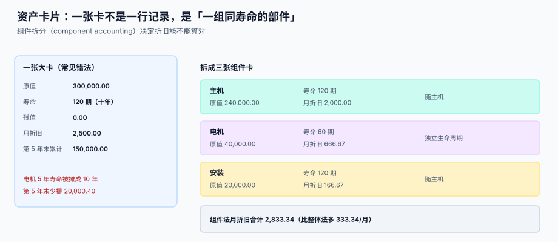

# 资产卡片与组件拆分

<p style="text-align:center;"></p>

「建一张卡」看起来只是填一张表，实际上是在做一个**分类决定**：这一堆零件里，哪些该有自己的寿命、哪些该跟着主机一起报废。这个决定一旦做错，后面每一期折旧都是错的，而且改起来要动历史。

::: tip 一句话理解
**一张资产卡片 = 一个「同寿命、同用途、同管理责任」的单元。** 寿命不同就必须拆卡，哪怕它们装在同一台机器上。
:::

本页判据族 `FAC-A` ~ `FAC-H`，共 8 条，定义在最后一节。

## 一、卡片的最小要素

一张卡要能独立回答三个问题：**这是什么、值多少、还要摊多久**。少于这九个字段，某一期折旧就一定算不出来：

| 字段 | 作用 | 缺了会怎样 |
| --- | --- | --- |
| `card_id` | 卡号，全生命周期唯一 | 变更、处置、盘点都对不上号 |
| `asset_name` / `category_id` | 名称与分类 | 折旧政策无从挂靠，只能人工填寿命 |
| `original_cost` | 原值（含可归属费用） | 折旧基数错 |
| `salvage_value` | 预计净残值 | 每期多提一点，末期变成负数 |
| `useful_life` | 寿命（按**期**存，不按年） | 月折旧 = 年折旧 ÷ 12 会引入二次误差 |
| `dep_method` | 折旧方法 | 只能全局一个默认值，无法按类区分 |
| `in_service_date` | 开始使用日期（= 折旧起算依据） | 首期提不提算不清 |
| `dept_id` / `location` | 使用部门与地点 | 费用无法归集到成本中心，盘点找不到人 |
| `status` | 在用 / 停用 / 待处置 / 已处置 | 已处置的卡仍被计入折旧范围 |

::: warning 寿命按「期」存，不按「年」存
`useful_life_months INTEGER` 而不是 `useful_life_years DECIMAL`。原因很实际：房屋 20 年是 240 期，但税法允许的「房屋建筑物 20 年」在会计上常被估成 30 年、25 年——**用年做单位，`/12` 会引入除不尽的误差**，而误差会累积到末期尾差里。存期数，一切整除。
:::

## 二、组件拆分：为什么必须拆



同一台设备：主机 240,000（10 年）、电机 40,000（5 年）、安装费 20,000（随主机 10 年）。整体按 10 年提，等于把电机的 5 年寿命摊成了 10 年。

| 口径 | 月折旧 | 第 5 年末累计折旧 | 与组件法的差 |
| --- | --- | --- | --- |
| 整体法（全部 10 年） | 2,500.00 | 150,000.00 | — |
| 组件法（三张卡） | 2,833.34 | 170,000.40 | **+20,000.40** |
| 第 10 年末（两者都应提完） | — | 300,000.60 / 300,000.00 | +0.60（尾差） |

差 20,000.40 不是小数：它等于电机在第 6~10 年**已经换过一次、却还在账上摊旧电机**的那部分。

### 拆不拆的三条判据

不需要背准则条文，问三个问题就够：

1. **这个部件的寿命显著短于主体吗？** 显著 = 差 30% 以上。电机 5 年 vs 主机 10 年，差 50%，拆。
2. **这个部件会被单独更换吗？** 会单独换（电机、刀具、滤芯、软件许可），拆；只会整体报废（机壳、底座），不拆。
3. **拆开之后单张卡还有管理意义吗？** 一张 200 元的螺丝卡不值得管，直接并进主机。

三个问题都答「是」才拆。**只答一个是常见的过度拆分**：寿命短但不会单独更换的部件（如焊接在主结构上的加强筋），拆开只会让处置时多注销几张卡。

## 三、卡号：一个不能重用的编号

```sql
CREATE TABLE asset_card (
  card_id           TEXT PRIMARY KEY,              -- 形如 FA-2026-000123
  asset_name        TEXT NOT NULL,
  category_id       TEXT NOT NULL,                 -- 挂折旧政策
  parent_card_id    TEXT REFERENCES asset_card(card_id),  -- 组件指向主机
  original_cost     NUMERIC(18,2) NOT NULL CHECK (original_cost > 0),
  salvage_value     NUMERIC(18,2) NOT NULL DEFAULT 0
                    CHECK (salvage_value >= 0 AND salvage_value < original_cost),
  useful_life       INTEGER NOT NULL CHECK (useful_life > 0),   -- 期数
  dep_method        TEXT NOT NULL
                    CHECK (dep_method IN ('STRAIGHT','DDB','SYD','NONE')),
  in_service_date   DATE NOT NULL,
  dept_id           TEXT NOT NULL,
  location          TEXT,
  status            TEXT NOT NULL DEFAULT 'IN_SERVICE'
                    CHECK (status IN ('IN_SERVICE','IDLE','TO_DISPOSE','DISPOSED')),
  created_at        TEXT NOT NULL DEFAULT (datetime('now')),
  CHECK (parent_card_id IS NULL OR parent_card_id <> card_id)
);
CREATE UNIQUE INDEX ux_card_component ON asset_card(parent_card_id, asset_name)
  WHERE parent_card_id IS NOT NULL;
```

三条约束值得单独说：

1. **`salvage_value < original_cost`**：残值大于等于原值时，折旧基数为 0 或负，`DDB` 会算出负数。数据库直接拦掉。
2. **`parent_card_id <> card_id`**：自引用的一行会让「组件合计 = 主机原值」这类勾稽查询陷入自环。只防一层不够，还要防环（见下）。
3. **`ux_card_component` 部分唯一索引**：同一台主机下不允许两张同名组件卡——这是「重复建卡」最常见的形态（同一个人点了两次「新增组件」）。

### 防自环：一次递归查询就够

```sql
-- 找出所有成环的组件链（含两级以上的环）
WITH RECURSIVE walk(card_id, path, depth) AS (
  SELECT card_id, ',' || card_id || ',', 0 FROM asset_card WHERE parent_card_id IS NULL
  UNION ALL
  SELECT c.card_id, w.path || c.card_id || ',', w.depth + 1
    FROM asset_card c JOIN walk w ON c.parent_card_id = w.card_id
   WHERE w.depth < 10 AND instr(w.path, ',' || c.card_id || ',') = 0
)
SELECT card_id FROM asset_card
 WHERE card_id NOT IN (SELECT card_id FROM walk);
-- 期望：0 行（每张卡都能从某个根走到）
```

## 四、卡片的四态与它管住的范围

| 状态 | 参不参与折旧 | 出现在盘点清单 | 可被处置 |
| --- | --- | --- | --- |
| `IN_SERVICE` 在用 | 是 | 是 | 是 |
| `IDLE` 闲置 | 是（闲置也要提，除非已提足） | 是 | 是 |
| `TO_DISPOSE` 待处置 | **否**（停止计提，但要单独复核） | 是 | 是 |
| `DISPOSED` 已处置 | 否 | 否 | 否 |

::: danger 两个状态口径的坑
1. **闲置不等于停提。** 只有「已提足折旧仍继续使用」和「单独计价入账的土地」不提；闲置设备照样提折旧，否则会变成「把设备放进仓库就能美化利润」。
2. **`TO_DISPOSE` 要停提，但不能长期停留。** 一旦停提，资产净值就冻结了；如果处置拖了半年，净值与市价会越差越远。实践做法是给 `TO_DISPOSE` 加时限（如 90 天），超时回到 `IN_SERVICE` 并补提。
:::

## 五、变更只追加，不改历史

卡片上的任何变化（部门、地点、寿命、残值、减值）都不许 `UPDATE` 原行，而是写一条 `asset_change`。原因不是洁癖，而是**审计要回答「第 24 期的时候，这张卡的寿命是多少」**——如果只存当前值，那个问题永远答不了。

```sql
CREATE TABLE asset_change (
  change_id     INTEGER PRIMARY KEY AUTOINCREMENT,
  card_id       TEXT NOT NULL REFERENCES asset_card(card_id),
  change_type   TEXT NOT NULL
                CHECK (change_type IN ('TRANSFER','IMPROVE','REVISE_LIFE','IMPAIR','SPLIT','MERGE')),
  field_name    TEXT,             -- 改了哪个字段（TRANSFER 时为 dept_id/location）
  old_value     TEXT,
  new_value     TEXT,
  effective_period TEXT NOT NULL, -- 生效期间，形如 2026-10
  reason        TEXT NOT NULL,    -- 必填，空理由的变更单不许提交
  created_by    TEXT NOT NULL,
  created_at    TEXT NOT NULL DEFAULT (datetime('now'))
);
```

`reason NOT NULL` 这一条经常被嫌麻烦，但它是**唯一能解释「为什么第 25 期月折旧突然降了 40%」的字段**。变更的会计处理见 [变更：转移、改良、减值](../Movement/index.md)。

## 六、判据清单

| 编号 | 判据 | 怎么验 |
| --- | --- | --- |
| `FAC-A` | 卡片九要素齐全，净值不落库 | `pragma_table_info('asset_card')` 无 `net_value` |
| `FAC-B` | 寿命以「期」存储，无 `*_years` 列 | 表结构里只有 `useful_life`（整数） |
| `FAC-C` | 残值严格小于原值，由 CHECK 保证 | 插入 `salvage_value = original_cost` 被拒 |
| `FAC-D` | 组件卡通过 `parent_card_id` 指向主机，不能自引用 | 插入 `parent_card_id = card_id` 被拒 |
| `FAC-E` | 同一主机下不允许同名组件（部分唯一索引） | 重复插入同名组件返回约束错误 |
| `FAC-F` | 组件链不成环，递归查询返回 0 行 | 跑防环查询，期望 0 行 |
| `FAC-G` | 卡片变更只追加，`asset_card` 无 `UPDATE` 入口 | 代码里不出现对 `asset_card` 的 `UPDATE` |
| `FAC-H` | `reason` 非空，空理由的变更被拒 | 插入 `reason = ''` 被 CHECK 或应用层拒绝 |

## 验证方式

```shell
# 1) 卡片不含净值列：应输出 0
sqlite3 /tmp/fa.db "SELECT count(*) FROM pragma_table_info('asset_card')
  WHERE name IN ('net_value','current_value');"
# 期望：0

# 2) 残值不得大于等于原值：应报错 CHECK constraint failed
sqlite3 /tmp/fa.db "INSERT INTO asset_card(card_id,asset_name,category_id,original_cost,
  salvage_value,useful_life,dep_method,in_service_date,dept_id)
  VALUES('FA-X','测试','ELEC',1000,1000,60,'STRAIGHT','2026-01-01','D1');"
# 期望：Error: CHECK constraint failed

# 3) 组件链不成环：应输出 0
sqlite3 /tmp/fa.db "WITH RECURSIVE walk(card_id,path,depth) AS (
  SELECT card_id, ','||card_id||',', 0 FROM asset_card WHERE parent_card_id IS NULL
  UNION ALL SELECT c.card_id, w.path||c.card_id||',', w.depth+1
    FROM asset_card c JOIN walk w ON c.parent_card_id=w.card_id
   WHERE w.depth<10 AND instr(w.path, ','||c.card_id||',')=0)
 SELECT count(*) FROM asset_card WHERE card_id NOT IN (SELECT card_id FROM walk);"
# 期望：0

# 4) 变更单理由不得为空：应输出 0
sqlite3 /tmp/fa.db "SELECT count(*) FROM asset_change WHERE length(trim(reason)) = 0;"
# 期望：0
```

## 参考资料

- [总览：七段资产链与三个「在账上」](../Overview/index.md)：卡片只是三本账里的第一本
- [取得成本与资本化](../Capitalization/index.md)：原值怎么算出来
- [折旧方法与月度引擎](../Depreciation/index.md)：`useful_life` 是引擎的第一个输入
- [变更：转移、改良、减值](../Movement/index.md)：`asset_change` 四种类型的会计处理
- IAS 16 §43-47（组件折旧的依据）：<https://www.ifrs.org/issued-standards/list-of-standards/ias-16-property-plant-and-equipment/>
