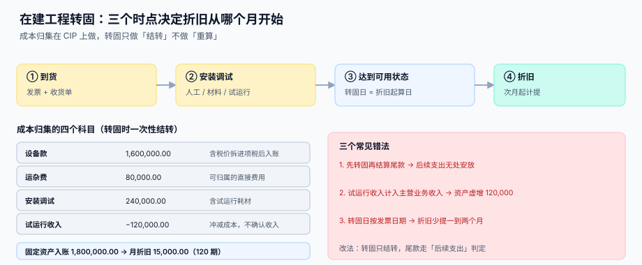

# 取得成本与资本化边界

<p style="text-align:center;"></p>

一台设备买回来，发票上是 1,800,000，但真正能进「固定资产」的金额往往不是这个数：运杂费该不该加、安装调试的人工该不该加、试运行期间卖出去的样品收入该不该冲、验收后付的尾款该不该加——**这四个判断决定了这台机器未来十年的月折旧**。

::: tip 一句话理解
**资本化的判据不是「金额大」，而是「这笔支出是否让资产达到预定可使用状态」。** 让资产「能用了」的支出计入原值，让资产「更好用」的支出是后续支出（走变更），让资产「被用掉」的支出是费用。
:::

本页判据族 `FAI-A` ~ `FAI-H`，共 8 条，定义在最后一节。

## 一、可归属成本的四类



| 类别 | 典型项目 | 计入原值 | 判据 |
| --- | --- | --- | --- |
| 购买价款 | 设备款、专用软件许可 | 是（不含可抵扣进项税） | 有发票且验收 |
| 相关税费 | 不可抵扣的关税、消费税、契税 | 是 | 税单上的税额部分 |
| 直接归属费用 | 运输、装卸、保险、安装、调试、专业人员服务 | 是 | 能证明「这笔钱是为了让它能用」 |
| 间接费用 | 厂房折旧、管理人员工资 | **一般不计** | 除非能单独归集且直接相关 |
| 试运行净收入 | 试运行期间产出产品的销售收入 | **冲减**原值 | 有销售凭证 |
| 培训费、广告费 | 操作培训、宣传 | 否（当期费用） | 与「达到可用状态」无关 |

```sql
CREATE TABLE cip_cost (           -- 在建工程成本归集
  cost_id       INTEGER PRIMARY KEY AUTOINCREMENT,
  cip_id        TEXT NOT NULL,    -- 在建工程单号，转固前的主键
  cost_type     TEXT NOT NULL
                CHECK (cost_type IN ('PURCHASE','TAX','FREIGHT','INSTALL','TRIAL_INCOME','OTHER')),
  amount        NUMERIC(18,2) NOT NULL,
  invoice_no    TEXT,
  occurred_on   DATE NOT NULL,
  note          TEXT
);
CREATE INDEX idx_cip ON cip_cost(cip_id, cost_type);
```

`TRIAL_INCOME` 存**负数**，与其它成本同表同符号体系。这样「转固金额 = `sum(amount)`」只有一句，不用在代码里写 `- trial_income`——**符号一旦散落在代码里，就一定会有一处写反**。

## 二、试运行收入：为什么冲减而不是确认收入

设备安装完先空跑一周，产出 5,000 件合格品卖掉，收入 120,000（不含税 106,194.69）。两种处理：

| 口径 | 固定资产入账 | 月折旧（120 期） | 10 年折旧合计 | 收入侧 |
| --- | --- | --- | --- | --- |
| 冲减成本 | 1,880,000.00 | 15,666.67 | 1,880,000.00 | 不确认 |
| 确认收入 | 2,000,000.00 | 16,666.67 | 2,000,000.00 | 确认 106,194.69 |

差 120,000 的资产、每月差 1,000 的折旧、十年差 120,000 的费用——**同一笔业务，两张报表都不一样**。

::: danger 三个易错点
1. **把试运行收入记进主营业务收入**：资产虚增，且当期利润虚增（收入没有对应成本）。
2. **只冲减收入不冲减成本**：`TRIAL_INCOME` 记了贷方，但 `cip_cost` 里没落行，转固金额仍按全额。
3. **试运行消耗的料工费不计入成本**：试运行本身要花钱，那部分要进 `INSTALL`，否则净额算错。
:::

## 三、转固日：一个必须有证据的日期

「达到预定可使用状态」不是一个会计感觉，而是三份证据之一：

| 证据 | 适用场景 | 记录方式 |
| --- | --- | --- |
| 验收单（签字日期） | 绝大多数设备 | `acceptance_no` + `accepted_on` |
| 实际投入使用（首件产出 / 首次并网） | 生产线、发电设备 | `first_run_at` |
| 竣工验收备案 | 房屋建筑物 | `filing_no` |

```sql
CREATE TABLE cip_transfer (
  transfer_id   TEXT PRIMARY KEY,
  cip_id        TEXT NOT NULL,
  card_id       TEXT NOT NULL REFERENCES asset_card(card_id),
  transferred_on DATE NOT NULL,     -- 转固日
  basis         TEXT NOT NULL
                CHECK (basis IN ('ACCEPTANCE','FIRST_RUN','FILING')),
  evidence_no   TEXT NOT NULL,      -- 验收单号 / 首次运行记录号 / 备案号
  amount        NUMERIC(18,2) NOT NULL CHECK (amount > 0)
);
```

**`evidence_no NOT NULL` 是这个表存在的全部意义。** 没有证据号的转固单，三个月后没人能说清「为什么这台机器是 3 月开始提折旧而不是 5 月」。

### 折旧从哪一期开始

转固日在 3 月 20 日，折旧从 4 月开始（当月增加当月不提）。如果系统按「转固日所在月的第一天」起算，就会多提一个月，金额等于月折旧 × 1。

本机读数（月折旧 15,666.67）：转固日取发票日期导致晚提两个月，两年后累计少提 **376,000.08**；取「验收当月」起算则多提一个月 **15,666.67**。

## 四、尾款与后续支出：两条完全不同的路

设备验收后半年付的质保尾款（如 5%），不是「补记原值」，而是要看它买的是什么：

| 尾款性质 | 处理 | 走哪里 |
| --- | --- | --- |
| 合同价的一部分（分期付） | 已在原值里，付款只是结清应付 | 应付账款 |
| 质保期内的维修 | 当期费用 | 费用 |
| 质保期后的重大改良 | 计入原值或单独建卡 | [变更](../Movement/index.md) |
| 违约金、赔偿 | 营业外支出 | 费用 |

::: warning 「先转固，后到票」是常态
货到了、验收了、票还没到——这时按**暂估金额**转固并开始提折旧，票到后只调金额不调起始日。这条规矩和 [收货暂估](../../ProcureToPay/GoodsReceipt/index.md) 是同一套逻辑：**先让账反映事实，再让票去对齐账**。
:::

## 五、多币种取得：非货币性项目不重估

外币购入的设备属于**非货币性项目**，按取得日汇率折算入账后，**期末不重估**。

本机读数（USD 100,000，取得日 7.1234，期末 7.2300）：

| 口径 | 入账金额 | 月折旧（120 期） |
| --- | --- | --- |
| 按取得日汇率（正确） | 712,340.00 | 5,936.17 |
| 按期末汇率重估（错误） | 723,000.00 | 6,025.00 |

按期末重估会虚增 **10,660.00** 的资产和对应的折旧基数——而且这个错误会**随汇率波动每月变化**，等于给资产装了一个随机数生成器。重估的适用范围见 [期末重估](../../MultiCurrency/Valuation/index.md)。

## 六、判据清单

| 编号 | 判据 | 怎么验 |
| --- | --- | --- |
| `FAI-A` | 成本归集表按类型分列，试运行收入以负数列示 | `cip_cost` 有 `cost_type`，`TRIAL_INCOME` 金额为负 |
| `FAI-B` | 转固金额 = Σ 成本归集（含负数），且有查询可复核 | 跑求和查询，与 `cip_transfer.amount` 相等 |
| `FAI-C` | 转固单必须有证据号，空证据号被拒 | `evidence_no = ''` 插入失败 |
| `FAI-D` | 折旧起算遵循「当月增加次月提」 | 转固月不计提，次月计提一次 |
| `FAI-E` | 暂估转固后到票只调金额，不改转固日 | 改金额前后 `transferred_on` 不变 |
| `FAI-F` | 外币取得的资产不被期末重估 | 期末重估任务不产出该卡的分录 |
| `FAI-G` | 尾款要么在原值内（合同价），要么走变更，不重复计入 | 同一 PO 的付款合计 ≤ 原值 + 变更额 |
| `FAI-H` | 培训费 / 广告费等不进入原值 | 成本归集里没有 `TRAINING` 类型 |

## 验证方式

```shell
# 1) 转固金额与成本归集一致：应输出 0
sqlite3 /tmp/fa.db "SELECT count(*) FROM cip_transfer t
  WHERE t.amount <> (SELECT coalesce(sum(amount),0) FROM cip_cost c WHERE c.cip_id = t.cip_id);"
# 期望：0

# 2) 试运行收入必须为负：应输出 0
sqlite3 /tmp/fa.db "SELECT count(*) FROM cip_cost WHERE cost_type='TRIAL_INCOME' AND amount > 0;"
# 期望：0

# 3) 证据号不能为空：应报 CHECK constraint failed
sqlite3 /tmp/fa.db "INSERT INTO cip_transfer(transfer_id,cip_id,card_id,transferred_on,basis,
  evidence_no,amount) VALUES('T-X','CIP-1','FA-1','2026-03-20','ACCEPTANCE','',100);"
# 期望：Error: CHECK constraint failed

# 4) 转固当月不得计提：应输出 0
sqlite3 /tmp/fa.db "SELECT count(*) FROM dep_schedule d JOIN cip_transfer t ON t.card_id=d.card_id
  WHERE d.period = strftime('%Y-%m', t.transferred_on);"
# 期望：0

# 5) 外币资产不被重估：应输出 0
sqlite3 /tmp/fa.db "SELECT count(*) FROM asset_card WHERE currency IS NOT NULL AND currency <> 'CNY'
  AND card_id IN (SELECT card_id FROM reval_entry);"
# 期望：0
```

## 参考资料

- [资产卡片与组件拆分](../AssetCard/index.md)：转固的产物是卡片
- [折旧方法与月度引擎](../Depreciation/index.md)：起算期规则在引擎里落地
- [变更：转移、改良、减值](../Movement/index.md)：后续支出走这条路
- [收货质检与暂估](../../ProcureToPay/GoodsReceipt/index.md)：先反映事实，再对齐票据
- [期末重估](../../MultiCurrency/Valuation/index.md)：非货币性项目为什么不重估
- IAS 16 §16-22（成本的构成）：<https://www.ifrs.org/issued-standards/list-of-standards/ias-16-property-plant-and-equipment/>
