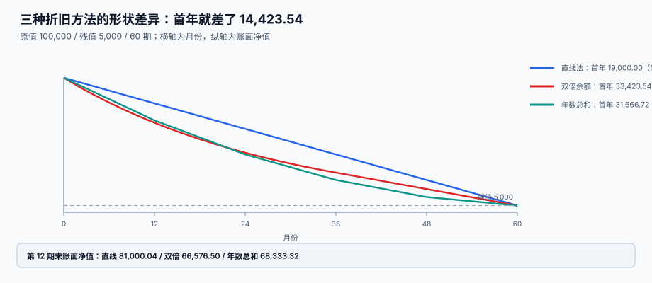

# 折旧方法与月度引擎

<p style="text-align:center;"></p>

折旧的公式只有一行：`(原值 − 残值) ÷ 期数`。但真正上线之后，出问题的从来不是这一行，而是它周围的四件事：**用哪种方法、从哪一期开始、每期怎么取整、重跑怎么办**。

::: tip 一句话理解
**折旧不是「每月算一次」，而是「建卡时就把全生命周期的每一期算出来，每月只取一行」。** 前者叫计划（`dep_schedule`），后者叫执行（`dep_run`），混在一起就没有审计。
:::

本页判据族 `FAD-A` ~ `FAD-H`，共 8 条，定义在最后一节。

## 一、三种方法的形状差异



原值 100,000、残值 5,000、60 期，三种方法全生命周期合计都是 95,000，但**每一年都不一样**：

| 方法 | 首期 | 末期 | 首年（12 期） | 首年占原值 | 第 12 期末净值 |
| --- | --- | --- | --- | --- | --- |
| 直线法 `STRAIGHT` | 1,583.33 | 1,583.53（尾差调平） | 19,000.00 | 19.00% | 81,000.04 |
| 双倍余额递减 `DDB` | 3,333.33 | 1,021.23 | 33,423.54 | 33.42% | 66,576.50 |
| 年数总和 `SYD` | 2,638.89 | 527.74 | 31,666.72 | 31.67% | 68,333.32 |

首年两者相差 **14,423.54**——同一台设备，换一种方法就能让第一年的利润差出 1.4 万。

### 双倍余额递减（DDB）必须切直线

`DDB` 的公式是「每期按净值的 `2/n` 提」，净值越来越小，折旧额永远到不了 0。标准做法是**最后两年改为直线**：

```sql
-- 计划生成时的分支：剩余期 ≤ 24 时切直线
CASE WHEN (useful_life - seq + 1) <= 24
     THEN round((nbv - salvage) / (useful_life - seq + 1), 2)
     ELSE round(nbv * 2.0 / useful_life, 2)
END
```

::: danger 不切直线会提前提完
本机读数（原值 100,000 / 残值 20,000 / 60 期）：不切直线时，**第 48 期就提完了 80,000**，最后 12 期全是 `0.00`。

后果不是「少提」，而是**面子上完全正常**：合计仍然等于 80,000，只是资产的折旧年限被悄悄压缩了 20%。做同行业对比时，你的「设备更新周期」会显得比别人短，而没人知道那是算法造成的。
:::

### 年数总和（SYD）的月额必须重新取整

年额 = `(原值 − 残值) × 剩余年数 ÷ 年数总和`，月额 = 年额 ÷ 12。**先算年额再除以 12** 与 **先算月率再乘** 会差几分钱，因为两次取整的位置不同。本册统一规定：**按年算、按月摊、末期调平**。

## 二、部分月规则：一年差 18,999.96

「当月增加的资产，当月提不提折旧」——两种口径都有人在用，但**同一个账套里必须只用一种**。

本机读数（月折旧 1,583.33，每月 15 日购入一台，一年 12 台）：

| 口径 | 本年计提 | 说明 |
| --- | --- | --- |
| 当月增加当月计提 | 123,499.74 | 1 月买的提 12 期，12 月买的提 1 期 |
| 当月增加次月计提 | 104,499.78 | 1 月买的提 11 期，12 月买的不提 |
| 差 | **18,999.96** | **18.18%** |

中国实务普遍采用「**当月增加当月不提、当月减少当月照提**」（即次月起提、减少当月仍提）。这条规则引出一个必须写进代码的推论：

```text
计提区间 = [in_service_date 的次月, 处置月的当月]
```

::: danger 三种口径混用的典型症状
1. **新增当月漏提又补提**：手工补提的凭证没有 `card_id` 明细，勾稽时对不上卡片台账。
2. **处置当月停提**：资产已经不在用了却还提一个月，处置损益里就多一笔折旧。
3. **跨年调整**：12 月新增的资产如果当月计提，会把费用挤进当年预算，年底关账时才发现超支。
:::

## 三、尾差：853 张卡里有 853 张对不上

`95,000 ÷ 60 = 1,583.3333...`，逐期四舍五入成 1,583.33 后，60 期合计是 **94,999.80**，比应提少 **0.20**。

单张卡差 2 毛不是问题，问题是**它会一直留在账上**：净值永远比残值多 0.20，处置时清理不掉。

本机读数（1,000 张随机卡，寿命 36/60/84/120/240 期）：

| 口径 | 累计 ≠ 应提的卡数 | 绝对差合计 |
| --- | --- | --- |
| 逐期四舍五入，末期不调平 | **853 张（85.3%）** | 29.96 |
| 末期取「应提 − 已提」 | 0 张 | 0.00 |

**85.3%** 这个比例说明：这不是边缘情况，而是**默认就会发生**。所以末期调平不是优化，是必选项：

```sql
-- 生成计划时，最后一期直接取差额
CASE WHEN seq = useful_life
     THEN (original_cost - salvage_value - impaired_amount)
          - (SELECT coalesce(sum(amount),0) FROM dep_schedule
              WHERE card_id = :card AND seq < :life)
     ELSE round(period_amount, 2)
END
```

## 四、月度引擎：五步，一次事务

```text
① 取范围    status IN ('IN_SERVICE','IDLE') 且 in_service_date <= 期末 且 未提足
② 取计划    从 dep_schedule 取 (card_id, period) 唯一的一行
③ 汇总      按 dept_id 分组，生成部门级凭证
④ 落库      INSERT INTO dep_run(period, card_id, amount)，唯一键 (period, card_id)
⑤ 出凭证    一张凭证一个部门，借方费用 / 贷方累计折旧
```

### 重跑必须幂等

折旧重跑是常态（改了卡片、补了资产、上个月算错了）。没有唯一键时：

| 写法 | 跑 3 次后的行数（应为 200） | 后果 |
| --- | --- | --- |
| 直接 `INSERT` | **600** | 费用翻三倍，且第二次之后没人敢删 |
| `(period, card_id)` 唯一键 + `INSERT OR IGNORE` | **200** | 幂等 |

```sql
CREATE TABLE dep_run (
  period    TEXT NOT NULL,        -- 2026-10
  card_id   TEXT NOT NULL REFERENCES asset_card(card_id),
  amount    NUMERIC(18,2) NOT NULL,
  dept_id   TEXT NOT NULL,
  voucher_no TEXT,
  created_at TEXT NOT NULL DEFAULT (datetime('now')),
  PRIMARY KEY (period, card_id)
);
```

::: warning 逆操作不要「删除重来」
发现某期提错时，正确做法是**红冲 + 重提**（两条新记录），而不是 `DELETE` 原记录。删除会让「历史发生过什么」永久丢失，而折旧的错误往往要追溯三五年。
:::

### 按部门汇总还是逐卡出凭证

| 口径 | 凭证条数（2,000 张卡） | 逐卡可追 | 适用 |
| --- | --- | --- | --- |
| 逐卡一张凭证 | 2,000 | 是 | 卡片极少、需要逐卡对账 |
| 按部门汇总 | **5**（差 400 倍） | 靠明细表 | 生产环境常规做法 |
| 全部合成一张 | 1 | 否 | 只有明细表能追时才可接受 |

推荐**按部门汇总出凭证 + 逐卡留明细**：凭证解决「总账对不对」，明细解决「哪张卡错了」。

## 五、月折旧率：保留 2 位小数会让折旧变成 0

有些系统不存「月折旧额」，而存「月折旧率」再乘原值。率的小数位会直接决定结果：

本机读数（原值 1,000,000，240 期）：

| 月率精度 | 月率 | 年折旧 | 20 年累计 | 与应提的差 |
| --- | --- | --- | --- | --- |
| 2 位 | 0.00 | **0.00** | **0.00** | −1,000,000.00 |
| 4 位 | 0.0042 | 50,400.00 | 1,008,000.00 | +8,000.00 |
| 6 位 | 0.004167 | 50,004.00 | 1,000,080.00 | +80.00 |
| 直接存金额 | — | 50,000.04 | 1,000,000.80 | +0.80 |

**2 位精度的结果是 0**：`1/240 = 0.0041666...` 四舍五入到 2 位就是 `0.00`，整栋楼一年不提折旧。这不是理论风险——只要有人为了「好看」把率列设成 `DECIMAL(6,2)`，这件事就会发生。

本册的立场：**存金额，不存率**。率是展示用的派生值，精度损失不能进入计算链。

## 六、判据清单

| 编号 | 判据 | 怎么验 |
| --- | --- | --- |
| `FAD-A` | 折旧方法落库（`dep_method`），不读全局配置 | 两张卡可设不同方法，互不影响 |
| `FAD-B` | 计划在建卡时一次生成全生命周期，执行只取行 | `dep_schedule` 行数 = `useful_life` |
| `FAD-C` | 末期取差额，Σ 计划 = 原值 − 残值 − 减值 | 逐卡求和与基数相等 |
| `FAD-D` | 部分月规则唯一：当月增加次月提 | 转固月无 `dep_run` 行 |
| `FAD-E` | `dep_run` 有 `(period, card_id)` 唯一键，重跑幂等 | 跑 3 次行数不变 |
| `FAD-F` | 折旧存金额不存率，或率精度 ≥ 6 位 | 表里无 `DECIMAL(*,2)` 的率列 |
| `FAD-G` | 提足后不再计提（净值不低于残值） | 连续跑 61 期，第 61 期金额为 0 |
| `FAD-H` | 改错用红冲 + 重提，不删除历史行 | 错误期有两行（一正一负），原行仍在 |

## 验证方式

```shell
# 1) 计划期内总额 = 原值 − 残值：应输出 0
sqlite3 /tmp/fa.db "SELECT count(*) FROM asset_card c
  WHERE round((SELECT coalesce(sum(amount),0) FROM dep_schedule d WHERE d.card_id=c.card_id), 2)
        <> round(c.original_cost - c.salvage_value, 2);"
# 期望：0

# 2) 计划行数 = 寿命：应输出 0
sqlite3 /tmp/fa.db "SELECT count(*) FROM asset_card c
  WHERE (SELECT count(*) FROM dep_schedule d WHERE d.card_id=c.card_id) <> c.useful_life;"
# 期望：0

# 3) 重跑幂等：同一期间连跑三次，行数不变
sqlite3 /tmp/fa.db "SELECT count(*) FROM dep_run WHERE period='2026-10';"
# 期望：等于当月应提卡片数，且三次运行结果相同

# 4) 提足后不再计提：应输出 0
sqlite3 /tmp/fa.db "SELECT count(*) FROM asset_card c
  WHERE (SELECT coalesce(sum(amount),0) FROM dep_schedule d WHERE d.card_id=c.card_id)
        > (c.original_cost - c.salvage_value) + 0.01;"
# 期望：0

# 5) 末期尾差调平：末期金额 = 基数 − 前 n-1 期合计
sqlite3 /tmp/fa.db "SELECT card_id, seq, amount FROM dep_schedule
  WHERE seq = (SELECT max(seq) FROM dep_schedule WHERE card_id = dep_schedule.card_id) LIMIT 3;"
# 期望：末期金额与「基数 − 已提」相等，允许 0.01 内误差
```

## 参考资料

- [资产卡片与组件拆分](../AssetCard/index.md)：`useful_life` 与 `salvage_value` 从哪来
- [取得成本与资本化](../Capitalization/index.md)：原值与起算期
- [变更：转移、改良、减值](../Movement/index.md)：改寿命之后计划怎么重算
- [与总账的勾稽与月结](../Ledger/index.md)：凭证与台账的第三处勾稽
- IAS 16 §50-62（折旧方法）：<https://www.ifrs.org/issued-standards/list-of-standards/ias-16-property-plant-and-equipment/>
