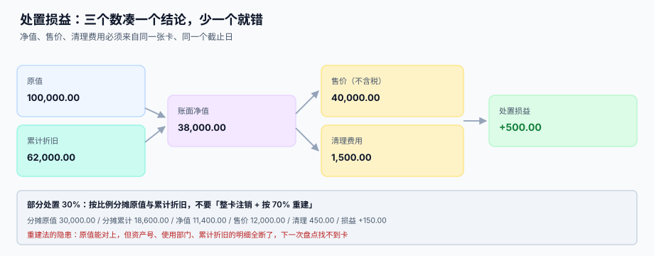

# 处置与清理

<p style="text-align:center;"></p>

处置是资产生命周期的最后一段，也是最容易「看起来算对了」的一段：原值、累计折旧、售价三个数一减，得出损益，凭证一记，卡片一注销——齐活。但**注销的顺序、部分处置的分摊、清理费用的归属**，每一处都能让这笔账在半年后的勾稽里冒出来。

::: tip 一句话理解
**处置损益 = 售价 − 账面净值 − 清理费用**，三个数必须来自同一张卡、同一个截止日。少一个数，损益就是猜的。
:::

本页判据族 `FAP-A` ~ `FAP-H`，共 8 条，定义在最后一节。

## 一、三个数凑一个结论



原值 100,000、累计折旧 62,000、售价 40,000（不含税）、清理费 1,500：

| 量 | 数值 | 来源 |
| --- | --- | --- |
| 账面净值 | 38,000.00 | 原值 − 累计折旧 − 减值准备 |
| 售价（不含税） | 40,000.00 | 处置合同 / 发票 |
| 清理费用 | 1,500.00 | 拆卸、运输、场地清理的发票 |
| 处置损益 | **+500.00** | 40,000 − 38,000 − 1,500 |

三个数里最容易错的是「截止日」：折旧提到 6 月、处置日填 6 月 15 日、清理费发票 7 月才到——如果按「发票到了才记账」，这批资产在 7 月又提了一个月折旧，净值少 1,583.33，损益就变成 +2,083.33。

::: danger 处置当月照提折旧
「当月减少当月照提」是部分月规则的另一半。系统实现要注意：**处置单在 6 月 15 日提交，6 月的折旧仍然要提**，7 月起才停。

常见错法是把 `status` 在提交处置单的那一刻就改成 `DISPOSED`，导致 6 月的折旧扫描直接跳过这张卡——少提一个月，且没人会发现。
:::

## 二、注销的顺序：先清子项，再销卡

一张卡沉淀了三样东西：**累计折旧**、**减值准备**、**尚未提完的计划行**。注销时必须一起清，顺序错了会留下孤儿数据。

```sql
-- 六步，一个事务
BEGIN;
-- ① 校验：计划行必须全部提完或作废，不能有「未来的计划」还挂着
SELECT count(*) FROM dep_schedule
 WHERE card_id = :card AND status = 'PLANNED' AND seq > :paid_seq;
-- 期望 0，否则先作废

-- ② 记账：借 固定资产清理（净值）、借 累计折旧、借 减值准备，贷 固定资产（原值）
INSERT INTO disposal_entry(disposal_id, account, debit, credit) VALUES
  (:id, '1606 固定资产清理', :nbv,  0),
  (:id, '1602 累计折旧',     :acc,  0),
  (:id, '1603 减值准备',     :imp,  0),
  (:id, '1601 固定资产',     0,    :cost);

-- ③ 记清理费用与售价
INSERT INTO disposal_entry(disposal_id, account, debit, credit) VALUES
  (:id, '1606 固定资产清理', :fee,  0),
  (:id, '1002 银行存款',     0,    :price);

-- ④ 结转损益：清理科目余额 = 损益
INSERT INTO disposal_entry(disposal_id, account, debit, credit)
SELECT :id, CASE WHEN s > 0 THEN '6115 资产处置损益' ELSE '1606 固定资产清理' END,
       CASE WHEN s > 0 THEN s ELSE -s END,
       CASE WHEN s > 0 THEN 0 ELSE -s END
  FROM (SELECT coalesce(sum(debit),0) - coalesce(sum(credit),0) AS s
          FROM disposal_entry WHERE disposal_id = :id) t;

-- ⑤ 销卡
UPDATE asset_card SET status = 'DISPOSED', disposed_on = :date WHERE card_id = :card;

-- ⑥ 留痕
INSERT INTO asset_change(card_id, change_type, field_name, old_value, new_value,
                         effective_period, reason, created_by)
VALUES (:card, 'DISPOSE', 'status', 'IN_SERVICE', 'DISPOSED', :period, '报废/出售', :who);
COMMIT;
```

第 ④ 步的 `s` 是「清理科目」的余额：正数说明卖亏了（借损益），负数说明卖赚了（贷损益）。**用余额判方向，而不是用「售价 − 净值」直接算**——因为还有清理费用，三个数的符号很容易写反一处。

## 三、部分处置：按比例分摊，不要重建

只处置 30%（比如拆掉一条生产线的一段）：

| 口径 | 原值 | 累计折旧 | 净值 | 损益 |
| --- | --- | --- | --- | --- |
| 按比例分摊（正确） | 30,000.00 | 18,600.00 | 11,400.00 | **+150.00** |
| 整卡注销 + 按 70% 重建 | 70,000.00 | 43,400.00 | 26,600.00 | — |

两种口径的「原值 − 累计折旧」恰好相等，所以**金额上看不出差别**。差别在别处：

1. **资产号变了**：重建的新卡没有历史，变更记录、盘点记录、折旧明细全断。
2. **累计折旧的明细断了**：审计要「这台机器第 30 期提了多少」，新卡只有 70% 的摊销。
3. **下次部分处置时基数错**：重建卡的原值 70,000 是「剩余部分」，再处置 30% 会按 70,000 × 30% 算，而正确应该是 100,000 × 30%。

所以部分处置必须改原值与原累计折旧（按比例减少），并写一条 `SPLIT` 类型的变更——**金额可以改，身份不能丢**。

## 四、报废：审批比计算更重要

报废的金额通常很小（净值接近 0），所以最容易被简化成「点一下就行」。但报废是**唯一能让资产从账上消失的动作**，它必须有审批与证据：

| 要件 | 作用 | 缺失后果 |
| --- | --- | --- |
| 报废申请（原因代码） | 区分「损坏 / 技术淘汰 / 丢失」 | 无法做原因分析，也无法索赔 |
| 技术鉴定或第三方证明 | 证明「确实不能用」 | 事后无法解释为何提前报废 |
| 审批链（部门 → 资产 → 财务） | 分权 | 一个人可以把公司资产报废掉 |
| 残值回收记录 | 废品收入入账 | 收入体外循环 |
| 处置日期 | 决定折旧停提月份 | 折旧与损益都错 |

::: warning 「丢失」不是报废
资产丢失要走**盘亏**（待处理财产损溢），不是报废。两者的税务处理、审批层级、责任追究都不同。系统里用不同的 `disposal_reason`，不要图省事都填「报废」。
:::

## 五、四种处置的科目路径

| 处置方式 | 售价 | 增值税 | 损益科目 |
| --- | --- | --- | --- |
| 出售（正常使用过的固定资产） | 有 | 按适用税率或简易计税 | 资产处置损益 |
| 报废（无残值收入） | 无 | — | 营业外支出 |
| 报废（有废料收入） | 有 | 按适用税率 | 营业外收支净额 |
| 无偿调拨 / 捐赠 | 无 | 视同销售 | 营业外支出 |

本册只负责**账面净值的清理**，税额计算与发票开具在税务侧处理。这里要守住的一条是：**售价一律按不含税金额进入处置损益**，税额单独走应交税费，否则损益会虚增一个税率。

## 六、判据清单

| 编号 | 判据 | 怎么验 |
| --- | --- | --- |
| `FAP-A` | 三数同源：净值、售价、清理费来自同一卡同一截止日 | 处置单记录 `as_of_date`，三者按该日取数 |
| `FAP-B` | 处置当月仍提折旧，次月起停提 | 处置月的 `dep_run` 有该卡 |
| `FAP-C` | 注销前校验无遗留计划行 | 存在 `PLANNED` 行时事务中止 |
| `FAP-D` | 累计折旧与减值准备一起注销，不留余额 | 卡片注销后两科目无该卡明细 |
| `FAP-E` | 部分处置按比例减原值与累计折旧，不重建卡号 | 处置后 `card_id` 不变 |
| `FAP-F` | 报废必须有原因代码 + 审批 + 证据 | 三字段非空，审批记录存在 |
| `FAP-G` | 售价按不含税金额进损益，税额单独记 | 损益 = 不含税售价 − 净值 − 清理费 |
| `FAP-H` | 「丢失」走盘亏而不是报废 | `disposal_reason` 无 `LOST` 取值 |

## 验证方式

```shell
# 1) 清理科目余额必须为 0（已结转到损益）：应输出 0
sqlite3 /tmp/fa.db "SELECT count(*) FROM (SELECT disposal_id,
    round(sum(debit)-sum(credit),2) s FROM disposal_entry
    WHERE account LIKE '1606%' GROUP BY disposal_id)
  WHERE abs(s) > 0.005;"
# 期望：0

# 2) 同一张卡不得处置两次：应报 UNIQUE constraint failed
sqlite3 /tmp/fa.db "INSERT INTO asset_disposal(disposal_id,card_id,disposed_on,reason,price,fee)
  VALUES('D-X','FA-0001','2026-07-01','SCRAP',0,0);"
# 期望：Error: UNIQUE constraint failed

# 3) 已处置的卡不得再计提：应输出 0
sqlite3 /tmp/fa.db "SELECT count(*) FROM dep_run r JOIN asset_card c ON c.card_id=r.card_id
  WHERE c.status='DISPOSED' AND r.period > strftime('%Y-%m', c.disposed_on);"
# 期望：0

# 4) 部分处置后卡号不变：应输出 1（同一张卡）
sqlite3 /tmp/fa.db "SELECT count(DISTINCT card_id) FROM asset_card WHERE card_id='FA-0001';"
# 期望：1

# 5) 损益方向：卖赚时清理科目余额为负
sqlite3 /tmp/fa.db "SELECT disposal_id, round(sum(debit)-sum(credit),2) FROM disposal_entry
  WHERE account LIKE '1606%' GROUP BY disposal_id LIMIT 3;"
# 期望：每行都是 0.00
```

## 参考资料

- [变更：转移、改良、减值](../Movement/index.md)：减值后的资产怎么处置
- [与总账的勾稽与月结](../Ledger/index.md)：处置凭证如何参与勾稽
- [资产盘点与账实核对](../Inventory/index.md)：盘亏与报废的分界
- [复式记账与分录](../../Ledger/DoubleEntry/index.md)：清理科目的两腿写法
- IAS 16 §67-72（终止确认）：<https://www.ifrs.org/issued-standards/list-of-standards/ias-16-property-plant-and-equipment/>
