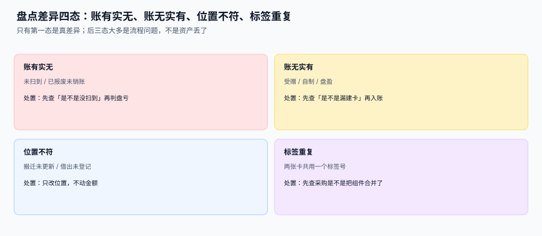

# 资产盘点与账实核对

<p style="text-align:center;"></p>

资产盘点和存货盘点是两件事。存货盘点数的是**数量**（100 件还是 98 件），资产盘点数的是**存在性**（这台贴着 `FA-2026-000123` 的机器还在不在）。数量差一件是缺货，存在性差一台可能是三件事：真的丢了、只是没扫到、或者它被搬到了别的楼层。

::: tip 一句话理解
**「没扫到」不等于「不存在」。** 盘点结果必须分成四态，只有第一态是真差异；直接把「没扫到」判成盘亏，等于用一次扫码的运气去调整一年的账。
:::

本页判据族 `FAV-A` ~ `FAV-H`，共 8 条，定义在最后一节。

## 一、四态：先分类，再处理



| 态 | 含义 | 常见原因 | 处置 |
| --- | --- | --- | --- |
| 账有实无 | 台账有卡，现场找不到 | 丢失 / 已报废未销账 / 借出未登记 | 先查证再判盘亏 |
| 账无实有 | 现场有实物，台账没卡 | 受赠 / 自制 / 漏建卡 | 先查采购再补建卡 |
| 位置不符 | 找到了，但不在登记地点 | 搬迁未更新 / 临时借用 | **只改位置，不动金额** |
| 标签重复 | 两个实物贴同一个标签号 | 组件被合并成一张卡 / 标签打印重复 | 先查是不是该拆分 |

本机读数（1,000 张卡，模拟一次实地盘点）：

| 指标 | 数值 |
| --- | --- |
| 账面卡片 | 1,000 |
| 实际扫到 | 972 |
| 未扫到 | **28（2.8%）** |
| 位置不符 | 21 |
| 标签重复 | 15 |
| 若把「未扫到」一律判盘亏 | 误判 28 张，按平均净值 68,400 元计**虚减 1,915,200 元** |

**2.8% 的漏扫率是正常的**——标签被油污盖住、设备在断电区、盘点员扫错行。这 2.8% 换成的 191 万虚减，才是真正的问题。

## 二、盘点流程：盲盘 + 二次复核

```text
① 冻结范围：按地点 / 部门圈定本次盘点清单（不是全量）
② 导出清单：只给「地点 + 资产名」，**不给账面数量与净值**（盲盘）
③ 实地扫码：扫到就记，扫不到不记，不做现场判断
④ 差异归集：进 four_state 表，按四态分类
⑤ 二次复核：对「账有实无」逐台复查（换人、换时间）
⑥ 调整入账：只对复核确认为差异的条目出调整单
```

::: danger 盲盘为什么必须「盲」
如果盘点清单上印着「这台机器账面净值 68,400」，盘点员会下意识地「帮系统找到它」——把相似的机器算成同一台，或者干脆不报。**盲盘不是防盘点员，是防人性**。所以清单只印地点、名称、卡片上的标签号，不印金额。
:::

## 三、数据模型：一次盘点一套快照

```sql
CREATE TABLE asset_count (
  count_id    TEXT PRIMARY KEY,          -- PC-2026-11-001
  scope_dept  TEXT,                      -- 圈定范围（部门或地点）
  scope_loc   TEXT,
  counted_on  DATE NOT NULL,
  counter     TEXT NOT NULL,
  status      TEXT NOT NULL DEFAULT 'OPEN'
              CHECK (status IN ('OPEN','CLOSED','ADJUSTED'))
);

CREATE TABLE asset_count_line (
  count_id    TEXT NOT NULL REFERENCES asset_count(count_id),
  card_id     TEXT NOT NULL REFERENCES asset_card(card_id),
  expected_loc TEXT,                     -- 盘点前的登记地点
  scanned_loc  TEXT,                     -- 现场扫到的地点，NULL = 未扫到
  four_state   TEXT
               CHECK (four_state IN ('FOUND','MISSING','WRONG_LOC','DUP_LABEL','EXTRA')),
  recheck_by   TEXT,                     -- 二次复核人
  recheck_at   TEXT,
  PRIMARY KEY (count_id, card_id)
);
CREATE UNIQUE INDEX ux_count_extra ON asset_count_line(count_id, scanned_loc)
  WHERE four_state = 'EXTRA';
```

`four_state` 允许为 NULL（还没分类），但**不允许在 `status='CLOSED'` 时仍为 NULL**——这条用触发器或关账前的断言检查，否则「没分类」的差异会悄悄漏掉。

## 四、盘亏与报废：两条完全不同的路

| 情形 | 走哪条路 | 审批 | 科目 |
| --- | --- | --- | --- |
| 复核确认丢失 | 盘亏 | 部门 + 资产 + 财务 | 待处理财产损溢 → 营业外支出 |
| 设备损坏无法修复 | 报废 | 技术鉴定 + 三级审批 | 固定资产清理 → 营业外支出 |
| 找到了、位置不对 | 位置变更 | 部门内 | 不动金额 |
| 台账没卡 | 补建卡 | 资产会计 | 按重置成本或原始凭证 |

本册的立场：**盘亏不直接进损益**，先进「待处理财产损溢」，等审批走完再转出。这样「差异发现了」与「差异认定了」两件事在账上是分开的——否则月底刚盘完，损益表上就多了一笔没人签字批准的费用。

## 五、标签：比系统更脆弱的一环

资产标签有三个常见失效：**脱落、褪色、贴错**。系统层面能做的三件事：

1. **标签号 = 卡号**，不做二次编码。二次编码（如 `TAG-0001` 对应 `FA-2026-000123`）会多一次对照，也是多一个能对错的地方。
2. **扫码结果包含校验位**，扫错号时前端能立即发现（与 [库位码](../../WarehouseOps/LocationModel/index.md) 的校验位是同一套思路）。
3. **重复标签要能查出来**：`ux_count_extra` 之外，还要有一条巡检查询——同一 `scanned_loc` 在本次盘点里出现两次即告警。

```sql
-- 本次盘点中，同一标签被扫到两次
SELECT scanned_loc, count(*) c FROM asset_count_line
 WHERE count_id = :cid AND scanned_loc IS NOT NULL
 GROUP BY scanned_loc HAVING c > 1;
-- 期望：0 行
```

## 六、判据清单

| 编号 | 判据 | 怎么验 |
| --- | --- | --- |
| `FAV-A` | 盘点结果必须落四态，不只记「有 / 无」 | `four_state` 有五个取值 |
| `FAV-B` | 盲盘：导出清单不含账面金额 | 导出 SQL 不查 `original_cost` |
| `FAV-C` | 「账有实无」必须经二次复核才能调整 | `recheck_by` 非空才允许出调整单 |
| `FAV-D` | 位置不符只改位置，不改金额 | 该类调整不产生金额分录 |
| `FAV-E` | 同一标签在同一盘点内只能出现一次 | 重复查询返回 0 行 |
| `FAV-F` | 关账时不允许存在未分类行 | `status='CLOSED'` 时 `four_state` 全非空 |
| `FAV-G` | 盘亏先进待处理财产损溢，不直接进损益 | 调整凭证借方是 `1901` 而非 `6711` |
| `FAV-H` | 盘点范围可复现：记录 scope 与生成时间 | `asset_count` 有 `scope_*` 与 `counted_on` |

## 验证方式

```shell
# 1) 关账后不得有未分类行：应输出 0
sqlite3 /tmp/fa.db "SELECT count(*) FROM asset_count_line l
  JOIN asset_count c ON c.count_id=l.count_id
 WHERE c.status='CLOSED' AND l.four_state IS NULL;"
# 期望：0

# 2) 同一盘点内标签不重复：应输出 0 行
sqlite3 /tmp/fa.db "SELECT scanned_loc, count(*) c FROM asset_count_line
 WHERE count_id='PC-2026-11-001' AND scanned_loc IS NOT NULL
 GROUP BY scanned_loc HAVING c > 1;"
# 期望：0 行

# 3) 盘亏未复核不得调整：应输出 0
sqlite3 /tmp/fa.db "SELECT count(*) FROM asset_count_line
 WHERE four_state='MISSING' AND recheck_by IS NULL AND adjust_id IS NOT NULL;"
# 期望：0

# 4) 位置不符不产生金额分录：应输出 0
sqlite3 /tmp/fa.db "SELECT count(*) FROM count_adjust a
  JOIN asset_count_line l ON l.card_id=a.card_id AND l.count_id=a.count_id
 WHERE l.four_state='WRONG_LOC' AND abs(a.amount) > 0.005;"
# 期望：0

# 5) 盘亏借方为待处理财产损溢：应输出 0
sqlite3 /tmp/fa.db "SELECT count(*) FROM count_adjust WHERE kind='SHORTAGE' AND debit_account <> '1901';"
# 期望：0
```

## 参考资料

- [资产卡片与组件拆分](../AssetCard/index.md)：卡片状态如何被盘点影响
- [处置与清理](../Disposal/index.md)：盘亏与报废的分界
- [循环盘点与差异处理](../../WarehouseOps/CycleCount/index.md)：存货盘点的另一套口径
- [与总账的勾稽与月结](../Ledger/index.md)：盘点调整如何进勾稽
- CAS 8（资产减值与资产组的认定）：<https://www.mof.gov.cn/>
