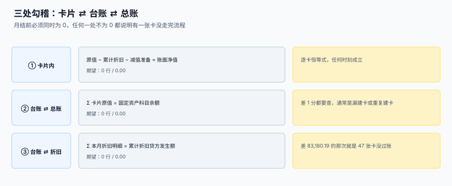

# 与总账的勾稽与月结

<p style="text-align:center;"></p>

资产模块每个月只做一件事：把「卡片上的数」变成「总账上的数」。这件事出错的方式特别安静——凭证生成了、借贷平了、报表出来了，但**科目录入的金额与卡片台账差 83,180.19**，而没有一条规则被违反。

::: tip 一句话理解
**勾稽不是「月底对一下」，而是三条恒等式，任何一条不为 0 就不许关账。** 流程会被跳过，SQL 不会。
:::

本页判据族 `FAG-A` ~ `FAG-H`，共 8 条，定义在最后一节。

## 一、三处勾稽



| 编号 | 等式 | 差 1 分说明什么 |
| --- | --- | --- |
| ① | 原值 − 累计折旧 − 减值准备 = 账面净值 | 逐卡恒等，任何时刻都该成立 |
| ② | Σ 卡片原值 = 固定资产科目余额 | 漏建卡或重复建卡 |
| ③ | Σ 本月折旧明细 = 累计折旧贷方发生额 | 有卡提了但没过账 |

②与③是两条**账账**勾稽，①是**账内**勾稽。三条都写成 SQL，放在月结脚本里，任何一条返回非 0 就不许关账。

```sql
-- ① 账内恒等（逐卡）
SELECT card_id,
       original_cost,
       coalesce((SELECT sum(amount) FROM dep_schedule d
                  WHERE d.card_id=c.card_id AND d.status='POSTED'), 0) AS acc_dep,
       coalesce((SELECT sum(amount) FROM asset_impair i
                  WHERE i.card_id=c.card_id), 0) AS impair,
       original_cost
         - coalesce((SELECT sum(amount) FROM dep_schedule d
                      WHERE d.card_id=c.card_id AND d.status='POSTED'), 0)
         - coalesce((SELECT sum(amount) FROM asset_impair i
                      WHERE i.card_id=c.card_id), 0) AS nbv
  FROM asset_card c
 WHERE c.status <> 'DISPOSED'
   AND nbv < -0.01;
-- 期望：0 行（净值不允许为负）
```

```sql
-- ② 台账 ⇄ 总账（原值）
SELECT round((SELECT sum(original_cost) FROM asset_card WHERE status <> 'DISPOSED'), 2) AS ledger_cost,
       round((SELECT sum(balance) FROM gl_balance
               WHERE account_code='1601' AND period=:p), 2) AS gl_cost,
       round((SELECT sum(original_cost) FROM asset_card WHERE status <> 'DISPOSED'), 2)
     - round((SELECT sum(balance) FROM gl_balance
               WHERE account_code='1601' AND period=:p), 2) AS diff;
-- 期望：diff = 0.00
```

```sql
-- ③ 折旧明细 ⇄ 累计折旧科目（本期发生额）
SELECT round((SELECT sum(amount) FROM dep_run WHERE period=:p), 2) AS detail_amt,
       round((SELECT sum(credit - debit) FROM gl_entry
               WHERE account_code='1602' AND period=:p), 2) AS gl_amt,
       round((SELECT sum(amount) FROM dep_run WHERE period=:p), 2)
     - round((SELECT sum(credit - debit) FROM gl_entry
               WHERE account_code='1602' AND period=:p), 2) AS diff;
-- 期望：diff = 0.00
```

本机读数（2,000 张卡，3% 未生成凭证）：

| 量 | 数值 |
| --- | --- |
| 卡片台账本月应提 | 4,193,640.33 |
| 总账累计折旧发生额 | 4,110,460.14 |
| 差 | **83,180.19（1.98%）** |
| 未过账卡片 | **47 张** |

1.98% 的差额，在利润表上表现为「折旧费用少了一点」，没人会为 2% 拉警报。而 ③ 这条查询会直接指出「差 83,180.19」，再往下钻就能定位到那 47 张卡。

## 二、月结的六步顺序

顺序不是流程洁癖，而是**每一步都依赖前一步的结果**：

| 步 | 动作 | 依赖 | 跳过会怎样 |
| --- | --- | --- | --- |
| 1 | 新增资产入账（建卡 + 转固） | 无 | 本月新增的资产提不到折旧 |
| 2 | 变更生效（寿命 / 残值 / 减值） | 步 1 | 折旧按旧参数算，一个月白提 |
| 3 | 折旧计提 | 步 1、2 | — |
| 4 | 处置注销 | 步 3（处置当月仍提） | 处置当月漏提 |
| 5 | 生成凭证并过账 | 步 3、4 | 明细有、总账无 |
| 6 | 三处勾稽 | 步 5 | 差异带到下个月，且越来越难查 |

::: danger 顺序错的两个真实后果
1. **先计提、后入账**：10 月新增 40 台（月折旧合计 63,333.20），本月漏提；而且 11 月、12 月……**每月的累计都少这一笔**，全年少提 759,998.40。
2. **先处置、后计提**：处置当月的折旧被跳过，损益多出一个月折旧额，且差异只在处置月出现一次，最难追。
:::

## 三、凭证：汇总出账，明细留痕

| 口径 | 凭证条数（2,000 张卡） | 优点 | 缺点 |
| --- | --- | --- | --- |
| 逐卡一张 | 2,000 | 逐卡可追 | 凭证量爆炸，月结慢 |
| 按部门汇总 | 5 | 快，符合会计习惯 | 单卡错误要靠明细查 |
| 全部一张 | 1 | 最快 | 部门费用无法归集 |

推荐「**按部门汇总出凭证 + 逐卡留 `dep_run` 明细**」，并在凭证上带一个可反查的标识：

```sql
CREATE TABLE gl_entry (
  entry_id     INTEGER PRIMARY KEY AUTOINCREMENT,
  voucher_no   TEXT NOT NULL,
  period       TEXT NOT NULL,
  account_code TEXT NOT NULL,
  dept_id      TEXT,
  debit        NUMERIC(18,2) NOT NULL DEFAULT 0,
  credit       NUMERIC(18,2) NOT NULL DEFAULT 0,
  source       TEXT NOT NULL,   -- 'DEP' / 'DISPOSAL' / 'IMPAIR' / 'COUNT'
  source_ref   TEXT NOT NULL,   -- '2026-10/D01' → dep_run(period, dept_id)
  CHECK (debit >= 0 AND credit >= 0),
  CHECK (debit = 0 OR credit = 0)
);
```

`source_ref` 是这张表的全部价值：它让「这笔凭证是从哪些卡来的」变成一条可执行的反查，而不是靠人去翻 Excel。

```sql
-- 由凭证反查明细：某张凭证对应的卡片与金额
SELECT r.card_id, r.amount
  FROM dep_run r
 WHERE r.period = substr(:source_ref, 1, 7)
   AND r.dept_id = substr(:source_ref, 9);
```

## 四、勾稽不平时的四步定位

```text
① 先看是「多」还是「少」，金额是不是整数倍（整数倍说明某张卡被算了两次 / 一次没算）
② 按部门分组看差额：差额集中在少数部门 → 该部门的过账任务失败
③ 按金额倒查：用差额去 dep_run 里找等额的行，命中即定位到卡
④ 对不上的，比「本月应提」与「本月实提」两个集合的差集
```

第 ③ 步的查询最常用：

```sql
-- 用差额反查：找金额等于差额的单卡或多卡组合（单卡优先）
SELECT card_id, amount FROM dep_run
 WHERE period = :p AND amount = :diff;
-- 命中即定位；不命中则差额是多张卡的合计，改用第 ④ 步的差集
```

```sql
-- ④ 差集：应提但没提的卡
SELECT s.card_id FROM dep_schedule s
 WHERE s.period = :p AND s.status = 'PLANNED'
   AND NOT EXISTS (SELECT 1 FROM dep_run r
                    WHERE r.period=s.period AND r.card_id=s.card_id);
-- 期望：0 行
```

## 五、判据清单

| 编号 | 判据 | 怎么验 |
| --- | --- | --- |
| `FAG-A` | 三条勾稽都写成 SQL 且可执行 | 三个查询都能返回 diff |
| `FAG-B` | 勾稽不为 0 时关账被阻断 | 人为制造差额，关账脚本退出码非 0 |
| `FAG-C` | 月结六步有固定顺序，步 1 在步 3 之前 | 脚本顺序可读，且有断言 |
| `FAG-D` | 凭证带 `source_ref`，可由凭证反查明细 | 反查查询能命中 |
| `FAG-E` | 汇总凭证 + 逐卡明细同时存在 | `gl_entry` 与 `dep_run` 都有当月数据 |
| `FAG-F` | 借贷方向由 CHECK 保证（不能同时非 0） | 插入双非 0 行被拒 |
| `FAG-G` | 处置当月仍计提，次月停 | 处置月 `dep_run` 有行，次月无 |
| `FAG-H` | 关账后不允许再改本期数据 | 关账标记后写入被拒 |

## 验证方式

```shell
# 1) 账内恒等：净值不为负，应输出 0
sqlite3 /tmp/fa.db "SELECT count(*) FROM asset_card c
  WHERE c.status <> 'DISPOSED'
    AND c.original_cost
        - (SELECT coalesce(sum(amount),0) FROM dep_schedule d WHERE d.card_id=c.card_id AND d.status='POSTED')
        - (SELECT coalesce(sum(amount),0) FROM asset_impair i WHERE i.card_id=c.card_id) < -0.01;"
# 期望：0

# 2) 台账 ⇄ 总账：差额应为 0.00
sqlite3 /tmp/fa.db "SELECT round((SELECT sum(original_cost) FROM asset_card WHERE status<>'DISPOSED'),2)
  - round((SELECT sum(balance) FROM gl_balance WHERE account_code='1601'),2);"
# 期望：0.0

# 3) 折旧明细 ⇄ 累计折旧：差额应为 0.00
sqlite3 /tmp/fa.db "SELECT round((SELECT sum(amount) FROM dep_run),2)
  - round((SELECT sum(credit-debit) FROM gl_entry WHERE account_code='1602'),2);"
# 期望：0.0

# 4) 应提未提的卡：应输出 0 行
sqlite3 /tmp/fa.db "SELECT s.card_id FROM dep_schedule s
  WHERE s.status='PLANNED'
    AND NOT EXISTS (SELECT 1 FROM dep_run r WHERE r.period=s.period AND r.card_id=s.card_id);"
# 期望：0 行

# 5) 凭证借贷不同时非 0：应报 CHECK constraint failed
sqlite3 /tmp/fa.db "INSERT INTO gl_entry(voucher_no,period,account_code,debit,credit,source,source_ref)
  VALUES('V-X','2026-10','1602',100,100,'DEP','2026-10/D01');"
# 期望：Error: CHECK constraint failed
```

## 参考资料

- [折旧方法与月度引擎](../Depreciation/index.md)：步 3 的输入
- [处置与清理](../Disposal/index.md)：步 4 的凭证
- [变更：转移、改良、减值](../Movement/index.md)：步 2 的影响
- [复式记账与分录](../../Ledger/DoubleEntry/index.md)：借贷平衡的一般规则
- [账实核对](../../Ledger/Reconciliation/index.md)：跨系统的对账方法论
