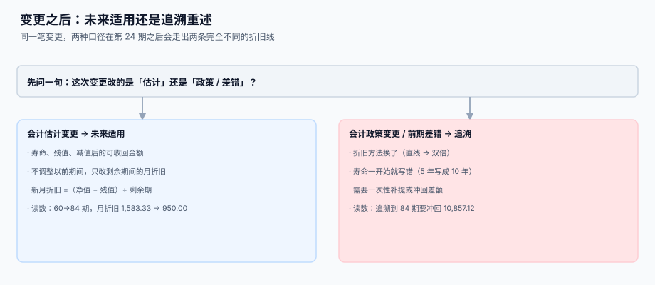

# 变更：转移、改良、减值

<p style="text-align:center;"></p>

资产不是建完卡就不动了。它会换部门、会被改造、会贬值、会被拆成两半。每一次变更都要回答同一个问题：**已提过的折旧算不算数**。答错的代价不是这一期错，而是从这一期起一直错。

::: tip 一句话理解
**改「估计」不追溯，改「政策」或「差错」才追溯。** 寿命、残值、减值属于估计（未来适用）；折旧方法、把 5 年写成 10 年属于政策或差错（追溯调整）。
:::

本页判据族 `FAM-A` ~ `FAM-H`，共 8 条，定义在最后一节。

## 一、决策树：先分清改的是什么



| 变更类型 | 属于 | 处理 | 要不要动历史 |
| --- | --- | --- | --- |
| 换使用部门 | 管理变更 | 只改 `dept_id`，折旧额不变 | 否 |
| 换存放地点 | 管理变更 | 只改 `location` | 否 |
| 寿命从 60 期改成 84 期 | 会计估计变更 | 剩余期重算 | **否** |
| 残值从 5,000 改成 8,000 | 会计估计变更 | 剩余期重算 | **否** |
| 发生减值 | 资产减值 | 计提减值准备，以后按新基数提 | 否 |
| 折旧方法从直线改成双倍 | 会计政策变更 | 追溯调整 | 是 |
| 当初把 10 年写成 5 年 | 前期差错 | 追溯重述 | 是 |

## 二、估计变更：未来适用怎么算

原值 100,000、残值 5,000、60 期，第 24 期末把寿命改成 84 期：

| 量 | 数值 |
| --- | --- |
| 第 24 期末累计折旧 | 37,999.92 |
| 第 24 期末净值 | 62,000.08 |
| 剩余期（旧 → 新） | 36 → 60 |
| 新月折旧 | **950.00** |
| 原月折旧 | 1,583.33 |
| 变化 | **−40.00%** |

公式只有一句：

```text
新月折旧 =（当前净值 − 残值 − 减值准备）÷ 剩余期数
```

::: danger 三个常见错法
1. **按新寿命从头重算**：84 期 × 1,130.95 = 95,000，但前 24 期已经按 1,583.33 提了 37,999.92，等于把历史也改了——这不是估计变更，这是追溯。
2. **只改卡片字段，不改计划**：卡片上写着 84 期，`dep_schedule` 仍是原 60 期的行，第 61 期之后不再有折旧，资产永远提不完。
3. **剩余期算成 `新寿命 − 已过月数`，但用「自然月」而不是「已计提期数」**：中间有停提月份时，两者不相等，会多提或少提一期。
:::

### 计划重算的实现顺序

```text
① 关掉旧计划：UPDATE dep_schedule SET status='VOID' WHERE card_id=? AND seq > 已提期数
② 算新基数：nbv = 原值 − 已提折旧 − 减值准备；剩余期 = 新寿命 − 已提期数
③ 重新生成 剩余期 行，seq 从 已提期数+1 开始
④ 写一条 asset_change（change_type='REVISE_LIFE'，含 reason）
```

**第 ① 步是 `VOID` 而不是 `DELETE`**：已作废的计划行要留着，否则审计问「第 30 期的计划是多少」时无话可说。

## 三、减值：提了之后必须重算折旧

第 30 期末，资产净值 52,500.10，可收回金额 32,500.10，计提减值 20,000：

| 量 | 数值 |
| --- | --- |
| 减值后账面价值 | 32,500.10 |
| 剩余期 | 30 |
| 新月折旧 | **916.67** |
| 原月折旧 | 1,583.33 |

不重算的后果：继续按 1,583.33 提满 30 期，累计折旧会到 94,999.80，比「原值 − 残值 − 减值」多出 **19,999.80**——正好是减值金额。换句话说，**减值提了等于没提**。

```sql
CREATE TABLE asset_impair (
  impair_id   INTEGER PRIMARY KEY AUTOINCREMENT,
  card_id     TEXT NOT NULL REFERENCES asset_card(card_id),
  period      TEXT NOT NULL,          -- 2026-06
  amount      NUMERIC(18,2) NOT NULL CHECK (amount > 0),
  recoverable NUMERIC(18,2) NOT NULL, -- 可收回金额
  basis       TEXT NOT NULL,          -- 评估报告号 / 市价来源
  UNIQUE (card_id, period)
);
```

`UNIQUE (card_id, period)` 挡住「同一期重复计提减值」——这类重复通常是评估报告补录造成的，两笔都合规，加起来就超了。

::: warning 减值不得转回
CAS 8 规定固定资产减值损失一经确认，在以后会计期间**不得转回**。系统层面要做的是：不允许对同一张卡写「负数减值」。如果业务上确实升值了，那是重估模式（IAS 16 允许、CAS 不允许），不在本册范围。
:::

## 四、改良与后续支出：加进原值还是单独建卡

| 情形 | 处理 | 判据 |
| --- | --- | --- |
| 延长寿命（如更换主机核心部件） | 计入原值，并重估剩余寿命 | 有验收单 + 新寿命评估 |
| 提高产能或产品质量 | 计入原值 | 有前后对比数据 |
| 仅维持原有性能（日常修理） | 当期费用 | 无性能提升 |
| 改造金额接近原值一半 | **考虑单独建卡** | 改造部分有独立寿命 |

「单独建卡」与「加进原值」的区别在处置时体现：单独建卡可以只处置改造部分，加进原值只能整体处置。

## 五、拆分与合并：守恒是唯一硬约束

一台设备拆成两张卡（主机 + 改造部分），或者两台卡合成一张（同批采购的小工具）。无论怎么拆合，两条恒等式必须成立：

```text
拆分：Σ 子卡原值 = 母卡原值；Σ 子卡累计折旧 = 母卡累计折旧
合并：新卡原值 = Σ 旧卡原值；新卡累计折旧 = Σ 旧卡累计折旧
```

本机读数：按比例拆分（30% / 70%）时，若对每个子卡分别四舍五入，**2,000 组里有 510 组（25.5%）** 的两个子卡合计不等于母卡，累计差 −2.90。修法和折旧尾差一样：**最后一个子卡取差额**。

## 六、部门分摊：费用要落到成本中心

一张卡由三个部门共用（40% / 35% / 25%），折旧费用要按比例分摊。同样的问题再来一次：

| 口径 | 2,000 张卡中合计 ≠ 总额 | 累计差 |
| --- | --- | --- |
| 每个部门独立四舍五入 | **510 张（25.5%）** | −2.90 |
| 最后一个部门取差额 | 0 张 | 0.00 |

```sql
CREATE TABLE dep_alloc (
  period   TEXT NOT NULL,
  card_id  TEXT NOT NULL,
  dept_id  TEXT NOT NULL,
  pct      NUMERIC(5,2) NOT NULL CHECK (pct > 0 AND pct <= 100),
  amount   NUMERIC(18,2) NOT NULL,
  PRIMARY KEY (period, card_id, dept_id),
  CHECK (pct = 100 OR pct < 100)   -- 单部门 100% 与多部门分摊互斥，由触发器保证
);
```

分摊比例合计必须为 100%——这条用触发器或应用层校验都行，但**必须有**，否则费用会凭空多出或少掉一块。

## 七、判据清单

| 编号 | 判据 | 怎么验 |
| --- | --- | --- |
| `FAM-A` | 变更只追加到 `asset_change`，含 `reason` 与生效期间 | 每类变更都有对应行，理由非空 |
| `FAM-B` | 估计变更走未来适用，不动已提期间 | 改寿命后 `dep_run` 历史行金额不变 |
| `FAM-C` | 旧计划置 `VOID` 而非删除 | `dep_schedule` 里能看到作废行 |
| `FAM-D` | 减值后按新基数重算剩余期折旧 | 减值次月起月折旧 =（净值−残值）÷ 剩余期 |
| `FAM-E` | 同一卡同一期不得重复计提减值 | 唯一键 `(card_id, period)` 拦截 |
| `FAM-F` | 减值不允许负数（不转回） | `amount > 0` 由 CHECK 保证 |
| `FAM-G` | 拆分 / 合并守恒：原值与累计折旧双向相等 | 守恒查询返回 0 行 |
| `FAM-H` | 部门分摊比例合计 = 100%，且金额合计 = 折旧额 | 两条查询都返回 0 行 |

## 验证方式

```shell
# 1) 拆分守恒（原值）：应输出 0
sqlite3 /tmp/fa.db "SELECT count(*) FROM asset_card p
  WHERE p.status='SPLIT'
    AND round((SELECT coalesce(sum(original_cost),0) FROM asset_card c
                WHERE c.parent_card_id=p.card_id),2) <> round(p.original_cost,2);"
# 期望：0

# 2) 减值后不得超提：应输出 0
sqlite3 /tmp/fa.db "SELECT count(*) FROM asset_card c
  WHERE (SELECT coalesce(sum(amount),0) FROM dep_schedule d WHERE d.card_id=c.card_id)
      + (SELECT coalesce(sum(amount),0) FROM asset_impair i WHERE i.card_id=c.card_id)
      > (c.original_cost - c.salvage_value) + 0.01;"
# 期望：0

# 3) 同一卡同一期减值唯一：应报 UNIQUE constraint failed
sqlite3 /tmp/fa.db "INSERT INTO asset_impair(card_id,period,amount,recoverable,basis)
  VALUES('FA-0001','2026-06',100,900,'重复计提测试');"
# 期望：Error: UNIQUE constraint failed

# 4) 部门分摊合计 = 当月折旧额：应输出 0
sqlite3 /tmp/fa.db "SELECT count(*) FROM dep_run r
  WHERE round((SELECT coalesce(sum(amount),0) FROM dep_alloc a
                WHERE a.period=r.period AND a.card_id=r.card_id),2) <> round(r.amount,2);"
# 期望：0

# 5) 分摊比例合计 100%：应输出 0
sqlite3 /tmp/fa.db "SELECT count(*) FROM (SELECT period,card_id,sum(pct) s FROM dep_alloc
  GROUP BY period,card_id) WHERE abs(s - 100) > 0.001;"
# 期望：0
```

## 参考资料

- [资产卡片与组件拆分](../AssetCard/index.md)：`asset_change` 的字段来源
- [折旧方法与月度引擎](../Depreciation/index.md)：计划重算后引擎怎么取行
- [处置与清理](../Disposal/index.md)：减值之后的资产怎么处置
- [与总账的勾稽与月结](../Ledger/index.md)：减值准备科目怎么进勾稽
- IAS 16 §51（估计变更的处理）：<https://www.ifrs.org/issued-standards/list-of-standards/ias-16-property-plant-and-equipment/>
