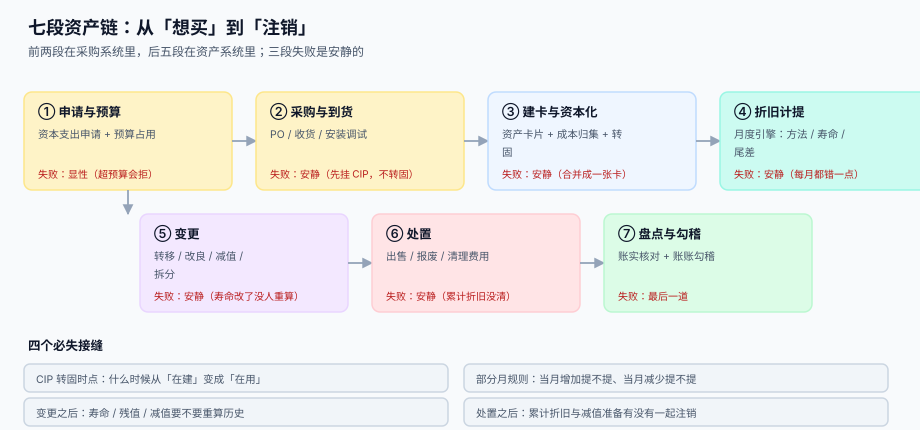

# 总览：七段资产链与三个「在账上」

<p style="text-align:center;"></p>

「这台设备在账上吗」这句话有三个完全不同的答案：**资产台账里有这张卡吗**、**这个月的折旧进费用了吗**、**总账的固定资产科目有这笔余额吗**。三者本该同时成立，但它们的失败方式各不相同——卡片会漏建，折旧会重跑，科目会少过账。

::: tip 一句话理解
**固定资产管理不是维护「一个现值」，而是维护「三本互相对得上的账」：卡片、折旧明细、总账科目。** 缺一本，另外两本就会在某个没人看的日子里分叉。
:::

本页判据族 `FAO-A` ~ `FAO-H`，共 8 条，定义在最后一节。

## 一、七段链：哪几段的失败是安静的



| 段 | 谁在做 | 交给下一段的东西 | 这一段独有的失败 | 谁来发现 |
| --- | --- | --- | --- | --- |
| ① 申请与预算 | 使用部门 | 申请单、预算号 | 预算没占用就下单 | 预算报表（显性） |
| ② 采购与到货 | 采购 | PO、收货单、CIP 余额 | 到货了但没挂 CIP，钱进了费用 | 月结时费用异常（**没人看**） |
| ③ 建卡与资本化 | 资产会计 | 资产卡片 | 五个部件合成一张卡 | 折旧算错（**几年后才发现**） |
| ④ 折旧计提 | 系统 | 折旧明细、凭证 | 寿命 / 残值 / 部分月规则 | 利润表异常（**没人看**） |
| ⑤ 变更 | 使用部门 / 会计 | 变更单 | 改了寿命不重算 | 折旧曲线偏离（**没人看**） |
| ⑥ 处置 | 使用部门 / 会计 | 处置单、损益 | 卡片注销但累计折旧没清 | 勾稽不平（**月结才查**） |
| ⑦ 盘点与勾稽 | 内审 / 会计 | 盘点单、勾稽报告 | 差异被直接判成盘亏 | 这道门本身 |

七段里有**五段的失败是安静的**。安静的失败有一个共同特征：**它不产生异常，只产生偏差**——数字变小了、变大了，但没有任何一条规则被违反。

## 二、三个「在账上」必须分列

| 口径 | 存在哪 | 回答什么 | 典型失效 |
| --- | --- | --- | --- |
| 卡片在账 | `asset_card` | 这台机器有没有身份 | 漏建卡（钱花了，资产不存在） |
| 折旧在账 | `dep_schedule` / `dep_run` | 这个月该摊多少进费用 | 重跑两遍（费用翻倍） |
| 余额在账 | `gl_balance` | 报表上固定资产是多少 | 少过账（科目比台账少 83,180.19） |

三者之间的关系不是「相等」，而是**三条各自成立的等式**：

```text
卡片：原值 − 累计折旧 − 减值准备 = 账面净值        （逐卡恒等）
折旧：Σ 每期折旧 = 原值 − 残值 − 减值影响           （一张卡全生命周期恒等）
总账：Σ 卡片原值 = 固定资产科目余额；Σ 累计折旧 = 累计折旧科目余额
```

::: danger 把三个口径合成一个字段的三个后果
1. **卡片是「现值」**：那就无法回答「原值多少、提了多少」，变更与处置时没有分摊基数。
2. **折旧写回卡片**：折旧明细就没了，重跑一次就是双倍费用，且无法审计「哪个月提了多少」。
3. **用总账反推明细**：总账是汇总数，反推不出「哪张卡错了」，盘点时只能整批调账。
:::

## 三、折旧是「每月都错一点」的那一类错误

折旧的计算公式只有一行，但它有四个输入：**原值、残值、寿命、方法**，每个输入都可能错，而且错一次会**持续错到寿命结束**。

本机读数（原值 1,000,000，残值 0）：

| 把寿命写成 | 月折旧 | 首年费用 | 与 10 年口径的差 |
| --- | --- | --- | --- |
| 5 年（电子设备的最短年限被误用到机器设备） | 16,666.67 | 200,000.04 | **多计 100,000.08** |
| 10 年（正确） | 8,333.33 | 99,999.96 | — |
| 20 年（房屋口径） | 4,166.67 | 50,000.04 | 少计 49,999.92 |

第一年多计 10 万，看起来只是「利润少了一点」；但如果这台设备后续还有 5 年，**每一年都多计 10 万**，累计 50 万——相当于凭空多摊了一台半设备。

这类错误的三个特征：

1. **没有报错**：16,666.67 是一个完全合法的月折旧额。
2. **不会自愈**：只要不改卡片，它会一直按错的数提下去。
3. **发现时已经晚了**：通常是审计或资产处置时才发现，那时要追溯调整好几个年度。

## 四、四个必失接缝

七段之间有四道接缝，它们不是「流程节点」，而是**信息断点**——上一段的产物在这一段被重新解释，解释错了没人拦。

| 接缝 | 断在哪 | 后果 | 本册哪一页管 |
| --- | --- | --- | --- |
| CIP 转固时点 | 「达到可用状态」是一个判断，不是一个日期 | 折旧晚提一到两个月 | [取得成本与资本化](../Capitalization/index.md) |
| 部分月规则 | 当月增加 / 当月减少提不提 | 一年 12 台设备差 18,999.96 | [折旧方法与月度引擎](../Depreciation/index.md) |
| 变更之后的基数 | 寿命 / 残值 / 减值改了，历史要不要重算 | 月折旧 1,583.33 → 950.00，差 40% | [变更：转移、改良、减值](../Movement/index.md) |
| 处置之后的注销 | 卡片注销了，累计折旧与减值准备有没有一起走 | 勾稽不平，且永远查不出是哪张卡 | [处置与清理](../Disposal/index.md) |

## 五、本册的工程立场

三句话，后面每页都会回到它们：

1. **一张卡只描述一个「同寿命单元」。** 主机与电机寿命不同，就是两张卡；这不是会计洁癖，而是让折旧能算对的唯一办法（见 [组件拆分](../AssetCard/index.md)：整体法与组件法第 5 年末差 20,000.40）。
2. **折旧是「计划 + 执行」两件事。** 计划（`dep_schedule`）在卡片建立时就生成全生命周期的每一期；执行（`dep_run`）每月只负责「取当月那一行并出凭证」。这样重跑、补提、审计都有据可依。
3. **所有勾稽都写成 SQL，不写成流程。** 流程会被跳过，SQL 不会——月结前跑三条查询，任何一条不为 0 就不许关账。

## 六、判据清单

| 编号 | 判据 | 怎么验 |
| --- | --- | --- |
| `FAO-A` | 七段各有产物表，且段与段之间不共用一张表 | 七张表都在，`asset_card` 不含折旧字段 |
| `FAO-B` | 三个「在账上」分列在三处，不合并成一个字段 | `asset_card` 无 `net_value` 之外的派生列，净值由查询得出 |
| `FAO-C` | 每条资产有唯一卡号，且卡号不随变更改变 | 同一卡号在 `asset_card` 只有一行 |
| `FAO-D` | 折旧明细只追加，不在原行上改数 | `dep_schedule` 有 `UPDATE` 入口即判失败 |
| `FAO-E` | 四个接缝各有对应的表与判据页 | 四张表存在，且各页判据族非空 |
| `FAO-F` | 每个失败模式都能追到「哪张卡、哪一期」 | 任取一条异常，能定位到 `card_id` + `period` |
| `FAO-G` | 本册不回答「税会差异」，且明确指向别处 | 目录页有分工表，正文不出现纳税调整计算 |
| `FAO-H` | 七段链的「失败是否安静」标注与实际代码一致 | 五段安静段均无异常抛出点 |

## 验证方式

```shell
# 1) 七段产物表齐全：应输出 7
sqlite3 /tmp/fa.db "SELECT count(*) FROM sqlite_master WHERE type='table' AND name IN
  ('capex_request','po_receipt','asset_card','dep_schedule','asset_change','asset_disposal','asset_count');"
# 期望：7

# 2) 卡片不含「现值」派生列（净值必须由查询得出）：应输出 0
sqlite3 /tmp/fa.db "SELECT count(*) FROM pragma_table_info('asset_card') WHERE name IN ('net_value','current_value');"
# 期望：0

# 3) 折旧明细没有更新入口：应输出 0
grep -rn "UPDATE dep_schedule" docs/Backend/FixedAsset/Practice/index.md | wc -l
# 期望：0
```


## 与「设备维护与可靠性」专题的分工（第 233 天补充）

同一份设备清单，两册看的是两条完全不同的时间线：本册按**折旧年限**切（5 年、8 年、10 年），那一册按**失效分布**切（β、η、间隔）。两条线可以对同一台设备给出相反的结论——账上刚过一半寿命的设备，失效分布可能已经进入磨损期。

| 你关心的问题 | 该读哪一册 | 为什么不是另一册 |
| --- | --- | --- |
| 这台设备今年摊多少折旧 | 本册（[折旧引擎](../Depreciation/index.md)） | 那一册不碰金额，只算时长 |
| 这台设备还能撑多久 | [设备维护与可靠性](../../EquipmentMaintenance/index.md) | 本册的「剩余寿命」是会计概念，不是物理概念 |
| 盘点时账实不符怎么查 | 本册（[盘点与账实](../../../Backend/FixedAsset/Inventory/index.md)） | 那一册的盘点查的是「记录全不全」，不是「资产在不在」 |
| 大修换主电机要不要拆资产 | 本册（[资本化](../Capitalization/index.md)） | 那一册只关心「这个部件还能用多久」 |

::: danger 一个两册都会踩的坑：设备号 = 资产号
图省事把设备号和固定资产号设成同一个值，大修拆分资产时就会出现「一台设备对应两张资产卡」或「一张卡对应两台设备」。维护侧此时无法判断停机该记给谁，历史 MTBF 被两段数据拼接污染。

**正确做法**：设备号与资产号分开存（本册的 `asset_no`、那一册的 `asset_id` 引用），并在换机时**新建设备号、旧号置 `RETIRED`**——旧号的停机历史留在原位，新号从零开始积累。
:::

## 与「合并报表」专题的分工

资产册判**账实相符**（卡片 / 折旧明细 / 总账三方），合并册判**这项资产在集团内部转手过几次**。

| 你关心的问题 | 该读哪一册 | 为什么 |
| --- | --- | --- |
| 这台设备原值多少、折旧怎么摊 | 本册 | 折旧方法、变更、减值、处置 |
| 母公司卖给子公司的设备，合并层原值是多少 | [合并报表与内部抵销](../../Consolidation/Elimination/index.md) | 内部处置收益与原值都要抵销 |
| 合并后折旧为什么要补提 | 合并册 | 抵销原值后，折旧基数变了 |
| 商誉算不算固定资产 | 都不算 | 商誉只在合并层出现，单独做减值测试 |
| 资产盘点差异要不要进合并 | 本册先处理 | 合并只做主体间抵销，不重做盘点 |

::: danger 本页特有的一处坑：抵销了原值却忘了补提折旧
内部卖设备时，买方按「内部售价」计提折旧，卖方确认了处置收益。合并层要抵销的是「原值虚增部分」与「处置收益」，**同时**要把买方多提的折旧冲回。

只抵原值不冲折旧，合并利润会连续几十年偏低一点点，每年差一个「虚增原值 ÷ 剩余年限」，且没有任何一张表会不平——它是本册与合并册之间最容易被漏掉的一笔。
:::

## 与「全面预算」专题的分工

| 你关心的问题 | 该读哪一册 | 为什么不是本页 |
| --- | --- | --- |
| 「这个资产还在不在、值多少」 | 本页 | 判**账实相符**与折旧摊销 |
| 「买这台设备的钱有没有预算」 | [全面预算与经营分析](../../Budgeting/Overview/index.md) | 那册判**资本化支出的额度**，本页判**入账后的价值消耗** |
| 「资本支出预算怎么释放到月」 | [期间化、承诺与预算控制](../../Budgeting/PeriodCommitment/index.md) | 那册判**释放曲线**，项目型支出应按里程碑而非 12 等分 |
| 「折旧进哪个责任中心的费用」 | [分摊与内部转移定价](../../Budgeting/Allocation/index.md) | 那册判**归属与守恒**，本页只判折旧计算 |

::: warning 一页一坑：资本支出按「12 等分」释放额度
费用类预算按 12 等分释放是合理的（每月都在花），但资本支出是**按项目节点花钱**的：一台 300 万的设备在 3 月一次性付款，而 12 等分口径下 3 月的额度只有 25 万。

结果是要么被硬控挡住（业务去拆单或走例外），要么被迫把设备采购推到 12 月（此时额度累积到 300 万）。本机在费用类科目上量过同一现象：11 月一笔 1,050,000 的申请，等分口径差 50,000 被挡，季节口径余 50,000 放行——**同一份年预算，两种释放口径给出相反结论**。

资本支出的正确做法是「按项目里程碑释放」，而里程碑日期必须来自项目计划，不能从预算表里猜。
:::

## 与「碳排放核算与 ESG 披露」的分工（第 237 天补充）

| 你关心的问题 | 该读哪一册 | 为什么不是本页 |
| --- | --- | --- |
| 「这台设备在不在账上、值多少」 | 本页 | 判**账实相符**与折旧摊销 |
| 「这台设备一年排多少碳」 | [活动数据：来源、期间与缺失](../../CarbonAccounting/ActivityData/index.md) | 那册判**能耗计量与缺失填补**，不看账面价值 |
| 「租来的厂房算不算我的排放」 | [组织边界与合并方法](../../CarbonAccounting/BoundaryOrg/index.md) | 那册判**运营控制与合并口径**，与是否资本化无关 |
| 「减排设备投资怎么摊」 | [披露、重述与履约](../../CarbonAccounting/Disclosure/index.md) | 那册判**披露口径**，本页判折旧年限 |

::: danger 一页一坑：账外资产照样排碳
本页的边界是「资本化并入表」，碳核算的边界是「谁有运营控制」——两者在**经营租赁**上正好相反。

本机实测：一栋租入的办公楼在财务上只是费用（不入表、不提折旧），在运营控制法下却是必须并进边界的排放源。这家企业的六个实体里，租入设施贡献 4,000 tCO₂e，正好等于三种合并方法之间的全部极差（79,000 − 75,000）——**5.06% 的边界分歧，全部来自一栋账外资产**。
:::

## 参考资料

- [资产卡片与组件拆分](../AssetCard/index.md)：一张卡到底是什么
- [折旧方法与月度引擎](../Depreciation/index.md)：那条一行公式的四个输入
- [与总账的勾稽与月结](../Ledger/index.md)：三条勾稽查询
- [复式记账与分录](../../Ledger/DoubleEntry/index.md)：折旧凭证的两腿
- IAS 16（组件折旧的准则依据）：<https://www.ifrs.org/issued-standards/list-of-standards/ias-16-property-plant-and-equipment/>
