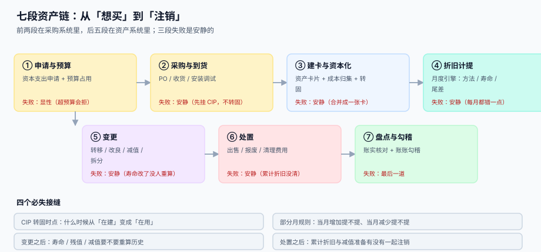

# 资产台账与折旧摊销

<p style="text-align:center;"></p>

固定资产系统最容易出的错，不是「算错了」，而是**没人看**。折旧每个月自动跑一遍、凭证自动生成、报表自动出来——一条资产被按 5 年提完本该用 10 年的设备，第一个月只多提了 100,000 元，之后 60 个月每个月都多提，五年下来账上多出一整套设备的费用，而这中间**没有任何一步会报错**。

::: tip 一句话理解
**固定资产不是「公司值多少钱」，而是一条从入账到注销的账**——每个月自动扣一点、自动结转、自动进报表。这条链上最危险的不是「扣错一次」，而是「扣错之后一直错下去」。
:::

## 这个专题讲什么

一件资产从「想买」到「注销」，要过七道工序。本专题按这七段组织，每一段都标出它的产物与失败方式：

| 段 | 这一段在做什么 | 产物 | 失败是否安静 |
| --- | --- | --- | --- |
| ① 申请与预算 | 资本支出申请、预算占用、审批 | 申请单 + 预算占用 | **显性**（超预算会被拒） |
| ② 采购与到货 | PO、收货、安装调试、验收入库 | 收货单 + 在建工程（CIP） | 安静（先挂 CIP，忘了转固） |
| ③ 建卡与资本化 | 建资产卡片、归集成本、CIP 转固 | 资产卡片 + 转固单 | 安静（多个部件合成一张卡） |
| ④ 折旧计提 | 按月算折旧、生成凭证 | 折旧明细 + 凭证 | **安静**（每月都错一点） |
| ⑤ 变更 | 转移、改良、减值、拆分合并 | 变更单 + 新的折旧计划 | 安静（寿命改了没重算） |
| ⑥ 处置 | 出售、报废、清理费用 | 处置单 + 损益 | 安静（累计折旧没一起清） |
| ⑦ 盘点与勾稽 | 账实核对、账账勾稽 | 盘点单 + 勾稽报告 | **最后一道** |



## 与其它专题的分工

库里已经有好几册在写「钱」和「物」，但问的问题都不一样。先看这张表再决定读哪一册：

| 你关心的问题 | 该读哪一册 | 为什么不是本册 |
| --- | --- | --- |
| 「这笔支出该记借还是贷」 | [复式记账与分录](../Ledger/DoubleEntry/index.md) | 那册讲**一笔业务怎么拆两腿**，本册讲**这两腿里的资产怎么按月摊** |
| 「设备是外币买的，汇率按哪天」 | [期末重估](../MultiCurrency/Valuation/index.md) | 那册讲**货币性项目的重估**，本册讲**非货币性项目为什么不重估** |
| 「设备采购怎么三单匹配」 | [收货质检与暂估](../ProcureToPay/GoodsReceipt/index.md) | 那册到「暂估入账」为止，本册从「达到可用状态」开始 |
| 「折旧算不算成本」 | [容量与成本](../../Ops/CapacityCost/Overview/index.md) | 那册讲**单位成本与预算**，本册讲**资产账面价值的摊销** |
| 「存货怎么盘点」 | [循环盘点与差异处理](../WarehouseOps/CycleCount/index.md) | 那册盘**数量**（件、箱），本册盘**存在性**（这台机器还在不在） |
| 「几万条资产数据怎么批量导入」 | [批量数据交换](../BulkDataExchange/RowValidation/index.md) | 那册讲**文件契约与行级回执**，本册讲**导入之后怎么保证算得对** |
| 「收入什么时候确认」 | [收入确认](../RevenueRecognition/Overview/index.md) | 那册讲**义务没了才算收入**，本册讲**资产的价值怎么一期期消耗** |
| 「月结怎么关账」 | [与总账的勾稽与月结](Ledger/index.md) | 本册只讲资产这一块的关账顺序，全局关账不在本册 |

::: info 为什么不并入「复式记账」
两册的判据没有一条可以复用：那一册的核心是「借贷必须平」（每笔业务两腿相等），本册的核心是「余额必须随月份单调递减到残值」（一条资产 60 期加起来必须等于原值减残值）。一个判「横平」，一个判「竖直」，合并只会造出一个两万字的怪物。
:::

## 本专题的章节

- [总览：七段资产链与三个「在账上」](Overview/index.md)
- [资产卡片与组件拆分](AssetCard/index.md)
- [取得成本与资本化边界](Capitalization/index.md)
- [折旧方法与月度引擎](Depreciation/index.md)
- [变更：转移、改良、减值](Movement/index.md)
- [处置与清理](Disposal/index.md)
- [资产盘点与账实核对](Inventory/index.md)
- [与总账的勾稽与月结](Ledger/index.md)
- [实战：从建卡到处置的可运行闭环](Practice/index.md)
- [常见问题与分诊](FAQ/index.md)

## 版本与标准

固定资产这一块**没有「大版本」概念**，因此本专题不建版本目录（如 `Spring5/`、`Spring6/` 那种）。三条理由：

1. **换代的是会计准则与税制**（中国 CAS 4 / 国际 IAS 16 / 美国 ASC 360），而判据未变：不管在哪套准则下，「原值 − 累计折旧 − 减值 = 净值」一字不差。
2. **并存的差异是辖区而不是代际**：同一个集团在不同国家的子公司按不同准则出表，差异是同一页上的几个分支，不是两套内容线。
3. **真正需要版本目录的是「同一份代码两套写法」**，而本专题写的是账模型与数据契约。可参考按大版本组织的先例：[Spring5](../Java/Frame/Spring/Spring5/index.md)、[Vue2](../../Frontend/Frame/Vue/Vue2/index.md)。

涉及外部依据时，本专题引用的是**长期稳定的编号**，而非某一年的版本号：

| 依据 | 编号 | 本专题用它说明什么 |
| --- | --- | --- |
| 企业会计准则第 4 号 | CAS 4（固定资产） | 资本化条件、折旧范围、后续支出的处理 |
| 国际会计准则第 16 号 | IAS 16（Property, Plant and Equipment） | 组件折旧（component accounting）与重估模式 |
| 企业所得税法实施条例 | 第六十条 | 最低折旧年限：房屋 20 年、机器设备 10 年、器具 5 年、电子设备 3 年 |
| 企业会计准则第 8 号 | CAS 8（资产减值） | 减值迹象、可收回金额、减值不得转回 |

::: warning 准则与税法的口径不是一回事
会计折旧按「经济寿命」提，税法折旧按「最低年限」扣。两者的差额要在汇算清缴时做纳税调整——**不要为了省事把会计折旧直接对齐税法年限**，那会让账面利润失真。本专题只讲会计口径，税会差异属于纳税调整，不在本册范围。
:::

## 判据纪律

| 页 | 判据族 | 这一族管什么 | 条数 |
| --- | --- | --- | --- |
| 总览 | `FAO-A` ~ `FAO-H` | 七段产物齐全、三个「在账上」分列、折旧错误可归因 | 8 |
| 资产卡片与组件拆分 | `FAC-A` ~ `FAC-H` | 卡号唯一、组件独立寿命、部门可达、变更只追加 | 8 |
| 取得成本与资本化 | `FAI-A` ~ `FAI-H` | 可归属成本四类、试运行冲减、转固日可证、尾款走变更 | 8 |
| 折旧方法与月度引擎 | `FAD-A` ~ `FAD-H` | 方法落库、部分月规则、尾差调平、重跑幂等 | 8 |
| 变更：转移、改良、减值 | `FAM-A` ~ `FAM-H` | 估计变更不追溯、减值后重算、拆分守恒 | 8 |
| 处置与清理 | `FAP-A` ~ `FAP-H` | 三数同源、部分处置按比例、报废必带审批 | 8 |
| 资产盘点与账实核对 | `FAV-A` ~ `FAV-H` | 四态分列、盲盘、差异不直接判亏 | 8 |
| 与总账的勾稽与月结 | `FAG-A` ~ `FAG-H` | 三处勾稽为 0、关账顺序、凭证可追 | 8 |
| 实战 | `FAX-A` ~ `FAX-H` | 建库一次成功、闭合查询恒 0、负向用例必须失败 | 8 |
| 常见问题 | `FAQ-A` ~ `FAQ-H` | 分诊可落地、止血五步有序、术语一致 | 8 |

每条判据回答三件事：**看什么现象、判成什么、不满足时改哪里**。编号逐页唯一，可被 `utils/audit` 下的判据类巡检机械核对。

## 验证方式

```shell
# 1) 专题结构：应为 11（目录页 + 10 章），每个子目录都有 index.md
find docs/Backend/FixedAsset -name "index.md" | wc -l
# 期望：11

# 2) 每页判据族 8 条、目录页 80 条：应全是 8（目录页那行是 80）
for f in docs/Backend/FixedAsset/*/index.md; do
  echo "$(grep -oE '`FA[A-Z]-[A-H]`' "$f" | sort -u | wc -l | tr -d ' ') $f"; done
# 期望：10 行，每行前面都是 8
grep -oE '`FA[A-Z]-[A-H]`' docs/Backend/FixedAsset/index.md | sort -u | wc -l
# 期望：80

# 3) 配图齐全：应为 8 张 SVG + 1 张 Logo
ls docs/Backend/FixedAsset/assets/*.svg | wc -l && ls docs/Backend/FixedAsset/assets/*.png
# 期望：8 与 fa-logo.png
```

## 参考资料

- [总览：七段资产链与三个「在账上」](Overview/index.md)
- [实战：从建卡到处置的可运行闭环](Practice/index.md)
- 财政部：企业会计准则第 4 号——固定资产：<https://www.mof.gov.cn/>
- IAS 16 Property, Plant and Equipment（IFRS 基金会）：<https://www.ifrs.org/issued-standards/list-of-standards/ias-16-property-plant-and-equipment/>
