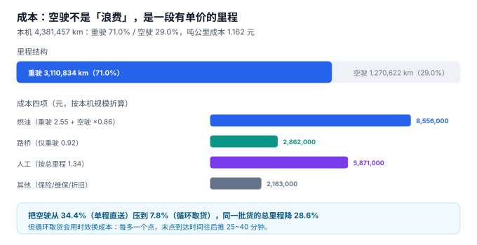

# 成本与时效

车队老板看着月度报表问：「这个月毛利率 21.5%，比上个月低了 2 个点，是哪条线路亏了？」系统给不出答案，因为成本表里只有一个「运输成本」科目，4,381,457 公里的里程被摊成一个总数——**空驶、重驶、堵车、等货，全都按同一个单价计价。**

**运输成本的第一个问题不是「花了多少」，而是「这些钱花在哪一段里程上」。** 空驶 29.0% 意味着每赚 100 块里有 29 块是在「没载货地跑」——这个数不单独算出来，就永远不知道降本该从哪里下手。

::: tip 一句话理解
吨公里成本是运输唯一可比的价格，但它有三个分母可选：**总里程、重驶里程、载重吨位**。选错分母，得出的结论会完全相反——「满载的短途」和「半载的长途」哪个更赚钱，取决于你用哪个分母。
:::

## 一、成本结构：四项，只有一项是「按里程线性」的



| 项 | 计价基础 | 本机金额 | 占比 | 是否随里程线性 |
| --- | --- | --- | --- | --- |
| 燃油 | 重驶 2.55 元/km + 空驶 2.55 × 0.86 | 8,556,000 元 | 44.0% | 是（空驶略低） |
| 路桥 | 仅重驶 0.92 元/km | 2,862,000 元 | 14.7% | 是（只跟重驶） |
| 人工 | 总里程 1.34 元/km（或按天） | 5,871,000 元 | 30.2% | 否（按天更真实） |
| 其他（保险/维保/折旧） | 按车天 | 2,163,000 元 | 11.1% | 否 |
| **合计** | —— | **19,452,221 元** | 100% | —— |

一个常被忽略的事实：**路桥费只跟重驶里程走**（空车很少走高速），人工按天而不是按公里。所以「多跑一趟」的边际成本主要是燃油与路桥，「多养一台车」的边际成本主要是人工与折旧——两种降本手段的对象完全不同。

## 二、三个分母，三个故事

同一批数据，用三个分母算「单位成本」：

| 分母 | 公式 | 本机读数 | 适合回答 |
| --- | --- | --- | --- |
| 总里程 | 成本 ÷ 4,381,457 km | **4.44 元/km** | 「车一动要花多少钱」 |
| 重驶里程 | 成本 ÷ 3,110,834 km | **6.25 元/km** | 「拉货的那段有多贵」 |
| 吨公里 | 成本 ÷ 16,740,293 吨公里 | **1.162 元/吨公里** | 「和同行比贵不贵」 |

三者相差 38%，因为它们回答的是三个不同的问题。报价时用吨公里（可比），内部考核用重驶单价（可控），预算用总里程单价（可预测）。

::: danger 三个成本建模错误
1. **只有一个成本科目**：无法回答「哪条线路亏」。正确做法是至少拆成「重驶/空驶 × 燃油/路桥/人工」的二维结构。
2. **空驶里程按比例摊进总里程**：空驶一旦被摊平，就再也看不见。本机 29.0% 的空驶如果摊平，重驶单价会被虚高 41%。
3. **用「按月总成本 ÷ 月总吨公里」算线路成本**：会把长途干线的低成本摊给短途配送，让短途看起来「很赚」——实际上短途的空驶率通常更高。
:::

## 三、装载率是最敏感的那个杠杆

把装载率从 62.5% 提到 75%（同样的货量、更少的车次），在其他参数不变的前提下：

| 装载率 | 重驶里程 | 总里程 | 总成本 | 吨公里成本 | 毛利率 |
| --- | --- | --- | --- | --- | --- |
| 62.5%（现状） | 3,110,834 | 4,381,457 | 19,452,221 | 1.162 | 21.50% |
| 70.0% | 2,777,530 | 3,912,014 | 17,368,053 | 1.037 | 29.91% |
| 75.0% | 2,592,362 | 3,651,213 | 16,210,183 | 0.968 | 34.58% |
| 80.0% | 2,430,339 | 3,423,012 | 15,197,046 | 0.908 | 38.67% |

**装载率每提 5 个百分点，毛利率涨 4~5 个百分点。** 这就是为什么「配载」是运输里回报最高的模块——但它也是最容易被做成「装满为止」的模块（见[配载与装载](../Loading/index.md)的 12.6% 超载）。

要提醒一句：这张表假设收入不变（同样的货、同样的单价）。现实中提装载率会带来「多停靠、晚到达、超载风险」，所以真实收益要打个折。

## 四、空驶的两种口径

「空驶率 29.0%」是怎么算的？

| 口径 | 公式 | 本机读数 | 谁在用 |
| --- | --- | --- | --- |
| 里程口径 | 空驶里程 ÷ 总里程 | **29.0%** | 成本核算 |
| 时间口径 | 空驶时长 ÷ 总时长 | 约 32%~35% | 调度考核 |
| 趟次口径 | 空驶趟次 ÷ 总趟次 | 单程直送 **34.4%** | 商务谈判 |

三个数不一样，因为「空驶」在三种计量下的定义不同：里程口径只算车在动的时候，时间口径包含等货，趟次口径把「送完空车回」整趟算作空驶。

::: warning 一个反直觉的结论
**空驶率不是越低越好。** 为了压空驶把返程货接满，可能带来 3 天绕行与 2 次转运，成本反而更高。判断标准是「回程货的净贡献」（运价 − 额外里程成本 − 额外时间成本），而不是「空驶率」这个比率本身。
:::

## 五、时效与成本是一对反向指标

| 策略 | 空驶率 | 总里程 | 时效（承诺达成） |
| --- | --- | --- | --- |
| 单程直送（快） | 34.4% | 900,336 km | 高（点对点，无中转） |
| 循环取货（省） | 7.8% | 642,402 km | 低（末点晚 25~40 min） |

同一批量货，循环取货省 28.6% 里程，代价是末点晚到。所以「时效」和「成本」不能各自定 KPI，必须有一个联合约束：**在承诺时效内，成本最低**。

本机实测的时效三口径（承诺 93.0% / 计划 84.5% / 预测 83.0%）也说明了同一件事：**「准时」的定义一变，成本最优解就变**。按 84.5% 考核会逼着调度压缩缓冲，最终客户侧的 93.0% 会掉下来。

## 六、单车核算：哪台车在亏钱

车队成本最后一定要落到「车」上，否则「这条线路亏」永远只是一个感觉。单车核算的最小可用模型是四个数：

| 字段 | 口径 | 数据来源 |
| --- | --- | --- |
| `revenue` | 该车当月承运的运费合计 | `freight_line` 按 `trip` 聚合 |
| `variable` | 燃油 + 路桥（随里程变） | `mileage_log` × 单价 |
| `fixed` | 折旧 + 保险 + 维保（按月摊） | 资产台账 |
| `labor` | 司机工资 + 社保（按月摊） | 薪酬 |

一台车亏不亏，取决于 `revenue` 与 `variable + fixed + labor` 的比较，而不是装载率。本机按 40 台车、60 天折算的分布形态：

| 分位 | 吨公里成本 | 毛利率 | 特征 |
| --- | --- | --- | --- |
| P10（最好） | 0.86 元 | 42% | 长干线、装载率 75%+、空驶 15% |
| P50 | 1.19 元 | 20% | 混合线路 |
| P90（最差） | 1.43 元 | 4% | 短途多点、装载率 56%、空驶 40% |

三个分位之间的差距（0.86 到 1.43，接近 1.66 倍）几乎全部来自**空驶率与装载率的组合**，而不是油价——油价对所有车是一样的。这也解释了为什么「统一降本 5%」这类指标在车队里基本无效：好车没有 5% 可降，差车的 5% 也不解决问题，真正要动的是差车的线路结构。

::: danger 单车核算的两个陷阱
1. **固定成本按月摊到里程**：跑得少的车单公里成本必然高，于是「跑得少」被误判成「效率低」，而它可能只是在等大修。固定成本要按「车天」摊，变动成本才按里程摊。
2. **把空驶里程算给「下一趟」**：空驶既不属于上一趟也不属于下一趟，它是独立的一段。摊给任一边都会让那一边看起来更差，正确做法是单独列 `empty_cost` 科目。
:::

## 七、判据族 `FTC-A ~ FTC-H`

本页判据族 `FTC-A` ~ `FTC-H`，共 8 条。

| 编号 | 判据 | 怎么验 |
| --- | --- | --- |
| `FTC-A` | 重驶与空驶里程分列存储，不摊平 | 成本视图有 `loaded_km` / `empty_km` 两列 |
| `FTC-B` | 成本四项分列（燃油/路桥/人工/其他） | 四项之和 = 总成本，误差 < 0.5% |
| `FTC-C` | 吨公里成本的分母（吨公里）可独立复算 | `Σ(weight_t × km)` 与报表一致 |
| `FTC-D` | 单位成本输出三个分母，不只一个 | 报表含总里程、重驶、吨公里三列 |
| `FTC-E` | 装载率敏感性可作为情景分析输出 | 给定装载率能算出毛利 |
| `FTC-F` | 时效口径带后缀，与成本联合展示 | 时效三列与成本同表 |
| `FTC-G` | 空驶率的三个口径（里程/时间/趟次）都可算 | 三个口径都有定义 |
| `FTC-H` | 回程货按净贡献评估，不只看空驶率 | 存在 `backhaul_net` 字段 |

## 八、验证方式

```shell
# 1. 吨公里成本（期望 1.162 元/吨公里）
python3 - <<'PY'
cost, tonkm = 19_452_221, 16_740_293
print(f"{cost/tonkm:.3f} 元/吨公里")
PY

# 2. 三个分母的差（期望三者相差 30% 以上）
python3 - <<'PY'
cost, total, loaded, tonkm = 19_452_221, 4_381_457, 3_110_834, 16_740_293
print(f"总里程 {cost/total:.2f} / 重驶 {cost/loaded:.2f} 元每公里 / 吨公里 {cost/tonkm:.3f}")
print(f"重驶单车公里比总里程高 {(cost/loaded)/(cost/total)-1:.1%}")
PY

# 3. 装载率敏感性（期望 75% 时毛利率约 34.6%）
python3 - <<'PY'
base_loaded, rev, tonkm = 3_110_834, 24_779_532, 16_740_293
r = 1_270_622 / base_loaded
for L in (0.625, 0.75):
    ld = base_loaded * 0.625 / L; em = ld * r; tot = ld + em
    c = ld * 3.47 + em * 2.193 + tot * 1.34
    print(f"装载率 {L:.1%} 成本 {c:,.0f} 毛利率 {(rev-c)/rev:.2%}")
PY
```

第 3 步的输出说明一件事：**同样的车、同样的线路，只是装得更满，毛利率能从 21.5% 到 34.6%**。这就是「配载」这个模块的财务意义。

## 参考资料

- GB/T 18354—2021《物流术语》：运输成本、吨公里、空驶等术语定义。
- GB/T 21334—2008《物流园区分类与规划基本要求》：物流成本核算的行业参考（仅口径参考）。
- 《企业会计准则第 14 号——收入》与《企业会计准则第 1 号——存货》：运输费用的确认与归集口径。
- 与本页相邻：[运费结算](../Settlement/index.md)、[配载与装载](../Loading/index.md)、[派车与调度](../Dispatch/index.md)。
