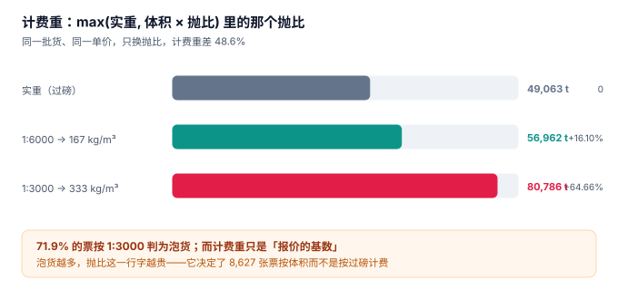

# 运输需求与计费重

客户在系统里下了一张单：30 件，实重 1.5 吨，体积 12 立方米，从上海到成都。客服看了一眼报出运费 2,480 元，客户当场翻出另一家承运商的报价 1,860 元。客服不知道怎么解释——因为在她的界面上，「1.5 吨」和「12 方」是两个并排的数字，没有任何一处告诉她：**这票货到底该按哪个算钱**。

**计费重是运输商务的全部起点，也是最容易被当成「一个乘法」的地方。** 它不是乘法，是一个取最大值加一条合同条款：`max(实重, 体积 × 抛比)`。抛比写错，七成票的价格就变了；抛比写死在代码里，换一个客户就要发一次版。

::: tip 一句话理解
计费重回答的不是「这票货有多重」，而是**「这票货占了我多少运力，该按多少收」**——占运力的是空间时就按体积折算，是重量时就按过磅。
:::

## 一、抛比到底是什么

抛比（也称「体积重系数」「材积比」）把体积折算成等效重量，单位是 kg/m³。行业里两种常见写法：

| 写法 | 折算规则 | 等效 kg/m³ | 典型场景 |
| --- | --- | --- | --- |
| 1:6000 | 体积(cm³) ÷ 6000 | **167** | 快递、航空轻抛货 |
| 1:3000 | 体积(cm³) ÷ 3000 | **333** | 快运、零担、专线 |

写法不同，结论可以差一倍。本机 12,000 张委托单：

| 口径 | 计费重合计 | 相对实重 | 说明 |
| --- | --- | --- | --- |
| 实重（过磅） | 49,062.8 t | —— | 路政与保险认这个数 |
| 1:6000（167 kg/m³） | 56,962.4 t | **+16.10%** | 轻抛货按空间折算 |
| 1:3000（333 kg/m³） | 80,785.5 t | **+64.66%** | 同样的货，多算 23,823 吨 |



23,823 吨按零担参考价 0.62 元/kg 折算约 **1,477 万元**——这就是「抛比」这一行字的价格。它也解释了为什么 71.9% 的票（8,627 / 12,000）在 1:3000 下会被判为泡货：只要实重小于体积重，收费基数就切换成体积。

### 一个必须自己算一遍的例子

| 项 | 值 | 说明 |
| --- | --- | --- |
| 件数 | 30 | 与计费重无关，但与「件数上限」有关 |
| 实重 | 1,500 kg | 过磅值，保留 0.1 kg |
| 体积 | 12.0 m³ | 按外包装尺寸累加，保留 0.01 m³ |
| 抛比 1:3000 | 12.0 × 333 = 3,996 kg | 泡货 |
| 抛比 1:6000 | 12.0 × 167 = 2,004 kg | 仍是泡货，但只多 33.6% |
| 计费重（1:3000） | **3,996 kg** | `max(1,500, 3,996)` |
| 计费重（1:6000） | **2,004 kg** | `max(1,500, 2,004)` |

同一票货，1:3000 与 1:6000 差 1,992 kg。如果单价 0.62 元/kg，差 1,235 元——比很多票的全程运费还高。

::: danger 四个必须写进单据的字段
1. **`actual_kg` 与 `volume_m3` 必须都存**，不能只存算好的 `chargeable_kg`。历史单据要能重算，客户质疑时要能拿出原料。
2. **`ratio_kg_m3` 必须落在单据上**（而不是产品配置或代码常量）。同一客户走零担与走快运，抛比可以不同；改合同不该改代码。
3. **体积必须来自「外包装累加」而不是「车厢占用」**：按车厢占用算，装得越松体积越大，客户会认为你在多收钱。
4. **件数必须与签收数对齐**：短签时按件折价扣款，件数错了扣款就没有依据（见[签收与回单](../ProofOfDelivery/index.md)）。
:::

## 二、整车与零担：两套计价，别混在一张表里

| 维度 | 整车（FTL） | 零担（LTL） |
| --- | --- | --- |
| 计价基数 | 车型 + 里程（元/车·公里） | 计费重（元/kg）+ 里程分段 |
| 是否看抛比 | **不看**（按车卖） | **看**（按占位卖） |
| 装载责任 | 承运方（装满为止） | 托运方（各自打托） |
| 典型争议 | 「你们装不满也要收整车价」 | 「这票到底算不算泡货」 |
| 本册建模 | `trip` 维度的成本与收入 | `shipment` 维度的计费重与单价 |

两条线共用一张 `shipment` 表是对的（单据结构相同），但**计价必须分成两个函数**。把它们混成一个「按里程 × 系数」的公式，整车单会被算出「按吨公里」的价格，零担单会被算出「按车」的价格——两种错都不会报错，只会在毛利报表上表现为「某些线路莫名亏损」。

## 三、委托单：一张表要装下的六个决定

| 字段 | 类型 | 为什么必须有 | 常见错法 |
| --- | --- | --- | --- |
| `shipment_no` | TEXT PK | 全链路唯一键 | 用「日期 + 序号」，跨零点重号 |
| `from_code` / `to_code` | TEXT | 决定计划里程与区域 | 存自由文本地址，无法算里程 |
| `pieces` | INTEGER | 短签扣款的分母 | 允许 0（「一托算一件」也要写 1） |
| `actual_kg` | REAL | 过磅值 | 用理论重量代替过磅 |
| `volume_m3` | REAL | 抛比折算的基数 | 按车厢占用估算 |
| `ratio_kg_m3` | REAL | 抛比随合同变 | 写在代码常量里 |
| `need_arrive_at` | TEXT | 对客承诺时刻 | 与「计划到达」混为一谈 |
| `window_from` / `window_to` | TEXT | 收货方可卸货时窗 | 只写「上午」，无法排程 |

`need_arrive_at` 与 `window_*` 是两件事：前者是对客户的承诺（可以带缓冲），后者是收货方的物理约束（不能商量）。本机实测中，把两者合并成一个「要求到达时间」的系统，时效达成率会被算高 8.5 个百分点——因为计划里悄悄吃掉了缓冲。

## 四、受理校验：三种必须当场拒绝的单

1. **超限单**：单件重量或尺寸超过车型限制。GB 1589—2016 规定了外廓尺寸与轴荷限值，超限车需要许可，不能当普通单接。
2. **时窗不可达单**：`need_arrive_at` 减去计划行驶时间后早于装货窗开始时间。这类单接进来必然晚点，且晚点是「接单那一刻就确定的」。
3. **危险品混装单**：与普通货同车。这条不是运输系统的判断，但系统必须能拦住「同一 `trip` 里混入危险品」的组合。

```sql
-- 时窗可达性：计划行驶时间按 60 km/h 折算，含 30 分钟装卸
SELECT shipment_no,
       need_arrive_at,
       datetime(window_from, '+' || (plan_km / 60.0 * 60 + 30) || ' minutes') AS earliest_arrive
FROM shipment s
JOIN route r USING (from_code, to_code)
WHERE datetime(window_from, '+' || (plan_km / 60.0 * 60 + 30) || ' minutes') > need_arrive_at;
-- 有结果 = 这批单在接单时就已经不可能准时
```

## 五、报价单必须能复算

客户拿到一张报价单，最常问的三个问题是「为什么是这个价」「按哪个里程」「下个月会不会变」。三个问题都指向同一件事：**报价单上的每一个数，都要能在事后用当时的参数重算出来**。

| 报价要素 | 必须随单存下的参数 | 三个月后还能不能复算 |
| --- | --- | --- |
| 计费重 | `actual_kg` / `volume_m3` / `ratio_kg_m3` | 能（三者都在） |
| 里程 | 计划里程 + 路网版本 + 起终点编码 | 能（若要精确到路径，还要存路网版本） |
| 单价 | 价格表版本 + 生效区间 | 能（价格表按版本存，不做原地改） |
| 附加费 | 油价 + 取价日 + 联动系数 | 能（三者写进报价快照） |
| 扣款规则 | 短签件价 + 定损标准 | 能（规则也按版本存） |

五要素里最容易漏的是**版本**：价格表如果允许原地改（`UPDATE price SET unit_price = 9`），三个月后重算这张报价单，得到的是新价格——于是「复算不一致」变成了一个无法证伪的争论。

```sql
-- 报价快照：把「算这个价用了什么」一起存下来
CREATE TABLE quote_snapshot (
  quote_no      TEXT PRIMARY KEY,
  shipment_no   TEXT NOT NULL,
  ratio_kg_m3   REAL NOT NULL,      -- 当时的抛比
  route_version TEXT NOT NULL,      -- 当时的路网版本
  price_version TEXT NOT NULL,      -- 当时的价格表版本
  fuel_price    REAL NOT NULL,      -- 当时的油价
  fuel_date     TEXT NOT NULL,      -- 取价日
  quoted_amount REAL NOT NULL,
  created_at    TEXT NOT NULL
);
```

有了这张表，「上个月同样的货为什么贵了 3.4%」这个问题可以从三个方向拆：抛比变了、油价变了、还是价格表换了版本。没有它，只能回答「系统算的」。

::: warning 一个反直觉的结论
**报价单不是「一次计算结果」，是一份「参数快照」**。把它当成计算结果存（只存 `quoted_amount`），等于把「为什么」丢掉了；而出问题的永远是「为什么」，不是「多少」。
:::

## 六、判据族 `FTD-A ~ FTD-H`

本页判据族 `FTD-A` ~ `FTD-H`，共 8 条。

| 编号 | 判据 | 怎么验 |
| --- | --- | --- |
| `FTD-A` | 计费重由 `max(actual_kg, volume_m3 × ratio_kg_m3)` 得出，不允许外部赋值 | 生成列或触发器实现，UPDATE `chargeable_kg` 报错 |
| `FTD-B` | `ratio_kg_m3` 来自单据，且落在合法区间 `[100, 400]` | 插入 `ratio_kg_m3 = 600` 被 CHECK 拒绝 |
| `FTD-C` | `volume_m3` 与 `actual_kg` 都 > 0 | 插入 0 被 CHECK 拒绝 |
| `FTD-D` | 泡货判定可独立复算：`actual_kg < volume_m3 × ratio` | 按此条件查出的票数 = 报表「泡货票数」 |
| `FTD-E` | 整车单与零担单的计价函数分离，且有 `billing_mode` 字段 | 全库检索计价入口只有两个 |
| `FTD-F` | `need_arrive_at` 与 `window_to` 分列存储 | 两列都在，且允许不相等 |
| `FTD-G` | 时窗不可达的单在受理时被标记，而不是排程时才发现 | 存在 `reject_reason` 字段且非空率可统计 |
| `FTD-H` | 抛比变更只对新单生效，历史单据计费重不变 | 改配置后旧单 `chargeable_kg` 不变 |

## 七、验证方式

```shell
# 1. 生成列：计费重必须等于 max(实重, 体积×抛比)（期望 3996.0）
sqlite3 :memory: "
create table s(actual_kg real, volume_m3 real, ratio real default 333,
  chargeable real generated always as (max(actual_kg, volume_m3*ratio)) virtual);
insert into s(actual_kg,volume_m3) values (1500,12);
select chargeable from s;"

# 2. 抛比合法性（期望 CHECK 拒绝，报 CHECK constraint failed）
sqlite3 :memory: "
create table s(ratio real check (ratio between 100 and 400));
insert into s values (600);" 2>&1 | head -1

# 3. 泡货占比（期望 71.9% 量级，不是 0 也不是 100%）
sqlite3 :memory: "
create table s(actual_kg real, volume_m3 real, ratio real default 333);
insert into s values (1500,12,333),(420,3.2,333),(5800,2.1,333),(900,6.0,333);
select round(100.0*sum(actual_kg < volume_m3*ratio)/count(*),1) from s;"
# 期望输出：75.0（4 票里 3 票是泡货）
```

第 3 步的意义在于：**泡货比例必须是一个能被算出来的数**。如果系统里没有这个数，就永远说不清「为什么这个月运费涨了」。

## 参考资料

- GB/T 18354—2021《物流术语》：计费重量、抛货（泡货）、承运、托运等术语定义。
- GB 1589—2016《汽车、挂车及汽车列车外廓尺寸、轴荷及质量限值》：外廓尺寸与轴荷限值，受理校验的强制依据。
- GB/T 29911—2013《汽车租赁服务规范》：车辆与承租方责任划分的参考（仅车型与载重口径）。
- 与本页相邻：[总览](../Overview/index.md)、[配载与装载](../Loading/index.md)、[运费结算](../Settlement/index.md)。
