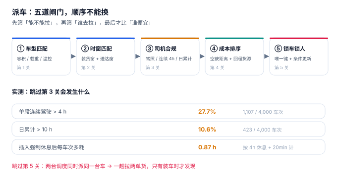

# 派车与调度

上午十点，两个调度员同时接到电话：一个要发 B 线，一个要发 C 线。两人各自在系统里选了同一台车——V-017，因为它离两个装货点都最近。系统没有报错，两次派车都成功了。直到下午装车，仓管发现同一台车挂着两张派车单，而车只有一台。

**派车看起来是「选一台车」，实际是五道闸门依次过滤，最后一步必须是一次能拒绝的写入。** 前四道闸门都是「查」，只有第五道是「写」；把前四道的结论直接当结果用，就会出现上面这一幕——两个事务都查到了「空闲」，然后都写成功了。

::: tip 一句话理解
派车不是「找一台最近的车」，而是**在「能不能拉」「谁去拉」「合不合规」「划不划算」四层过滤之后，用一次带条件的写入把车和人锁住**。前四层错了只是效率问题，第五层错了是生产事故。
:::

## 一、五道闸门，顺序不能换



| 闸门 | 过滤什么 | 数据来源 | 跳过它的后果 |
| --- | --- | --- | --- |
| ① 车型匹配 | 容积、载重、温控、危化资质 | `vehicle` | 装到一半发现装不下 |
| ② 时窗匹配 | 装货窗 + 送达窗 + 行驶时间 | `shipment` + 路网 | 接单时就注定晚点 |
| ③ 司机合规 | 驾照、连续驾驶、日累计 | `driver` + 工时记录 | 罚单、事故责任、保险拒赔 |
| ④ 成本排序 | 空驶距离、回程货源、路桥 | 位置 + 历史 | 空驶率虚高，毛利被吃掉 |
| ⑤ 锁车锁人 | 唯一键 + 条件更新 | 数据库约束 | **同一台车被派两次** |

顺序不能换的理由很实在：前三道是**硬约束**（不满足就不能派），第四道是**软约束**（不满足只是贵）。先比成本再筛合规，会得到一堆「便宜但违法」的方案。

## 二、车辆可用性：不是一个布尔值

「车在不在」这个问题至少有三个维度：

| 维度 | 取值 | 存在哪 | 常见错法 |
| --- | --- | --- | --- |
| 状态 | `IDLE` / `ON_TRIP` / `MAINT` / `RETIRED` | `vehicle.state` | 用 `is_available` 布尔，维修中的车被派出去 |
| 时间 | 上一趟预计回场时刻 | `trip.return_at` | 只看状态不看时间，车还在高速上就被派 |
| 空间 | 当前位置到装货点的空驶距离 | 定位快照 | 用「所属车队」代替位置，空驶 200 公里 |

正确的可用性判断是一条**带时间的查询**，而不是一个字段：

```sql
-- 某装货时刻可用的车：状态空闲 + 上一趟已回场 + 车型满足
SELECT v.vehicle_id, v.vtype
FROM vehicle v
WHERE v.state = 'IDLE'
  AND NOT EXISTS (
    SELECT 1 FROM trip t
    WHERE t.vehicle_id = v.vehicle_id
      AND t.state IN ('PLANNED','LOADED','DEPARTED')
      AND t.return_at > :load_at          -- 还没回场就不算可用
  )
  AND v.volume_m3 >= :need_volume
  AND v.payload_kg >= :need_weight;
```

注意 `return_at > :load_at` 这个条件：它比 `state = 'IDLE'` 更可靠，因为状态字段会因为「司机忘了点完成」而长期停在 `ON_TRIP`，也会因为「调度手工改状态」而提前变 `IDLE`。

## 三、司机合规：一条 4 小时的硬线

《道路货物运输及站场管理规定》要求驾驶员连续驾驶不超过 4 小时、24 小时内累计不超过 8 小时（部分情形可延至 10 小时，需按规定休息）。这条约束在系统里通常只被写成一个「提示」，于是：

| 指标 | 本机读数 | 含义 |
| --- | --- | --- |
| 单段连续驾驶 > 4 h 的车次 | **27.7%**（1,107 / 4,000） | 近三分之一的车次存在违规风险 |
| 日累计 > 10 h | **10.6%**（423 / 4,000） | 疲劳驾驶的高风险群体 |
| 插入强制休息后每车次多耗 | **0.87 h** | 合规是有成本的，必须算进报价 |

0.87 小时不是小数：按 40 台车、每天 78 个车次算，一天多耗约 68 车时；一个月就是 2,040 车时。**这就是「合规成本」，它必须出现在报价模型里，而不是等罚单出现时才知道。**

::: danger 三个派车建模错误
1. **把「车辆可用」做成布尔字段**：状态、时间、位置三个维度压成一个布尔，必然在「车还在路上」或「车在维修」时误派。
2. **先比成本再筛合规**：得到的最优解通常是「让同一个司机连跑两趟长途」——成本最低，但违法。
3. **派车写入没有唯一键**：两个调度并发派同一台车，两次都成功。正确做法是 `UNIQUE(vehicle_id, depart_at)` 或条件更新 `UPDATE ... WHERE state='IDLE'`，让第二次写失败。
:::

## 四、成本排序：先压空驶，再压单价

派车的成本大头不是油费，是**空驶**。本机 1,200 组对比：

| 模式 | 空驶率 | 同一批量货的总里程 | 相对 |
| --- | --- | --- | --- |
| 单程直送（送完空车回） | **34.4%** | 900,336 km | —— |
| 循环取货（milk-run，串点） | **7.8%** | 642,402 km | **−28.6%** |

循环取货把空驶从 34.4% 压到 7.8%，总里程降 28.6%——这是运输里性价比最高的一个优化。但它有代价：每多一个停靠点，末点的到达时间往后推 25~40 分钟。所以「压空驶」必须和「时效承诺」一起算，不能单独做。

排序用的成本函数至少要有四项：

```text
预计成本 = 空驶里程 × 空驶单价          -- 到装货点的距离
         + 重驶里程 × 重驶单价          -- 装货点到各卸货点
         + 路桥费                       -- 按路段
         + 司机工时 × 工时单价          -- 含强制休息的 0.87 h
         − 回程货源收益                 -- 能捎回的货，抵扣空驶
```

最后一项是关键：**回程货源**让「空驶 200 公里去装货」可能比「空驶 50 公里」更划算，因为回程有货。只按距离排序的系统永远算不出这一层。

## 五、并发派车：唯一键 + 条件更新

```sql
-- 条件更新：只有仍空闲的车才能被派出去
UPDATE vehicle
   SET state = 'ON_TRIP'
 WHERE vehicle_id = :vid
   AND state = 'IDLE';
-- 影响行数为 0 表示被别人抢先派走，应返回 409 而不是静默成功
```

```sql
-- 幂等键：同一次派车操作的重复提交不产生第二张派车单
CREATE TABLE trip (
  trip_no    TEXT PRIMARY KEY,
  idem_key   TEXT NOT NULL UNIQUE,
  vehicle_id TEXT NOT NULL REFERENCES vehicle(vehicle_id),
  ...
);
```

两条一起用：`idem_key` 挡「同一次操作的重复提交」，条件更新挡「不同操作抢同一台车」。少一条都会出问题——只有幂等键时，两个调度用不同的键抢同一台车，仍然双派；只有条件更新时，网络重试会产生两张派车单。

## 六、判据族 `FTP-A ~ FTP-H`

本页判据族 `FTP-A` ~ `FTP-H`，共 8 条。

| 编号 | 判据 | 怎么验 |
| --- | --- | --- |
| `FTP-A` | 车辆可用性判断包含状态、回场时间、位置三个维度 | 查询里同时出现 `state` 与 `return_at` |
| `FTP-B` | 派车写入是条件更新或唯一键，不依赖「先查后写」 | 并发两次派同一车，第二次失败 |
| `FTP-C` | 派车请求有幂等键，重复提交不产生第二张单 | 相同 `idem_key` 第二次插入报错 |
| `FTP-D` | 司机连续驾驶与日累计作为硬约束，不满足即拒绝 | 构造 5 h 连续驾驶的排班被拒 |
| `FTP-E` | 成本排序包含空驶、路桥、工时与回程抵扣四项 | 成本函数有四个入参 |
| `FTP-F` | 车型匹配校验容积与载重两项 | 只满足一项的车不进入候选 |
| `FTP-G` | 时窗不可达的车次在派车前被排除 | 候选集里无「注定晚点」的组合 |
| `FTP-H` | 派车与装车分离：派车成功不代表装载合法 | 装载校验在 `trip_stop` 插入时独立执行 |

## 七、验证方式

```shell
# 1. 条件更新：第二次派同一台车必须失败（期望 1 然后 0）
sqlite3 :memory: "
create table vehicle(id text primary key, state text);
insert into vehicle values ('V1','IDLE');
update vehicle set state='ON_TRIP' where id='V1' and state='IDLE';
select changes();
update vehicle set state='ON_TRIP' where id='V1' and state='IDLE';
select changes();"
# 期望输出：1 与 0

# 2. 幂等键：重复提交被唯一键挡住（期望 UNIQUE constraint failed）
sqlite3 :memory: "
create table trip(trip_no text primary key, idem_key text unique);
insert into trip values ('T1','k-1');
insert into trip values ('T2','k-1');" 2>&1 | head -1

# 3. 合规成本：插入休息后的时间增量（期望 > 0.8 h）
python3 - <<'PY'
drive, rest_after, rest_min = 6.4, 4.0, 20
extra = (drive // rest_after) * rest_min / 60
print(f"连续驾驶 {drive} h，需插入 {int(drive//rest_after)} 次休息，多耗 {extra:.2f} h")
PY
# 期望输出：连续驾驶 6.4 h，需插入 1 次休息，多耗 0.33 h
```

第 1 步的两个数字（1 和 0）就是并发派车的全部答案：**第二次写的影响行数为 0，必须被当成冲突返回，而不是当成成功**。

## 参考资料

- 《道路货物运输及站场管理规定》（交通运输部）：驾驶员连续驾驶时间与休息要求，本页「4 小时硬线」的依据。
- 《中华人民共和国道路运输条例》（国务院令第 406 号，2022 年修订）：营运车辆与从业人员的准入要求。
- GB 1589—2016《汽车、挂车及汽车列车外廓尺寸、轴荷及质量限值》：车型与载重的强制限值。
- 与本页相邻：[配载与装载](../Loading/index.md)、[在途与轨迹](../Tracking/index.md)、[成本与时效](../Cost/index.md)。
